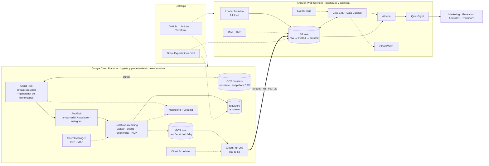

# TrendAnalyzer · ARCHITECTURE

> Documento maestro de arquitectura, contratos y plan de trabajo.
> **Versión 2.2 · 17 oct 2026** · Las fuentes en streaming pasan a ser **Reddit, Facebook e Instagram** y el texto lo produce un **generador de comentarios en Python** (`marca,comentario`), en lugar de los datasets de emociones en inglés de la v2.1.
> Fuentes de verdad combinadas: `README.md` + `diagramaFINAL.drawio` + decisiones de este documento.
> **v2.1:** cada fase y lote queda asociado a sus historias de usuario (`HU.md`, formato HU-000). Ver §7 y la matriz de trazabilidad §7.1. **v2.2:** resumen de cambios en §1.5; las HU afectadas por el cambio de fuentes se señalan en §7.1.

---

## 0. Cómo usar este documento

Este archivo está pensado para que **baste con leerlo (o pegármelo) para construir cualquier pieza del proyecto sin tener que enviar el código ya hecho**.

| Si quieres… | Lee |
|---|---|
| Entender qué cambió y por qué | §1 |
| Ver el panorama completo | §2 |
| Entender cómo funciona el simulador | §3 |
| Saber **cómo hablarle a cada componente** (formatos, nombres, topics, tablas, IAM) | **§5 (contratos)** |
| Saber qué construir y en qué orden | §7 (fases y lotes) |
| Saber qué historias de usuario cubre cada fase o lote | **§7 y §7.1** (detalle en `HU.md`) |
| Pedirme el siguiente lote | §8 (plantilla de petición) |

**Regla de oro:** si dos componentes se comunican, su interfaz vive en §5. Si algo no está en §5, no es una interfaz y no debe depender de él ningún otro componente. Cuando una interfaz cambie, se cambia **primero aquí** y luego en el código.

---

## 1. Qué cambia respecto al README y al diagrama FINAL

### 1.1 Decisión central

Reddit, Facebook e Instagram solo se pueden consumir por APIs REST/OAuth (polling), lo que no es streaming real, y además dependen de aprobaciones y límites de acceso: Reddit exige aprobación OAuth, y las APIs de Meta (Facebook/Instagram) exigen revisión de la app y permisos, y no dan acceso libre a la conversación pública de terceros. **Decisión:** las tres fuentes pasan a ser **simuladas**. Cada una pide al **generador de comentarios** (§3.2) un par `marca,comentario` y publica un mensaje a Pub/Sub cada **1–3 s**. El dataset histórico es un **full load** batch directo a S3, generado con el **mismo** generador.

*Evolución:* la v2.0/v2.1 simulaba Mastodon, Reddit y RSS reproduciendo datasets públicos de emociones (TEC, GoEmotions, SemEval, DailyDialog). Se reemplazan porque estaban en inglés, no hablaban de las marcas del negocio y obligaban a inyectarlas artificialmente; el generador ya produce comentarios en español colombiano sobre marcas concretas.

Todo lo que viene después de Pub/Sub (Dataflow, GCS, BigQuery, S3, Glue, Athena, QuickSight) **no cambia de naturaleza**: el pipeline real es idéntico al que tendría con fuentes reales. Lo único falso es el origen del dato.

### 1.2 Delta contra el diagrama FINAL

| Elemento del diagrama FINAL | Cambio en v2 |
|---|---|
| Mastodon / Reddit / RSS → Cloud Run (flechas "Streaming HTTPS", "REST/OAuth2", "HTTPS") | Se eliminan las flechas externas. Los tres orígenes se sustituyen por **Reddit, Facebook e Instagram simulados**. Dentro de GCP aparece **`stream-simulator`** (Cloud Run), que invoca al generador de comentarios y publica a Pub/Sub. |
| Cloud Run (collectors) | Pasa a ser un único servicio always-on `stream-simulator` (§3.1). Los collectors reales (`src/collectors/`) quedan como código legado/opcional. |
| Cloud Scheduler → Cloud Run | Cambia de rol: ya no dispara polling. Dispara el **exportador GCS→S3** cada 15 min (y opcionalmente escenarios de demo, §3.7). |
| Secret Manager (credenciales de APIs) | Ya no guarda tokens de Mastodon/Reddit. Guarda la **llave HMAC de anonimización**. |
| Datasets históricos → S3 | Se mantiene. Se precisa: `scripts/generate_comments.py` / `historical/loader` generan registros con el **mismo generador** y el mismo envelope (§5.2) y los suben a `s3://…/raw/origin=historical/`. |
| *(no existe)* Datasets de emociones en GCS | Ya no se usan (v2.2). El bucket `…-ta-datasets` solo guarda el estado del simulador y snapshots opcionales del generador (§5.4). |
| *(no existe)* GCS → S3 | **Falta en el diagrama.** Se agrega el exportador `gcs-to-s3` (§5.6). Hoy el único camino GCP→AWS dibujado es BigQuery→QuickSight. |
| Flecha huérfana `? → EventBridge` | Sin origen. Se resuelve: EventBridge es un **schedule** que dispara el workflow de Glue (§5.7). |
| BigQuery → QuickSight "Carga batch" | **Verificar** si el conector de QuickSight a BigQuery está disponible para la cuenta. Camino principal recomendado: Parquet en S3 → Athena → QuickSight. BigQuery queda para analítica caliente en GCP. |

### 1.3 Discrepancias README ↔ diagrama FINAL (resueltas)

El README menciona **Firestore, Cloud SQL, Neptune y Dataplex**, que **no están** en el diagrama FINAL. El diagrama manda:

| Servicio del README | Decisión v2 |
|---|---|
| Firestore, Cloud SQL | **Fuera del alcance v1.** El estado del simulador vive en un objeto GCS (§3.6). |
| Neptune | **Fuera del alcance v1.** "Análisis de relaciones" se cubre con tablas de aristas en Curated consultables por Athena (§5.7). Neptune queda como extensión si sobra tiempo. |
| Dataplex / OpenLineage | Catálogo = **Glue Data Catalog**. Linaje = **dbt docs + documento de linaje** (§7, Fase 5). |

### 1.4 Estado de `README.md`

Actualizado en v2.2: tabla de fuentes (Reddit/Facebook/Instagram), generador de comentarios, arquitectura, stack, estructura del repo y notas. **Pendiente:** actualizar `LocalContext/trend_analyzer_multicloud.drawio` según §1.2 (Lote 0.1).

### 1.5 Resumen de cambios v2.1 → v2.2

| Área | v2.1 | v2.2 |
|---|---|---|
| Fuentes simuladas | Mastodon, Reddit, RSS | **Reddit, Facebook, Instagram** (`source` ∈ `reddit`, `facebook`, `instagram`) |
| Origen del texto | Datasets de emociones (TEC, GoEmotions, SemEval, DailyDialog) en `prepared/*.jsonl` | **Generador de comentarios** en Python (`marca,comentario`), en proceso (§3.2) |
| Idioma | Inglés | **Español (Colombia)**, `lang = "es"` |
| NLP | `emotion-english-distilroberta-base` | **RoBERTuito (pysentimiento)**: sentimiento y emoción en español (ADR-05) |
| Marca | Asignada al azar al ~35% de los mensajes | **Viene del generador**; el simulador solo controla los pesos en el tiempo (§3.8) |
| Envelope | `dataset`, `cycle`, `row_index`, `sim.label_raw`, `sim.label_unified` | `generator`, `seq`, `sim.label_sentiment` (opcional), `sim.scenario` |
| Pub/Sub | `ta-raw-mastodon / reddit / rss` | `ta-raw-reddit / facebook / instagram` |
| Preparación offline | `scripts/prepare_datasets.py` | Eliminada. Se agrega `scripts/generate_comments.py` (snapshots / histórico) |
| ADR | — | ADR-01 y ADR-05 actualizados; **ADR-11** nuevo |

`schema_version` se mantiene en `"1.0"` porque ningún componente consume aún el contrato (todo está ⬜ en §10). Si ya existe código que lo use, subir a `"1.1"` y migrar.

---

## 2. Arquitectura objetivo



**Dos planos, un contrato.** GCP = plano caliente (segundos/minutos). AWS = plano de lakehouse (horas). Ambos hablan el mismo **envelope** (§5.2), por eso el dato histórico y el streaming terminan en la misma tabla Trusted.

---

## 3. El simulador de streaming

### 3.1 Dónde corre (y por qué no EC2)

**Decisión:** **un solo servicio Cloud Run `ta-stream-simulator`**, con `min-instances=1`, `max-instances=1` y CPU siempre asignada (`--no-cpu-throttling`).

- *Por qué no EC2:* publicar a Pub/Sub desde AWS obliga a llevar credenciales de GCP a otra nube y añade latencia/egreso entre nubes. El simulador debe vivir **donde está Pub/Sub**.
- *Por qué Cloud Run y no una VM:* el diagrama ya lo dibuja, ya existe módulo Terraform de Cloud Run y Dockerfiles en el repo, y se despliega/actualiza con una imagen.
- *Por qué `max=1`:* con más de una instancia habría emisiones duplicadas y el cursor se pisaría.
- *Servicio único con 3 workers asyncio* (uno por fuente) en vez de 3 servicios: una sola instancia siempre encendida, un solo costo fijo.
- *Plan B si el costo molesta:* una VM `e2-small` en GCE con el mismo contenedor (ADR-02, §9).

El contenedor expone `GET /healthz` (requisito de Cloud Run) y, opcionalmente, `POST /control/scenario` (§3.7). El resto es un loop de fondo.

### 3.2 El generador de comentarios

El script de Python que ya existe se integra como módulo del simulador (`src/simulator/generator/comment_generator.py`). **No es un servicio aparte**: corre en el mismo proceso del simulador y también se invoca en batch para el histórico (Lote 3.1).

**Contrato mínimo de salida** (CSV UTF-8 o su equivalente en objeto): `marca,comentario`.

```csv
marca,comentario
Postobón,Opinión personal: soy fan d Postobón y no pienso cambiar. Volvería mil veces. 🙌
Pepsi,Mi aporte del día: no tolero Pepsi Cola en el trancón. Mejor me hubiera tomado un agua. Es mi opinión.
Sprite,Vamos al punto: me chifla Sprite sobre todo con el frío de Bogotá. Eso sí es sabor. 🥤
```

Lo que se observa en los ejemplos: español coloquial colombiano, jerga, abreviaturas (`d`), emojis, y la marca presente tanto en la columna como en el texto. **No trae** red social, usuario, fecha, engagement ni etiqueta: eso lo añade el simulador (§3.8). Como un comentario puede contener comas, el CSV se escribe siempre con el módulo `csv` (con comillas).

**Cambios propuestos al script** (se pueden ajustar):

| # | Cambio | Por qué | Prioridad |
|---|---|---|---|
| 1 | Exponer `generate(rng, marca=None, sentimiento=None) -> Comentario` como función pura, con un `random.Random` inyectado (sin `random.choice` global) | Determinismo e idempotencia (§3.6) | Requerido |
| 2 | Aceptar `marca` y `sentimiento` opcionales | El simulador controla los pesos de marca en el tiempo (§3.8) y los escenarios de demo (§3.7) | Requerido |
| 3 | Devolver una tercera columna opcional `sentimiento` ∈ `positivo\|negativo\|neutro` (la plantilla ya lo conoce) | *Ground truth* para medir la precisión del NLP (§5.10). Sin ella esa métrica se omite | Recomendado |
| 4 | Normalizar la marca a una clave canónica (`Postobón` → `postobon`) con los alias de `brands.yaml` | Joins y dimensiones estables (`dim_brand`) | Requerido |
| 5 | Ampliar la variedad: más plantillas por marca y sentimiento, aperturas y cierres intercambiables, comentarios neutros/informativos y algunos con dos marcas ("Pepsi vs Postobón") | Menos repetición léxica y relaciones marca–marca para el análisis de grafos | Recomendado |
| 6 | Quitar (si los tiene): `sleep`, bucles infinitos, `print` o escritura directa a archivo, pesos de marca fijos, semilla global | El ritmo, el estado y la selección de marca los controla el simulador | Requerido |
| 7 | Mezclar longitudes (frase corta y 2–3 frases) y conservar el ruido (typos, jerga, emojis) | Los posts de Reddit usan la primera frase como título (§3.8); el ruido ejercita la limpieza en Trusted | Opcional |

**Marcas** (`src/simulator/config/brands.yaml`). La clave canónica es la que viaja en `brands[]`; hay que registrar cada marca que produzca el generador:

```yaml
brands:
  postobon:
    display: "Postobón"
    aliases: ["Postobón", "Postobon"]
    role: propia            # por confirmar (§9)
    facebook_page: "Postobón (sim)"
    instagram_account: "postobon.sim"
  pepsi:
    display: "Pepsi"
    aliases: ["Pepsi", "Pepsi Cola"]
    role: competidor
    facebook_page: "Pepsi (sim)"
    instagram_account: "pepsi.sim"
  sprite:
    display: "Sprite"
    aliases: ["Sprite"]
    role: competidor
    facebook_page: "Sprite (sim)"
    instagram_account: "sprite.sim"
```

**Modos de uso:**
- *En línea:* el bucle de emisión (§3.5) llama a `generate(rng, marca, sentimiento)`.
- *Batch:* `python scripts/generate_comments.py --n 50000 --seed 7 --out comentarios.csv` (histórico y snapshots).

### 3.3 Reparto por fuente y etiquetas

Cada comentario se publica por **una** red simulada. Las tres comparten el texto del generador y difieren en el `payload` y en la mezcla de tipos:

| Fuente simulada | Naturaleza | `kind` | Contexto simulado |
|---|---|---|---|
| **Reddit** | Foro, hilos | `post` 30% · `comment` 70% | Subreddit de una lista (`r/colombia`, `r/medellin`, …) |
| **Facebook** | Red social, páginas de marca | `post` 15% · `comment` 85% | Página de la marca comentada (`facebook_page` en `brands.yaml`) |
| **Instagram** | Red visual, cuentas de marca | `comment` 100% | Publicación (`media_id`, `media_type`) de la cuenta de la marca (`instagram_account`) |

**Etiquetas de salida del NLP** (ADR-05): `sentiment_label` ∈ `negative|neutral|positive` (el modelo devuelve `NEG/NEU/POS`; se mapea) y `emotion_label` ∈ 7 clases `joy, sadness, anger, fear, disgust, surprise, neutral` (la clase neutra del modelo de emoción se mapea a `neutral`; verificar el nombre exacto de la etiqueta al integrar). El mapeo vive en `src/common/label_map.yaml`.

**Ground truth:** `sim.label_sentiment` ∈ `positive|negative|neutral|null`, tomado de la columna opcional `sentimiento` del generador (cambio #3). No hay ground truth de emoción. **No se usa** como feature ni como respuesta del pipeline: solo sirve para medir la precisión del NLP (insumo para la sustentación). El sentimiento y la emoción oficiales los produce el modelo.

### 3.4 Reproducibilidad y snapshots (opcional)

Ya no hay preparación offline obligatoria. Todo el aleatorio sale de una semilla (`SIM_SEED`), de modo que misma semilla + fuente + `seq` ⇒ mismo comentario (con los mismos pesos de marca; los escenarios de §3.7 son la excepción y quedan marcados en `sim.scenario`). Para auditar o repetir una demo se puede guardar un snapshot con `scripts/generate_comments.py` en `gs://{GCP_PROJECT}-ta-datasets/snapshots/` (no se versiona en git).

### 3.5 Bucle de emisión

```
para cada fuente (tarea asyncio independiente):
  seq = leer cursor de sim-state (o 0)
  loop infinito:
     rng = Random(f"{SIM_SEED}|{fuente}|{seq}")                    # §3.6
     marca = elegir_marca(pesos_brands(seq), escenario_activo)     # §3.8
     c = generador.generate(rng, marca=marca, sentimiento=…)       # §3.2
     evento = construir_envelope(c, fuente, seq, rng)              # §3.8
     publicar(topic ta-raw-{fuente}, evento)
     seq += 1
     cada 50 mensajes: guardar cursor
     dormir uniform(1, 3) segundos
```

- Cadencia: ~0.5 msg/s por fuente → ~1.5 msg/s en total (~130k mensajes/día). Trivial para Pub/Sub y Dataflow.
- El generador es inagotable: ya no hay "vueltas" de dataset. El **texto exacto puede repetirse** entre eventos (plantillas); eso **no** es un duplicado, porque `event_id` depende de `seq`. Los duplicados se miden por `event_id`, no por texto.

### 3.6 Identidad, idempotencia y estado

- `event_id = uuid5(NAMESPACE_URL, "{origin}|{source}|{seed}|{seq}")`. Determinista → reenviar tras un reinicio produce el **mismo** id (Dataflow lo deduplica). La semilla forma parte del id: si se cambia, los ids nuevos no chocan con los anteriores.
- Entrega **al menos una vez**. Un reinicio puede repetir hasta 50 mensajes; es aceptable y deduplicable.
- **Cursor** persistido en `gs://…-ta-datasets/sim-state/{source}.json` → `{"seed": 7, "seq": 1207, "updated_at": "…"}`. Si la semilla configurada no coincide con la del cursor, se reinicia en `seq = 0`.
- Todo el aleatorio sale de `random.Random(f"{seed}|{source}|{seq}")`. **No usar `hash()` de Python** para sembrar: varía entre procesos (aleatorización de hash de `str`) y rompería la reproducibilidad.

### 3.7 Escenarios de demo (opcional, Fase 6)

Para mostrar alertas en la sustentación sin esperar una tendencia real:

`POST /control/scenario` `{"brand": "postobon", "sentiment": "negative", "multiplier": 5, "duration_s": 600, "source": "instagram"}` (`source` opcional) → durante ese tiempo el simulador fuerza esa marca y ese sentimiento al generador (p. ej. una ola de comentarios negativos sobre `postobon`), sube la frecuencia y marca los eventos con `sim.scenario`. Cloud Scheduler puede dispararlo. Protegido con ID token de Cloud Run (no público). Requiere el cambio #2 del generador (§3.2).

### 3.8 Qué se inventa (campos sintéticos)

El **texto, la marca y (opcionalmente) el sentimiento** vienen del generador. Todo lo demás se simula en `src/simulator/enrich/`:

| Campo | Cómo se genera |
|---|---|
| **Selección de marca** | El simulador elige la marca con **pesos de `brands.yaml` que varían con `seq`** (ciclos suaves con deriva, para crear tendencias reproducibles) y se la pasa al generador. `brands[]` = marca elegida + otras marcas de `brands.yaml` detectadas por alias en el texto (p. ej. comentarios que comparan dos marcas). Es `[]` solo si el texto no menciona ninguna. |
| **Usuarios** | Pool estable por fuente (~2.000 usuarios, semilla fija, `Faker('es_CO')`). Actividad tipo Zipf (pocos publican mucho). Mismo pool en stream e histórico → los usuarios se repiten y se pueden unir/analizar relaciones. |
| **Handle** | Estilo por red: Reddit `u/usuario`; Facebook nombre visible (`María Gómez`); Instagram `@usuario_89`. |
| **Seguidores** | Lognormal por usuario (estable). Facebook: amigos/seguidores; Instagram: seguidores; Reddit: aproximación (karma). |
| **Engagement** | Reddit: `score` / `upvote_ratio` / `num_comments`. Facebook: reacciones (total y desglose `like/love/haha/wow/sad/angry`), `shares_count`, `comments_count`. Instagram: `like_count`, `comments_count` (sin shares). Escalado por seguidores, con leve impulso para sentimiento extremo y, en Facebook, un sesgo leve del desglose de reacciones según `label_sentiment` cuando existe. Se interpreta como *snapshot* al momento de la recolección. |
| **Fechas** | `event_time` = instante de emisión − lag aleatorio (0–5 s). `ingest_time` = instante de publicación. Siempre UTC. |
| **Hashtags** | El texto del generador no trae. El simulador añade 1–2 hashtags derivados de la marca y del sector (`#Postobon`, `#Colombia`) con probabilidad por red (por defecto Instagram ~60%, Facebook ~15%, Reddit ~0%), los agrega al final del texto y los registra en `hashtags[]`. Configurable en `sim.yaml`. |
| **Subreddit / página / cuenta** | Reddit: lista de subreddits. Facebook: `facebook_page` de la marca. Instagram: `instagram_account` de la marca y `media_type` aleatorio. URLs ficticias (`sim.local`). |
| **`kind` y `parent_id`** | Según §3.3. Un `comment` de Reddit o Facebook lleva el `parent_id` de un post reciente simulado. |

> **Limitación honesta (para el informe):** los comentarios salen de plantillas y la marca/sentimiento están controlados por el simulador, así que la asociación marca→sentimiento es artificial y el vocabulario es acotado (las métricas de NLP serán optimistas). El objetivo es **ingeniería de datos** (ingesta, calidad, linaje, latencia), no conclusiones de negocio válidas.

### 3.9 Caos controlado (para que Calidad tenga qué medir)

Activable con `SIM_CHAOS_ENABLED=true`. Tasas configurables en `sim.yaml`:

| Defecto | Tasa por defecto | Qué ejercita |
|---|---|---|
| Duplicado (re-publica mismo `event_id`) | 0.5% | KPI Unicidad / Duplicados |
| Evento tardío (`event_time` −2 a −30 min) | 1% | Ventanas, watermarks, latencia |
| Campos opcionales nulos (`lang`, `followers`) | 1% | KPI Completitud |
| Mensaje malformado (JSON roto o falta campo requerido) | 0.2% | Validación + DLQ |

Hay que poder apagarlo para medir la línea base de los KPIs.

---

## 4. Flujo extremo a extremo

| # | Etapa | Componente | Entrada | Salida | Latencia objetivo |
|---|---|---|---|---|---|
| 1 | Emisión | `stream-simulator` (+ generador de comentarios) | Comentario `marca,comentario` generado en proceso | Mensaje Pub/Sub `ta-raw-{source}` | 1–3 s entre mensajes |
| 2 | Validación + dedup | Dataflow | Pub/Sub | Válidos continúan; inválidos → `ta-dlq` + `gs://…/dlq/` | segundos |
| 3 | Anonimización | Dataflow | Envelope con `author.user_id/handle` | `author.user_hash` (HMAC); sin handle ni id en claro | segundos |
| 4 | Normalización | Dataflow | `payload` específico de red | `likes/shares/comments` normalizados | segundos |
| 5 | NLP | Dataflow (`RunInference`) | `text` | `sentiment_*`, `emotion_*` | segundos |
| 6 | Escritura | Dataflow | Evento enriquecido | BigQuery `posts_enriched` + GCS `raw/` y `enriched/` | < 1 min |
| 7 | Tendencias | Dataflow (ventanas) | Eventos enriquecidos | BigQuery `trend_windows` | **< 5 min** (KPI) |
| 8 | Exportación | `gcs-to-s3` | GCS `enriched/` | S3 `raw/origin=stream/` | cada 15 min |
| 9 | Carga histórica | `historical/loader` (mismo generador, en batch) | Comentarios generados con semilla propia | S3 `raw/origin=historical/` | one-shot |
| 10 | Raw → Trusted | Glue | S3 `raw/` | S3 `trusted/posts/` | horario |
| 11 | Trusted → Curated | Glue/dbt | `trusted/` | S3 `curated/*` | horario |
| 12 | Consulta | Athena → QuickSight | `curated/` | Dashboards | **< 3 s** (KPI) |

---

## 5. Contratos de comunicación

> Esta es la sección que hace innecesario enviarme código. Cada subsección = una interfaz.

### 5.1 Convenciones globales

**Variables de entorno comunes** (todo código las lee del entorno; nada hardcodeado):

| Variable | Valor por defecto / ejemplo | Usada por |
|---|---|---|
| `ENV` | `dev` | todos |
| `GCP_PROJECT` | *(por confirmar, ver `terraform.tfvars`)* | simulador, Dataflow, exportador |
| `GCP_REGION` | `us-central1` *(confirmar)* | idem |
| `AWS_REGION` | `us-east-1` *(confirmar)* | exportador, loader, Glue |
| `TA_HMAC_SECRET_NAME` | `ta-hmac-key` | Dataflow, loader |
| `SIM_SEED` | `7` | simulador, loader histórico |
| `SIM_CHAOS_ENABLED` | `false` | simulador (§3.9) |

**Nombres:** prefijo `ta-` en todos los recursos. Labels/tags: `project=trend-analyzer`, `env=dev`, `owner=<persona>`.
**Código:** Python 3.11, type hints, `pytest`, logs JSON a stdout, configuración por env vars + YAML, cero secretos en el repo.
**Terraform:** ≥1.6, un módulo por recurso lógico en `infra/{gcp,aws}/modules/`, entornos en `infra/{gcp,aws}/environments/dev/`. Cada módulo expone `outputs.tf` (§5.9).
**Tiempo:** todo en **UTC**, ISO-8601 con milisegundos y `Z`.

### 5.2 Envelope canónico (v1.0)

Todo evento —de stream o histórico, de cualquier fuente— tiene esta forma al salir del simulador/loader. Es el **contrato más importante del proyecto**.

```json
{
  "schema_version": "1.0",
  "event_id": "7d1c3f9e-…",
  "origin": "stream",
  "source": "reddit",
  "generator": "comment-gen@1.0",
  "seq": 1207,
  "event_time": "2026-10-17T14:03:11.482Z",
  "ingest_time": "2026-10-17T14:03:13.020Z",
  "author": {
    "user_id": "u_000481",
    "handle": "u/mariag_89",
    "followers": 412
  },
  "text": "Opinión personal: soy fan d Postobón y no pienso cambiar. Volvería mil veces. 🙌",
  "lang": "es",
  "brands": ["postobon"],
  "hashtags": [],
  "payload": { },
  "sim": {
    "label_sentiment": "positive",
    "scenario": null,
    "chaos": []
  }
}
```

| Campo | Tipo | Req. | Notas |
|---|---|---|---|
| `schema_version` | string | ✔ | `"1.0"`. Cambia solo con cambio incompatible. |
| `event_id` | string (UUID) | ✔ | Ver §3.6. Clave de deduplicación. |
| `origin` | enum `stream`\|`historical` | ✔ | |
| `source` | enum `reddit`\|`facebook`\|`instagram` | ✔ | **Red social simulada**, también en histórico. |
| `generator` | string | ✔ | Nombre y versión del generador de comentarios (`comment-gen@1.0`). |
| `seq` | int | ✔ | Posición del evento en la secuencia de su fuente (§3.5). |
| `event_time` | timestamp | ✔ | Cuándo "se publicó". |
| `ingest_time` | timestamp | ✔ | Cuándo se emitió. |
| `author.user_id` | string | ✔ | Estable. **Solo existe hasta Dataflow/loader.** |
| `author.handle` | string | ✔ | **Solo existe hasta Dataflow/loader.** |
| `author.followers` | int | – | Puede ser nulo (caos §3.9). |
| `text` | string | ✔ | Texto plano (comentario del generador + hashtags añadidos, §3.8). |
| `lang` | string | – | `es` en v2.2. |
| `brands` | string[] | ✔ | Puede ser `[]`. Claves de `brands.yaml`. |
| `hashtags` | string[] | ✔ | Puede ser `[]`. |
| `payload` | objeto | ✔ | Específico de red (abajo). |
| `sim.*` | objeto | ✔ | `label_sentiment` (`positive`\|`negative`\|`neutral`\|`null`), `scenario` (string o `null`) y `chaos` (lista). Ground truth y trazas. **Nunca se usa como feature.** |

**`payload` por fuente:**

```json
// source = "reddit"
{ "reddit_id": "t1_k3x9a1", "kind": "comment", "subreddit": "r/colombia",
  "title": null, "parent_id": "t3_j8f2ds", "score": 27, "upvote_ratio": null,
  "num_comments": null, "permalink": "/r/colombia/comments/j8f2ds/_/k3x9a1/", "flair": null }

// source = "facebook"
{ "comment_id": "1029384756_5647382910", "kind": "comment", "page_id": "sim-page-postobon",
  "page_name": "Postobón (sim)", "post_id": "sim-post-000812", "parent_id": "sim-post-000812",
  "reactions_total": 14,
  "reactions": { "like": 9, "love": 3, "haha": 1, "wow": 0, "sad": 0, "angry": 1 },
  "shares_count": 2, "comments_count": 3,
  "permalink": "https://sim.facebook.local/postobon/posts/000812" }

// source = "instagram"
{ "comment_id": "17912345678901234", "kind": "comment", "media_id": "17855544433322211",
  "media_type": "IMAGE", "account_username": "postobon.sim", "parent_id": null,
  "like_count": 31, "comments_count": 4,
  "permalink": "https://sim.instagram.local/p/000812/" }
```

Los campos imitan el estilo de cada red (Reddit API, Graph API de Meta) pero son simulados. En Facebook, cuando `kind = "post"`, `parent_id` es `null`. `media_type` ∈ `IMAGE`\|`VIDEO`\|`CAROUSEL_ALBUM`.

**Envelope enriquecido** (lo que sale de Dataflow / loader hacia BigQuery y S3) = envelope **menos** `author.user_id`, `author.handle`, **más**:

```json
{
  "author": { "user_hash": "9a4c…(HMAC-SHA256 hex)", "followers": 412 },
  "likes": 27, "shares": null, "comments": null,
  "sentiment_label": "positive", "sentiment_score": 0.93,
  "emotion_label": "joy", "emotion_score": 0.88,
  "nlp_model_version": "robertuito-sentiment@<hash>+robertuito-emotion@<hash>",
  "process_time": "2026-10-17T14:03:13.900Z"
}
```

Normalización de engagement: `likes` = `score` (Reddit) | `reactions_total` (Facebook) | `like_count` (Instagram); `shares` = `shares_count` (Facebook) | `null` (Reddit, Instagram); `comments` = `num_comments` (Reddit) | `comments_count` (Facebook, Instagram).

### 5.3 Pub/Sub

| Recurso | Nombre | Notas |
|---|---|---|
| Topic | `ta-raw-reddit`, `ta-raw-facebook`, `ta-raw-instagram` | Un topic por fuente. |
| Suscripción | `ta-raw-{source}-df` | Pull, consumida por Dataflow. Ack deadline 60 s. |
| Topic DLQ | `ta-dlq` | Mensajes que no pasan validación. |
| Topic alertas | `ta-alerts` | Fase 6. |
| Retención | 7 días | |

- **Cuerpo:** JSON UTF-8 del envelope (§5.2).
- **Atributos del mensaje:** `event_id`, `source`, `origin`, `schema_version`. Dataflow usa `event_id` como `id_label` para deduplicar.
- **Publica:** `sa-simulator`. **Consume:** `sa-dataflow`.
- Sin ordenamiento garantizado (no se necesita).

### 5.4 Google Cloud Storage

| Bucket | Contenido |
|---|---|
| `{GCP_PROJECT}-ta-datasets` | Estado del simulador (cursor) y snapshots opcionales del generador |
| `{GCP_PROJECT}-ta-lake` | Salida de Dataflow |

```
gs://{GCP_PROJECT}-ta-datasets/
  snapshots/comentarios-{seed}-{n}.csv      # opcional: salida de scripts/generate_comments.py (no se versiona en git)
  sim-state/{source}.json                   # cursor del simulador
gs://{GCP_PROJECT}-ta-lake/
  raw/source={s}/dt={YYYY-MM-DD}/hr={HH}/part-*.jsonl.gz     # envelope tal cual llegó (auditoría/replay)
  enriched/source={s}/dt={YYYY-MM-DD}/hr={HH}/part-*.parquet # envelope enriquecido, anonimizado
  dlq/dt={YYYY-MM-DD}/part-*.jsonl.gz
  export-state/watermark.json
```

Particiones por **fecha/hora de proceso**. `raw/` conserva el handle simulado (dato sintético, solo para auditoría y replay; acceso restringido). **Solo `enriched/` sale hacia AWS.**

### 5.5 BigQuery

Dataset: `ta_stream` (ubicación = región de GCP).

**`posts_enriched`** — partición por `DATE(event_time)`, clustering `source, brand_primary`.

| Columna | Tipo |
|---|---|
| `event_id` | STRING (único) |
| `origin`, `source`, `generator` | STRING |
| `event_time`, `ingest_time`, `process_time` | TIMESTAMP |
| `user_hash` | STRING |
| `followers` | INT64 |
| `text`, `lang` | STRING |
| `brands` | ARRAY&lt;STRING&gt; |
| `brand_primary` | STRING |
| `hashtags` | ARRAY&lt;STRING&gt; |
| `likes`, `shares`, `comments` | INT64 |
| `sentiment_label` | STRING (`negative`/`neutral`/`positive`) |
| `sentiment_score`, `emotion_score` | FLOAT64 |
| `emotion_label` | STRING (7 clases) |
| `label_sentiment` | STRING (ground truth, nullable, solo evaluación) |
| `nlp_model_version` | STRING |
| `payload` | JSON |

**`trend_windows`** — ventanas deslizantes de 5 min (paso 1 min) por `brand` × `source`.

| Columna | Tipo |
|---|---|
| `window_start`, `window_end` | TIMESTAMP |
| `brand`, `source` | STRING |
| `n_posts`, `n_negative`, `n_positive` | INT64 |
| `avg_sentiment` | FLOAT64 |
| `emotion_counts` | JSON |
| `zscore_volume`, `zscore_sentiment` | FLOAT64 (vs. baseline móvil) |
| `is_alert` | BOOL |

**`dlq_events`** — `received_at`, `source`, `error_type`, `error_detail`, `raw_message` (STRING).
**`dq_results`** — resultados de calidad (§5.10).

### 5.6 Puente GCP → AWS (exportador)

- **Componente:** Cloud Run Job `ta-gcs-to-s3`, disparado por Cloud Scheduler cada 15 min.
- **Lee:** `gs://…-ta-lake/enriched/` con watermark en `export-state/watermark.json`.
- **Escribe:** `s3://{lake_bucket}/raw/origin=stream/source={s}/dt={YYYY-MM-DD}/hr={HH}/{mismo nombre}.parquet`.
- **Idempotente:** si el objeto ya existe en S3 con el mismo tamaño, lo omite. Actualiza el watermark solo tras subir con éxito.
- **Autenticación recomendada:** el ID token OIDC de `sa-exporter` asume el rol AWS `ta-gcp-exporter-role` vía `AssumeRoleWithWebIdentity` (requiere un OIDC identity provider de Google en IAM). Evita llaves estáticas. *Plan B:* usuario IAM con llaves guardadas en Secret Manager (menos seguro).
- **Transporte:** HTTPS/TLS; objetos cifrados con SSE-KMS en destino.

### 5.7 AWS: S3, Glue, Athena, QuickSight

**Bucket:** `ta-{ENV}-{aws_account_id}-lake`

```
s3://…-lake/
  raw/origin={stream|historical}/source={s}/dt={YYYY-MM-DD}/…parquet
  trusted/posts/source={s}/dt={YYYY-MM-DD}/…parquet
  curated/{tabla}/…parquet
  quality/{run_date}/…                      # reportes de Great Expectations
  athena-results/
```

Formato: **Parquet + Snappy**. Particiones registradas con **partition projection** en Athena (sin crawlers, más simple y barato).

| Capa | Glue DB | Contenido |
|---|---|---|
| Raw | `ta_raw` | Tal como llega (ya anonimizado). Tabla `posts_raw`. |
| Trusted | `ta_trusted` | Unión stream + histórico, deduplicado por `event_id`, tipos correctos, texto limpio, reglas de calidad aplicadas. Tabla `posts`. |
| Curated | `ta_curated` | Modelo analítico (abajo). |

**Curated (esquema estrella + agregados + aristas):**

| Tabla | Descripción |
|---|---|
| `fact_posts` | Un registro por post; FKs a dimensiones; métricas `likes/shares/comments`, scores. |
| `dim_date`, `dim_source`, `dim_brand`, `dim_user` | Dimensiones (`dim_user` solo con `user_hash`). |
| `agg_emotion_by_brand_hour` | Conteos de emoción por marca/fuente/hora. |
| `agg_trend_daily` | Volumen y sentimiento diario por marca. |
| `edges_user_brand` | Arista usuario→marca (peso = nº de menciones). |
| `edges_hashtag_cooccurrence` | Co-ocurrencia de hashtags. *(Cubre "análisis de relaciones" sin Neptune.)* |

**Orquestación:** EventBridge `rate(1 hour)` → Glue Workflow `ta-wf-raw-to-curated` (jobs `ta-job-raw-to-trusted`, `ta-job-trusted-to-curated`).
**Athena:** workgroup `ta-analytics`, resultados en `athena-results/`, límite de bytes escaneados por consulta.
**QuickSight:** datasets sobre `ta_curated` vía Athena, **SPICE** para cumplir < 3 s. Acceso por roles (IAM).

### 5.8 Identidades y permisos (mínimo privilegio)

| Identidad | Nube | Permisos |
|---|---|---|
| `sa-simulator` | GCP | `pubsub.publisher` en `ta-raw-*`; `storage.objectUser` en `…-ta-datasets` |
| `sa-dataflow` | GCP | `pubsub.subscriber`; `bigquery.dataEditor` en `ta_stream`; `storage.objectAdmin` en `…-ta-lake`; `secretmanager.secretAccessor` en `ta-hmac-key`; `dataflow.worker` |
| `sa-exporter` | GCP | `storage.objectViewer` en `…-ta-lake`; objeto escritura en `export-state/`; puede emitir OIDC |
| `ta-gcp-exporter-role` | AWS | `s3:PutObject`, `s3:HeadObject`, `kms:GenerateDataKey` solo sobre `raw/origin=stream/` |
| `ta-glue-role` | AWS | R/W en `raw/ trusted/ curated/ quality/`; Glue Catalog; logs |
| `ta-historical-loader` | AWS | `s3:PutObject` en `raw/origin=historical/` (perfil/SSO del desarrollador) |
| `ta-quicksight-role` | AWS | `athena:*` en workgroup `ta-analytics`; lectura `curated/` |

### 5.9 Salidas de Terraform (outputs que consumen los demás)

| Módulo | Outputs |
|---|---|
| `infra/gcp` | `topic_names` (map source→topic), `subscription_names`, `datasets_bucket`, `lake_bucket`, `bq_dataset`, `simulator_url`, `service_accounts` (map) |
| `infra/aws` | `lake_bucket`, `glue_db_names`, `athena_workgroup`, `exporter_role_arn`, `glue_role_arn`, `kms_key_arn` |

El código **nunca** hardcodea estos valores: los recibe como variables de entorno o de plantilla de Dataflow. Para pedirme algo nuevo, basta darme los `outputs` reales.

### 5.10 Reglas de calidad ↔ KPIs

| KPI | Regla | Dónde se mide |
|---|---|---|
| Completitud ≥ 95% | `event_id, event_time, source, text, user_hash` no nulos; ratio global de no-nulos | GE sobre `trusted/posts` y BigQuery |
| Unicidad ≥ 99% | `event_id` único | idem |
| Duplicados < 1% | `COUNT(*) − COUNT(DISTINCT event_id)` / `COUNT(*)` | idem (medir **en Trusted**, tras dedup) |
| 100% anonimización | No existen columnas `handle`/`user_id`; `user_hash` con regex hex de 64 | GE + test en CI |
| Latencia < 5 min (p95) | `process_time − event_time` en eventos no tardíos | BigQuery + Cloud Monitoring |
| Dashboard < 3 s | Tiempo de carga con SPICE | Prueba manual documentada |
| Precisión NLP *(extra)* | `sentiment_label` vs `label_sentiment` (solo si el generador entrega la etiqueta, §3.2 cambio #3) | notebook / dbt model |

Resultados en BigQuery `dq_results` y `s3://…/quality/`.

### 5.11 Matriz "si construyes X, necesitas…"

| Si construyes… | Necesitas leer | Me tienes que dar |
|---|---|---|
| Simulador | §3, §5.2, §5.3, §5.4 | `outputs` de `infra/gcp` y el **script del generador** (o su lista de plantillas) |
| Pipeline Dataflow | §5.2, §5.3, §5.4, §5.5, §5.8 | Nombres reales de topics/buckets, región |
| Exportador | §5.4, §5.6, §5.8 | ARN del rol AWS, bucket S3 |
| Loader histórico | §3.2, §3.8, §5.2, §5.7 | Perfil AWS, bucket S3 |
| Jobs de Glue / dbt | §5.2, §5.7, §5.10 | Esquema real de Athena (`SHOW CREATE TABLE`) si ya existe algo |
| Calidad | §5.5, §5.7, §5.10 | — |
| Terraform | §5.1, §5.8, §5.9 | Estado actual de `infra/` y `terraform.tfvars` (sin secretos) |
| Dashboard | §5.7 (Curated) | Región de QuickSight |

---

## 6. Estructura del repositorio (v2)

```
.
├── README.md
├── ARCHITECTURE.md                  <- este archivo
├── HU.md                            <- historias de usuario (HU-001 a HU-045)
├── contracts/                       <- copia legible por máquina de §5 (Fase 0)
│   ├── envelope.v1.schema.json
│   ├── payload.{reddit,facebook,instagram}.schema.json
│   ├── bigquery/{posts_enriched,trend_windows,dlq_events}.sql
│   └── athena/{posts_raw,posts,curated}.sql
├── infra/
│   ├── gcp/{modules,environments/dev}
│   └── aws/{modules,environments/dev}
├── scripts/
│   └── generate_comments.py         <- CLI del generador: snapshots CSV / histórico (§3.2)
├── src/
│   ├── common/                      <- librería compartida: envelope, anonimización, NLP, label_map
│   ├── simulator/                   <- NUEVO (reemplaza a collectors)
│   │   ├── app.py  publisher.py  state.py
│   │   ├── generator/comment_generator.py   <- script de comentarios (marca, comentario) adaptado
│   │   ├── enrich/{users,engagement,brands,chaos}.py
│   │   ├── config/{sim,brands}.yaml
│   │   ├── tests/  Dockerfile  requirements.txt
│   ├── streaming/                   <- Dataflow (Beam)
│   ├── historical/                  <- full load (usa el mismo generador)
│   ├── exporter/                    <- gcs-to-s3
│   ├── lakehouse/{glue_jobs,dbt}/
│   ├── quality/                     <- Great Expectations
│   └── collectors/                  <- LEGADO: conectores reales Mastodon/Reddit/RSS (no se despliega)
└── .github/workflows/
```

`src/common/` evita duplicar lógica: el **mismo** código de anonimización y NLP lo usan Dataflow y el loader histórico (así stream e histórico son comparables).

---

## 7. Plan por fases (lotes)

> Hoy es **17 oct**. Hitos: **Sprint 2 → 28 oct** (11 días) · **Sprint Final → 11 nov** (25 días). El plan está comprimido en consecuencia (las fechas por fase no se recalcularon en v2.2). Responsables sugeridos según el README: **M** = Miguel (infra/IAM/CI-CD), **C** = Camila (pipelines), **A** = Alejandro (simulador/calidad). Las fases 1, 2 y 3 se pueden trabajar en paralelo una vez cerrada la Fase 0.

**Trazabilidad:** cada fase y cada lote indica las **HU** que cubre (definidas en `HU.md`, con criterios de aceptación). Una fase se considera cerrada cuando todas sus HU cumplen sus criterios de aceptación y su estado se marca en §10. La matriz completa está en §7.1.

Cada **lote** es una petición mía de tamaño razonable: yo entrego un conjunto cerrado de archivos con pruebas, ustedes los integran y validan, y pasamos al siguiente.

### Fase 0 · Alineación — 15–16 oct (todos)
**HU cubiertas:** HU-001, HU-002, HU-003

**Objetivo:** congelar decisiones y contratos.
- **Lote 0.1** → `contracts/*`, README actualizado (hecho en v2.2), especificación de cambios del diagrama v2.2 (o el `.drawio` editado). · **HU:** HU-001, HU-002
- **Ustedes me dan:** respuestas a §9 (preguntas abiertas), estado real de `infra/` (qué ya está aplicado), proyecto GCP y región.
- **Listo cuando:** ADRs aprobados y contratos en el repo.

### Fase 1 · Simulador — 16–19 oct (A, con M para infra)
**HU cubiertas:** HU-004, HU-008, HU-009, HU-010, HU-011, HU-012, HU-013, HU-014, HU-015, HU-016, HU-017

- **Lote 1.1** → `src/common/` (envelope, hashing, label_map) + adaptación del generador de comentarios (§3.2: función pura con `rng`, parámetros `marca`/`sentimiento`, marca canónica) y `scripts/generate_comments.py`. · **HU:** HU-008, HU-009
- **Lote 1.2** → núcleo del simulador (cursor, selección de marca con pesos, usuarios, engagement por red, hashtags, caos, publisher asyncio) + tests unitarios (incluye test de determinismo: misma semilla + `seq` ⇒ mismo `event_id` y mismo texto; y test de reanudación del cursor). · **HU:** HU-010, HU-011, HU-012, HU-013, HU-014, HU-015
- **Lote 1.3** → `Dockerfile` + Terraform GCP: Cloud Run `min=max=1` sin throttling, topics, suscripciones, DLQ, buckets, service accounts. · **HU:** HU-004, HU-016
- **Lote 1.4** → script de verificación: se suscribe y reporta tasa de mensajes, ids únicos y `cycle`. · **HU:** HU-017
- **Listo cuando:** los 3 topics reciben ~0.5 msg/s cada uno, el cursor sobrevive a un reinicio, y el test de determinismo pasa.

### Fase 2 · Streaming en GCP — 19–22 oct (C)
**HU cubiertas:** HU-005, HU-018, HU-019, HU-020, HU-021, HU-022, HU-023

- **Lote 2.1** → esqueleto Dataflow: lectura, validación, dedup por `event_id`, DLQ, escritura a `raw/`. · **HU:** HU-018, HU-019
- **Lote 2.2** → anonimización HMAC + normalización de engagement + sink a BigQuery `posts_enriched` + `enriched/` Parquet. · **HU:** HU-020, HU-021
- **Lote 2.3** → NLP con `RunInference` (contenedor personalizado) + `nlp_model_version`. · **HU:** HU-022
- **Lote 2.4** → ventanas `trend_windows` + Terraform (BigQuery, plantilla de Dataflow, secret HMAC). · **HU:** HU-005, HU-023
- **Listo cuando:** un evento emitido aparece en BigQuery con `emotion_label` en < 1 min, y p95 de latencia < 5 min.

### Fase 3 · Histórico y puente a AWS — 21–24 oct (A + M)
**HU cubiertas:** HU-006, HU-024, HU-025

- **Lote 3.1** → `historical/`: usa el generador en batch (el mismo código del simulador, con otra semilla) para producir N registros (por defecto ~50k, configurable) repartidos entre `reddit`, `facebook` e `instagram`, con fechas en los últimos 180 días (estacionalidad semanal/horaria y tendencias de marca, para que haya historia que comparar), mismo envelope, anonimiza, corre el NLP en lote y escribe Parquet a `raw/origin=historical/`. · **HU:** HU-024
- **Lote 3.2** → exportador `gcs-to-s3` + federación OIDC GCP→AWS + Terraform en ambas nubes. · **HU:** HU-006, HU-025
- **Listo cuando:** datos de ambos orígenes aparecen en `s3://…/raw/`.

### Fase 4 · Lakehouse AWS — 23–27 oct (C + M)
**HU cubiertas:** HU-007, HU-026, HU-027, HU-028, HU-029, HU-030

- **Lote 4.1** → Terraform: Glue DBs, tablas con partition projection, workgroup Athena, EventBridge, KMS/IAM. · **HU:** HU-007, HU-029
- **Lote 4.2** → Glue job `raw→trusted` (unión, dedup, tipos, limpieza). · **HU:** HU-026
- **Lote 4.3** → `trusted→curated` (dbt-athena o Glue): hechos, dimensiones, agregados. · **HU:** HU-027, HU-030
- **Lote 4.4** → tablas de aristas para análisis de relaciones. · **HU:** HU-028
- **Listo cuando:** `SELECT` en Athena sobre `ta_curated.fact_posts` devuelve datos de stream e histórico.

### Fase 5 · Calidad y gobernanza — 22–27 oct (A, en paralelo)
**HU cubiertas:** HU-031, HU-032, HU-033, HU-034, HU-035, HU-036

- **Lote 5.1** → *profiling* (US-14) sobre Raw/Trusted. · **HU:** HU-031
- **Lote 5.2** → suites de Great Expectations + tests dbt según §5.10; escritura en `dq_results`. · **HU:** HU-032, HU-033
- **Lote 5.3** → catálogo (descripciones de tablas/columnas en Glue), documento de linaje (dbt docs + diagrama), mapeo DAMA-DMBOK y nota Ley 1581 (los datos son sintéticos; igualmente se documenta el tratamiento). · **HU:** HU-034, HU-035, HU-036

> ### ★ Entrega Sprint 2 — 28 oct
> Debe poder demostrarse: simulador → Pub/Sub → Dataflow → BigQuery; exportación a S3; Glue Raw→Trusted→Curated; consulta en Athena; reportes de calidad; catálogo y linaje documentados.

### Fase 6 · Serving, alertas y escenarios — 29 oct–3 nov (C + A)
**HU cubiertas:** HU-037, HU-038, HU-039, HU-040

- **Lote 6.1** → datasets y dashboard de QuickSight (guía + definiciones). · **HU:** HU-037, HU-038
- **Lote 6.2** → alertas: `trend_windows.is_alert` → `ta-alerts` → notificación. · **HU:** HU-039
- **Lote 6.3** → endpoint `/control/scenario` y guion de demo de picos. · **HU:** HU-040

### Fase 7 · CI/CD, observabilidad y control de costos — 3–8 nov (M)
**HU cubiertas:** HU-041, HU-042, HU-043

- **Lote 7.1** → GitHub Actions: tests, `terraform fmt/validate/plan`, build y push de imágenes. · **HU:** HU-041
- **Lote 7.2** → dashboards/alertas de Cloud Monitoring y CloudWatch; métricas de latencia y DLQ. · **HU:** HU-042
- **Lote 7.3** → scripts de encendido/apagado (Dataflow y simulador) y alertas de presupuesto. · **HU:** HU-043

### Fase 8 · Informe y sustentación — 8–11 nov (todos)
**HU cubiertas:** HU-044, HU-045

- **Lote 8.1** → estructura del informe técnico, tabla de KPIs medidos, guion de sustentación, runbook. · **HU:** HU-044, HU-045
> ### ★ Sprint Final — 11 nov

### 7.1 Matriz de trazabilidad Fase · Lote → HU

> Fuente de verdad de las HU: `HU.md`. Si se agrega o reasigna una HU, se actualiza `HU.md` primero y esta matriz en el mismo commit.

| Fase | Lote | HU | Resp. |
|---|---|---|---|
| 0 | 0.1 | HU-001, HU-002 | Todos |
| 0 | — | HU-003 | Todos |
| 1 | 1.1 | HU-008, HU-009 | A |
| 1 | 1.2 | HU-010, HU-011, HU-012, HU-013, HU-014, HU-015 | A |
| 1 | 1.3 | HU-004, HU-016 | M + A |
| 1 | 1.4 | HU-017 | A |
| 2 | 2.1 | HU-018, HU-019 | C |
| 2 | 2.2 | HU-020, HU-021 | C |
| 2 | 2.3 | HU-022 | C |
| 2 | 2.4 | HU-005, HU-023 | C + M |
| 3 | 3.1 | HU-024 | A |
| 3 | 3.2 | HU-006, HU-025 | M |
| 4 | 4.1 | HU-007, HU-029 | M |
| 4 | 4.2 | HU-026 | C |
| 4 | 4.3 | HU-027, HU-030 | C |
| 4 | 4.4 | HU-028 | C |
| 5 | 5.1 | HU-031 | A |
| 5 | 5.2 | HU-032, HU-033 | A |
| 5 | 5.3 | HU-034, HU-035, HU-036 | A |
| 6 | 6.1 | HU-037, HU-038 | C |
| 6 | 6.2 | HU-039 | C |
| 6 | 6.3 | HU-040 | A |
| 7 | 7.1 | HU-041 | M |
| 7 | 7.2 | HU-042 | M |
| 7 | 7.3 | HU-043 | M |
| 8 | 8.1 | HU-044, HU-045 | Todos |

**Cobertura:** 45 HU (HU-001 a HU-045), cada una asignada a exactamente un lote o a la Fase 0. HU de Sprint 2: HU-001 a HU-036. HU de Sprint Final: HU-037 a HU-045.

**Equivalencia con las US del README:** US-10 → HU-010 · US-11 → HU-011 · US-12 → HU-012 · US-13 → HU-032 · US-14 → HU-031. *(El README v2.2 ya no presenta US-10/11/12 como conectores externos.)*

> ⚠️ **Impacto v2.2 en `HU.md` (pendiente; no formó parte de esta actualización):** revisar los criterios de aceptación que mencionen datasets (TEC, GoEmotions, SemEval, DailyDialog), `prepare_datasets`, Mastodon/RSS o inglés. En particular: HU-008/HU-009 (Lote 1.1) pasan a cubrir `src/common` y la **adaptación del generador**; HU-010/011/012 eran los conectores Mastodon/Reddit/RSS (US-10/11/12) → **propuesta:** HU-010 = Facebook, HU-011 = Reddit (se conserva), HU-012 = Instagram; HU-022 (NLP) pasa a modelos en español; HU-024 (histórico) usa el generador en lugar de DailyDialog. Se actualiza `HU.md` primero y esta matriz en el mismo commit.

---

## 8. Protocolo de trabajo conmigo

**Para pedirme un lote, envíame:**

```text
Lote: <fase.lote>  (ej. 2.2)
HU: <HU-xxx cubiertas por el lote, según §7.1>  (ej. HU-020, HU-021)
Contexto: ARCHITECTURE.md adjunto (usa §<secciones de la matriz 5.11>).
Entorno real: <outputs de Terraform / proyecto / región / cualquier valor que cambie>
Restricciones: <opcional: lo que ya existe y no hay que tocar>
Entrégame: archivos completos en las rutas de §6, con tests y comandos para validarlos.
```

**Lo que yo entrego:**
1. Archivos completos en la ruta exacta de §6 (no fragmentos).
2. Pruebas y los comandos para correrlas.
3. La confirmación de **qué criterios de aceptación de cada HU** quedan cubiertos (y cuáles no).
4. Una lista de **"contratos tocados"**: si un lote requiere cambiar §5, lo digo explícitamente y propongo el cambio al documento antes de que el código lo asuma.

**Reglas que me impongo:**
- Si un archivo depende de otro ya existente, uso §5 y **no necesito verlo**.
- Nunca invento nombres de recursos: uso los de §5 o los `outputs` que me pasen.
- Nunca hardcodeo secretos ni IDs; todo va por variable de entorno.

**Reglas para ustedes:**
- Si cambian una interfaz en el código, actualicen §5 en el mismo commit.
- Marquen el estado en §10 al cerrar cada lote y en la tabla resumen de `HU.md` al cumplir cada HU.

---

## 9. Decisiones (ADR), riesgos y preguntas abiertas

### Decisiones

| ID | Decisión | Alternativa descartada |
|---|---|---|
| ADR-01 | Fuentes **Reddit, Facebook e Instagram simuladas** con un generador de comentarios en Python | APIs reales (OAuth de Reddit, revisión de app de Meta); datasets de emociones en inglés (v2.1); polling REST |
| ADR-02 | Simulador en Cloud Run (`min=max=1`, CPU always-on) | EC2 (cross-cloud); VM en GCE (plan B por costo) |
| ADR-03 | Un servicio con 3 workers, no 3 servicios | 3 servicios always-on (3× costo fijo) |
| ADR-04 | Envelope único para stream e histórico; `origin` distingue | Esquemas separados |
| ADR-05 | NLP en **español** con modelos preentrenados RoBERTuito de pysentimiento: `robertuito-sentiment-analysis` (POS/NEG/NEU) y `robertuito-emotion-analysis` (emoción) | Modelo en inglés (v2.1); traducir comentarios; modelo multilingüe (plan B por evaluar: `cardiffnlp/twitter-xlm-roberta-base-sentiment`) |
| ADR-06 | Anonimización HMAC-SHA256 en el **primer** paso de cada plano (Dataflow / loader) | Anonimizar en AWS (el dato en claro cruzaría de nube) |
| ADR-07 | GCS→S3 con Cloud Run Job + OIDC | Storage Transfer Service / llaves estáticas |
| ADR-08 | Partition projection en Athena | Glue Crawlers |
| ADR-09 | Aristas en Curated en lugar de Neptune | Neptune |
| ADR-10 | Catálogo = Glue Data Catalog; linaje = dbt docs | Dataplex + OpenLineage |
| ADR-11 | Generador de comentarios **integrado en el proceso del simulador** y reutilizado en batch para el histórico; la selección de marca/sentimiento la hace el simulador | Generar un CSV fijo y reproducirlo por vueltas; servicio de generación separado |

### Riesgos

| Riesgo | Mitigación |
|---|---|
| **Tiempo** (13 días a Sprint 2) | Paralelizar fases 1–3; NLP en Dataflow es lo más arriesgado → fallback: modelo ligero o NLP en Cloud Run con Pub/Sub intermedio |
| **Costo** (Dataflow 24/7 + Cloud Run always-on) | `maxNumWorkers=1–2`, apagar fuera de demos, alertas de presupuesto (Lote 7.3) |
| Dataflow + modelos HF (imagen pesada, memoria; RoBERTuito requiere `pysentimiento` y su `preprocess_tweet`) | Contenedor personalizado, probar local con `DirectRunner` primero; si la memoria no alcanza, correr solo el modelo de sentimiento y dejar la emoción como mejora |
| Federación OIDC GCP→AWS no funciona a tiempo | Plan B con llaves en Secret Manager (documentar como deuda) |
| Licencias de modelos NLP | Uso académico; verificar la licencia de cada modelo en su *model card* (los de pysentimiento se entrenaron con corpus TASS) y citarlos en el informe |
| Modelos entrenados en tweets vs. comentarios con jerga y emojis de Reddit/Facebook/Instagram | Medir contra `label_sentiment`; declarar la limitación en el informe |
| Generador por plantillas: baja variedad léxica y texto repetido | Ampliar plantillas (§3.2 cambio #5); medir duplicados por `event_id` y **no** por texto; reportar la diversidad léxica en el profiling |

### Preguntas abiertas (necesito respuesta para cerrar la Fase 0)

1. ¿Cuál es el **proyecto y región de GCP** y la **región/cuenta de AWS** ya provisionados? ¿Qué parte de `infra/` ya está aplicada?
2. ¿Aceptan **ADR-02** (Cloud Run) o prefieren VM en GCE por costo?
3. ¿Cuál es la **empresa y las marcas simuladas**? Los ejemplos traen Postobón, Pepsi y Sprite: ¿Postobón es la marca propia y las otras son competidores? ¿Qué otras marcas o productos produce el generador? (para `brands.yaml`)
4. ¿Confirman las **tres fuentes** (Reddit, Facebook, Instagram) y los cambios propuestos al generador (§3.2), en especial `marca`/`sentimiento` como parámetros y la columna opcional `sentimiento`? ¿Pueden compartir el script o su lista de plantillas?
5. ¿Tienen créditos/presupuesto que permitan Dataflow encendido durante las demos?
6. ¿Hay acceso a QuickSight en la cuenta AWS, y se verificó el conector a BigQuery?
7. ¿Aceptan el NLP en español con RoBERTuito/pysentimiento (ADR-05) y la licencia académica de esos modelos?

---

## 10. Estado del proyecto

| Fase | Estado | Responsable | HU | Notas |
|---|---|---|---|---|
| 0 · Alineación | ⬜ | Todos | HU-001 a HU-003 | |
| 1 · Simulador | ⬜ | A (+M) | HU-004, HU-008 a HU-017 | Revisar HU-008 a HU-012 por el cambio de fuentes (§7.1) |
| 2 · Streaming GCP | ⬜ | C | HU-005, HU-018 a HU-023 | |
| 3 · Histórico + puente | ⬜ | A + M | HU-006, HU-024, HU-025 | |
| 4 · Lakehouse AWS | ⬜ | C + M | HU-007, HU-026 a HU-030 | |
| 5 · Calidad y gobernanza | ⬜ | A | HU-031 a HU-036 | |
| ★ Sprint 2 (28 oct) | ⬜ | | HU-001 a HU-036 | |
| 6 · Serving y alertas | ⬜ | C + A | HU-037 a HU-040 | |
| 7 · CI/CD y costos | ⬜ | M | HU-041 a HU-043 | |
| 8 · Informe | ⬜ | Todos | HU-044, HU-045 | |
| ★ Sprint Final (11 nov) | ⬜ | | HU-037 a HU-045 | |

Leyenda: ⬜ pendiente · 🟨 en curso · ✅ completada