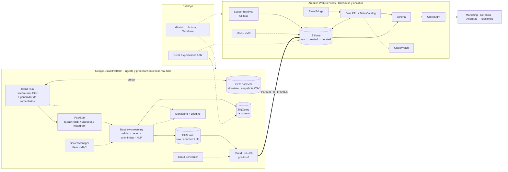

# TrendAnalyzer · ARCHITECTURE

> Documento maestro de arquitectura y contratos. **Versión vigente: 2.43.**
> Historial de versiones: [`CHANGELOG.md`](CHANGELOG.md) · Plan por fases, trazabilidad HU y estado: [`PLAN.md`](PLAN.md) · Historias de usuario: `HU.md` · Visión general: `README.md`.
> Fuentes de verdad combinadas: `README.md` + `diagramaFINAL.drawio` + decisiones de este documento.

---

## 0. Cómo usar este documento

Este archivo está pensado para que **baste con leerlo (o pegármelo) para construir cualquier pieza del proyecto sin tener que enviar el código ya hecho**.

| Si quieres… | Lee |
|---|---|
| Entender la decisión central y el delta contra el diagrama | §1.1–§1.3 (historial de versiones: `CHANGELOG.md`) |
| Ver el panorama completo | §2 |
| Entender cómo funciona el simulador | §3 (el generador y `src/common/`: §3.2.1 y §3.2.2) |
| Saber **cómo hablarle a cada componente** (formatos, nombres, topics, tablas, IAM) | **§5 (contratos)** |
| Saber **cómo se valida cada contrato** y cómo mantener §5 y `contracts/` alineados | **§5.13** |
| Saber **qué infraestructura base existe** y cómo aplicarla (estado remoto, APIs, presupuestos) | **§5.14** |
| Saber qué hay en GCP (topics, buckets, service accounts, Cloud Run, BigQuery, secreto HMAC) y cómo desplegar el simulador | **§5.15** y §3.14 |
| Comprobar que el simulador emite bien (tasa, ids únicos, `seq`, reinicio) | **§3.11** |
| Levantar el simulador en local, sin nube ni credenciales | **§3.12** y `project/LOCAL_DEV.md` |
| Correr o verificar el pipeline de streaming (local con DirectRunner o en Dataflow) | **§3.13** y `src/streaming/README.md` |
| Anonimizar, normalizar y escribir `enriched/` y `posts_enriched`; cargar la llave HMAC | **§3.14** y `src/streaming/ENRICHED.md` |
| Sentimiento y emoción (RoBERTuito), imagen `dataflow-nlp` y NLP en local | **§3.15** y `docs/validation/validation-2-3.md` |
| Ventanas de tendencias (`trend_windows`), `dlq_events`, `dq_results` y la plantilla Flex de Dataflow | **§3.16**, `src/streaming/TRENDS.md` y `docs/validation/validation-2-4.md` |
| Generar y cargar el histórico (loader, NLP en lote, bucket S3 del lake, KMS y rol `ta-historical-loader`) | **§3.17**, `src/historical/HISTORICAL.md` y `docs/validation/validation-3-1.md` |
| Exportar `enriched/` a S3 (federación OIDC GCP → AWS, job `ta-gcs-to-s3`, Scheduler en pausa) | **§3.18** (interfaces: CLI, logs, API, Terraform y validador en **§3.18.1**), §5.6, `src/exporter/EXPORTER.md` y `docs/validation/validation-3-2.md` |
| Consultar el lake con Athena, el catálogo de Glue, el workflow `ta-wf-raw-to-curated` y su horario; escribir un job de Glue (4.2/4.3) | **§3.19** (interfaces: contrato de un job, cómo reemplazarlo, API, Terraform, operación y validador en **§3.19.1**), §5.7, §5.8 y `docs/validation/validation-4-1.md` |
| Perfilar Raw y Trusted del lake (nulos, cardinalidad, distribuciones, tipos, anomalías, diversidad léxica) y ver las reglas de calidad propuestas para el Lote 5.2 | **§3.20** (interfaces: CLI, JSON del informe, API, comprobaciones y validador en **§3.20.1**), **§5.10** (catálogo de reglas DQ-01…DQ-63) y `docs/validation/validation-5-1.md` |
| Construir o leer Trusted (`ta_trusted.posts`): el job `ta-job-raw-to-trusted`, su reporte, `text_clean`, qué filas descarta y cómo leer Trusted desde el 4.3 | **§3.21** (interfaces: argumentos, logs, reporte, API, Terraform, validador y «Para el Lote 4.3» en **§3.21.1**), §5.7 (Trusted y `text_clean`), §5.12 y `docs/validation/validation-4-2.md` |
| Construir o leer Curated (`ta_curated`: `fact_posts`, dimensiones y agregados): el job `ta-job-trusted-to-curated`, su reporte, qué es cada tabla, las consultas guardadas de ejemplo y cómo sumar las aristas (4.4) o probar Curated (5.2) | **§3.22** (interfaces: argumentos, reporte, API, consultas guardadas, Terraform, validador, «Para el Lote 4.4» y «Para el Lote 5.2 y el 6.1» en **§3.22.1**), §5.7 (Curated) y `docs/validation/validation-4-3.md` |
| Leer o cambiar las aristas (`edges_user_brand`, `edges_hashtag_cooccurrence`: grano, peso, orden de los pares, cómo las calcula el job y cómo se recalculan en SQL); qué de Curated usan el 5.2 y el 6.1 | **§3.23** (interfaces: reglas de ADR-27, reporte y comprobaciones nuevas, API del job y del validador, SQL de recálculo y de ejemplo, «Para el siguiente lote» en **§3.23.1**), §5.7 (aristas) y `docs/validation/validation-4-4.md` |
| Medir la calidad con Great Expectations (Raw, Trusted y Curated), los KPI de HU-032, la precisión del NLP (HU-033) y escribir `dq_results`; reglas DQ-64…DQ-77 de Curated | **§3.24** (interfaces: CLI `run_dq.py`, forma de cada regla en GX, reglas de Curated, filas de `dq_results`, API, validador y «Para el siguiente lote» en **§3.24.1**), §5.10 (catálogo DQ-01…DQ-63), §5.5 y `docs/validation/validation-5-2.md` |
| Describir una tabla o columna en el catálogo de Glue (descripción y clase de privacidad), ver el diccionario de datos, el linaje de extremo a extremo y por columna, o la gobernanza (DAMA-DMBOK, Ley 1581, datos sintéticos) | **§3.25** (interfaces: cómo describir una columna, CLI y API de `catalog_spec`, validador y «Para el siguiente lote» en **§3.25.1**), `docs/CATALOG.md`, `docs/LINEAGE.md`, `docs/GOVERNANCE.md` y `docs/validation/validation-5-3.md` |
| Comprobar qué está encendido antes de validar un lote | **§8** (preflight) |
| Encender, comprobar y apagar lo que cobra; validar un lote con un solo comando | `docs/ACTIVE_SERVICES.md` (`scripts/on.py`, `off.py`, `status.py`), `scripts/validate_2_3.py` (§3.15), `scripts/validate_2_4.py` (§3.16), `scripts/validate_3_1.py` (§3.17), `scripts/validate_3_2.py` (§3.18; con `status` y `off` del exportador), `scripts/validate_4_1.py` (§3.19; con `status`, `off` y `on` del horario del lakehouse), `scripts/validate_4_2.py` (§3.21; con `status` y `off`), `scripts/validate_4_3.py` (§3.22; con `status`, `off` y `on`: el horario queda **encendido**, estado normal), `scripts/validate_4_4.py` (§3.23; ídem, con las aristas), `scripts/validate_5_1.py` (§3.20), `scripts/validate_5_2.py` (§3.24; calidad con Great Expectations en el venv `~/.venvs/ta-gx`) y `scripts/validate_5_3.py` (§3.25; catálogo, linaje y gobernanza) |
| Saber qué construir y en qué orden | `PLAN.md` §1 (fases y lotes) |
| Saber qué historias de usuario cubre cada fase o lote | **`PLAN.md` §1 y §2** (detalle en `HU.md`) |
| Saber en qué estado está cada fase y lote | **`PLAN.md` §3** |
| Pedirme el siguiente lote | §8 (plantilla de petición) |

**Regla de oro:** si dos componentes se comunican, su interfaz vive en §5. Si algo no está en §5, no es una interfaz y no debe depender de él ningún otro componente. Cuando una interfaz cambie, se cambia **primero aquí** y luego en el código.

---

## 1. Qué cambia respecto al README y al diagrama FINAL

### 1.1 Decisión central

Reddit, Facebook e Instagram solo se pueden consumir por APIs REST/OAuth (polling), lo que no es streaming real, y además dependen de aprobaciones y límites de acceso: Reddit exige aprobación OAuth, y las APIs de Meta (Facebook/Instagram) exigen revisión de la app y permisos, y no dan acceso libre a la conversación pública de terceros. **Decisión:** las tres fuentes pasan a ser **simuladas**. Cada una pide al **generador de comentarios** (§3.2) un par `marca,comentario` y publica un mensaje a Pub/Sub cada **1–3 s**. El dataset histórico es un **full load** batch directo a S3, generado con el **mismo** generador.

*Evolución:* la v2.0/v2.1 simulaba Mastodon, Reddit y RSS reproduciendo datasets públicos de emociones (TEC, GoEmotions, SemEval, DailyDialog). Se reemplazan porque estaban en inglés, no hablaban de las marcas del negocio y obligaban a inyectarlas artificialmente; el generador ya produce comentarios en español colombiano sobre marcas concretas.

Todo lo que viene después de Pub/Sub (Dataflow, GCS, BigQuery, S3, Glue, Athena, QuickSight) **no cambia de naturaleza**: el pipeline real es idéntico al que tendría con fuentes reales. Lo único falso es el origen del dato.

### 1.2 Delta contra el diagrama FINAL

| Elemento del diagrama FINAL | Cambio en v2 |
|---|---|
| Mastodon / Reddit / RSS → Cloud Run (flechas "Streaming HTTPS", "REST/OAuth2", "HTTPS") | Se eliminan las flechas externas. Los tres orígenes se sustituyen por **Reddit, Facebook e Instagram simulados**. Dentro de GCP aparece **`stream-simulator`** (Cloud Run), que invoca al generador de comentarios y publica a Pub/Sub. |
| Cloud Run (collectors) | Pasa a ser un único servicio always-on `stream-simulator` (§3.1). Los collectors reales (`src/collectors/`) quedan como código legado/opcional. |
| Cloud Scheduler → Cloud Run | Cambia de rol: ya no dispara polling. Dispara el **exportador GCS→S3** cada 15 min (y opcionalmente escenarios de demo, §3.7). |
| Secret Manager (credenciales de APIs) | Ya no guarda tokens de Mastodon/Reddit. Guarda la **llave HMAC de anonimización**. |
| Datasets históricos → S3 | Se mantiene. Se precisa: `src/historical/` (`scripts/load_historical.py`, Lote 3.1, §3.17) genera los registros con el **mismo simulador y generador**, el mismo envelope (§5.2), la misma anonimización y el mismo NLP, y los sube a `s3://…/raw/origin=historical/`. |
| *(no existe)* Datasets de emociones en GCS | Ya no se usan (v2.2). El bucket `…-ta-datasets` solo guarda el estado del simulador y snapshots opcionales del generador (§5.4). |
| *(no existe)* GCS → S3 | **Falta en el diagrama.** Se agrega el exportador `gcs-to-s3` (§5.6), implementado en el Lote 3.2 (v2.30, §3.18). Hoy el único camino GCP→AWS dibujado es BigQuery→QuickSight. |
| Flecha huérfana `? → EventBridge` | Sin origen. Se resuelve: EventBridge es un **schedule** que dispara el workflow de Glue (§5.7). *(v2.32)* Es un horario de **EventBridge Scheduler** (`rate(1 hour)` → `glue:StartWorkflowRun`), creado deshabilitado (§3.19, ADR-23); *(v2.36)* encendido por decisión del usuario. |
| BigQuery → QuickSight "Carga batch" | **Verificar** si el conector de QuickSight a BigQuery está disponible para la cuenta. Camino principal recomendado: Parquet en S3 → Athena → QuickSight. BigQuery queda para analítica caliente en GCP. |

### 1.3 Discrepancias README ↔ diagrama FINAL (resueltas)

El README menciona **Firestore, Cloud SQL, Neptune y Dataplex**, que **no están** en el diagrama FINAL. El diagrama manda:

| Servicio del README | Decisión v2 |
|---|---|
| Firestore, Cloud SQL | **Fuera del alcance v1.** El estado del simulador vive en un objeto GCS (§3.6). |
| Neptune | **Fuera del alcance v1.** "Análisis de relaciones" se cubre con tablas de aristas en Curated consultables por Athena (§5.7). Neptune queda como extensión si sobra tiempo. |
| Dataplex / OpenLineage | Catálogo = **Glue Data Catalog**. Linaje = **dbt docs + documento de linaje** (`PLAN.md` §1, Fase 5). *(v2.37)* El Lote 4.3 se hizo **sin dbt** (decisión del usuario, §3.22): no hay proyecto dbt del que salgan los *dbt docs*; cómo se hace el linaje del 5.3 queda **a decidir por el usuario** (§9, ADR-10). *(v2.43, decisión del usuario)* Linaje = **documento y diagrama hechos a mano** (`docs/LINEAGE.md`, §3.25, ADR-29), sin *dbt docs*. |

### 1.4 Historial de cambios

Movido a [`CHANGELOG.md`](CHANGELOG.md): una entrada por versión (v2.2 → v2.42), la más reciente primero. Este documento describe siempre la versión vigente (2.38).

---

## 2. Arquitectura objetivo



**Dos planos, un contrato.** GCP = plano caliente (segundos/minutos). AWS = plano de lakehouse (horas). Ambos hablan el mismo **envelope** (§5.2), por eso el dato histórico y el streaming terminan en la misma tabla Trusted.

---

## 3. El simulador de streaming

### 3.1 Dónde corre (y por qué no EC2)

**Decisión:** **un solo servicio Cloud Run `ta-stream-simulator`**, con `min-instances=1`, `max-instances=1` y CPU siempre asignada (`--no-cpu-throttling`).

- *Por qué no EC2:* publicar a Pub/Sub desde AWS obliga a llevar credenciales de GCP a otra nube y añade latencia/egreso entre nubes. El simulador debe vivir **donde está Pub/Sub**.
- *Por qué Cloud Run y no una VM:* el diagrama ya lo dibuja, ya existe módulo Terraform de Cloud Run y Dockerfiles en el repo, y se despliega/actualiza con una imagen.
- *Por qué `max=1`:* con más de una instancia habría emisiones duplicadas y el cursor se pisaría.
- *Servicio único con 3 workers asyncio* (uno por fuente) en vez de 3 servicios: una sola instancia siempre encendida, un solo costo fijo.
- *Plan B si el costo molesta:* una VM `e2-small` en GCE con el mismo contenedor (ADR-02, §9).

El contenedor expone `GET /healthz` (requisito de Cloud Run) y, opcionalmente, `POST /control/scenario` (§3.7). El resto es un loop de fondo.

> **Restricción de Cloud Run (observada en el Lote 1.3):** el *frontend* de Google reserva algunas rutas terminadas en `z`, como `/healthz`, y responde 404 antes de llegar al contenedor. Las sondas de arranque y de vida sí llegan, porque llaman al contenedor directamente, así que `/healthz` sirve para ellas. Para consultar el estado desde fuera hace falta otra ruta (propuesta: `GET /health`, pendiente; §5.15).

### 3.2 El generador de comentarios

El script de Python que ya existe se integra como módulo del simulador (`src/simulator/generator/comment_generator.py`). **No es un servicio aparte**: corre en el mismo proceso del simulador y también se invoca en batch para el histórico (Lote 3.1).

**Contrato mínimo de salida** (CSV UTF-8 o su equivalente en objeto): `marca,comentario`.

```csv
marca,comentario
Postobón,Opinión personal: soy fan d Postobón y no pienso cambiar. Volvería mil veces. 🙌
Pepsi,Mi aporte del día: no tolero Pepsi Cola en el trancón. Mejor me hubiera tomado un agua. Es mi opinión.
Sprite,Vamos al punto: me chifla Sprite sobre todo con el frío de Bogotá. Eso sí es sabor. 🥤
```

> **Salida real desde el Lote 1.1.** El CSV de `scripts/generate_comments.py` trae `marca,comentario,sentimiento[,categoria]` y la columna `marca` lleva la **clave canónica** (`postobon`, no `Postobón`). `sentimiento` queda vacío cuando es `null` (categorías ambiguas). Ejemplo generado con `--seed 7 --categoria`:
>
> ```csv
> marca,comentario,sentimiento,categoria
> postobon,Me encanta Postobón cuando está bien fría. Quedé tan contento que se lo conté a mi novio. ¡Qué viva Postobón!,positive,gusto
> sprite,Dato: en el domicilio pedí una Sprite con carimañolas. Atentos.,neutral,informativo
> pepsi,"Mira, a mi jefe le gusta Pepsi Cola y yo no entiendo cómo. Eso fue una tortura. Cero.",negative,asco
> ```

Lo que se observa en los ejemplos: español coloquial colombiano, jerga, abreviaturas (`d`), emojis, y la marca presente tanto en la columna como en el texto. **No trae** red social, usuario, fecha, engagement ni etiqueta: eso lo añade el simulador (§3.8). Como un comentario puede contener comas, el CSV se escribe siempre con el módulo `csv` (con comillas).

**Cambios propuestos al script** (se pueden ajustar):

| # | Cambio | Por qué | Prioridad |
|---|---|---|---|
| 1 | Exponer `generate(rng, marca=None, sentimiento=None) -> Comentario` como función pura, con un `random.Random` inyectado (sin `random.choice` global) | Determinismo e idempotencia (§3.6) | Requerido |
| 2 | Aceptar `marca` y `sentimiento` opcionales | El simulador controla los pesos de marca en el tiempo (§3.8) y los escenarios de demo (§3.7) | Requerido |
| 3 | Devolver una tercera columna opcional `sentimiento` ∈ `positivo\|negativo\|neutro` (la plantilla ya lo conoce) | *Ground truth* para medir la precisión del NLP (§5.10). Sin ella esa métrica se omite | Recomendado |
| 4 | Normalizar la marca a una clave canónica (`Postobón` → `postobon`) con los alias de `brands.yaml` | Joins y dimensiones estables (`dim_brand`) | Requerido |
| 5 | Ampliar la variedad: más plantillas por marca y sentimiento, aperturas y cierres intercambiables, comentarios neutros/informativos y algunos con dos marcas ("Pepsi vs Postobón") | Menos repetición léxica y relaciones marca–marca para el análisis de grafos | Recomendado |
| 6 | Quitar (si los tiene): `sleep`, bucles infinitos, `print` o escritura directa a archivo, pesos de marca fijos, semilla global | El ritmo, el estado y la selección de marca los controla el simulador | Requerido |
| 7 | Mezclar longitudes (frase corta y 2–3 frases) y conservar el ruido (typos, jerga, emojis) | Los posts de Reddit usan la primera frase como título (§3.8); el ruido ejercita la limpieza en Trusted | Opcional |

**Estado (v2.13):** los siete cambios están hechos en el Lote 1.1 (#1 y #2 en `generate()`, #3 en `Comentario.sentimiento` y la columna del CSV, #4 en `generator/brands.py`, #5 en `generator/templates/`, #6 en el diseño del módulo y #7 en la mezcla de núcleo, contexto y reacciones, más el ruido). Ver §3.2.1 y §3.2.2.

#### 3.2.1 Estado del script real (`generar_comentarios.py`, v3 con plantillas ampliadas)

Ya cumple buena parte del cambio #5 (4 categorías, plantillas generativas, ruido de redes) y su función `construir(rng, marca, cat, …)` ya recibe `rng`, marca y categoría, por lo que se parece mucho a la función pura de los cambios #1 y #2. Puntos que resuelve el Lote 1.1 (HU-008), con la decisión adoptada:

| # | Hallazgo | Decisión (adoptada, ADR-13) | Resultado en el Lote 1.1 |
|---|---|---|---|
| 1 | `MARCAS` trae 5 marcas (Postobon, CocaCola, Sprite, Pepsi, Colombiana); v1 usa 3. | Leer la lista de `brands.yaml` (`postobon`, `pepsi`, `sprite`). CocaCola y Colombiana quedan fuera de v1 y se pueden añadir después. Clave canónica sin tilde (`postobon`), `display` con tilde. | ✅ `config/brands.yaml` con `postobon`, `pepsi` y `sprite`. Los alias y complementos por marca de CocaCola y Colombiana se conservan en `templates/huecos.py`, pero no se usan en v1. |
| 2 | El script no tiene *sentimiento*, solo `categoria` ∈ `gusto\|asco\|nostalgia\|adiccion`. | `gusto → positive`, `asco → negative`, `informativo → neutral` (categoría nueva, fila 3), `nostalgia` y `adiccion → null` (ambiguas, sin ground truth). El parámetro `sentimiento` de `generate()` restringe la categoría (`positive → gusto`, `negative → asco`, `neutral → informativo`). | ✅ El mapeo vive solo en `common/label_map.yaml`; el generador lo lee de ahí. Pasar `sentimiento` restringe la categoría. |
| 3 | No hay comentarios neutros/informativos ni con dos marcas. Sin neutral la precisión del NLP se mide en solo 2 clases. | Añadir una categoría `informativo` (→ `neutral`) y plantillas comparativas ("Pepsi vs Postobón"). Cambio #5, incluido en HU-008 (mínimo 15 plantillas informativas y 15 comparativas). | ✅ 40 plantillas informativas y 18 comparativas de dos marcas. Cerca de 3 de cada 10 comentarios informativos mencionan dos marcas. |
| 4 | `ruido_texto` pasa a minúsculas/mayúsculas, quita tildes y mete *typos* en palabras de más de 4 letras: puede dañar el nombre de la marca ("Postobón" → "Pstoobón"). | `brands[]` = marca elegida (se conoce de antemano) + otras detectadas por alias **normalizados** (sin tildes, sin mayúsculas). Proteger los tokens de marca del *typo*. | ✅ Los alias usados se enmascaran antes del ruido y se restauran después; si aun así se perdiera una marca, se conserva el texto sin ruido. Medido: 0 de 20.000 comentarios con ruido pierden la marca. |
| 5 | Usa un `random.Random(seed)` secuencial (el resultado depende del orden) y `--unico` usa `hash()` de Python (varía entre procesos). | Un `Random(f"{seed}\|{fuente}\|{seq}")` por evento (§3.6). Para unicidad en batch usar `hashlib`. El modo en línea no exige unicidad (§3.5). | ✅ `common.envelope.event_rng(seed, source, seq)`. Mismo resultado con distinto `PYTHONHASHSEED`, probado en subprocesos. `--unico` usa `hashlib`. |
| 6 | Los cierres ya incluyen hashtags (`#Colombia`, `#<marca>`, `#Nostalgia`…), contrario a lo que asume §3.8. | Extraer `hashtags[]` del texto con regex; el simulador solo añade los que falten según la probabilidad por red (§3.8). | ✅ `common.hashtags.extract_hashtags()` devuelve la forma canónica, sin repetidos y en orden de aparición. |
| 7 | CSV en `utf-8-sig`, `-n` por defecto 20 (el docstring dice 2.000.000) y salida solo `marca,comentario[,categoria]`. | `scripts/generate_comments.py` conserva el CLI; la salida pasa a `Comentario(marca, texto, categoria, sentimiento)` y el CSV agrega `sentimiento`. | ✅ CLI con `-n`, `-o` y `--unico` conservados; `-n` por defecto 1000; CSV `marca,comentario,sentimiento[,categoria]` en UTF-8 sin BOM. |

**Marcas** (`src/simulator/config/brands.yaml`). La clave canónica es la que viaja en `brands[]`; hay que registrar cada marca que produzca el generador (v1: `postobon`, `pepsi`, `sprite`):

```yaml
brands:
  postobon:
    display: "Postobón"
    aliases: ["Postobón", "Postobon"]
    role: propia            # confirmado en Fase 0
    facebook_page: "Postobón (sim)"
    instagram_account: "postobon.sim"
  pepsi:
    display: "Pepsi"
    aliases: ["Pepsi", "Pepsi Cola"]
    role: competidor
    facebook_page: "Pepsi (sim)"
    instagram_account: "pepsi.sim"
  sprite:
    display: "Sprite"
    aliases: ["Sprite"]
    role: competidor
    facebook_page: "Sprite (sim)"
    instagram_account: "sprite.sim"
```

**Modos de uso:**
- *En línea:* el bucle de emisión (§3.5) llama a `generate(rng, marca, sentimiento)`.
- *Batch:* `python scripts/generate_comments.py --n 50000 --seed 7 --out comentarios.csv` (histórico y snapshots).

#### 3.2.2 Implementación del generador y de `src/common/` (Lote 1.1)

> Entregado en el Lote 1.1 (HU-008, HU-009). Las rutas son relativas a `project/`. **No se tocó** ninguna interfaz de §5.2–§5.8 ni `contracts/`.

**Qué hay en cada módulo:**

| Ruta | Contenido |
|---|---|
| `src/common/envelope.py` | `event_id(origin, source, seed, seq)` (uuid5, §3.6) · `event_rng(seed, source, seq)` · `format_ts()` / `parse_ts()` (UTC con milisegundos y `Z`) · `build_envelope(...)` · `pubsub_attributes(envelope)` · `normalize_engagement(source, payload)`. Constantes `SCHEMA_VERSION`, `ORIGINS`, `SOURCES`, `SENTIMENTS`, `CHAOS_VALUES`. |
| `src/common/hashing.py` | `user_hash(user_id, secret)` (HMAC-SHA256 en hex, 64 caracteres) e `is_user_hash()`. La llave la recibe como argumento: no la obtiene de Secret Manager. |
| `src/common/hashtags.py` | `normalize_hashtag(raw)` (devuelve la forma canónica o `None`) y `extract_hashtags(text)`. |
| `src/common/label_map.yaml` y `label_map.py` | `map_sentiment()`, `map_emotion()`, `categoria_sentimiento()` y `categorias_para(sentimiento)`. Contiene los mapeos `NEG/NEU/POS`, la emoción (`others` y `neutral` → `neutral`) y la tabla de ADR-13. |
| `src/simulator/config/brands.yaml` | Las 3 marcas de v1, exactamente como en §3.2.1. |
| `src/simulator/generator/brands.py` | `Brands` (`keys`, `canonical(nombre)`, `detect(texto)`), `load_brands(path=None)` y `normalize_text()`. La detección compara alias **normalizados** (sin tildes ni mayúsculas) y no cuenta coincidencias dentro de otra palabra. |
| `src/simulator/generator/comment_generator.py` | `generate(...)`, `Comentario` y `GENERATOR_ID`. |
| `src/simulator/generator/noise.py` | `aplicar_ruido(texto, datos_cat, rng, protegidos)`. |
| `src/simulator/generator/templates/` | Un módulo por categoría (`gusto`, `asco`, `informativo`, `nostalgia`, `adiccion`) y `huecos.py` (huecos compartidos y alias por marca). |
| `scripts/generate_comments.py` | CLI del generador (abajo). |
| `pytest.ini`, `src/conftest.py` | `pythonpath = src`, `testpaths = src` y la fixture `envelope_validator` (valida contra `contracts/`). |

**API del generador:**

```python
generate(rng, marca=None, sentimiento=None, *, categoria=None, ruido=0.20, brands=None) -> Comentario
Comentario(marca, texto, categoria, sentimiento)   # dataclass inmutable
GENERATOR_ID = "comment-gen@1.0"                   # valor de `generator` en el envelope (§5.2)
```

- Es una **función pura**: el único origen de aleatoriedad es el `rng` que se le pasa; no hace `print`, `sleep` ni escribe archivos.
- `marca` acepta clave, `display` o alias (se normaliza a la clave canónica). Con `None` elige una al azar.
- `sentimiento` ∈ `positive|negative|neutral|None` restringe la categoría (ADR-13). Si además se fija `categoria`, debe ser coherente con el sentimiento.
- `ruido` es la probabilidad de aplicar ruido de redes (`0` lo apaga). Ante argumentos inválidos lanza `ValueError`.
- `Comentario.sentimiento` es el *ground truth* que el simulador copia a `sim.label_sentiment`. Para el campo `brands[]` del envelope, el simulador usa la marca elegida más `Brands.detect(texto)` (§3.8).

**CLI** `scripts/generate_comments.py` (se corre desde `project/`):

| Opción | Efecto |
|---|---|
| `-n`, `--n` | Número de filas (por defecto 1000). |
| `-o`, `--out` | Archivo de salida (por defecto `comentarios.csv`). |
| `--seed` | Semilla (por defecto `SIM_SEED` o 7). |
| `--ruido` | Probabilidad de ruido, de 0 a 1. |
| `--marca` | Limita a esas marcas; se puede repetir. |
| `--sentimiento` | Fuerza el sentimiento. |
| `--solo-categoria` | Fuerza la categoría. |
| `--categoria` | Agrega la columna `categoria` al CSV. |
| `--unico` | Evita duplicados exactos (hash con `hashlib`; usa más memoria). |
| `--brands` | Ruta a otro `brands.yaml`. |
| `--bom` | Escribe UTF-8 con BOM, para abrir en Excel de Windows. |

**Parámetros del generador** (constantes al inicio de `comment_generator.py`). Los tres primeros los decidió el Lote 1.1 y están **adoptados por defecto** desde la v2.14 (§5.12, §9 #12):

| Constante | Valor | Efecto |
|---|---|---|
| `PESOS_CATEGORIA` | `gusto` 28 % · `asco` 24 % · `informativo` 18 % · `nostalgia` 15 % · `adiccion` 15 % | Mezcla cuando no se fija sentimiento ni categoría. El ground truth resultante es 28 % `positive`, 24 % `negative`, 18 % `neutral` y 30 % `null`. |
| `P_COMPARATIVA` | 0,30 | Dentro de `informativo`, probabilidad de usar una comparativa de dos marcas (necesita ≥ 2 marcas en `brands.yaml`). |
| Truncado de hashtags | 100 caracteres | `normalize_hashtag()` corta a 100 para respetar el rango 1–100 de §5.2. |
| `DEFAULT_RUIDO` | 0,20 | Probabilidad de ruido por defecto. |
| `P_GENERATIVA` | 0,55 | Frase generativa (`{verbo} {m} {complemento}.`) frente a plantilla fija. |
| `P_CONTEXTO` | 0,40 | Añade una frase de contexto. |

**Medido** (referencia, no es un requisito): sobre 20.000 comentarios, 99,995 % de textos únicos y unos 12.000 comentarios por segundo; dos millones de filas tardan unos 3 minutos. En la máquina de desarrollo con Windows (v2.14), 50.000 filas en 3,5 s.

**Pruebas:** 64 en `src/common/tests/` y `src/simulator/tests/`. Las que usan los schemas (`test_envelope_contract.py` y `test_generator_contract.py`, esta con 1.000 eventos por fuente y caos apagado, §5.12) y la que compara `normalize_hashtag()` con la copia de `contracts/tests/test_contracts.py` se **omiten** si faltan `jsonschema`, `referencing` o `contracts/`.

```bash
# desde project/
pip install pyyaml pytest jsonschema referencing
python -m pytest                         # usa pytest.ini (pythonpath = src); funciona aunque `pytest` no esté en el PATH
python -m pytest contracts/tests -q      # las 18 de siempre, sin cambios
python scripts/generate_comments.py --n 50000 --seed 7 --out comentarios.csv
```

> **Estado de la verificación (v2.14):** `python -m pytest` da **64 passed** y `python -m pytest contracts/tests -q` da **18 passed** (Windows, Python 3.14.7, `jsonschema` 4.26.0). Las pruebas contra los schemas corrieron, no se omitieron. En Windows se usa `python -m pytest` porque `pytest.exe` queda fuera del PATH tras `pip install`. Si una prueba contra los schemas falla en el futuro, el desajuste está entre este código y `contracts/`, no en la lógica del generador.

**Lo que queda para el Lote 1.2:** el `enrich/brands.py` del simulador (pesos de marca en el tiempo, §3.8) **reutiliza** `generator/brands.py` para cargar `brands.yaml`; no es una segunda lectura del archivo.

### 3.3 Reparto por fuente y etiquetas

Cada comentario se publica por **una** red simulada. Las tres comparten el texto del generador y difieren en el `payload` y en la mezcla de tipos:

| Fuente simulada | Naturaleza | `kind` | Contexto simulado |
|---|---|---|---|
| **Reddit** | Foro, hilos | `post` 30% · `comment` 70% | Subreddit de una lista (`r/colombia`, `r/medellin`, …) |
| **Facebook** | Red social, páginas de marca | `post` 15% · `comment` 85% | Página de la marca comentada (`facebook_page` en `brands.yaml`) |
| **Instagram** | Red visual, cuentas de marca | `comment` 100% | Publicación (`media_id`, `media_type`) de la cuenta de la marca (`instagram_account`) |

**Etiquetas de salida del NLP** (ADR-05): `sentiment_label` ∈ `negative|neutral|positive` (el modelo devuelve `NEG/NEU/POS`; se mapea) y `emotion_label` ∈ 7 clases `joy, sadness, anger, fear, disgust, surprise, neutral` (la clase neutra del modelo de emoción se mapea a `neutral`; verificar el nombre exacto de la etiqueta al integrar). El mapeo vive en `src/common/label_map.yaml` (implementado en el Lote 1.1; se usa con `common.label_map.map_sentiment()` y `map_emotion()`, que lanzan `ValueError` ante una etiqueta desconocida).

**Ground truth:** `sim.label_sentiment` ∈ `positive|negative|neutral|null`, tomado de la columna opcional `sentimiento` del generador (cambio #3). Mapeo desde la categoría del script en §3.2.1 #2 (ADR-13): `nostalgia` y `adiccion` → `null`. No hay ground truth de emoción. **No se usa** como feature ni como respuesta del pipeline: solo sirve para medir la precisión del NLP (insumo para la sustentación). El sentimiento y la emoción oficiales los produce el modelo.

### 3.4 Reproducibilidad y snapshots (opcional)

Ya no hay preparación offline obligatoria. Todo el aleatorio sale de una semilla (`SIM_SEED`), de modo que misma semilla + fuente + `seq` ⇒ mismo comentario (con los mismos pesos de marca; los escenarios de §3.7 son la excepción y quedan marcados en `sim.scenario`). Para auditar o repetir una demo se puede guardar un snapshot con `scripts/generate_comments.py` en `gs://{GCP_PROJECT}-ta-datasets/snapshots/` (no se versiona en git).

### 3.5 Bucle de emisión

```
para cada fuente (tarea asyncio independiente):
  seq = leer cursor de sim-state (o 0)
  loop infinito:
     rng = Random(f"{SIM_SEED}|{fuente}|{seq}")                    # §3.6
     marca = elegir_marca(pesos_brands(seq), escenario_activo)     # §3.8
     c = generador.generate(rng, marca=marca, sentimiento=…)       # §3.2
     evento = construir_envelope(c, fuente, seq, rng)              # §3.8
     publicar(topic ta-raw-{fuente}, evento)
     seq += 1
     cada 50 mensajes: guardar cursor
     dormir uniform(1, 3) segundos
```

- Cadencia: ~0.5 msg/s por fuente → ~1.5 msg/s en total (~130k mensajes/día). Trivial para Pub/Sub y Dataflow.
- El generador es inagotable: ya no hay "vueltas" de dataset. El **texto exacto puede repetirse** entre eventos (plantillas); eso **no** es un duplicado, porque `event_id` depende de `seq`. Los duplicados se miden por `event_id`, no por texto.

### 3.6 Identidad, idempotencia y estado

- `event_id = uuid5(NAMESPACE_URL, "{origin}|{source}|{seed}|{seq}")`. Determinista → reenviar tras un reinicio produce el **mismo** id (Dataflow lo deduplica). La semilla forma parte del id: si se cambia, los ids nuevos no chocan con los anteriores.
- Entrega **al menos una vez**. Un reinicio puede repetir hasta 50 mensajes; es aceptable y deduplicable.
- **Cursor** persistido en `gs://…-ta-datasets/sim-state/{source}.json` → `{"seed": 7, "seq": 1207, "updated_at": "…"}`. Si la semilla configurada no coincide con la del cursor, se reinicia en `seq = 0`.
- Implementado en `common.envelope.event_id()` y `event_rng()` (Lote 1.1). Una prueba en subprocesos comprueba que el resultado no cambia con `PYTHONHASHSEED`.
- Todo el aleatorio sale de `random.Random(f"{seed}|{source}|{seq}")`. **No usar `hash()` de Python** para sembrar: varía entre procesos (aleatorización de hash de `str`) y rompería la reproducibilidad.

### 3.7 Escenarios de demo (opcional, Fase 6)

Para mostrar alertas en la sustentación sin esperar una tendencia real:

`POST /control/scenario` `{"brand": "postobon", "sentiment": "negative", "multiplier": 5, "duration_s": 600, "source": "instagram"}` (`source` opcional) → durante ese tiempo el simulador fuerza esa marca y ese sentimiento al generador (p. ej. una ola de comentarios negativos sobre `postobon`), sube la frecuencia y marca los eventos con `sim.scenario`. Cloud Scheduler puede dispararlo. Protegido con ID token de Cloud Run (no público). Requiere el cambio #2 del generador (§3.2).

### 3.8 Qué se inventa (campos sintéticos)

El **texto, la marca y (opcionalmente) el sentimiento** vienen del generador. Todo lo demás se simula en `src/simulator/enrich/`:

| Campo | Cómo se genera |
|---|---|
| **Selección de marca** | El simulador elige la marca con **pesos de `brands.yaml` que varían con `seq`** (ciclos suaves con deriva, para crear tendencias reproducibles) y se la pasa al generador. `brands[]` = marca elegida + otras marcas de `brands.yaml` detectadas por alias en el texto (p. ej. comentarios que comparan dos marcas). Es `[]` solo si el texto no menciona ninguna. |
| **Usuarios** | Pool estable por fuente (~2.000 usuarios, semilla fija, `Faker('es_CO')`). Actividad tipo Zipf (pocos publican mucho). Mismo pool en stream e histórico → los usuarios se repiten y se pueden unir/analizar relaciones. |
| **Handle** | Estilo por red: Reddit `u/usuario`; Facebook nombre visible (`María Gómez`); Instagram `@usuario_89`. |
| **Seguidores** | Lognormal por usuario (estable). Facebook: amigos/seguidores; Instagram: seguidores; Reddit: aproximación (karma). |
| **Engagement** | Reddit: `score` / `upvote_ratio` / `num_comments`. Facebook: reacciones (total y desglose `like/love/haha/wow/sad/angry`), `shares_count`, `comments_count`. Instagram: `like_count`, `comments_count` (sin shares). Escalado por seguidores, con leve impulso para sentimiento extremo y, en Facebook, un sesgo leve del desglose de reacciones según `label_sentiment` cuando existe. Se interpreta como *snapshot* al momento de la recolección. |
| **Fechas** | `event_time` = instante de emisión − lag aleatorio (0–5 s). `ingest_time` = instante de publicación. Siempre UTC. |
| **Hashtags** | El generador ya inserta algunos en los cierres (`#Colombia`, `#<marca>`…): se extraen del texto con regex a `hashtags[]` (§3.2.1 #6). El simulador añade 1–2 más derivados de la marca y del sector (`#Postobon`, `#Colombia`) con probabilidad por red (por defecto Instagram ~60%, Facebook ~15%, Reddit ~0%) solo si faltan, los agrega al final del texto y los registra en `hashtags[]`, en su **forma canónica**: minúsculas, sin `#`, sin tildes, solo `[a-z0-9_]`, sin repetidos y en orden de aparición (el texto conserva el hashtag tal como se escribió: `#Postobón` ⇒ `"postobon"`). Configurable en `sim.yaml`. La extracción y la normalización están en `common/hashtags.py` (`extract_hashtags`, `normalize_hashtag`; Lote 1.1). |
| **Subreddit / página / cuenta** | Reddit: lista de subreddits. Facebook: `facebook_page` de la marca. Instagram: `instagram_account` de la marca y `media_type` aleatorio. URLs ficticias (`sim.local`). |
| **`kind` y `parent_id`** | Según §3.3. Un `comment` de Reddit o Facebook lleva el `parent_id` de un post reciente simulado. |

> **Limitación honesta (para el informe):** los comentarios salen de plantillas y la marca/sentimiento están controlados por el simulador, así que la asociación marca→sentimiento es artificial y el vocabulario es acotado (las métricas de NLP serán optimistas). El objetivo es **ingeniería de datos** (ingesta, calidad, linaje, latencia), no conclusiones de negocio válidas.

### 3.9 Caos controlado (para que Calidad tenga qué medir)

Activable con `SIM_CHAOS_ENABLED=true`. Tasas configurables en `sim.yaml`:

| Defecto | Tasa por defecto | Qué ejercita |
|---|---|---|
| Duplicado (re-publica mismo `event_id`) | 0.5% | KPI Unicidad / Duplicados |
| Evento tardío (`event_time` −2 a −30 min) | 1% | Ventanas, watermarks, latencia |
| Campos opcionales nulos (`lang`, `followers`) | 1% | KPI Completitud |
| Mensaje malformado (JSON roto o falta campo requerido) | 0.2% | Validación + DLQ |

Hay que poder apagarlo para medir la línea base de los KPIs.

### 3.10 Implementación del núcleo del simulador (Lote 1.2)

> Entregado y cerrado en el Lote 1.2 (HU-010 a HU-015), v2.15. Rutas relativas a `project/src/simulator/`. No toca §5.2–§5.8 ni `contracts/`; solo amplía §5.1 con variables propias del simulador.

| Ruta | Contenido |
|---|---|
| `config/sim.yaml` | Cadencia (1–3 s), lag (0–5 s), `checkpoint_every` (50), mezcla de `kind` por red, pesos de marca por `seq`, hashtags por red, pool de usuarios, subreddits, medias de Instagram y tasas de caos. |
| `sim_config.py` | `load_config()` / `config_from_dict()`: lee y valida `sim.yaml`; `SIM_SEED` y `SIM_CHAOS_ENABLED` lo pisan. |
| `enrich/brands.py` | `BrandSelector` (pesos deterministas por `seq` = base × ciclo × deriva), `brands_in_text()`, `add_hashtags()`, `first_sentence()`. Reutiliza `generator/brands.py`. |
| `enrich/users.py` | `UserPool`: 2.000 usuarios por fuente con `Faker('es_CO')` y semilla fija `users.pool_seed` (1581, independiente de `SIM_SEED`), actividad Zipf (s = 1,1), seguidores lognormales. `user_id` = `u_{n:06d}` con un rango por fuente (reddit 0–1999, facebook 2000–3999, instagram 4000–5999). |
| `enrich/engagement.py` | Métricas por red (§3.8), con impulso para sentimiento extremo y sesgo de reacciones en Facebook según `label_sentiment`. |
| `enrich/chaos.py` | `plan()` decide los defectos con un `Random("{seed}\|{source}\|{seq}\|chaos")` propio: encender el caos no cambia texto, marca ni `event_id`. |
| `factory.py` | `EventFactory.make(source, seq, now, scenario=None) -> Emission` (envelope + mensajes Pub/Sub). `Scenario` queda listo para el Lote 6.3. |
| `state.py` | `Cursor` y almacenes `GcsStateStore`, `LocalStateStore` (escritura atómica) y `MemoryStateStore`; `resume_seq()`. |
| `publisher.py` | `PubSubPublisher` (respeta `PUBSUB_EMULATOR_HOST`), `StdoutPublisher`, `MemoryPublisher` y `SourceWorker` (bucle de §3.5; reintenta el mismo `seq` con *backoff* si falla la publicación). |
| `app.py` | Tres workers asyncio + HTTP mínimo: `GET /healthz` (200 con `seq` y contadores por fuente; 503 si un worker cayó) y `POST /control/scenario` → 501 hasta el Lote 6.3. Guarda los cursores al recibir `SIGTERM`. |

**Determinismo.** Misma semilla + fuente + `seq` ⇒ mismo `event_id`, texto, marca, usuario, hashtags y payload; solo `event_time` e `ingest_time` dependen del reloj. Orden fijo de extracciones del `Random` del evento: tipo → marca → contexto → usuario → generador → hashtags → lag → padre → engagement → flair. Las tres primeras se repiten sin estado (`EventFactory.peek`) para enlazar cada `comment` con un **post real reciente** de la misma fuente (en Facebook, de la misma marca; en Reddit hereda su subreddit); si aún no hay ninguno, apunta a un post preexistente simulado (`sim-post-pre-{marca}` o un `t3_` fijo). La pausa entre mensajes usa `Random("{seed}\|{source}\|{seq}\|sleep")`. Verificado con distintos `PYTHONHASHSEED`.

**Caos.** `duplicate` re-publica la misma copia con `sim.chaos = ["duplicate"]` (el original no lleva la marca); `late` resta 2–30 min a `event_time`; `null_fields` pone `lang` y/o `author.followers` en `null`; `malformed` (exclusivo) envía JSON truncado o el envelope sin uno de `event_time`, `text`, `source`, `author` o `payload`, con los atributos Pub/Sub intactos para que Dataflow lo mande a la DLQ.

**Identificadores sintéticos.** Reddit: `t3_`/`t1_` + 7 caracteres base 36; Facebook: `post_id` = `sim-post-{seq:06d}` del post, `comment_id` = `{página}_{evento}` (10 + 10 dígitos); Instagram: `comment_id` y `media_id` de 17 dígitos, una media nueva por cuenta cada 40 `seq` y el comentario va a una de las 3 últimas.

**Pruebas** (`tests/`): determinismo, reanudación del cursor (cada 50, al parar y tras una caída simulada, con los mismos ids), cambio de semilla ⇒ `seq = 0`, mezcla de `kind`, invariantes de payload, enlace a padres, Zipf, tasas de caos, `/healthz` y `test_simulator_contract.py` (1.000 eventos por fuente contra `contracts/*.schema.json`, caos apagado; se omite si faltan los schemas).

> **Estado de la verificación (v2.15):** desde la raíz del repo, `python -m pytest -c project/pytest.ini -rs` da **134 passed, 0 omitidas** (incluye `test_simulator_contract.py` contra los `contracts/` reales) y `python -m pytest project/contracts/tests -q` da **18 passed**. Entorno: WSL (Ubuntu) con un entorno virtual; las dependencias se instalan con `python -m pip install -r project/src/simulator/requirements.txt pytest jsonschema referencing`. La corrida tarda unos 3 minutos con el repo en `/mnt/c` (OneDrive); es la lentitud del sistema de archivos, no del código.

### 3.11 Verificación de la ingesta (Lote 1.4)

> Entregado en el Lote 1.4 (HU-017), aplicado contra GCP y **cerrado en v2.18**. Rutas relativas a `project/`. No toca §5.2–§5.8 ni `contracts/`: el verificador solo **lee** los topics de §5.3 y el cursor de §5.4.

**Qué hace.** `scripts/verify_ingest.py` se suscribe a `ta-raw-{source}` y reporta por fuente: mensajes y tasa (msg/s), `event_id` únicos y copias repetidas, `seq` mínimo y máximo (el "seq actual"), el `seq` del cursor en `sim-state/{source}.json` e integridad básica (JSON, campos `event_id`/`source`/`seq`, atributos de §5.3 coherentes con el cuerpo y, si están `jsonschema`, `referencing` y `contracts/`, validación contra `envelope.v1.schema.json`). Con `restart-check` comprueba además que el `seq` continúa tras reiniciar el servicio.

**Suscripciones.** Por defecto crea una suscripción temporal por topic, `ta-verify-{source}-{AAAAMMDDhhmmss}-{4 hex}` (pull, ack 60 s, retención 10 min, expiración por inactividad de 1 día y etiquetas `project`, `env`, `owner`, `component=ingest-verify`), y la borra al terminar (`--keep-subscriptions` la conserva). **Nunca** consume `ta-raw-{source}-df`: son de Dataflow y el CLI rechaza cualquier nombre terminado en `-df`. Como la suscripción es nueva, solo recibe lo publicado después de crearla; cada mensaje se asigna a la ventana por su `publish_time` de Pub/Sub, de modo que la latencia de entrega no altera la tasa. Al final se reciben 5 s más (`--drain`) para los mensajes en vuelo. Con `PUBSUB_EMULATOR_HOST` (Lote 1.5) se crean sin expiración ni etiquetas.

| Ruta | Contenido |
|---|---|
| `scripts/verify_ingest.py` | Punto de entrada; añade `src/` al `sys.path` y llama a `ingest_check.cli.main()`. |
| `src/ingest_check/stats.py` | Puro, sin nube: `parse_message()` → `Observation`, `IngestStats` (seguro para hilos), `summarize()` por fuente y ventana, `measure_checks()`, `cursor_checks()`, `restart_checks()` y `verdict()`. |
| `src/ingest_check/cursor.py` | `parse_cursor()` y lectores `GcsCursorReader` (`gs://{bucket}/sim-state/`), `LocalCursorReader` (`SIM_STATE_DIR`) y `NullCursorReader`. Solo lectura. |
| `src/ingest_check/schema.py` | `load_envelope_validator()`: registra todos los `contracts/*.schema.json` por `$id` y por nombre de archivo. |
| `src/ingest_check/pubsub_io.py` | `PubSubBackend`: crea o reutiliza suscripciones, *streaming pull*, `ack` siempre, y limpieza. |
| `src/ingest_check/cli.py` | Comandos `measure` y `restart-check`, reporte de texto y JSON. |
| `src/ingest_check/testing.py` | Dobles de prueba (reloj, backend y envelopes sintéticos); reutilizables en el Lote 1.5. |
| `src/ingest_check/requirements.txt` | `google-cloud-pubsub` y `google-cloud-storage` (versiones de `simulator/constraints.txt`) más `jsonschema` y `referencing`. |

**Criterios** (umbrales configurables por opción):

| Verificación | Pasa | Aviso | Falla |
|---|---|---|---|
| Mensajes por fuente | ≥ 10 en la ventana | — | < 10 (los demás criterios de esa fuente no se evalúan) |
| Tasa | 0,35–0,65 msg/s (§3.5: ~0,5) | — | fuera de rango |
| `event_id` únicos | ≥ 99 % y ninguna copia sin marca de caos | ≥ 99 % con copias sin marca | < 99 % |
| Cuerpo y schema | todos válidos | inválidos con `--expect-chaos` | inválidos sin caos |
| Atributos | `event_id` y `source` iguales al cuerpo; `source` = topic | — | incoherentes |
| `seq` | sin huecos entre mínimo y máximo | con huecos (mensajes en vuelo, malformados) | — |
| Cursor | semilla = `--seed`; `seq` a ≤ 55 del último observado | sin cursor o desfasado | semilla distinta |
| Reinicio | tras reiniciar, `seq` mínimo ≥ máximo previo − 50 y luego lo supera | el máximo previo es < 50 (no concluyente) | vuelve atrás más de 50, no reanuda o no progresa |
| Repetidos tras reiniciar | ≤ 50 `event_id` (mismos ids, §3.6) | — | > 50 |
| Cursor antes → después | misma semilla y `seq` que no retrocede | — | cambia la semilla o retrocede |

**Diagnóstico.** El reporte incluye los mensajes recibidos en total (también fuera de ventana) y el desfase de reloj (mediana de recepción local − `publish_time`). Si el desfase supera 2 s (típico de WSL tras suspender el equipo), las ventanas se corrigen al reloj local y se avisa. Si no llega ningún mensaje a ningún topic, el reporte sugiere comprobar que el servicio esté encendido (`gcloud run services describe` y el output `simulator_url`). `--region` (por defecto `GCP_REGION`) vale para ambos comandos.

Las reentregas de Pub/Sub (mismo `message_id`) no cuentan como duplicado. Las copias con `sim.chaos = ["duplicate"]` se informan aparte. Salida: 0 = pasa (con o sin avisos), 1 = falla, 2 = error de uso o de infraestructura (topic inexistente, sin credenciales).

**Reinicio** (`restart-check`): observa `--before` s (90), pide el reinicio y observa `--after` s (120) desde que el servicio vuelve.

| `--restart` | Cómo |
|---|---|
| `manual` (por defecto) | Usted reinicia (por ejemplo `simulator_running = false` → `apply` → `true` → `apply`, como en `infra/DEPLOY_SIMULATOR.md`) y pulsa Enter cuando el servicio está *Ready*. Necesita terminal. |
| `wait` | Espera `--restart-wait` s (180) a un reinicio hecho por otro medio. |
| `gcloud` | `gcloud run services update ta-stream-simulator --update-env-vars TA_RESTART_NONCE=<epoch>`: crea una revisión nueva y el contenedor anterior recibe `SIGTERM` (guarda el cursor). **Deriva:** `TA_RESTART_NONCE` no está en Terraform; el siguiente `apply` la quita y eso vuelve a reiniciar el servicio (inofensivo). |

**Permisos de quien lo corre** (credenciales de usuario, §5.1): crear y borrar suscripciones adjuntas a `ta-raw-*` (`roles/pubsub.editor` en el proyecto; Owner y Editor lo incluyen), leer `sim-state/` en `…-ta-datasets` (`roles/storage.objectViewer`) y, con `--restart gcloud`, `roles/run.developer`. No usa ninguna service account de §5.8.

```bash
# desde project/, con ADC (gcloud auth application-default login)
python -m pip install -r src/ingest_check/requirements.txt
export GCP_PROJECT=project-0568d9ba-848f-413c-88b
python scripts/verify_ingest.py measure --duration 120 --json-out evidencia/ingesta_measure.json
python scripts/verify_ingest.py restart-check --restart manual --json-out evidencia/ingesta_restart.json
python -m pytest src/ingest_check -q      # pruebas del verificador, sin nube
```

Otras opciones: `--sources`, `--subscription FUENTE=NOMBRE` (reutilizar una suscripción propia), `--cursor gcs|local|none`, `--state-bucket`, `--state-dir`, `--seed`, `--checkpoint-every`, `--validate auto|yes|no`, `--contracts`, `--expect-chaos` (por defecto `SIM_CHAOS_ENABLED`), `--rate-min`, `--rate-max`, `--min-messages`, `--min-unique-ratio`, `--drain`. Lee del entorno `GCP_PROJECT`, `GCP_REGION`, `SIM_SOURCES`, `SIM_TOPIC_TEMPLATE`, `SIM_STATE_BACKEND`, `SIM_STATE_BUCKET`, `SIM_STATE_DIR`, `SIM_SEED`, `SIM_CHAOS_ENABLED` y `ENV` (§5.1); no define variables nuevas.

**Pruebas** (`src/ingest_check/tests/`, 54): métricas, ventanas por `publish_time`, reentregas frente a duplicados, caos, umbrales, cursor (local y GCS con cliente falso), reglas de reinicio, CLI completo con reloj y backend falsos (`measure`, `restart-check` en los tres modos, errores de configuración) y `PubSubBackend` con un `SubscriberClient` falso (nombres, expiración, nunca `-df`, `ack` siempre, limpieza). `test_ingest_schema.py` valida los ejemplos de envelope de `contracts/examples/valid/` contra los schemas reales; se omite si falta `contracts/` o no hay ejemplos de envelope sin anonimizar. Ninguna prueba usa red ni credenciales.

> **Estado de la verificación (v2.18):** en el repo (WSL), `python -m pytest src/ingest_check -q` dio 52 passed con `contracts/` en la primera versión; el diagnóstico añadido después suma 2 pruebas (54), que se integraron al repo con el Lote 1.5 (§3.12). Contra GCP (20-oct-2026, simulador con caos apagado, evidencia en `evidencia/ingesta_measure.json` y `evidencia/ingesta_restart.json`; la carpeta `evidencia/` es local y no se versiona salvo que el equipo decida lo contrario):
>
> - `measure --duration 120`: **OK** en las tres fuentes. Reddit 58 mensajes (0,483 msg/s, `seq` 367–424), Facebook 62 (0,517 msg/s, 368–429), Instagram 59 (0,492 msg/s, 355–413); tasa total 1,492 msg/s; 100 % de `event_id` únicos, sin duplicados ni huecos de `seq`; todos cumplen `envelope.v1.schema.json`; cursor en 400 con `seed = 7`.
> - `restart-check --restart gcloud` (revisión `ta-stream-simulator-00002-dt9`): **OK**. Antes del reinicio el `seq` llegó a 522, 524 y 505; después reanudó en 500 en las tres fuentes y siguió hasta 567, 560 y 563; repetidos 23, 25 y 6 (≤ 50, mismos ids); cursor 450 → 550.
> - Una primera corrida dio 0 mensajes porque el servicio estaba apagado (`simulator_running = false`; con el servicio borrado, Terraform no guarda el output `simulator_url` porque vale `null`). De ahí el diagnóstico de abajo.

**Observaciones del cierre (no bloquean):**
- **Reanudación en el último *checkpoint*.** Las tres fuentes reanudaron exactamente en 500, el último múltiplo de 50, y no en el `seq` del `SIGTERM`. Al cambiar de revisión, Cloud Run arranca la instancia nueva antes de apagar la vieja: la nueva lee el cursor guardado (500) mientras la vieja sigue publicando, y el guardado de la vieja al recibir `SIGTERM` llega tarde. Por eso hay hasta ~25 eventos repetidos con **los mismos** `event_id`, dentro de la garantía de al menos una vez (§3.6); Dataflow los deduplica (HU-018). Mientras dura el solapamiento hay dos emisores a la vez, pese a `max = 1`. Un apagado con `simulator_running = false` → `true` no tiene solapamiento.
- **Deriva de `TA_RESTART_NONCE`.** `--restart gcloud` deja esa variable en el servicio; el siguiente `terraform apply` la quita y crea otra revisión.
- **URL del servicio.** `gcloud` mostró `https://ta-stream-simulator-63567159332.us-central1.run.app` (URL determinista) y `describe` mostró `https://ta-stream-simulator-kyu3kofmtq-uc.a.run.app`; las dos apuntan al mismo servicio. El output `simulator_url` de Terraform es la que vale para el resto del proyecto (§5.9).

**Lote 1.5:** el consumidor local de validación puede reutilizar `ingest_check` tal cual contra el emulador (`PUBSUB_EMULATOR_HOST`, `--cursor local`).

### 3.12 Entorno local con emulador (Lote 1.5)

> Entregado en el Lote 1.5 (HU-047) y **cerrado en v2.19**, validado en la máquina del equipo (WSL con Docker Desktop). El criterio de `DirectRunner` de HU-047 queda para el Lote 2.1. Rutas relativas a `project/`; guía paso a paso en `LOCAL_DEV.md`. No toca §5.2–§5.8 ni `contracts/`.

**Qué levanta.** `docker-compose.yml` (proyecto Compose `trendanalyzer-local`) con cuatro servicios y un volumen:

| Servicio | Imagen | Qué hace |
|---|---|---|
| `pubsub-emulator` | `gcr.io/google.com/cloudsdktool/google-cloud-cli:emulators` | `gcloud beta emulators pubsub start --project=ta-local` en el puerto 8085 (`PUBSUB_EMULATOR_PORT` en el host). Guarda todo en memoria. |
| `pubsub-init` | `ta-local-tools` (`local/validator.Dockerfile`) | Crea los nombres de §5.3 en el emulador (`ta-raw-{source}`, `ta-raw-{source}-df`, `ta-dlq`, `ta-alerts`) con `scripts/local_pubsub_init.py`, deja el volumen del cursor con dueño uid 10001 y termina. Idempotente. |
| `simulator` | `ta-stream-simulator:local`, construida con `src/simulator/Dockerfile`, *target* `runtime` (no corre la etapa `test`; esa la corre Cloud Build) | La misma imagen que Cloud Run (§5.15), con `PUBSUB_EMULATOR_HOST`, `SIM_STATE_BACKEND=local` y `SIM_STATE_DIR=/state`. Puerto 8080 (`SIM_PORT`). Sonda de salud en `/healthz`, que dentro del contenedor sí responde (la restricción de §3.1 es del *frontend* de Cloud Run). `stop_grace_period` de 20 s para guardar el cursor al recibir `SIGTERM`. |
| `validator` | `ta-local-tools` | Perfil `tools`, solo bajo demanda. Es `scripts/verify_ingest.py` (§3.11) contra el emulador, con `--validate yes` (cada mensaje contra `envelope.v1.schema.json`) y `--cursor local` (lee el volumen en solo lectura). |
| Volumen `sim-state` | — | Cursor del simulador. Sobrevive a `down`; `reset` lo borra. |

La imagen `ta-local-tools` (Python 3.11 slim) solo trae dependencias con las versiones de `constraints.txt` del Lote 1.3 y `jsonschema` 4.26.0; el código (`src/`, `scripts/`, `contracts/`) se monta en `/work` en solo lectura, así que un cambio de código no exige reconstruirla. Su contexto de construcción es `local/`, de modo que no depende de la lista de permitidos de `project/.dockerignore`.

**Valores locales de §5.1** (fijos en el Compose): `ENV=local`, `GCP_PROJECT=ta-local` (ficticio: el real nunca aparece en el archivo), `GCP_REGION=us-central1`, `SIM_SOURCES` y `SIM_TOPIC_TEMPLATE` por defecto, `SIM_SEED` (7) y `SIM_CHAOS_ENABLED` (`false`) configurables desde el shell. Ningún servicio monta credenciales de GCP ni de AWS; una prueba lo comprueba.

**`scripts/local_dev.sh`**: `preflight` (Docker, `docker compose`, puertos y archivos; no cambia nada), `up` (construye, levanta y espera a que el simulador esté sano), `status` (contenedores, `/healthz` desde el host y cursor del volumen), `verify [seg]`, `restart-check` (lanza `restart-check --restart wait` y a los 70 s hace `docker compose restart simulator`), `logs`, `down` y `reset`. Las corridas dejan `evidencia/local_measure.json` y `evidencia/local_restart.json`.

**Seguridad.** `ingest_check.emulator` (y por tanto `local_pubsub_init.py`) se niega a correr sin `PUBSUB_EMULATOR_HOST`: en GCP la topología la crea Terraform y el script no debe tocarla.

**`DirectRunner` (criterio de HU-047).** Entregado en el Lote 2.1 (§3.13): `docker-compose.dataflow.yml` suma el servicio `dataflow-local` (Apache Beam con `DirectRunner`, perfil `dataflow`) y el verificador `streaming-check` (perfil `tools`) a este Compose sin modificarlo; se manejan con `scripts/local_dataflow.sh`. Comprobado en v2.21: `local_dataflow.sh check` **OK** y tráfico del simulador en las tres fuentes sin copias repetidas (§3.13). Mientras nadie consuma las suscripciones `ta-raw-{source}-df`, acumulan mensajes en memoria.

**Pruebas** (en `src/ingest_check/tests/`, se suman a las del Lote 1.4): `test_ingest_emulator.py` (nombres de §5.3, idempotencia, rechazo sin emulador), `test_local_compose.py` (servicios, orden de arranque, variables de §5.1, volumen compartido, rutas montadas existentes y ausencia de credenciales) y, en `test_ingest_cli.py`, que con el emulador las instrucciones de reinicio sean locales (`docker compose restart simulator`) y no de Cloud Run. Total del paquete: **65** con `contracts/` presente.

> **Estado de la verificación (v2.19):** en la máquina del equipo (WSL, Docker 29.7.2, Compose v5.5.1; evidencia en `evidencia/local_measure.json` y `evidencia/local_restart.json`):
>
> - `local_dev.sh preflight`: OK. `up`: imágenes descargadas y construidas en ~1,5 min; emulador sano, `pubsub-init` terminado y simulador sano.
> - `verify` (60 s): **OK** en las tres fuentes. Reddit 29 mensajes (0,483 msg/s), Facebook 29 (0,483), Instagram 32 (0,533); 100 % de ids únicos, `seq` sin huecos, todos cumplen `envelope.v1.schema.json`, cursor en 50 con `seed = 7`.
> - `restart-check` con `docker compose restart simulator`: **OK**. Antes del reinicio el `seq` llegó a 130, 132 y 131; después reanudó en 131, 133 y 132 (el siguiente exacto) con **0 repetidos**; cursor 100 → 150. A diferencia de Cloud Run (§3.11), no hay solapamiento: el `SIGTERM` guarda el cursor y la instancia nueva arranca después.
> - Pruebas: la primera corrida dio 62 en vez de 64 porque el repo no tenía el diagnóstico del Lote 1.4 (solo se habían copiado los documentos del cierre). Con `stats.py`, `cli.py` y `test_ingest_cli.py` al día: 65.

### 3.13 Pipeline de streaming: validación, deduplicación, DLQ y `raw/` (Lote 2.1)

> Entregado en v2.20 (HU-018, HU-019; cierra el criterio de `DirectRunner` de HU-047) y **cerrado en v2.21**, validado en la máquina del equipo (WSL con Docker Desktop) y en GCP con Dataflow. Rutas relativas a `project/`; guía paso a paso en `src/streaming/README.md`. No toca `contracts/` ni `schema_version`; fija formatos que §5.3–§5.5 no definían (ver "Contratos" abajo).

**Flujo.**

```
ta-raw-{source}-df ─► Validate ─┬─► Dedup(event_id) ─► raw/source=…/dt=…/hr=…/part-*.jsonl.gz
                                └─► DLQ ─┬─► ta-dlq (Pub/Sub)
                                         ├─► dlq/dt=…/part-*.jsonl.gz
                                         └─► ta_stream.dlq_events (opcional, --dlq_table; la tabla llega con el Lote 2.4)
```

Una lectura por fuente (`ReadFromPubSub` con atributos); la fuente sale de la suscripción, no del cuerpo. `build_from_messages()` recibe la `PCollection` ya leída y devuelve `unique` (eventos válidos y únicos): el Lote 2.2 se engancha ahí para anonimizar y escribir `posts_enriched` y `enriched/`.

| Ruta | Contenido |
|---|---|
| `src/streaming/pipeline.py` | `TrendStreamOptions`, `make_options()`, `build_pipeline()`, `build_from_messages()`, `run()`; logs JSON a stdout. |
| `src/streaming/config.py` | Opciones propias y `resolve()` → `StreamConfig` (nombres de §5.3 y §5.4 por defecto; lee `GCP_PROJECT`, `GCP_REGION`). |
| `src/streaming/schemas.py` | `load_bundle()` lee `contracts/*.schema.json` al construir el pipeline; los schemas viajan dentro del DoFn (los workers no necesitan `contracts/`). Registro por `$id` y por nombre de archivo. |
| `src/streaming/validate.py` | `check_message()` (pura) y `Validators`. |
| `src/streaming/transforms.py` | `ValidateFn`, `DedupByEventId`, `WritePartitionedJsonl`, `to_dlq_pubsub_message()`. |
| `src/streaming/records.py` | `ValidEvent`, `DlqRecord`, `format_ts()`, `raw_partition()`, `dlq_partition()`. |
| `src/streaming/inject.py`, `lake_report.py`, `cli.py` | Verificador (`scripts/verify_streaming.py`). |
| `src/streaming/requirements.txt` | Apache Beam 2.77.0 y versiones exactas (Pub/Sub 2.43.0 y Storage 3.17.1, las mismas del simulador). |
| `src/setup.py` | Paquete `ta-streaming` (`streaming` + `common`) que instala Dataflow en los workers. |
| `scripts/dataflow_job.sh` | `preflight` (solo lectura), `start`, `status`, `drain`, `cancel`. |
| `docker-compose.dataflow.yml`, `local/dataflow.Dockerfile`, `scripts/local_dataflow.sh` | Servicio `dataflow-local` y verificador `streaming-check` sobre el Compose del Lote 1.5. |

**Validación** (`check_message`, en este orden; el primer fallo decide el `error_type`):

| `error_type` | Cuándo |
|---|---|
| `encoding` | El cuerpo no es UTF-8 (también un JSON cortado a mitad de una tilde). |
| `json` | No es JSON o no es un objeto. |
| `schema` | No cumple `envelope.v1.schema.json` (con sus payloads). Sin *format checker*, igual que `contracts/tests/`. |
| `attributes` | Los atributos no cumplen `pubsub.attributes.schema.json` o `event_id`, `source`, `origin` o `schema_version` difieren del cuerpo (§5.3). |
| `routing` | Evento válido de otra fuente en esta suscripción. |

El detalle es `ruta: mensaje` del primer error de `jsonschema` (máximo 2.000 caracteres). Los malformados del caos (§3.9) caen en `json`, `schema` o `encoding`.

**Deduplicación, en dos capas.** En Dataflow, `id_label = "event_id"` en la lectura (§5.3). Además, un DoFn con estado por `event_id` deja pasar solo la primera copia dentro de una ventana fija de tiempo de proceso de 1 h (`--dedup_window_seconds`); el runner borra el estado al cerrar la ventana. **No usa timers**: en Dataflow un timer de tiempo de proceso retiene la marca de agua en la hora del elemento hasta que dispara, y la primera versión (TTL de 15 min con timer) atrasaba el cierre de las ventanas de `raw/` unos 15 min (observado al validar en GCP, v2.20). La segunda capa cubre el DirectRunner (que no admite `id_label`) y las copias que llegan fuera de la ventana de Pub/Sub, como las de un reinicio del simulador (§3.11: hasta 50 con los mismos ids). Dos copias que caigan en horas distintas no se descartan; Trusted vuelve a deduplicar (§5.7).

**Archivos de `raw/` y `dlq/`.** Cada elemento se re-marca con su hora de proceso y se agrupa en ventanas fijas (`--raw_window_seconds`: 300 s en Dataflow, 60 s en local) por partición. Un `GroupByKey` por partición y ventana escribe un archivo `part-{inicio de ventana:%Y%m%dT%H%M%S}Z-p{panel:03d}.jsonl.gz` (gzip con `mtime = 0`, líneas ordenadas): reintentar la misma ventana reescribe el mismo archivo con los mismos bytes. En GCS el objeto aparece completo al cerrarse; en local se escribe un temporal y se renombra. Con ~0,5 msg/s por fuente salen unos 12 archivos por hora y fuente. Re-marcar con la hora de proceso hace que las ventanas coincidan con las particiones `dt`/`hr` (§5.4) y evita que el DirectRunner, cuya marca de agua es la hora actual, descarte como tardío el *backlog* acumulado antes de arrancar.

**DirectRunner.** Con `--runner DirectRunner` (o sin runner) el pipeline usa la implementación clásica `BundleBasedDirectRunner` en modo streaming: el DirectRunner de Python intenta primero Prism, que no admite timers de tiempo de proceso y descargaría un binario. Con `PUBSUB_EMULATOR_HOST` exige un `--output_root` local.

**Dataflow** (`scripts/dataflow_job.sh start`): job `ta-stream-{ENV}`, cuenta `sa-dataflow`, 1 × `e2-standard-2` sin autoescalado, Streaming Engine, `--setup_file src/setup.py`, temporales en `gs://{GCP_PROJECT}-ta-lake/_dataflow/{temp,staging}/`, etiquetas `project`, `env`, `owner`, `component=streaming`. Se lanza desde Python 3.11 (la imagen del worker es la de esa versión). Se apaga con `drain`, que cierra las ventanas abiertas; `cancel` puede perder la última. Costo del orden de 0,25 USD por hora mientras está activo.

**Verificación** (`scripts/verify_streaming.py`, sin Beam):

- `report`: por fuente, archivos, líneas, `event_id` únicos y copias repetidas en `raw/` de las últimas N horas, líneas que no son JSON o no coinciden con su partición, y `dlq/` por tipo de error y fuente. Falla si hay copias repetidas (umbral `--max-extra-copies`, 0) o líneas malas.
- `check`: publica un plan de 7 mensajes con un `run_id`: el centinela dos veces (envelope de Reddit válido, semilla reservada 990001, `generator = "ta-verify@2.1"`) y un mensaje por tipo de error (`truncated_json`, `missing_field`, `attribute_mismatch`, `wrong_topic` —envelope de Reddit en el topic de Facebook— y `not_utf8`). Antes crea `ta-verify-dlq-{run}` sobre `ta-dlq` (expira a 1 día; se borra al terminar). Pasa si el centinela aparece **una sola vez** en `raw/`, cada defecto aparece una vez en `dlq/` con su `error_type` (se busca su `event_id` en `raw_message`), ninguno aparece en `raw/`, cada defecto llega a `ta-dlq` con `dlq_error_type` correcto, y no hay copias repetidas en `raw/`. Sin `PUBSUB_EMULATOR_HOST` exige `--allow-cloud`.
- Salida: 0 pasa, 1 falla, 2 error de uso o de infraestructura; `--json-out` guarda la evidencia.

**Local** (sobre §3.12): `bash scripts/local_dataflow.sh up | check | report | logs | down | down-all | reset-lake`. Imagen `ta-dataflow-local:local` (Python 3.11 slim + `requirements.txt`, que llega como contexto adicional `streaming`); el código se monta en solo lectura; el lake es `project/.local-lake/` (no se versiona), escrito con el uid del usuario; sin credenciales. Si se para el contenedor se pierde la ventana abierta (el DirectRunner confirma los mensajes al leerlos).

**Pruebas** (`src/streaming/tests/`, sin red ni credenciales): validación por tipo de error y orden, cuerpo con saltos de línea, atributos, `routing`; configuración y errores; `$ref` por `$id` y por nombre de archivo; escritor (nombre, contenido determinista, reintento idempotente, paneles tardíos, sin temporales); pipeline completo con `TestStream` en el DirectRunner (deduplicación entre ventanas, DLQ, particiones); plan del verificador de punta a punta; lake local y GCS con cliente falso; CLI (`check` con dobles, tiempo agotado, negativa a publicar en la nube sin `--allow-cloud`); Compose; y, con `contracts/` presente, el centinela y cada defecto contra los schemas reales y los ejemplos de envelope de `contracts/examples/` (válidos pasan, inválidos van a la DLQ como `schema`).

> **Estado de la verificación (v2.21):** en la máquina del equipo (WSL; Python 3.11.17 instalado con `uv` en `~/.venvs/ta-streaming`, porque Ubuntu solo trae 3.14):
>
> - `python -m pytest src/streaming -q`: **91 passed**, sin omitidas, con `contracts/` real (el centinela y cada defecto cumplen o violan los schemas reales; los ejemplos de envelope de `contracts/examples/` se aceptan y rechazan igual que en `contracts/tests/`). `contracts/tests`: 18 passed.
> - **Local** (DirectRunner + emulador): `check` **OK** (13/13: centinela una vez en `raw/`, 5 defectos con su tipo en `dlq/` y en `ta-dlq`); `report` con el simulador: 487 / 478 / 475 líneas en 17 archivos por fuente, 0 copias repetidas, 0 líneas malas. Evidencia en `evidencia/local_streaming_check.json` y `local_streaming_report.json`.
> - **GCP** (job `ta-stream-dev`, 1 × e2-standard-2, Streaming Engine): de *Pending* a *Running* en unos 2 min; `verify_streaming.py check --allow-cloud` **OK** a los 298 s (13/13). El *backlog* de las suscripciones (220 / 215 / 222 mensajes de validaciones anteriores) quedó en `raw/` sin copias repetidas. Evidencia en `evidencia/streaming_check.json`. `sa-dataflow` no necesitó `roles/pubsub.viewer`.
>
> **Correcciones que salieron de la validación (v2.21):**
> 1. *Empaquetado:* los entornos creados con `uv` no traen `setuptools`, y `--setup_file` falló antes de crear el job. `requirements.txt` lo fija (80.9.0) y `dataflow_job.sh preflight` lo comprueba.
> 2. *Deduplicación:* la primera versión usaba un timer de tiempo de proceso (TTL de 15 min). En Dataflow ese timer retiene la marca de agua en la hora del elemento, así que las ventanas de `raw/` cerraban unos 15 min tarde y el primer `check` agotó su tiempo (la DLQ, que no pasa por ese paso, sí llegó). Se reemplazó por estado en ventanas fijas de 1 h sin timers (`--dedup_window_seconds`); una prueba falla si el DoFn vuelve a declarar timers. En local no se notaba porque el DirectRunner no aplica esa retención.
>
> Antes de entregar (v2.20) el pipeline ya había corrido con el DirectRunner contra un servidor Pub/Sub de prueba y en *dry run* de `DataflowRunner`; ninguna de las dos pruebas podía mostrar la retención de la marca de agua.

**Observaciones (no bloquean):**
- `sa-exporter` tiene `storage.objectViewer` en todo `…-ta-lake` (§5.8), así que puede leer `raw/`. HU-025 ya exige que el exportador lea solo `enriched/`: el Lote 3.2 debe limitar ese rol con una condición de IAM a ese prefijo. Hoy el exportador no existe, así que solo `sa-dataflow` y los dueños del proyecto acceden a `raw/`. *(v2.30: hecho en el Lote 3.2, §3.18.)*
- El bucket `…-ta-lake` tiene *soft delete* (7 días): los temporales que Dataflow borra en `_dataflow/temp` siguen cobrando esos días (pocos MB). Recomendado en Terraform: desactivarlo en ese bucket o mover los temporales a un bucket propio sin *soft delete*.
- `dataflow_job.sh status` puede no listar contadores en los primeros minutos (las métricas de usuario tardan en publicarse); la consola de Dataflow los muestra igual.
- La validación local se hizo con la deduplicación de v2.20 (timer). La de v2.21 está cubierta por las pruebas con `TestStream` y por la corrida en GCP; repetir `local_dataflow.sh check` es opcional.
- El empaquetado de `--setup_file` deja `src/ta_streaming.egg-info/`; `start` lo borra. Recomendado: `*.egg-info/` y `.local-lake/` en el `.gitignore` de la raíz.

### 3.14 Rama enriched: anonimización, engagement, `enriched/` y `posts_enriched` (Lote 2.2)

> Entregado en **v2.22** (HU-020, HU-021) y **cerrado en v2.24**, validado en la máquina del equipo y en GCP. Rutas relativas a `project/`; guía paso a paso en `src/streaming/ENRICHED.md`. No toca `contracts/` ni `schema_version`. Adelanta del Lote 2.4 (HU-005) el dataset `ta_stream`, la tabla `posts_enriched`, el secreto `ta-hmac-key` y los dos permisos de `sa-dataflow` que la rama necesita (ADR-18).

**Flujo.**

```
unique (§3.13) ─► EnrichAnonymize ─► [NLP, Lote 2.3] ─┬─► enriched/source=…/dt=…/hr=…/part-*.parquet
                                                       └─► ta_stream.posts_enriched (streaming inserts)
```

Se engancha con dos líneas en `pipeline.py` (`from streaming.enriched import attach_enriched` y `attach_enriched(unique)` tras `build_from_messages()`); `test_enriched_hook.py` falla mientras falten. `attach_enriched()` lee las opciones del propio pipeline, así que `dataflow_job.sh` no cambia.

| Ruta | Contenido |
|---|---|
| `src/common/enriched_row.py` | `POSTS_ENRICHED_COLUMNS` (columnas, tipo y modo de §5.5, en orden), `hash_user()` (envuelve `common.hashing.user_hash`), `engagement()` (envuelve `common.envelope.normalize_engagement`), `enrich_envelope()` (envelope de §5.2 → enriquecido sin NLP), `to_posts_enriched_row()` (aplanado de §5.4), `row_problems()` y `bigquery_schema_fields()`. Sin Beam ni pyarrow: lo reutiliza el loader histórico (Lote 3.1). |
| `src/common/parquet_rows.py` | Esquema de pyarrow, `rows_to_parquet_bytes()` y `parquet_bytes_to_rows()`. pyarrow se importa al usarse. |
| `src/common/hmac_key.py` | `KeySource` (`secret`, `env`, `local_dev`), `access_secret()` (Secret Manager por REST con `google-auth`, reintentos y CRC32C) y `load_hmac_key()`. |
| `src/streaming/enriched.py` | `EnrichedOptions`, `resolve_enriched_config()`, `envelope_of()`, `EnrichFn`, `WriteEnrichedParquet`, `WritePostsEnrichedToBigQuery`, `EnrichedBranch` y `attach_enriched()`. |
| `src/streaming/enriched_check.py`, `enriched_cli.py`, `scripts/verify_enriched.py` | Verificador (abajo). |
| `src/streaming/enriched_testing.py` | Envelopes de §5.2 hechos a mano, `FakeValidEvent` y un lake local de ejemplo. |
| `scripts/hmac_key.sh` | `status` (solo lectura) e `init` (primera versión del secreto; se niega si ya hay una). |
| `infra/gcp/modules/{bigquery_stream,hmac_secret}/`, `infra/gcp/environments/dev/{streaming,variables_streaming,outputs_streaming}.tf` | Terraform (§5.5, §5.8, §5.9). Se suman sin modificar los archivos del Lote 1.3. |

**Anonimización (HU-020).** `author` pasa a `{user_hash, followers}` con `user_hash = HMAC-SHA256(llave, user_id)` en hex. El hash depende solo de `user_id`: el mismo usuario da el mismo hash en stream e histórico. `enrich_envelope()` rechaza la salida si aparece `user_id` o `handle` en cualquier nivel.

**Llave.** La lee cada worker en `EnrichFn.setup()`; nunca es una opción del pipeline ni queda en el grafo del job. Con `DataflowRunner`, o si alguna salida es `gs://…` o BigQuery, sale de `ta-hmac-key` en Secret Manager (`TA_HMAC_SECRET_NAME`, §5.1) por REST, sin añadir `google-cloud-secret-manager` a las dependencias. En local (DirectRunner con lake local) se usa una llave **pública** de desarrollo, válida solo con datos sintéticos; `--hmac_key_env` permite otra en local y se rechaza con `DataflowRunner`. El valor lo sube `scripts/hmac_key.sh init` por stdin (32 bytes aleatorios en hex): no pasa por Terraform ni por el repositorio. **No se rota**: cambiarla cambia todos los `user_hash`.

**Normalización (HU-021).** `likes`, `shares` y `comments` según §5.2, con la función del Lote 1.1. `brand_primary = brands[0]` (o nulo), `label_sentiment = sim.label_sentiment`, `payload` como JSON compacto. Desde el Lote 2.3 las columnas de NLP las rellena `streaming.nlp` (§3.15), que `attach_enriched()` arma desde las opciones; con `--nlp_enabled=false` vuelven a ir en nulo.

**`enriched/`.** Igual que `raw/` (§3.13): cada fila se re-marca con su hora de proceso, ventanas fijas de `--enriched_window_seconds` (por defecto la de `raw/`: 300 s en Dataflow, 60 s en local; debe dividir 3600), un `GroupByKey` por fuente y ventana y un archivo `part-{inicio}Z-p{panel:03d}.parquet` con las filas ordenadas por `event_id` (mismo contenido ⇒ mismos bytes). Los paneles tardíos se admiten durante una ventana más y salen como `p001`, `p002`… Formato en §5.4.

**`posts_enriched`.** *Streaming inserts* (`STREAMING_INSERTS`, `CREATE_NEVER`, `RETRY_ON_TRANSIENT_ERROR`): Python puro, sin el servicio de expansión de Java que pide la Storage Write API. Las filas rechazadas suben `enriched/bq_failed_rows` y dejan un log `bq_insert_failed` con el `event_id`; el Parquet se escribe igual. La deduplicación de BigQuery es de mejor esfuerzo; Trusted vuelve a deduplicar (§5.7).

**Opciones** (`--enriched_enabled`, `--enriched_root`, `--enriched_window_seconds`, `--posts_enriched_table` = `auto`|`none`|tabla, `--hmac_secret_name`, `--hmac_secret_project`, `--hmac_key_env`): todas con valor por defecto, descritas en `ENRICHED.md` §1. Los nombres no repiten ninguno del Lote 2.1, porque Beam falla si dos clases de opciones definen el mismo.

**Métricas** (espacio `enriched`): `enriched_rows`, `enrich_errors`, `event_to_process_ms` (distribución), `parquet_files`, `parquet_rows` y `bq_failed_rows`.

**Verificación** (`scripts/verify_enriched.py report`, sin Beam): lee `enriched/` y `raw/` de las últimas horas (local o GCS) y, si el lake es `gs://`, consulta BigQuery. Comprueba columnas = `posts_enriched`, ninguna columna ni clave `user_id`/`handle`, `user_hash` hex de 64, reglas de engagement por fuente, `brand_primary`, 0 copias de `event_id`, cobertura `raw → enriched` ≥ 95 % (solo ventanas de `raw/` ya cerradas y, desde v2.25, que empiezan dentro de la ventana revisada), `user_hash` 1 a 1 con `user_id` (cruce con `raw/` por `event_id`, sin conocer la llave) y, en BigQuery, columnas, ids únicos, reglas y cobertura `enriched → BigQuery`. Reporta la latencia `process_time − event_time` (p50, p95) como dato; el KPI de latencia es del Lote 2.4. Salida 0 / 1 / 2 como los demás verificadores; `--json-out` guarda la evidencia.

**Pruebas** (`src/streaming/tests/test_enriched_*.py`, sin red): fila y envelope enriquecido por fuente y `kind`, ausencia de identidad, hash determinista y distinto por usuario y por llave, referencia HMAC-SHA256, engagement por fuente, schema de Terraform = código, Parquet ida y vuelta con bytes deterministas, llave (REST con sesión falsa, 403/404/5xx, CRC32C, entorno, local), configuración por runner, rama completa con `TestStream` en el `BundleBasedDirectRunner` (Parquet escrito, elementos inválidos contados sin detener el pipeline), sink de BigQuery con un `WriteToBigQuery` falso, verificador (casos que pasan y que fallan, GCS y BigQuery falsos), enganche en `pipeline.py` y, con `contracts/`, la DDL de `posts_enriched` y de `posts_raw` contra las columnas del código y los ejemplos válidos contra `envelope.enriched.v1`.

> **Estado de la verificación (v2.22, antes de entregar):** en un entorno aislado con Python 3.11 y Apache Beam 2.77.0: **65 passed, 1 omitida** (`test_enriched_hook.py`, porque no estaba `pipeline.py`). `common.envelope` y `common.hashing` se reemplazaron por dobles con la firma de §3.2.2, y `contracts/` por una aproximación con la estructura de §5.2 y §5.5; con el repo real esas pruebas usan el código y los contratos verdaderos. Terraform se revisó con un analizador de HCL y la alineación de `terraform fmt`; **no** se pudo correr `terraform validate` (sin acceso al registro de proveedores). **No** se corrió con el pipeline real del Lote 2.1, ni en local con el emulador, ni en GCP.

> **Estado de la verificación (v2.24, cierre):** validado en la máquina del equipo (WSL con Python 3.11.17 en `~/.venvs/ta-streaming`) y en GCP. Evidencia en `evidencia/local_enriched_report.json`, `evidencia/enriched_report.json` y `evidencia/streaming_check_2_2.json`.
>
> - **Pruebas:** del lote, **67 passed** y 0 omitidas, con `pipeline.py`, `common/` y `contracts/` reales; todo `streaming/`, **158 passed** (91 + 67); `contracts/tests`, 18 passed; `common/` + simulador (entorno `ta`), 116 passed. Los 13 avisos son de columnas `NOT NULL` en la DDL que Terraform deja nulas (compatible) y de pytest al recoger `TestStream`.
> - **Terraform:** `validate.sh` en verde tras reformatear el `terraform.tfvars` local.
> - **Local:** `verify_enriched.py --local` **OK**: 262 / 259 / 267 filas, 0 copias, cobertura `raw → enriched` del 100 %, 46 usuarios con hash 1 a 1, p95 de 5,7 a 7,1 s. `local_dataflow.sh check` OK (11/11).
> - **GCP:** job `ta-stream-dev`. `verify_enriched.py` **OK**, también en BigQuery, con cobertura `enriched → BigQuery` del 100 % (551 / 543 / 552). En BigQuery, en 1 h: 719 / 736 / 736 filas con ids únicos, `hash_malo = 0`, `shares` solo en Facebook (719/719), NLP en nulo, ground truth en el 71 %, ninguna columna `user_id`/`handle`, `payload_con_identidad = 0` y p95 `process_time − event_time` de 5 s. `verify_streaming.py check --allow-cloud` OK (13/13), con `raw/` sin copias repetidas.
>
> **Observaciones del cierre (no bloquean):**
> - El primer job no recibió datos porque el simulador estaba apagado (`simulator_running = false`), y por eso no había `hmac_key_loaded`: los workers leen la llave con el primer lote de datos. Lo explica `docs/ACTIVE_SERVICES.md`.
> - `enriched_config` se registra en la terminal del launcher al construir el job, no en Cloud Logging. `validation-2-2.md` E8 decía lo contrario; queda corregido.
> - Los workers registran `PERMISSION_DENIED` (`GETTING_PUBSUB_SUBSCRIPTION_FAILED`) al leer la configuración de `ta-raw-*-df`: a `sa-dataflow` le falta `roles/pubsub.viewer`. Es un aviso de Dataflow y el consumo funciona; se declara en Terraform en el Lote 2.4.
> - `test_routes_and_three_workers` (simulador, Lote 1.2) se cuelga en el entorno `ta-streaming` y pasa en `ta`. Es una diferencia de entorno; no afecta al 2.2.
> - El equipo cambió `local/dataflow.Dockerfile` (Lote 2.1) para instalar las dependencias con `uv` y caché de BuildKit, porque la construcción con `pip` tardaba demasiado.
> - Al pasar el código a `build_from_messages()`, la rama se apaga sola fuera de Dataflow si no hay salida (`enriched_disabled`), para no romper las pruebas del 2.1 que usan `TestStream` sin `--output_root` (corrección entregada durante la validación).

**Puntos a confirmar al validar (pueden pedir un ajuste pequeño):**
- `envelope_of()` reconoce dicts, cuerpos JSON, pares `(clave, valor)` y objetos con el envelope en `envelope`/`event`/`parsed`/`record`/`value` o el cuerpo en `body`/`data`/`raw`/`raw_body`/`message`. Si `ValidEvent` (§3.13) guarda el envelope con otro nombre, `enrich_errors` sube con `elemento no reconocido: …` y basta añadir ese nombre.
- `hash_user()` llama a `common.hashing.user_hash(user_id, llave_en_texto)` y, si la firma pide bytes, reintenta con la llave en UTF-8. `test_hash_es_hmac_sha256_del_user_id` fija la referencia de §5.2; si falla, la diferencia está en `common/hashing.py`.
- `test_enriched_contract.py` exige que ninguna columna sea `REQUIRED` en Terraform si la DDL la permite nula (rechazaría filas válidas). Terraform deja `REQUIRED` solo `event_id` y `event_time`; las columnas `NOT NULL` de la DDL que Terraform deja nulas solo generan un aviso (es compatible y el NLP aún no llega).

### 3.15 NLP: sentimiento y emoción con RoBERTuito (Lote 2.3)

> Entregado en **v2.23** (HU-022) y **cerrado en v2.25**, validado en la máquina del equipo y en GCP (ver "Estado de la verificación (v2.25, cierre)" al final de esta sección). Rutas relativas a `project/`; validación paso a paso en `docs/validation/validation-2-3.md` y automática con `scripts/validate_2_3.py`. No toca `contracts/` ni `schema_version`. **No** modifica ningún archivo del Lote 2.1: la etapa se engancha sola desde `attach_enriched()` (§3.14) y fija la imagen de los workers sobre las opciones del propio pipeline, así que `pipeline.py` y `dataflow_job.sh` no cambian (ADR-19).

**Flujo.**

```
filas de posts_enriched (§3.14) ─► RunInference(sentimiento) ─► RunInference(emoción) ─┬─► enriched/
                                                                                         └─► posts_enriched
```

| Ruta | Contenido |
|---|---|
| `src/streaming/nlp.py` | `RobertuitoModelHandler` (ModelHandler de RunInference), `RobertuitoNlp` (las dos inferencias y la fusión en la fila), `NlpOptions`, `resolve_nlp_config()`, `apply_container_image()`, `nlp_from_options()`, `preprocess()`, `load_classifier()`, `read_manifest()` y `nlp_model_version()`. |
| `src/streaming/nlp_testing.py` | Clasificadores falsos (sin torch) para las pruebas. |
| `src/streaming/nlp_image/` | Imagen `dataflow-nlp`: `Dockerfile` (etapas `models`, `runtime` y `local`), `fetch_models.py`, `image_smoke.py`, `requirements-nlp.txt`, `cloudbuild.yaml`. Contexto autocontenido: no usa el `.dockerignore` ni el `.gcloudignore` de `project/`. |
| `scripts/build_nlp_image.sh` | Construye y publica `{región}-docker.pkg.dev/{proyecto}/ta-images/dataflow-nlp:{commit}` y `:latest` (Cloud Build por defecto, o Docker local). |
| `docker-compose.nlp.yml`, `scripts/local_nlp.sh` | `dataflow-local` con la imagen de NLP (target `local`); se suma a los dos Compose existentes sin modificarlos. |
| `infra/gcp/environments/dev/nlp.tf` | `roles/artifactregistry.reader` en `ta-images` para `sa-dataflow` (para descargar la imagen). |
| `src/streaming/enriched.py`, `enriched_check.py`, `enriched_cli.py` | Del Lote 2.2: `attach_enriched()` arma la etapa NLP desde las opciones; el verificador suma `--expect-nlp`; las filas se re-marcan siempre con la hora actual antes de escribir `enriched/` (ver abajo). Desde v2.25 la cobertura `raw → enriched` ignora las ventanas de `raw/` que empiezan antes de la ventana revisada: pueden ser de un job anterior sin la rama o sin NLP. |
| `scripts/nlp_bench.py` | Velocidad del NLP dentro de la imagen local (lote 1 frente a 16, un hilo frente a todos). Se corre con `docker run … ta-dataflow-nlp-local:local`. |
| `scripts/validate_2_3.py`, `src/ops/validate23.py` | Validación automática de `docs/validation/validation-2-3.md`: partes B y C (pruebas y Terraform), D (local) y E (GCP). Resumen OK/FALLA y evidencia en `evidencia/validacion_2_3.json`. Usa los scripts de operación de `src/ops/` (`on.py`, `off.py`, `status.py`; ver `docs/ACTIVE_SERVICES.md`). |

**Modelos.** `pysentimiento/robertuito-sentiment-analysis` (`NEG`/`NEU`/`POS`) y `pysentimiento/robertuito-emotion-analysis` (`others`, `joy`, `sadness`, `anger`, `surprise`, `disgust`, `fear`), descargados **al construir la imagen** y guardados en `/opt/ta-nlp/models/{sentiment,emotion}` junto con `models.json` (repo y commit de cada uno). En ejecución no hay acceso a Hugging Face (`HF_HUB_OFFLINE=1`). `load_classifier()` verifica que `config.id2label` traiga exactamente esas etiquetas; la prueba de humo de la imagen (`image_smoke.py`) también, y además clasifica una frase claramente positiva y otra claramente negativa. Si algo no cuadra, la imagen no se publica.

**Preprocesado.** `preprocess_tweet(text, lang="es")` de pysentimiento 0.7.3, que es lo que usa su `create_analyzer` para español: reemplaza usuarios y URLs, separa hashtags, convierte emojis a texto en español y normaliza risas. Se carga desde `pysentimiento/preprocessing.py` sin ejecutar el `__init__` del paquete, que importaría `datasets` y `spacy`; por eso la imagen instala pysentimiento con `--no-deps` y solo `emoji`. Truncado a 128 tokens, como pysentimiento.

**Etiquetas y versión.** `common.label_map.map_sentiment()` y `map_emotion()` (Lote 1.1, §3.3): `NEG/NEU/POS` → `negative/neutral/positive` y `others` → `neutral`. Score = probabilidad de la etiqueta elegida, en [0, 1]. `nlp_model_version = robertuito-sentiment@<commit[:12]>+robertuito-emotion@<commit[:12]>`, tomado de `models.json` (§5.2).

**RunInference.** Un `ModelHandler` propio por tarea, en lugar del de Hugging Face de Beam, para controlar el preprocesado, la verificación de etiquetas y el `model_id`. Lotes de `--nlp_batch_size` (16) con espera máxima de `--nlp_batch_seconds` (5 s; `TA_NLP_BATCH_SECONDS`): en streaming cada *bundle* trae 1 o 2 comentarios, y sin esa espera cada uno se infiere solo. Medido en la máquina del equipo con `scripts/nlp_bench.py`: ~3 comentarios/s con lote 1 frente a ~23/s con lote 16, para ~1,5/s de entrada. Con lote 1 el pipeline local acumuló un retraso creciente (p95 de 78 min). La espera usa la agrupación con estado de `BatchElements` (`min_batch_size = max_batch_size`, porque el estimador adaptativo arranca en 1); su timer de tiempo de proceso retiene la marca de agua como mucho esos segundos. Torch usa todos los núcleos (`TA_NLP_THREADS`). **En Dataflow**, `share_model_across_processes() = True`: un solo modelo de cada tarea por VM, aunque haya un proceso del SDK por vCPU. Por eso el modelo llega como *proxy* y el handler solo le llama métodos (`classify()`, `get_revision()`). **En local** (DirectRunner) va en `False` y `load_model()` guarda el modelo en una caché del proceso (v2.25, ver "NLP en local" abajo). Con `with_exception_handling()`, si un lote falla, sus filas siguen con el NLP en nulo (`nlp/nlp_failed_rows`, log `nlp_inference_failed`): no se pierden ni se detiene el pipeline.

**Marca de tiempo tras RunInference.** `BatchElements` emite cada lote con el fin de su ventana: el de la ventana de 1 h de la deduplicación (§3.13), o el de la ventana global. Por eso `WriteEnrichedParquet` re-marca **siempre** con la hora actual. La versión del Lote 2.2 usaba `max(hora actual, marca de entrada)` y habría puesto los archivos en la hora del fin de ventana. El SDK de Python no impone un límite a re-marcar hacia atrás.

**NLP en local (DirectRunner, v2.25).** `nlp_from_options()` pasa `share_across_processes = cfg.is_dataflow`: el modelo se comparte entre procesos solo en Dataflow. En local, `load_model()` carga cada modelo una vez por proceso (caché por loader, carpeta y tarea; los loaders `lambda` de las pruebas no se cachean). Motivo, encontrado al validar:
- **Con el modelo compartido, el pipeline local se congelaba** unos segundos después de cargar los modelos. El `BundleBasedDirectRunner` tiene un solo hilo de trabajo y vuelve a crear cada DoFn y a llamar a `setup()` en cada *bundle*. Con `MultiProcessShared`, el servidor del modelo vive en un hilo del mismo proceso, así que cada *bundle* abre conexiones nuevas y suelta *proxies* viejos. Tarde o temprano el `_decref` de un *proxy* viejo corre dentro del hilo que acepta conexiones del servidor y lo bloquea. El único hilo del DirectRunner queda esperando para siempre en `_RunInferenceDoFn.setup()`, y no se vuelve a escribir ni `enriched/` ni `raw/`. Pasaba igual con la versión de v2.23 y con la de v2.24. Se reprodujo con Beam 2.77 y el código real (modelo falso con el costo de `nlp_bench.py`): 0 filas en `enriched/` y el centinela del 2.1 sin llegar a `raw/`; el volcado de hilos mostraba ese bloqueo.
- **Sin compartir y sin caché, el modelo se recargaba a cada rato:** `shared.Shared` solo mantiene vivo el último objeto adquirido, y el DirectRunner rehace el DoFn en cada *bundle*. En la reproducción: 33 cargas en 3 minutos.
- **En local los lotes salen casi de uno en uno** aunque se pidan 16. La clave con que `BatchElements` agrupa (`WithSharedKey`) también depende de `shared.Shared` y cambia en casi cada *bundle* (330 claves en 654 *bundles*). Con lote 1 alcanzan unos 3 comentarios/s (`nlp_bench.py`) para 1,5/s de entrada: sobra, pero con poco margen. En Dataflow los DoFn se reutilizan y el lote de 16 sí funciona.
- Pruebas: `tests/test_nlp_local.py` (local sin compartir, Dataflow compartiendo, una carga por proceso, `lambda` sin caché). Dos de ellas fallan con el código de v2.24.

**Activación** (`--nlp_enabled`, por defecto `auto`):
- Con `DataflowRunner`, siempre: fija `sdk_container_image` a `--nlp_container_image`, o a `TA_NLP_IMAGE`, o a `…/ta-images/dataflow-nlp:latest`, y pone `sdk_location=container`, sobre las opciones del pipeline antes de `run()`. Si `--sdk_container_image` ya trae otra imagen, falla en vez de elegir una.
- En local, solo si existe `$TA_NLP_MODELS_DIR/models.json` (es decir, dentro de la imagen de NLP).
- `false` la apaga y las columnas vuelven a ir en nulo, como en el Lote 2.2. Con `auto`, la variable `TA_NLP_ENABLED=false` hace lo mismo sin pasar opciones (útil con `dataflow_job.sh`).

**Imagen.**
- `runtime`: `apache/beam_python3.11_sdk:2.77.0`, `torch==2.5.1` de CPU, `transformers==4.46.3`, `pysentimiento==0.7.3` sin dependencias, `emoji==2.14.0` y los modelos. Comprueba que la versión de Beam no cambie, y es la que usan los workers.
- `local`: la misma sin el `ENTRYPOINT` del SDK y con `PYTHONPATH=/work/src`, para `dataflow-local`.

El código del proyecto no va en la imagen: en Dataflow lo instala `--setup_file` y en local se monta. Tamaño del orden de 2,5 GB; el primer worker tarda unos minutos más en arrancar.

**Memoria y costo.** Los dos modelos (~1 GB con torch) caben en el `e2-standard-2` del Lote 2.1 (8 GB), que no cambia. Así corrió la validación de v2.25: los dos modelos cargados, sin errores y con todas las filas con NLP. El pico de memoria del worker queda por anotar (E10 de `docs/validation/validation-2-3.md`). La imagen fija `OMP_NUM_THREADS=1` para las demás librerías; torch usa todos los núcleos (`TA_NLP_THREADS`). El costo de Dataflow no cambia (~0,25 USD/h); cada construcción de la imagen en Cloud Build cuesta ~0,10 USD.

**Verificación.** `verify_enriched.py report --expect-nlp` suma:
- NLP presente en ≥ 99 % de las filas;
- etiquetas dentro de los enums de §5.2, scores en [0, 1] y formato de `nlp_model_version`;
- un aviso si hay más de una versión de modelos;
- en BigQuery, filas sin NLP y etiquetas inválidas.

Como dato, reporta la distribución de sentimiento y emoción y el acuerdo con `label_sentiment`. La medición formal de precisión es HU-033 (Lote 5.2).

**Pruebas** (`src/streaming/tests/test_nlp*.py`, 31 desde v2.25, sin torch ni red):
- `label_map` cubre las etiquetas crudas de ambos modelos;
- formato de la versión y manifiesto;
- handler (preprocesado, `model_id`, salida incompleta);
- transform completo en el `BundleBasedDirectRunner`, también con el modelo compartido entre procesos;
- una falla de inferencia no pierde filas;
- rama enriched con NLP escribiendo Parquet;
- activación por runner, imagen fijada en las opciones y conflicto de imágenes;
- preprocesado real de pysentimiento (necesita `pip install --no-deps pysentimiento==0.7.3 emoji==2.14.0`);
- verificador con `--expect-nlp`, y `raw/` de un job anterior sin efecto en la cobertura (v2.25);
- con `contracts/`, versión y etiquetas contra `envelope.enriched.v1`;
- *v2.24:* hilos de torch, lotes por tiempo en el handler y la configuración, y agrupación por tiempo con `TestStream`;
- *v2.25* (`test_nlp_local.py`): local sin compartir el modelo, Dataflow compartiéndolo, una carga por proceso y `lambda` sin caché.

En `src/ops/tests/test_ops_validate23.py`, desde v2.25: E2 distingue el permiso nuevo de la deriva del simulador, E4 encuentra la imagen en la descripción del job, y E7 espera a tener una ventana completa de `raw/`.

> **Estado de la verificación (v2.23, antes de entregar):** en un entorno aislado con Python 3.11 y Beam 2.77.0: **87 passed, 1 omitida** entre los lotes 2.2 y 2.3. La omitida es el enganche, porque no estaba `pipeline.py`. Se usaron dobles de `common.label_map`/`envelope`/`hashing` y una aproximación de `contracts/`. El preprocesado se probó con pysentimiento 0.7.3 real. **No** se pudieron descargar los modelos (Hugging Face bloqueado desde ese entorno) ni construir la imagen, así que la primera inferencia real ocurre en `build_nlp_image.sh` o en `local_nlp.sh build`, con la prueba de humo. **No** se corrió en local ni en GCP.

> **Estado de la verificación (v2.25, cierre):** validado en la máquina del equipo (WSL con Docker Desktop y `~/.venvs/ta-streaming`) y en GCP, con `scripts/validate_2_3.py` y un `verify_enriched.py` adicional con ventana amplia. Evidencia en `evidencia/validacion_2_3.json`, `local_nlp_report.json`, `nlp_report.json`, `nlp_report_cobertura.json` y `streaming_check_2_3.json`.
>
> - **Pruebas y Terraform (partes B y C):** *cifras por anotar* con la salida de `validate_2_3.py tests`. Esperado: 98 en los lotes 2.2 y 2.3 sin omitidas (67 + 31), 189 en `streaming/` (91 + 67 + 31) y 18 en `contracts/tests`. El script exige al menos 89.
> - **Local (parte D):**
>   - D1–D3: imagen `ta-dataflow-nlp-local:local` y prueba de humo OK (`robertuito-sentiment-analysis@a2cc0f67ebd7`, `robertuito-emotion-analysis@bcd6835f4d1a`); `nlp_model_loaded × 2` y `nlp_config` activo.
>   - D4: `verify_enriched.py --local --expect-nlp` OK.
>   - D6: `local_dataflow.sh check` OK con la imagen de NLP.
>   - Hizo falta la corrección "NLP en local" de arriba. Antes, D4 daba 0 filas en `enriched/` y D6 fallaba, porque el pipeline se congelaba.
> - **GCP (parte E):**
>   - La imagen `dataflow-nlp` publicada es la que usa el job (confirmado en `gcloud dataflow jobs describe`; etiqueta en la evidencia).
>   - Workers: `nlp_model_loaded × 2` y 0 errores (`nlp_inference_failed`, `enrich_error`, `bq_insert_failed`).
>   - BigQuery: una sola versión, `robertuito-sentiment@a2cc0f67ebd7+robertuito-emotion@bcd6835f4d1a`; 0 filas sin NLP; p95 de emisión a BigQuery de 27,4 s.
>   - Centinela de `verify_streaming.py check --allow-cloud`: OK, y llegó a BigQuery con NLP a los 5 s. **Cumple el criterio de HU-022** (< 1 min).
> - **Verificador con ventana amplia** (`--hours 0.35`), en reddit / facebook / instagram:
>   - `enriched/`: 473 / 469 / 473 filas en 25 archivos por fuente.
>   - Cobertura `raw → enriched`: 100 % (298/298, 297/297, 296/296).
>   - NLP en el 100 % de las filas, 0 copias, sin identidad en claro y `user_hash` 1 a 1 en 413 usuarios.
>   - BigQuery: 637 / 633 / 637 filas con ids únicos y NLP en todas; cobertura `enriched → BigQuery` del 100 %.
>   - Como dato: acuerdo con `label_sentiment` de 92,4 / 91,8 / 90,4 %. Sentimiento repartido casi en tercios. En emoción manda `neutral`, seguida de `joy`, `anger` y `sadness`; `fear`, `disgust` y `surprise` casi no aparecen.
> - **Licencias (E11):** las *model cards* de los dos modelos no declaran licencia. pysentimiento advierte que sus modelos quedan sujetos a las licencias de los datos con que se entrenaron, muchas de uso no comercial. Los de español usan TASS 2020: el de emoción, la tarea 2, que se basa en EmoEvent. El proyecto es académico y sin uso comercial, compatible con ADR-05. Las *model cards* piden citar pysentimiento (arXiv:2106.09462), RoBERTuito (LREC 2022), TASS 2020 (IberLEF 2020) y EmoEvent (LREC 2020).
>
> **Observaciones del cierre (no bloquean):**
> - **Latencia** `event_time → process_time`: p95 de 134 a 152 s en los ~20 min del job. Está dentro del objetivo de 5 min del Lote 2.4, pero lejos de los 5 s del 2.2. Probablemente la infla el *backlog* que se acumula mientras se cambia de job y se cargan los modelos: el centinela, al final, tardó 5 s. Se mide formalmente en el 2.4.
> - **Validador** (corregido en `src/ops/validate23.py`):
>   - E4 daba `AVISO` (`sdkContainerImage None`): buscaba un campo que `gcloud` no devuelve con ese nombre. Ahora busca la imagen en toda la descripción del job.
>   - E7 daba aviso en la cobertura y en `user_hash`: la ventana revisada (10 min) era igual al tiempo de asentamiento del verificador (10 min), así que no quedaba ningún archivo de `raw/` que contar. Ahora cuenta desde el arranque del job y espera a tener una ventana completa.
>   - E2 decía "aplicado" cuando el permiso ya existía y solo se actualizó el simulador (deriva de Cloud Run). Ahora lo distingue.
> - **Etiqueta de la imagen:** salió con la fecha UTC y no con el commit, porque `git rev-parse` no respondió en esa terminal y `build_nlp_image.sh` usa la fecha en ese caso. Sirve igual para lanzar un job reproducible.
> - **Pendiente de anotar:** el pico de memoria del worker (E10).
>
> Los "puntos a confirmar" de v2.23 quedaron resueltos: la prueba de humo pasó; las etiquetas mapeadas son las del contrato (`verify_enriched.py`: etiquetas y versión válidas en el 100 %); y `dataflow-local` monta el código en `/work` (D3).

### 3.16 Tendencias, `dlq_events` y plantilla de Dataflow (Lote 2.4)

> Entregado en **v2.26** (HU-005, HU-023) y **cerrado en v2.27** (cierra la Fase 2). Rutas relativas a `project/`; guía del módulo en `src/streaming/TRENDS.md`; validación paso a paso en `docs/validation/validation-2-4.md` y automática con `scripts/validate_2_4.py`. No toca `contracts/` ni `schema_version`. Cierra dos pendientes: `dlq_events` (Lote 2.1) y `roles/pubsub.viewer` para `sa-dataflow` (Lote 2.2). ADR-20.

**Flujo.**

```
filas con NLP (attach_enriched, §3.14–§3.15) ─► TrendFeatures ─► SlidingWindows(300 s, 60 s) ─► CombinePerKey(marca|fuente)
   ─► ScoreTrends (baseline en estado) ─┬─► ta_stream.trend_windows      (Dataflow, streaming inserts)
                                        └─► {output_root}/trend_windows/ (solo local)
ta-dlq-df ─► DlqEventsToBigQuery ─► ta_stream.dlq_events                (solo Dataflow)
```

| Ruta | Contenido |
|---|---|
| `src/streaming/trends_core.py` | Lógica pura: `TrendConfig`, `window_starts()`, `feature_from_row()`, acumulador, `WindowAggregate`, `score_window()` (baseline, z-score, alerta), `trend_row()`, `row_problems()` y `latest_versions()`. |
| `src/streaming/trends.py` | `TrendOptions`, `resolve_trends_config()`, `resolve_rows()`, `ExtractTrendFeatures`, `TrendCombineFn`, `AttachWindow`, `ScoreTrendsFn`, `TrendWindows`, `AppendTrendJsonl` y `attach_trends()`. |
| `src/streaming/dlq_bq.py` | `dlq_row()`, `DlqMessageToRow` y `DlqEventsToBigQuery` (`ta-dlq-df` → `dlq_events`). |
| `src/streaming/bq_sink.py` | `WriteRowsToBigQuery`: *streaming inserts* con registro de las filas rechazadas. |
| `src/common/stream_tables.py` | Columnas de `trend_windows`, `dlq_events` y `dq_results`; genera los schemas JSON de Terraform (`python -m common.stream_tables --write …`). |
| `src/streaming/trends_check.py`, `trends_bq.py`, `trends_cli.py`, `scripts/verify_trends.py` | Verificador (abajo). |
| `src/streaming/template_tools.py`, `flex_main.py`, `flex_template/{Dockerfile,metadata.json}`, `scripts/dataflow_template.py` | Plantilla Flex (abajo). |
| `infra/gcp/modules/bigquery_stream_tables/` | Las tres tablas y la vista `trend_windows_latest` (schemas en `schemas/`). |
| `infra/gcp/environments/dev/{trends,variables_trends,outputs_trends}.tf` | Tablas, `ta-dlq-df` y permisos de `sa-dataflow`. Se suman sin modificar los archivos de los lotes 1.3, 2.2 y 2.3. |
| `scripts/validate_2_4.py`, `src/ops/validate24.py` | Validación automática (partes A a F). |

**Enganche.** Dos líneas en `pipeline.py` (`from streaming.trends import attach_trends` y `attach_trends(enriched_rows)` con lo que devuelve `attach_enriched(unique)`) y, si hace falta, `return rows` al final de `attach_enriched()` (`TRENDS.md` §2). `test_trends_hook.py` y el paso A4 lo comprueban. La rama lee las opciones del propio pipeline, así que `dataflow_job.sh` no cambia; `TA_TRENDS_ENABLED=false` y `TA_DLQ_BQ_ENABLED=false` la apagan sin pasar opciones.

**Ventanas (HU-023).** Cada fila se re-marca con su `event_time` y entra en `SlidingWindows(300, 60)` (inicios en múltiplos de 60 s). Disparador `AfterWatermark` con paneles tardíos y modo `ACCUMULATING`, con *allowed lateness* de 30 min (§5.12). En Dataflow los datos tardíos se agrupan en un panel por minuto (`AfterProcessingTime(60)`); en local, cada dato tardío dispara su panel (`AfterCount(1)`), porque con `AfterProcessingTime` el `BundleBasedDirectRunner` se queda girando sin avanzar (comprobado con Beam 2.77). Un post con más de 30 min de atraso respecto a la hora actual no entra en ventanas (contador `late_events`); sigue en `posts_enriched`. `brand` = `brand_primary`; las filas sin marca no cuentan (`trend_rows_without_brand`). `n_posts` cuenta también los posts sin NLP; `avg_sentiment` solo los que tienen sentimiento, y `emotion_counts` los que tienen emoción (las 7 claves siempre presentes).

**Versiones de una ventana.** Cada panel es una fila nueva: el panel a tiempo y, si llegan datos tardíos, otros con los conteos acumulados. La versión vigente de cada ventana × marca × fuente es la de **mayor `n_posts`** (crece en cada panel); la vista `trend_windows_latest` la selecciona y es la que deben consultar los lotes 6.1 y 6.2.

**Baseline y alertas.** Un DoFn con estado por `marca|fuente` (ventana global) guarda `n_posts` y `avg_sentiment` de las últimas ventanas. z = (x − media) / máx(desviación estándar, piso), con pisos de 1 post y 0,05 de sentimiento, frente a las 60 ventanas anteriores (las que no tienen posts cuentan como volumen 0). Las primeras ventanas de la clave en el job (incompletas) no entran en el baseline. z es nulo con menos de 2 ventanas de baseline. `is_alert` exige baseline completo (60 ventanas, §5.12), `n_posts ≥ 5` y |z| ≥ 3 en volumen o sentimiento, y que la ventana esté **completa**: si el panel sale antes de que la ventana termine en tiempo real, no alerta (contador `panes_incomplete`). Eso pasa al drenar el job: la marca de agua salta al infinito, Dataflow cierra las ventanas abiertas con los datos que tenga y la caída de volumen es falsa (visto en la validación: 48 alertas del job anterior). Cada alerta deja un log `trend_alert` (insumo del Lote 6.2). Un panel tardío reemplaza su versión en el baseline, pero no recalcula ventanas ya puntuadas. El estado vive en el job: un job nuevo arranca en frío.

**DLQ → BigQuery (HU-018).** El mismo job lee `ta-dlq-df` (suscripción nueva sobre `ta-dlq`, §5.3) y escribe una fila de `dlq_events` por mensaje con los atributos `dlq_*` de §5.3, sin tocar el código del Lote 2.1. `error_detail` llega del atributo (máximo 1.024 bytes; en `dlq/` es de hasta 2.000 caracteres); `raw_message` es el cuerpo en UTF-8 con los bytes inválidos como `\xNN`. No se usa a la vez que `--dlq_table` del 2.1: si esa opción viene, la rama se apaga sola.

**Plantilla Flex (HU-005).** Imagen `dataflow-launcher` (base `python311-template-launcher-base`, dependencias de `src/streaming/requirements.txt`, `src/` y `contracts/`; prueba de humo: Beam 2.77.0 e importar `streaming.pipeline`), construida en Cloud Build con un contexto temporal propio (no usa las listas de permitidos de `project/`). `flex_main.py` corre `streaming.pipeline` como `__main__` desde `src/` (igual que `dataflow_job.sh`, porque las opciones del 2.1 usan rutas relativas: `--contracts_dir=../contracts`, `--setup_file=./setup.py`), pasa el parámetro `nlp_container_image` a `TA_NLP_IMAGE` (§5.1), completa `--streaming` y `--runner` y no espera a que el job termine. El lanzador pasa `--template_location`: con esa opción Beam solo escribe la descripción del job y devuelve un resultado sin job, cuyo `job_id()` falla con `AttributeError` (Beam 2.77); `flex_main.py` lo parchea para que devuelva `None`. La prueba de humo de la imagen comprueba `./setup.py`, `../contracts` y ese parche. Especificación en `gs://{GCP_PROJECT}-ta-lake/_dataflow/templates/ta-stream-{etiqueta}.json` y `ta-stream.json` (§5.4). `dataflow_template.py run` toma todos los parámetros de `terraform output` (§5.9) y lanza `ta-stream-{ENV}` con las mismas características que `dataflow_job.sh start`; se niega si ya hay un job activo con ese nombre. Los workers siguen usando `dataflow-nlp`.

**Terraform.** Módulo `bigquery_stream_tables` (tablas con partición diaria, *clustering* y expiración de §5.5 y §5.12; la vista) y, en `trends.tf`, `ta-dlq-df`, `roles/pubsub.viewer` de `sa-dataflow` en las cuatro suscripciones que lee y `roles/pubsub.subscriber` en `ta-dlq-df` (a nivel de suscripción, no de proyecto). `depends_on` apunta a `module.pubsub` y `module.bigquery_stream`. Plan esperado con `-target` de los recursos del lote: **10 a crear, 0 a cambiar, 0 a destruir**. Los outputs que solo usan variables (`dataflow_template_spec`, `dataflow_launcher_image`) llevan `depends_on` a `ta-dlq-df`: con `-target`, Terraform solo guarda los outputs que dependen de algún recurso del objetivo (observado en la validación; `test_trends_terraform.py` lo exige para todos los outputs del lote).

**Verificador** (`scripts/verify_trends.py`, sin Beam):

- `tables`: T1, tablas y vista con las columnas de §5.5.
- `report` (`--local` o BigQuery, desde `--since`): T2 ventanas de las tres fuentes; T3 reglas de cada fila; T4 conciliación de la versión vigente de cada ventana cerrada con el recálculo desde los posts (`posts_enriched` o `enriched/`, con `trends_core`), ≥ 99 %; T5 sin alertas en la primera hora; T5b sin alertas en las ventanas del cambio de job (AVISO; las deja el drenado de un job sin la corrección); T6 z-scores; T7 latencia p95 `event_time → process_time` desde que el job se puso al día (o sin los 10 primeros minutos; KPI < 5 min); con `--watch-minutes` (≥ 6), T8 latencia de detección (fin de ventana → fila visible en BigQuery) por ventana × marca × fuente: con `--wait-caught-up-minutes` primero espera a que la ventana más reciente haya cerrado hace ≤ 150 s; cuentan las ventanas que cerraron ≥ 5 min antes del final y las que no aparecieron entran con su cota inferior; con `--write-dq`, T9: los KPI en `dq_results` (capa `stream`, `suite = verify_trends`).
- `dlq-check --allow-cloud`: publica en `ta-raw-reddit` tres defectos con una marca (`json`, `schema`, `encoding`) y espera verlos en `dlq_events` con su `error_type` y `source = reddit`.

Salida 0 / 1 / 2 como los demás verificadores; `--json-out` guarda la evidencia.

**Métricas** (espacio `trends`): `trend_rows_in`, `late_events`, `trend_rows_without_brand`, `trend_rows_unrecognized`, `panes_on_time`, `panes_late`, `panes_incomplete`, `window_emit_delay_ms`, `windows_emitted`, `alerts`, `bq_failed_rows`. Espacio `dlq_bq`: `dlq_rows`, `received_at_fallback`, `rows_without_type`, `unexpected_error_type`, `bq_failed_rows`. **Logs:** `trends_config` y `dlq_bq_attached` en la terminal del lanzador; en los workers, `trend_alert`, `trend_row_unrecognized`, `trend_bq_insert_failed` y `dlq_bq_insert_failed`.

**Pruebas** (sin red ni credenciales): 167 en `src/streaming/tests/` (`test_trends_core`, `_config`, `_pipeline`, `_verifier`, `_terraform`, `_contract`, `_hook` y `test_flex_template`) y 46 en `src/ops/tests/test_ops_validate24.py`: 213 en el repositorio. Cubren la lógica pura (ventanas, acumulador, z-score, arranque en frío, poda del estado, reglas de fila), la rama completa con `TestStream` en el `BundleBasedDirectRunner` (paneles a tiempo y tardíos, descarte de más de 30 min, claves por marca y fuente, alerta tras el baseline, drenado sin alertas falsas, salida local), la configuración por runner, la DLQ, el verificador con lake local y BigQuery falsos, la plantilla (argumentos, comandos, parámetros = metadatos), el validador, y, con el repositorio presente, los schemas de Terraform = código, la DDL de `contracts/bigquery/`, `common.label_map`, los nombres de módulos de `depends_on` y el enganche.

> **Estado de la verificación (v2.26, antes de entregar):** en un entorno aislado con Python 3.11.15 y Apache Beam 2.77.0: **181 passed, 9 omitidas**. Las 9 necesitan archivos del repositorio (`contracts/`, `pipeline.py`, `enriched.py`, `platform.tf`, `streaming.tf`, `common.label_map`); con un repositorio simulado con esas piezas pasan las 23 de esos archivos (y `validate_2_4.py tests` dio B1 = 190 passed, 0 omitidas). Terraform: `fmt -check` y `validate` en verde con OpenTofu 1.8.5 y el proveedor `google` 6.10 sobre una raíz que imita a `environments/dev`. El grafo de Dataflow con los sumideros reales (`WriteToBigQuery`, `ReadFromPubSub` de `ta-dlq-df`) se tradujo a un job de Runner v2 con `--dry_run=True`, sin enviarlo. **No** se corrió con el código real de los lotes 2.1 a 2.3, ni en local, ni en GCP; no se construyó la imagen del lanzador.

> **Primera validación (A–C, v2.26):** en la máquina del equipo, A OK; B1 190 passed sin omitidas, B2 345, B3 18 y B4 72; C1–C3 OK (plan de 10 recursos, aplicado). C4 falló: el apply con `-target` no guardó `dataflow_template_spec` ni `dataflow_launcher_image`, que solo usan variables. Corrección: `depends_on` en esos dos outputs, el validador aplica también cuando el plan solo cambia outputs, y C4 marca AVISO (no FALLA) si faltan solo esos dos, que `dataflow_template.py` sabe derivar. Con la corrección, B1 pasa a 194, B2 a 346 y B4 a 75.
>
> **Primer intento de E:** el validador se quedó sin mostrar nada mientras leía `terraform output` (lento en `/mnt/c`) y E4a agotó los 300 s esperando a `dataflow_job.sh drain`. Corrección: el drenado se pide con `gcloud dataflow jobs drain` y se espera consultando el estado; los comandos corren sin entrada estándar (un script que pida confirmación falla en vez de esperar en silencio); los pasos largos muestran su salida mientras corren; y se avisa al leer `terraform output`. Pruebas del lote: 200 (B4 81).
>
> **Primera corrida completa de E (v2.26):** E1–E6 OK (`dlq-check`: 3/3 en 20,7 s), E8 y E9 OK, E10 OK (0 errores del lote y 0 `GETTING_PUBSUB_SUBSCRIPTION_FAILED`). E7: T1–T7 y T9 OK (410 filas sin problemas, conciliación 126/126, latencia p95 5,4 s) y **T8 FALLA** (p50 52,6 s, p95 = máx = 310,5 s con 108 claves: una sola ventana de 12, observada justo cuando el job terminaba de cargar los modelos y procesaba el *backlog* del cambio). T5 informó 48 alertas antes de `since`: las escribió el job anterior **al drenarse** (ventanas cerradas con datos parciales). Correcciones: (1) las ventanas emitidas antes de terminar en tiempo real no alertan (`complete`), con una prueba que reproduce el drenado con `TestStream`; (2) T8 espera a que el job se ponga al día, cuenta solo ventanas con 5 min de margen e incluye las que no aparecieron con su cota inferior (antes una observación sin ventanas nuevas daba AVISO); (3) nuevo T5b; (4) `--no-restart` comprueba las opciones del job. Pruebas del lote: 213 (B2 357, B4 83).
>
> **Parte F, primer intento:** F1 OK y F2 OK (imagen `dataflow-launcher:20261023-1918` construida en 1 min 48 s, prueba de humo "lanzador listo", plantilla publicada). F3 quedó esperando el drenado del job de E sin mostrar avance (solo imprimía cambios de estado). El validador ahora informa cada 2 min y acepta `--cancel-after-minutes`. Pruebas del lote: 215 (B4 85).
>
> **Parte F, segundo intento:** F3 OK (el job de E ya estaba cancelado; antes, su worker había reiniciado los procesos del SDK a las 19:15:54 UTC y la marca de agua quedó detenida en el paso `Enriched/NLP/Emotion/BatchElements`, por lo que el drenado no podía terminar; sin mensajes de memoria en los logs de severidad WARNING o mayor, causa por confirmar). F4 falló: el job de la plantilla no llegó a *Running* en 25 min. Causa **confirmada** en los logs del lanzador (`AttributeError: 'NoneType' object has no attribute 'id'`, con `--template_location=…/template_launches/<id>/job_object` entre los argumentos) y en el código de Beam 2.77: con `--template_location` el resultado no tiene job y `result.job_id()` (que el pipeline del 2.1 llama para el log `dataflow_submitted`) lanza `AttributeError`; además el lanzador no trabajaba desde `src/`. Corrección en `flex_main.py` y en el Dockerfile (`WORKDIR` en `src/`, prueba de humo ampliada); el validador sigue el job por su id y avisa enseguida si termina en *Failed*, con los errores del lanzador. El servicio solo registra "Template launch failed: exit status 1" como error; el traceback de Python llega en los logs del lanzador con severidad INFO, y el validador ahora también los trae. Los mismos logs muestran que el lanzador pasa las etiquetas juntas (`--labels=component=streaming,env=dev,…`) y sueltas; Beam parte solo en el primer `=` y la junta solo queda bien porque las sueltas vienen después, así que `flex_main.py` las separa (una por clave). Pruebas del lote: 224 (B2 362, B4 89). Hay que reconstruir la imagen.

> **Cierre (v2.27).** Evidencia: A y B OK (B1 190 sin omitidas en el repositorio antes de las correcciones; 224 con ellas); C OK (10 recursos aplicados; outputs corregidos); E, segunda corrida: E1–E6 y E8–E10 OK, T1–T7 y T9 OK (410 filas sin problemas, conciliación 126/126, **latencia p95 `event_time → process_time` de 5,4 s**, KPI de HU-023), `dlq-check` 3/3 en 20,7 s, 0 `GETTING_PUBSUB_SUBSCRIPTION_FAILED`, detección p50 52,6 s; F1–F5 OK con la imagen corregida: el job lanzado desde la plantilla llegó a *Running* con `dataflow-nlp` y las tablas del 2.4 (criterio de plantilla de HU-005). F6 OK con el job de la plantilla, tras descartar el atraso de las suscripciones (`gcloud pubsub subscriptions seek`): 446 filas sin problemas, conciliación **216/216**, 0 alertas en el arranque y en el cambio de job, latencia p95 `event_time → process_time` de **5,1 s** y **detección p95 de 61,3 s** (p50 44,0 s, 63 claves); F7 y F8 OK. (Un intento previo de F6 arrancó con más de una hora de atraso, porque el job anterior se trabó y se canceló con el simulador encendido; T4/T7/T8 midieron ese atraso.) **Abierto, sin bloquear:** (1) la prueba en GCP de que el drenado no deja alertas falsas (cubierta por la prueba con `TestStream`); (2) la parte D (local con DirectRunner); (3) la causa del reinicio de los procesos del SDK que trabó el NLP de un job (19:15 UTC del 23-oct; sin mensajes de memoria en los logs; pico de memoria pendiente desde el 2.3). Recomendación operativa: apagar el simulador cuando el job esté apagado (`off.py`) o, antes de relanzar en desarrollo, descartar el atraso con `gcloud pubsub subscriptions seek … --time=<ahora>`.

**Hallazgos durante el desarrollo:**
- Con `TestStream`, el `BundleBasedDirectRunner` se queda girando al 100 % de CPU si los paneles tardíos usan `AfterProcessingTime`; por eso en local el disparador tardío es `AfterCount(1)` y `--trend_late_delay_seconds > 0` se rechaza fuera de Dataflow.
- En modo streaming, el DirectRunner pierde las métricas de los *bundles* que no emiten nada; las pruebas de contadores llaman a los DoFn directamente.

**Puntos a confirmar al validar (pueden pedir un ajuste pequeño):**
- Qué devuelve `attach_enriched()`: `attach_trends` acepta la `PCollection` o un objeto con `rows`, `nlp_rows`, `enriched_rows`… (A4 y `test_trends_hook.py`).
- Los nombres `module.pubsub` y `module.bigquery_stream` de los `depends_on` (C1 y `test_trends_terraform.py` dicen cuál cambiar).
- Plantilla: que el lanzador pase `--project`, `--region`, `--temp_location` y `--staging_location` al programa y que el job arranque con `nlp_container_image` y `--setup_file` (F4–F5).
- Si el aviso `GETTING_PUBSUB_SUBSCRIPTION_FAILED` también pide permiso sobre los topics (E10).

### 3.17 Carga histórica (Lote 3.1)

> Entregado en **v2.28** (HU-024) y **cerrado en v2.29**; validación en `docs/validation/validation-3-1.md` (automática con `scripts/validate_3_1.py`). Rutas relativas a `project/`; guía del módulo en `src/historical/HISTORICAL.md`. No toca `contracts/` ni `schema_version`. Adelanta del Lote 4.1 (HU-007) el bucket del lake, su llave KMS y el rol `ta-historical-loader` (ADR-21), igual que el Lote 2.2 adelantó el dataset de BigQuery (ADR-18): sin ellos el histórico no tendría dónde escribir.

**Flujo.**

```
EventFactory.make(source, seq, t) ─► aceptación por tendencias ─► enrich_envelope() + ta-hmac-key ─► stage1/   (host)
   (simulador, HIST_SEED = 3101)        (plan.py)                     (anonimizado)
stage1/ ─► streaming.nlp (RunInference, RoBERTuito) ─► stage2/                                     (imagen de NLP)
stage2/ ─► rows_to_parquet_bytes() ─► {root}/raw/origin=historical/source=…/dt=…/hr=…/part-*.parquet  (host)
        ─► upload (rol ta-historical-loader, SSE-KMS) ─► s3://ta-dev-{cuenta}-lake/raw/origin=historical/…
```

`{root}` es un espejo local del bucket (`project/.local-s3/`, no se versiona). Cada etapa es reanudable y deja su resumen en `{root}/_historical/s{seed}/` (`generate.json`, `nlp.json`, `output.json`, `upload.json`).

| Ruta | Contenido |
|---|---|
| `src/historical/plan.py` | Lógica pura: `HistoricalConfig`, `load_config()`, `TrendModel` (factores de marca y sentimiento, intensidad por hora), `slot_times()` (reparto en el tiempo), `acceptance()`, `accept_draw()`, `split_counts()`, `plan_summary()`. |
| `src/historical/config/historical.yaml` | Plan por defecto: semilla 3101, 50.000 filas, 180 días, perfiles semanal y horario (hora local UTC−5), crecimiento, tendencias de marca y episodios. |
| `src/historical/adapters.py` | Llamadas al código de los lotes 1.1–2.3 (simulador, `enrich_envelope`, `to_posts_enriched_row`, `rows_to_parquet_bytes`, `load_hmac_key`, `nlp_from_options`) con descubrimiento de firmas (`call_flexible`). |
| `src/historical/generate.py`, `nlp_batch.py`, `writer.py` | Etapas 1 a 3. |
| `src/historical/verify.py`, `bq.py`, `s3io.py` | Verificación H1–H14, cruces con `posts_enriched` y subida/comprobación en S3. |
| `src/historical/doctor.py`, `cli.py`, `schema.py`, `work.py`, `testing.py` | Diagnóstico de adaptadores, CLI, validación contra `contracts/`, archivos de etapa y dobles de prueba. |
| `src/historical/requirements.txt` | `boto3` y `jsonschema` (el simulador va con su `constraints.txt`; pyarrow y BigQuery vienen con Beam). |
| `scripts/load_historical.py`, `scripts/historical_nlp.sh` | CLI (`plan`, `doctor`, `generate`, `nlp`, `write`, `verify`, `upload`, `status`) y la etapa de NLP en la imagen `ta-dataflow-nlp-local:local`. |
| `infra/aws/modules/{kms_key,s3_lake,historical_loader_role}/`, `infra/aws/environments/dev/{lake,variables_lake,outputs_lake}.tf` | Terraform de AWS (abajo). Se suman a los archivos del Lote 1.0 sin modificarlos. |
| `scripts/validate_3_1.py`, `src/ops/validate31.py` | Validación automática (partes A a F). |

**Mismo código que el stream (HU-024).**
- *Generador y simulador:* cada registro sale de `EventFactory.make(source, seq, t)` (§3.10) con `SIM_SEED = HIST_SEED` (3101) y el caos apagado: el mismo generador, `BrandSelector`, pool de usuarios (`users.pool_seed = 1581`, independiente de la semilla), engagement, hashtags y payloads. `t` es el instante del plan; `event_time = t − lag` (0–5 s) e `ingest_time = t`.
- *Envelope:* el mismo de §5.2 con `origin = "historical"` y `event_id = uuid5("historical|{source}|{seed}|{seq}")` (§3.6), así que no choca con el stream ni entre semillas.
- *Anonimización:* `common.enriched_row.enrich_envelope()` con la llave de `ta-hmac-key` leída con `common.hmac_key` y las credenciales del desarrollador (§5.8): el mismo `user_id` da el mismo `user_hash` que en el stream. Antes de publicar la etapa 1 se cruzan los 500 `user_hash` más activos con `posts_enriched`; si el stream tiene filas y ninguno coincide, se aborta sin escribir.
- *NLP:* el PTransform de `streaming.nlp.nlp_from_options()` (§3.15) en un pipeline batch con el `BundleBasedDirectRunner`, dentro de la imagen de NLP local del Lote 2.3 (modelos horneados, sin credenciales): mismo preprocesado, mapeo de etiquetas y `nlp_model_version` que el stream. Lotes de 16 sin espera (`--nlp_batch_seconds 0`).
- *Fila y Parquet:* `to_posts_enriched_row()` y `rows_to_parquet_bytes()` (§3.14): las 24 columnas de `posts_enriched` en orden, el mismo formato que `enriched/` (§5.4).

**Plan del dataset** (`historical.yaml`, §5.12). Por cada fuente, N/3 instantes en las 4.320 horas de la ventana `[as_of − 180 d, as_of)` con intensidad = semana × hora local × crecimiento (+30 %) × ruido diario (σ = 0,10) × factor medio de marcas, repartidos con suma exacta. Para cada instante se piden eventos al simulador con `seq` creciente y se **acepta** cada uno con probabilidad `factor_marca × factor_sentimiento / máximo` (sorteo propio `Random("{seed}|{source}|{seq}|hist-accept")`): el `seq` crece con el tiempo, como en el stream, y la mezcla de marcas y sentimiento sigue el plan sin modificar el simulador. Tendencias: Pepsi +35 % de punta a punta, Postobón −10 %, Sprite estable. Episodios: `campana_sprite` (hace 120 días, 10 días, volumen ×1,8, positivos ×1,5) y `crisis_postobon` (hace 40 días, 6 días, volumen ×1,5, negativos ×3, positivos ×0,6). Aceptación media esperada ~0,7. `as_of` por defecto es hoy a las 00:00 UTC y queda guardado: las corridas siguientes lo reutilizan.

**Reejecutable sin duplicar.** Misma semilla, configuración y `as_of` ⇒ mismo *digest* (sha256 de `source|seq|event_id|event_time`), mismos `event_id` y mismas claves de S3. `generate` no repite si el plan no cambió (`--force`), `--digest-only` lo comprueba sin escribir, `write` reescribe las mismas claves (y borra del espejo local los Parquet de la semilla que ya no correspondan) y `upload` omite los objetos que ya existen con el mismo tamaño.

**Archivos** (§5.7). `raw/origin=historical/source={s}/dt={AAAA-MM-DD}/hr={HH}/part-historical-s{seed}-{AAAAMMDD}T{HH}.parquet`, con `dt`/`hr` = fecha y hora UTC de `event_time` (en el stream son las del proceso en GCS, que difieren de `event_time` en segundos). Un archivo por fuente y hora, filas ordenadas por `event_id`: unos 12.000 archivos de ~9 KB (≈ 110 MB) para 50.000 filas. Es el precio de respetar la proyección por `hr` de `posts_raw`; Trusted (Lote 4.2) reparte por `DATE(event_time)` y compacta.

**AWS, adelantado del Lote 4.1** (`infra/aws/environments/dev/lake.tf`):

| Recurso | Nombre | Detalle |
|---|---|---|
| Llave KMS + alias | `alias/ta-dev-lake` | Rotación anual; política por defecto de la cuenta (los permisos se dan con IAM). 1 USD/mes. |
| Bucket | `ta-dev-648617469176-lake` (`ta-{env}-{aws_account_id}-lake`) | SSE-KMS por defecto con la llave y *bucket key*; bloqueo total de acceso público; `BucketOwnerEnforced`; política que deniega todo sin TLS; `athena-results/` expira a 7 días y los *multipart* incompletos a 7 (§5.12); `force_destroy = false`. Sin versionado (lo decide el 4.1). |
| Rol | `ta-historical-loader` | Lo asumen los principales de la cuenta (`historical_loader_principals` lo limita). `s3:PutObject` en `raw/origin=historical/*`, `s3:ListBucket` con `s3:prefix` = `raw/origin=historical/*` y `kms:GenerateDataKey` en la llave. Sin lectura, borrado ni otros prefijos. La cuenta raíz de AWS no puede asumir roles: con ella, `upload --no-role` sube con el perfil y F3 prueba la política con `iam simulate-principal-policy`. |

Plan con `-target` de los tres módulos: **10 a crear, 0 a cambiar, 0 a destruir**. Outputs nuevos en §5.9. El Lote 4.1 suma Glue, Athena, EventBridge y las políticas de Glue y QuickSight sobre la misma llave.

**Verificación** (`load_historical.py verify`): H1 archivos y particiones = `event_time`; H2 columnas y tipos; H3 filas por fuente, unicidad y `origin`; H4 `event_id` = fórmula para los `seq` aceptados; H5 ventana de 180 días; H6 estacionalidad semanal (r ≥ 0,8) y horaria (r ≥ 0,9) y crecimiento; H7 tendencias de marca; H8 episodios (volumen y ground truth); H9 anonimización; H10 engagement; H11 NLP en el 100 %, una versión y motor real; H12 marcas y hashtags; con `--bq`, H13 `user_hash` compartidos con el stream y la misma `nlp_model_version`; con `--s3`, H14 objetos = `output.json` y SSE-KMS. Con menos de 10.000 filas, H6 y H8 solo avisan.

**Pruebas** (`src/historical/tests/`, 142; `src/ops/tests/test_ops_validate31.py`, 39; sin red, Docker ni nube): plan (configuración, reparto exacto y estacional, aceptación, determinismo entre procesos), etapas con dobles (aceptación, digest, anonimización en disco, abortos, reanudación y reintento del NLP, particiones, idempotencia), verificador (cada regla detecta su defecto), adaptadores con variantes de firma, S3 y BigQuery falsos, CLI de punta a punta, Terraform (nombres, cifrado, mínimo privilegio, variables declaradas en la raíz, `terraform fmt`), scripts y, en `test_hist_repo.py`, el simulador, la anonimización, la fila y el Parquet **reales** con `contracts/`.

> **Estado de la verificación (v2.28, antes de entregar):** en un entorno aislado con Python 3.11 y Apache Beam 2.77.0. Sin el repositorio: 143 passed y 9 omitidas (las 8 de `test_hist_repo.py` y `terraform fmt`; además falla `test_encaja_con_la_raiz_del_entorno`, que necesita las variables del Lote 1.0). Con un repositorio simulado (simulador, `common/` y `streaming.nlp` con las firmas de §3.2.2, §3.10, §3.14 y §3.15, y una aproximación de `contracts/`) y OpenTofu como `terraform`: **154 passed, 0 omitidas**; y la CLI completa (`doctor`, `generate`, `nlp` con el motor Beam, `write`, `verify`) de punta a punta. Terraform: `fmt -check` y `validate` en verde con OpenTofu 1.8.5 y el proveedor `aws` 5.80 sobre una raíz que imita a `environments/dev`; `plan` sin conexión con `-target`: 10 a crear. **No** se corrió con el código real de los lotes 1.1–2.3, ni con los modelos de NLP, ni contra GCP o AWS.

> **Primera validación (A y C, v2.28):** A1 y A4 fallaron porque a `ta-streaming` le faltaban `faker` y `boto3` (dependencias del punto 3 de la guía), no por el código. C0–C1 OK (cuenta `648617469176`, `validate.sh` en verde); C2a falló con `Missing region value`: el backend S3 del entorno AWS es parcial y el validador corría `init` sin `-backend-config=backend.hcl`. En esta copia del repo el entorno AWS no tenía `backend.hcl` ni `terraform.tfvars` (no se versionan). Correcciones: nuevo C0b que los exige antes de `init`, con los valores de §5.9; `init` con `-backend-config=backend.hcl`; C0 avisa si el perfil es la cuenta raíz, y F sube entonces con `--no-role` y prueba el rol con `iam simulate-principal-policy` (6 casos, también con un usuario IAM); `upload` explica por qué la raíz no puede asumir el rol; A6 distingue Docker apagado de imagen ausente; la instrucción de instalación sirve desde la raíz. **E3** falló con `llave HMAC vacía` (mensaje del código del Lote 2.2): `load_key()` aceptaba un resultado vacío y `make_enricher()` solo reconocía nombres exactos del parámetro de la llave. Ahora un resultado vacío pasa al siguiente camino (`load_hmac_key` → `access_secret` → `gcloud`), el parámetro se busca por nombre parecido (`key`, `secret`, `hmac`, `llave`) y, si no aparece, falla con la firma; `generate` imprime el camino usado y la huella. Pruebas: 130 + 35.
>
> **E3 y E4 (v2.28):** E3 OK: la llave coincide con el stream (500 de 500 `user_hash` más activos en `posts_enriched`; 176.715 filas de stream). E4 corría a ~2,3 filas/s (≈ 6 h para 50.000): el loader forzaba `--nlp_batch_seconds 0`, y con eso el pipeline no espera a llenar el lote y RunInference trabaja casi de a una fila (lo mismo que §3.15 describe en local). Además, con la espera por defecto y un último lote incompleto (667 filas por fuente), el `BundleBasedDirectRunner` en batch rechazaba las filas que el temporizador suelta al final en el `GroupByKey` de `WriteToText`. Correcciones: ya no se fuerza la espera (queda la del pipeline, 5 s), la salida se recoge con un `Map` en el mismo proceso (sin `GroupByKey`), `--runner bundle|fnapi` y `--batch-seconds` opcionales, el tamaño real de cada lote se registra (`batch_mean` y `nlp_batches` por archivo) y `historical_nlp.sh doctor --nlp-bench N` mide filas/s y lote medio por configuración y recomienda la mejor. Los archivos ya procesados se conservan. Medido en la máquina del equipo (`--nlp-bench 160`, 16 núcleos visibles, torch con 16 hilos): `bundle` con espera por defecto 2,89 filas/s con lote medio 16; `bundle` con 0 s 2,37 (lote 10,7); `fnapi` 3,06 (lote 16). Es decir, los lotes ya se llenan pero un proceso no pasa de ~3 filas/s. Se agrega `--workers N`: N procesos (`spawn`) con sus modelos y `núcleos / N` hilos de torch, cada uno con sus archivos, y el benchmark mide también 4 procesos en paralelo y la parte del tiempo que es inferencia. Pruebas: 136 + 36.
>
> **Segundo benchmark (v2.28): fuera el `FnApiRunner`.** Con 1 proceso: espera por defecto 2,60 filas/s (lote 16, inferencia el 98 % del tiempo), 0 s 2,24 (lote 11,0), `fnapi` 2,67 (lote 16, 99 %): el costo es la inferencia misma, no Beam. La prueba de 4 procesos con `fnapi` falló con `AssertionError: A total of 1 time-pending bundles did not execute`. Causa, reproducida con Beam 2.77.0 y un transform de la misma forma (dos `RunInference` con lotes de 16 y espera de 5 s): el NLP del stream agrupa en lotes con estado y temporizador (`_StatefulBatchElementsDoFn`, dos por pipeline según los avisos) en dos pasos encadenados; el `FnApiRunner` usa como hora de disparo de un temporizador de tiempo de proceso la marca de tiempo del elemento (`hold_timestamp`), y las filas del último lote parcial del primer paso salen con el temporizador de ventana y la marca máxima; el lote parcial del segundo paso queda entonces *time-pending* para siempre y el runner termina con esa aserción (4 o 1.990 filas) o, según el momento, **pierde esas filas sin error** (40 filas → 32). El `BundleBasedDirectRunner` entrega todas (4, 37, 40 y 1.990). El benchmark de 160 filas con 1 proceso no lo mostró porque 160 es múltiplo de 16. Por eso `nlp` usa siempre el `BundleBasedDirectRunner` (`--runner fnapi` y `validate_3_1.py --nlp-runner fnapi` se rechazan explicando por qué) y la velocidad se busca con `--workers`; el benchmark compara 1 proceso con 2 y 4 procesos en paralelo (`--bench-workers 2,4`), cuenta las filas que falten en cada configuración y no se queda esperando a un proceso que el sistema mate por memoria. Pruebas: 139 + 37 (nueva: dos agrupaciones con estado encadenadas y lotes parciales de 4 y 37 filas).
>
> **La causa de la lentitud (v2.28).** No era el loader ni la CPU: el entorno local del stream (`trendanalyzer-local-*`, lotes 1.5–2.4) seguía encendido en Docker, y su `dataflow-local` corre el mismo NLP sin parar sobre lo que emite el simulador. `docker stats` lo mostró al 778 % de CPU y con 1,6 GB de los 7,4 GB de Docker. Las dos cargas, cada una con torch en 16 hilos, se estorbaban. Con ese entorno apagado (`local_dataflow.sh down-all`): `nlp_bench.py` (Lote 2.3, misma imagen) da **41 comentarios/s** con lote 16 y los dos modelos, igual con 1 hilo que con 16; el loader, **35,3 filas/s** con 1 proceso (antes 2,6, unas 13 veces menos) y **45,5** con 4 procesos × 4 hilos en el benchmark de 160 filas (40 por proceso, donde pesan el arranque y los lotes incompletos). En la carga real, en cambio, con 4 procesos × 4 hilos cada proceso hizo ~4 filas/s (≈ 16 en total, ~8,5 min por archivo de 2.000 filas, inferencia el 98 % del tiempo): el benchmark usaba textos sintéticos cortos, y el costo de estos modelos crece con el largo del texto (hasta 128 tokens), así que sobreestimaba unas 3 veces. Ahora `--nlp-bench` mide con filas reales de `stage1/` cuando existen (D7 lo indica, con la mediana de caracteres) y solo con textos sintéticos si todavía no se corrió `generate`. Las 50.000 filas toman ~50 min. Para que el entorno del stream no vuelva a competir, el validador comprueba los contenedores encendidos: **A8** avisa en el preflight y **D5a/E4a** no arrancan el NLP mientras el entorno del stream u otro contenedor de NLP esté encendido (`--allow-busy` corre igual; si ya corre `ta-hist-nlp`, pide esperar o `historical_nlp.sh stop`). Pruebas: 140 + 39.
>
> **E4–E7 (v2.28).** Con el entorno del stream apagado y `--nlp-workers 4`, E4 terminó (50.000 filas con NLP, 0 sin NLP); E5 escribió **12.102 archivos**; E7 dio el mismo digest (`939248b3…`). E6: H1–H6 y H8–H13 OK (50.000 filas = plan; semana r = 0,991, hora r = 1,000, final/inicio 1,36 frente a 1,34; `campana_sprite` ×4,69 y `crisis_postobon` ×1,45; 4.547 `user_hash` 1 a 1; NLP en el 100 % con acuerdo del 91,8 % con `label_sentiment`; 500 de 500 `user_hash` en el stream y la misma `nlp_model_version`). **H7 dio AVISO** (`sprite: cambio +0.033 vs esperado -0.021`), y era un falso aviso: H7 calculaba lo esperado como si el simulador entregara las tres marcas en proporción fija, pero el `BrandSelector` mueve su mezcla con `seq` (base × ciclo × deriva, §3.10) y el plan solo la multiplica. Corrección: H7 reconstruye los candidatos del primer y el último mes (los `seq` rechazados entre dos aceptados comparten el instante del aceptado), pide su marca al simulador (`EventFactory.make`, determinista por `seq`) y suma la probabilidad de aceptación del plan. Así compara la participación observada con la esperada (tolerancia de ±2 pp o 4 σ) y muestra la tendencia aplicada frente a la marca sin tendencia: Pepsi ≈ ×1,28 y Postobón ≈ ×0,92 entre los puntos medios del primer y el último mes. Sin el simulador vuelve al cálculo uniforme y lo dice en el detalle. Pruebas: 142 + 39 (nuevas: deriva de marcas por `seq` que el cálculo uniforme marca y el nuevo no, y una tendencia del plan que no está en los datos).
>
> **Cierre (v2.29).** A OK (A1–A8); B OK (B1 142, B2 39, B3 18, B4 28); C en AVISO solo por la cuenta raíz (10 recursos aplicados; SSE-KMS y acceso público bloqueado); D OK (600 filas con NLP real, H1–H12, mismo digest, reescribir sin cambios; corrió antes de las correcciones de E4, que cubren E y F); E OK salvo el falso aviso de H7 descrito arriba; F en AVISO solo por la cuenta raíz: **12.102 objetos** en `s3://ta-dev-648617469176-lake/raw/origin=historical/` en 164,7 s, la política del rol cumple los 6 casos (simulada), **H1–H12 y H14 OK en S3 con el verificador corregido, incluido H7**, y la segunda subida no sube nada (12.102 omitidos). **Abierto, sin bloquear:** probar la asunción real de `ta-historical-loader` con un usuario IAM o SSO.

**Puntos a confirmar al validar (pueden pedir un ajuste pequeño en `adapters.py`; `doctor` y `test_hist_repo.py` lo dicen antes de la corrida larga):**
- Cómo se construye `EventFactory` (solo con la configuración, o con un `build_factory`) y que `load_config()` aplique `SIM_SEED` del entorno.
- Que `make(source, seq, now)` respete el `now` que se le pasa (`datetime` UTC) y devuelva el envelope en `Emission`.
- Los nombres de parámetro de `enrich_envelope()` (llave y hora de proceso) y que `load_hmac_key()` devuelva la llave igual que en los workers (E3 lo comprueba contra el stream).
- Que `nlp_from_options()` acepte unas opciones de un pipeline batch con `BundleBasedDirectRunner` y devuelva el PTransform (D3).
- La velocidad del NLP en la máquina del equipo (D5): de ella sale el tiempo de E4.

### 3.18 Exportador GCS → S3 y federación OIDC GCP → AWS (Lote 3.2)

> Entregado en **v2.30** y cerrado en **v2.31** (HU-006, HU-025); validación en `docs/validation/validation-3-2.md` (automática con `scripts/validate_3_2.py`, partes A–F). Rutas relativas a `project/`; guía del módulo en `src/exporter/EXPORTER.md`. No toca `contracts/` ni `schema_version`. Cierra un pendiente del Lote 2.1: `sa-exporter` deja de leer todo el lake (solo `enriched/`). ADR-22.

**Flujo.**

```
Cloud Scheduler ta-gcs-to-s3-cada-15-min (*/15 UTC, creado EN PAUSA) ─► Cloud Run Job ta-gcs-to-s3 (identidad sa-exporter)
   ─► ID token de sa-exporter (servidor de metadatos, aud = ta-gcp-exporter-role)
   ─► STS AssumeRoleWithWebIdentity (sin firmar) ─► ta-gcp-exporter-role (sesión de 1 h)
   ─► GCS enriched/source=…/dt=…/hr=…/part-*.parquet  (desde la partición de cursor − solape − margen)
   ─► S3 raw/origin=stream/source=…/dt=…/hr=…/{mismo nombre}.parquet  (PUT con SSE-KMS, bucket key y CRC32C de GCS)
   ─► export-state/watermark.json  (solo si todo subió; con precondición de generación)
```

| Ruta | Contenido |
|---|---|
| `src/exporter/config.py`, `keys.py`, `watermark.py`, `core.py` | Configuración desde el entorno, mapeo de claves `enriched/` → `raw/origin=stream/`, watermark y la corrida (`run_export`): listar, decidir con el listado de S3, subir en paralelo y mover el cursor. Lógica pura con puertos `GcsPort` y `S3Port`. |
| `src/exporter/gcs_io.py`, `s3_io.py` | Adaptadores reales: `google-cloud-storage` (listado con `start_offset` y campos mínimos, descarga por generación, watermark con `ifGenerationMatch`) y boto3 (`ListObjectsV2` por partición, `PutObject` de una parte con SSE-KMS y `ChecksumCRC32C`). |
| `src/exporter/identity.py` | ID token (metadatos en Cloud Run; impersonación con `generateIdToken` o `gcloud` fuera), claims sin verificar para diagnosticar, comparación con la confianza del rol y `AssumeRoleWithWebIdentity`. |
| `src/exporter/probe.py`, `verify.py`, `lake_check.py` | Sondas de permisos (G1–G6 en GCS, A1–A7 en AWS), verificador GCS ↔ S3 (V1–V4) y ambos orígenes en S3 con el esquema de un Parquet de cada uno (parte F). |
| `src/exporter/cli.py`, `scripts/export_gcs_to_s3.py` | CLI: `run`, `plan`, `probe`, `token`, `doctor`, `verify`, `status`, `lake-report`. |
| `src/exporter/{Dockerfile,cloudbuild.yaml,requirements.txt}`, `scripts/build_exporter_image.sh` | Imagen `gcs-to-s3` (etapas `deps`, `runtime` y `test`) construida en Cloud Build con un contexto temporal propio. |
| `infra/aws/modules/gcp_exporter_role/`, `infra/aws/environments/dev/{exporter,variables_exporter,outputs_exporter}.tf` | Rol `ta-gcp-exporter-role` y su política. Se suman a los archivos de los lotes 1.0 y 3.1 sin modificarlos. |
| `infra/gcp/modules/cloud_run_exporter/`, `infra/gcp/environments/dev/{exporter,variables_exporter,outputs_exporter}.tf` | Job, `run.invoker` de `sa-exporter` sobre el job, Scheduler y los permisos de `sa-exporter`. **Único cambio a un archivo anterior:** se quita de `platform.tf` (Lote 1.3) `exporter_lake_read`, el `objectViewer` sin condición. |
| `infra/*/environments/dev/*_exporter.auto.tfvars.example` | Formato del enlace entre nubes que escribe el validador (los `*.auto.tfvars` no se versionan). |
| `scripts/validate_3_2.py`, `src/ops/validate32.py` | Validación automática (partes A a F, `status` y `off`). |

**Identidad (HU-006).** AWS trae a Google como proveedor OIDC **integrado** (`accounts.google.com`): no se crea un `aws_iam_openid_connect_provider` (no hace falta, y el criterio de HU-006 se cumple con el integrado). La confianza del rol fija `accounts.google.com:aud` ∈ {uniqueId de `sa-exporter`, su correo, la audiencia}, `accounts.google.com:oaud` = la audiencia (`ta-gcp-exporter-role`) y `accounts.google.com:sub` = el uniqueId. AWS compara `accounts.google.com:aud` con el claim **`azp`** del token cuando existe (y con `aud` si no), y `oaud` con `aud`, según su documentación de claves de condición; los tokens de una service account traen `azp` (el uniqueId o el correo según cómo se emitan), por eso se aceptan los dos y la identidad la fija `sub`. El uniqueId lo lee el validador (`gcloud iam service-accounts describe`) y lo escribe en `gcp_exporter.auto.tfvars`: si `sa-exporter` se recrea, cambia y hay que volver a aplicar. En Cloud Run el token sale del servidor de metadatos; para validar desde la máquina del equipo (parte D), la cuenta del desarrollador tiene `roles/iam.serviceAccountOpenIdTokenCreator` **solo sobre `sa-exporter`** (`exporter_oidc_token_creators`) y el token sale de `generateIdToken`. `AssumeRoleWithWebIdentity` no necesita credenciales de AWS: por eso la cuenta raíz del equipo no estorba aquí (en el 3.1 impedía asumir el rol). `export_gcs_to_s3.py token` muestra los claims reales y si la confianza los acepta antes de cualquier corrida.

**Permisos (§5.8).**
- *GCP:* `sa-exporter` tiene `roles/storage.objectViewer` con la condición `resource.type == "storage.googleapis.com/Bucket" || (resource.type == "storage.googleapis.com/Object" && resource.name.startsWith("projects/_/buckets/{lake}/objects/enriched/"))`: `storage.objects.list` se evalúa sobre el bucket, así que puede listar nombres de todo el lake pero solo leer objetos de `enriched/` (HU-025). La escritura en `export-state/` sigue siendo la del Lote 1.3 (`objectUser` con condición; incluye borrar, que sobrescribir el watermark necesita). `roles/run.invoker` sobre el job: el Scheduler lo dispara con la identidad de `sa-exporter`.
- *AWS:* `s3:PutObject` en `raw/origin=stream/*`, `s3:ListBucket` con `s3:prefix` = `raw/origin=stream/*` y `kms:GenerateDataKey` en la llave del lake con `kms:ViaService = s3.us-east-1.amazonaws.com`. Sin lectura ni borrado. **Contrato tocado:** §5.8 y HU-006 pedían `s3:HeadObject`, que no es una acción de IAM (un HEAD exige `s3:GetObject`); la idempotencia se hace listando la partición, como `ta-historical-loader`.

**Exportación (HU-025).** Cada corrida lista `enriched/source={s}/` desde la partición de `cursor − solape − margen` (1 h + 2 h; el margen cubre los paneles tardíos, que se escriben en la partición de su ventana) y toma como candidatos los objetos con `timeCreated > cursor − solape`: lo creado en la última hora se vuelve a mirar, así que un objeto que se hizo visible tarde no se pierde. Las claves que no son `enriched/source=…/dt=…/hr=…/part-*.parquet` no se exportan (`unrecognized`). Por cada partición candidata lista S3 una vez; con el mismo nombre y tamaño omite, sin el objeto sube y con otro tamaño sobrescribe (log `export_object_overwritten`). Sube con 8 hilos y un `PutObject` de una parte (los Parquet pesan KB; el *multipart* pediría además `kms:Decrypt`) con `ServerSideEncryption = aws:kms`, la llave del lake, `BucketKeyEnabled` y `ChecksumCRC32C` = el CRC32C que GCS guarda del objeto (el mismo formato), así que S3 rechaza bytes distintos; además guarda `gcs-generation`, `gcs-crc32c` y `gcs-md5` como metadatos. Si S3 responde otro cifrado u otra llave, el objeto cuenta como fallido. Corta en 5.000 objetos por corrida (`TA_EXPORT_MAX_OBJECTS`); el resto sale en la siguiente. Hasta 10 subidas en paralelo (el tamaño de los pools HTTP de los dos clientes). Un error inesperado (p. ej. una carrera al leer el watermark) queda como log `export_error` y la corrida sale con 1.

**Watermark** (`export-state/watermark.json`, formato en §5.6). Se escribe solo si ningún objeto falló, con `ifGenerationMatch` (si otra corrida escribió en medio, se queda con el cursor mayor y reintenta). `cursor_time_created` nunca retrocede; con un corte por `max_objects` queda justo antes del primer pendiente. Con una falla la corrida sale con 1 y Cloud Run la reintenta una vez; lo ya subido se omite en la siguiente por tamaño.

**Estado de ahorro.** El Scheduler se crea con `paused = true` y Terraform ignora ese campo (`ignore_changes`), así que pausarlo o reanudarlo con `gcloud` no deja deriva para `on.py`/`off.py`. El job no cobra mientras no corre. Encenderlo de forma permanente lo deciden los compañeros; `validate_3_2.py off` lo pausa, cancela ejecuciones y lo confirma, y `validate_3_2.py status` lo muestra (`status.py` todavía no conoce el exportador: queda para el Lote 7.3).

**Terraform.** Enlace entre nubes sin `terraform_remote_state` ni credenciales cruzadas: el validador escribe `infra/aws/environments/dev/gcp_exporter.auto.tfvars` (uniqueId y correo de `sa-exporter`) y `infra/gcp/environments/dev/aws_exporter.auto.tfvars` (outputs de `infra/aws`, la cuenta para el token y la imagen), ambos fuera de git (`*.auto.tfvars` en `infra/.gitignore`) y formateados con `terraform fmt`. El rol solo se crea con el uniqueId; el job y el Scheduler, solo con imagen y valores de AWS. La llave y el bucket del lake se toman por nombre (`data.aws_kms_alias`), sin depender de los nombres de los outputs de los módulos del 3.1. Planes esperados con `-target`: AWS **2 a crear** (rol y política); GCP base **2 a crear y 1 a destruir** (`exporter_lake_enriched`, el permiso de token y `exporter_lake_read`); GCP job **3 a crear**. Los outputs del lote dependen de recursos (lección del 2.4).

**Imagen.** `{región}-docker.pkg.dev/{proyecto}/ta-images/gcs-to-s3:{commit o fecha}-{huella de src/exporter}` y `:latest`: la huella cambia con el código aunque no haya *commit*, y Terraform ve la imagen nueva. Python 3.11 slim, `google-cloud-storage 3.17.1` (la del stream) y `boto3 1.43.100`; corre como uid 10001; la etapa `test` corre las pruebas sin red y falla si alguna falla o se omite. El paquete no importa código de otros lotes (solo copia bytes); `lake_check` carga `common.enriched_row` y pyarrow al usarse.

**Verificación.**
- `probe` (como el exportador): G1 listar `enriched/`, G2 leer `enriched/`, G3 leer `raw/` (debe fallar), G4 escribir en `enriched/` (debe fallar), G5–G6 escribir y borrar en `export-state/_probe/`; A1 rol asumido, A2 listar `raw/origin=stream/`, A3–A7 denegados (listar el histórico y `trusted/`, escribir en el histórico, leer y borrar en el stream). No deja objetos.
- `verify` (credenciales del desarrollador): V1 todo lo anterior al cursor está en S3 con el mismo tamaño, V2 lo posterior, V3 S3 solo tiene claves de `enriched/` con su formato, V4 en una muestra, SSE-KMS con la llave del lake, *bucket key* y CRC32C igual a GCS.
- `lake-report`: objetos de `raw/origin=historical/` y `raw/origin=stream/` por fuente y un Parquet de cada origen con las 24 columnas de `posts_enriched`, su `origin`, sin `user_id`/`handle` y `user_hash` hex de 64.
- Logs JSON: `export_start`, `export_assumed_role`, `export_plan`, `export_object_failed`, `export_object_overwritten`, `export_watermark_updated`, `export_done` y `probe_result`. Nunca el token ni las credenciales.

**Pruebas** (sin red, Docker ni nube): 120 en `src/exporter/tests/` (claves y configuración, watermark, la corrida con dobles —primera, repetida, objeto nuevo, solape, panel tardío, fallas, cifrado inesperado, sobrescritura, corte por `max_objects`, conflicto de watermark—, identidad y confianza con tokens hechos a mano, adaptadores reales con `Stubber` de botocore y un cliente de GCS falso, sondas, verificador, CLI, `lake_check` con pyarrow, imagen, Terraform y, en `test_exp_repo.py`, `common.enriched_row` real) y 68 en `src/ops/tests/test_ops_validate32.py` con un ejecutor falso. En la imagen corren 96 (las marcadas `repo` y `pyarrow` se deseleccionan).

> **Estado de la verificación (v2.30, antes de entregar):** en un entorno aislado con Python 3.11.17. Con un repositorio simulado (el `platform.tf` real del 1.3 con el cambio del lote; las raíces de Terraform, `common/enriched_row.py` y los scripts de operación con la forma que describen §3.14, §5.14 y §5.15) y OpenTofu 1.8.5 como `terraform`: **B1 118 passed, 0 omitidas; B2 62 passed** (120 tras la corrección de la sonda A6). Terraform: `fmt -check` en verde; **no** se pudo correr `validate` ni `plan` (sin acceso al registro de proveedores), así que los nombres de argumentos de los recursos de `google` 6.x y `aws` 5.x se revisaron contra su documentación y los comprueban C1 y C2/C6 en su máquina. Con moto (S3, KMS y STS simulados) se comprobó el `PutObject` con SSE-KMS y *bucket key* y `AssumeRoleWithWebIdentity` sin firmar; moto no valida el CRC32C, así que el rechazo de bytes distintos solo está probado con el doble. La etapa de pruebas de la imagen se reprodujo en un entorno con solo `requirements.txt` y pytest (94 passed, 0 omitidas; 96 tras la corrección de A6); la imagen no se construyó (sin Docker). **No** se corrió contra GCP ni AWS: los claims reales del token, la condición de listado de GCS, la asunción real, los tiempos y el Scheduler los miden D y E.

> **Cierre (v2.31).** Validado por A (asignado a M) con `validate_3_2.py`; evidencia en `evidencia/validacion_3_2.json`. A en AVISO solo porque el simulador estaba encendido (este lote no lo usa); B OK con el código final (B1 120 sin omitidas, B2 68, B3 18, B4 11); C en AVISO solo por la cuenta raíz (2 recursos en AWS; en GCP 2 creados y `exporter_lake_read` destruido; política simulada 8/8; IAM real C8 OK); D OK (claims reales `azp = sub` = uniqueId de `sa-exporter` y `aud = ta-gcp-exporter-role`; asunción real; 20 objetos subidos con SSE-KMS y el CRC32C de GCS; luego 1.155 → 1.135 por subir); E OK en la tercera corrida, 16/16 (la primera paró en E3 porque Terraform no pudo guardar el estado; la segunda, en E2, por el `retry_config` del Scheduler: CHANGELOG v2.30); F OK; `off` y `status` OK. **Cifras:** sonda 13/13 desde Cloud Run (`raw/` de GCS y un objeto real de `raw/origin=stream/` denegados); primera ejecución 1.135 objetos (51 MB) en 107 s, 0 fallidos; verificador 1.155 de 1.155 con el mismo tamaño y 50 de 50 con SSE-KMS, la llave del lake y el CRC32C de GCS; segunda ejecución 0 subidos; canario 1 subido y borrado de los dos lados; un disparo real del Scheduler creó una ejecución de `sa-exporter` que terminó bien y el Scheduler volvió a `PAUSED`; 0 errores en los logs. En S3: 12.102 objetos del histórico (130,9 MB) y 1.155 del stream (51,9 MB; 385 por fuente), con las mismas 24 columnas de `posts_enriched` (**"Listo cuando" de la Fase 3**). Costo medido: ≈ 0,16 USD/día con el Scheduler encendido; queda en `PAUSED`.

**Costo.** Cloud Run Jobs cobra la instancia con un mínimo de 1 minuto por ejecución (us-central1: 0,000018 USD por vCPU-s y 0,000002 por GiB-s): con 1 vCPU y 512 MiB. *(v2.31, medido en E12)* Las ejecuciones duraron 36–118 s (se cobra el máximo entre la duración y 60 s): ≈ 0,0016 USD por ejecución y **≈ 0,16 USD/día** con el Scheduler encendido (96 ejecuciones; la estimación de v2.30, ~0,1, suponía ejecuciones de 1 min), más centavos de S3 (PUT y LIST) y de salida de red. Pausado, 0 de Cloud Run; el Scheduler pausado cuenta como job (0,10 USD/mes por encima de los 3 gratuitos de la cuenta de facturación). E12 lo recalcula con las duraciones medidas.

**Puntos a confirmar al validar (pueden pedir un ajuste pequeño):**
- Los claims reales del token de `sa-exporter` (`azp` = uniqueId o correo) frente a la confianza: D1 lo muestra antes de asumir.
- Que la condición con `resource.type == "storage.googleapis.com/Bucket"` permita listar el lake a `sa-exporter` (E5, G1) y que leer `raw/` quede denegado (G3; si `raw/` está vacío, C8 lo cubre con la política real).
- Que `kms:GenerateDataKey` con `kms:ViaService` baste para el PUT con *bucket key* (D4; la documentación de S3 lo indica para un PUT de una parte).
- El formato de salida de `gcloud run jobs execute --wait --format=json` (nombre y tiempos de la ejecución; si no viene, el validador lo saca del texto y de `executions describe`).
- La forma real de `common.enriched_row.POSTS_ENRICHED_COLUMNS` (`test_exp_repo.py` y `doctor` X5).

#### 3.18.1 Interfaces del lote (cómo usar cada pieza sin leer el código)

*(v2.30)* Todo lo de esta subsección es interfaz: otro lote puede depender de ello, y si cambia se cambia aquí primero (§0, regla de oro).

**Cómo se ejecuta el job.** La imagen tiene `ENTRYPOINT ["python", "-m", "exporter.cli"]` y `CMD ["run"]`; Terraform le pone `args = ["run"]` y las variables de entorno de §5.1. Desde fuera se usa así:

| Qué | Comando |
|---|---|
| Una corrida a mano | `gcloud run jobs execute ta-gcs-to-s3 --region us-central1 --wait` |
| La sonda de permisos, como `sa-exporter` | `gcloud run jobs execute ta-gcs-to-s3 --region us-central1 --args=probe --wait` |
| Encender o apagar el disparo cada 15 min | `gcloud scheduler jobs resume\|pause ta-gcs-to-s3-cada-15-min --location us-central1` |
| Disparar ya con la identidad del Scheduler | `gcloud scheduler jobs run ta-gcs-to-s3-cada-15-min --location us-central1` |
| Estado (ahorro = `PAUSED`) | `gcloud scheduler jobs describe ta-gcs-to-s3-cada-15-min --location us-central1 --format="value(state)"` o `validate_3_2.py status` |
| Leer el resultado de una ejecución | `gcloud logging read 'resource.type="cloud_run_job" AND resource.labels.job_name="ta-gcs-to-s3" AND labels."run.googleapis.com/execution_name"="<ejecución>" AND jsonPayload.event="export_done"'` |

Una ejecución termina con 0 si todo subió (o no había nada). Termina con 1 si falló algún objeto o hubo un error inesperado, y con 2 si falta configuración o falló la identidad. Con cualquier código distinto de 0, Cloud Run la reintenta una vez; cada intento dura como máximo 840 s. El Scheduler no reintenta: no declara `retry_config`, cuyo valor por defecto es 0 reintentos (con `retry_count = 0` explícito la API no devuelve el bloque y cada plan proponía añadirlo).

**CLI `scripts/export_gcs_to_s3.py <subcomando>`** (lo mismo que `python -m exporter.cli` desde `src/`). Toma la configuración de las variables de §5.1 y responde 0 si todo salió bien, 1 si una comprobación falló y 2 por un error de uso, configuración o identidad. Nunca imprime el token ni las credenciales.

| Subcomando | Qué hace | Credenciales | Opciones propias | `--json-out` guarda |
|---|---|---|---|---|
| `run` | Exporta (lo que corre el job) | GCS: la del proceso. AWS: el rol asumido | `--max-objects N`, `--workers N` (1–10), `--dry-run` | El reporte de la corrida (abajo) |
| `plan` | Lo mismo sin escribir en S3 ni el watermark | Igual que `run` | Las de `run` | El reporte con `dry_run = true` y `planned_keys` |
| `probe` | Sondas G1–G6 (GCS) y A1–A7 (AWS). A6 lee un objeto **existente** de `raw/origin=stream/source=` (lo busca listando, `MaxKeys = 1`) y espera `AccessDenied`; si el prefijo está vacío da OK con `got = sin objetos`, porque a una clave inexistente S3 responde `NoSuchKey` (el rol tiene `s3:ListBucket`) y eso no prueba nada | Las de `sa-exporter` (en Cloud Run) o el rol con un token impersonado | `--no-gcs`, `--no-aws` | `{ok, passed, total, run_id, aws, results: [{id, what, expect, got, ok, detail}]}` (`expect` y `got` valen `permitido` o `denegado`) |
| `token` | Claims del ID token y si la confianza del rol los acepta | Para impersonar: `serviceAccountOpenIdTokenCreator` | `--unique-id ID`, `--trust-json ARCHIVO` (la confianza o la salida de `aws iam get-role`), `--trust-from-aws` (la lee con el perfil) | `{token_source, claims: {iss, aud, azp, sub, email, email_verified, iat, exp}, problems, trust_source, trust_problems, ok}` |
| `doctor` | Comprueba Python, las dependencias, la configuración y `common.enriched_row` (X1–X5); con red, también GCS y el watermark (X6–X7) | Con red: lectura de GCS | `--offline` | `{status, checks: [{id, what, status, detail}]}` |
| `verify` | Compara GCS `enriched/` con S3 `raw/origin=stream/` (V1–V4) | GCS y **el perfil de AWS** (necesita `HeadObject`) | `--sample N` (50), `--keys-from ARCHIVO` (verifica las `uploaded_keys` de un `run`), `--cursor TS` | `{status, gcs_enriched, s3_stream, cursor, s3_by_source, state_key, checks: [{id, what, status, detail, …}]}` |
| `status` | Muestra el watermark | Lectura de GCS | — | `{state_key, generation, exists, schema, cursor_time_created, updated_at, run_id, exporter, last_run}` |
| `lake-report` | Ambos orígenes en S3 y el esquema de un Parquet de cada uno | **El perfil de AWS** (`GetObject` y `kms:Decrypt`) | — | `{status, problems, columns_source, expected_columns, origins: {historical\|stream: {objects, bytes, by_source, sample: {key, rows, columns, problems}}}}` |

Opciones que tienen todos los subcomandos:

| Opción | Valores | Por defecto |
|---|---|---|
| `--token-source` | `auto` (metadatos si existe `CLOUD_RUN_JOB` o `K_SERVICE`; si no, impersonación y luego `gcloud`), `metadata`, `impersonate`, `gcloud` | `auto` |
| `--aws-auth` | `role` (asume `TA_EXPORTER_ROLE_ARN` con el token) o `profile` (el perfil de AWS CLI) | `role`; en `verify` y `lake-report`, `profile` |
| `--aws-profile` | Nombre del perfil, si `--aws-auth profile` | `AWS_PROFILE` o el perfil por defecto |
| `--state-key` | Otro watermark, siempre bajo `export-state/` (para pruebas) | `TA_EXPORT_STATE_KEY` |
| `--json-out` | Ruta del JSON de resultado | — |

**Reporte de una corrida** (`run`/`plan --json-out`; los mismos campos llegan al log `export_done`):

| Campo | Significado |
|---|---|
| `run_id`, `exporter`, `dry_run`, `ok`, `started_at`, `finished_at`, `duration_s` | La corrida (`ok` = ningún objeto falló) |
| `listed`, `unrecognized`, `unrecognized_names` | Objetos listados en `enriched/` y los que no son `part-*.parquet` de una partición válida (hasta 20 nombres) |
| `candidates`, `partitions_checked` | Creados después de `cursor − solape`, y cuántas particiones de S3 se listaron |
| `to_upload`, `uploaded`, `overwritten`, `skipped_same_size` | Lo planeado, lo subido nuevo, lo sobrescrito (otro tamaño) y lo omitido (mismo tamaño) |
| `pending`, `truncated` | Lo que quedó para la próxima corrida por `TA_EXPORT_MAX_OBJECTS` |
| `bytes_uploaded`, `failed` (hasta 50 `{name, error}`), `failed_count` | Volumen y fallas |
| `uploaded_keys`, `planned_keys` | Claves de S3, hasta 200 de cada una |
| `watermark_before`, `watermark_after`, `watermark_written`, `watermark_conflicts` | El cursor antes y después; `watermark_written = false` si algo falló o con `plan` |
| `by_source` | `{reddit\|facebook\|instagram: {listed, candidates, uploaded}}` |
| `aws`, `config` | Solo en el JSON: cómo se autenticó (`mode`, `token_source`, `claims`, `assumed_arn`, `expiration`) y la configuración pública (§5.1) |

**Logs** (una línea JSON por evento en stdout; en Cloud Logging, `jsonPayload` con `severity`, `event`, `message` y `time`):

| `event` | Severidad | Campos |
|---|---|---|
| `export_start` | INFO | `run_id`, `dry_run`, `config` |
| `export_assumed_role` | INFO | `run_id`, `mode`, `token_source`, `claims` (sin el token), `assumed_arn`, `expiration`, `subject`, `audience`, `provider` |
| `export_plan` | INFO | `run_id`, `listed`, `candidates`, `partitions`, `to_upload`, `skipped_same_size`, `truncated`, `unrecognized` |
| `export_object_failed` | ERROR | `run_id`, `name`, `error` |
| `export_object_overwritten` | WARNING | `run_id`, `key`, `s3_size`, `gcs_size` |
| `export_watermark_conflict` | WARNING | `run_id`, `generation` |
| `export_watermark_updated` | INFO | `run_id`, `cursor`, `conflicts` |
| `export_done` | INFO, o ERROR si algo falló | `run_id`, `ok`, `dry_run`, `listed`, `candidates`, `to_upload`, `uploaded`, `overwritten`, `skipped_same_size`, `pending`, `failed`, `bytes_uploaded`, `duration_s`, `watermark_before`, `watermark_after`, `by_source` |
| `export_watermark_invalid` | ERROR | `run_id`, `detail` (el watermark no tiene el formato de §5.6; la corrida no sube nada) |
| `export_error` | ERROR | `command`, `error` (configuración, identidad o un error inesperado; no hay `export_done`) |
| `probe_result` | INFO, o ERROR si falla una sonda | Lo mismo que `probe --json-out` |

**API de Python** (para otro lote que quiera reutilizar el exportador sin el CLI; `src/` en el `PYTHONPATH`):

| Llamada | Contrato |
|---|---|
| `exporter.config.load_config(env=None, *, require_upload=True) -> ExporterConfig` | Lee las variables de §5.1. Lanza `ConfigError` si falta algo (con `require_upload`, también `TA_LAKE_KMS_KEY_ARN`). `ExporterConfig.public()` devuelve la configuración sin secretos |
| `exporter.core.run_export(cfg, gcs, s3, *, dry_run=False, log=…, now=…, run_id=None) -> ExportReport` | La corrida completa; `report.ok` y `report.to_json()` (campos de arriba). Lanza `WatermarkError` si el watermark es inválido |
| Puerto `GcsPort` | `list_objects(prefix, start_offset=None) -> Iterable[GcsObject(name, size, generation, time_created, crc32c, md5)]`, `download(obj) -> bytes`, `read_state(key) -> (dict\|None, generación; 0 si no existe)`, `write_state(key, data, if_generation_match) -> generación` (lanza `StateConflict`). Implementación: `exporter.gcs_io.GcsLake(bucket, project=None)` |
| Puerto `S3Port` | `list_prefix(prefix) -> {clave: tamaño}`, `put_object(key, body, *, crc32c, md5, metadata) -> {sse, kms_key_id, bucket_key, checksum_crc32c, etag}`. Implementación: `exporter.s3_io.S3Lake(bucket, kms_key_arn, client)`, con `s3_client(session, region)` |
| `exporter.identity.get_token(mode, audience, sa_email) -> (token, camino)` | `mode` es uno de los valores de `--token-source`; lanza `IdentityError` |
| `exporter.identity.assume_role(token, role_arn, *, run_id, region, duration) -> AssumedRole` | STS sin firmar. `AssumedRole.boto3_session(region)` y `.public()` (sin secretos) |
| `exporter.identity.decode_claims(token)`, `compare_with_trust(claims, trust_policy) -> [problemas]` | Diagnóstico: AWS es quien verifica la firma |
| `exporter.keys.to_s3_key(gcs_key)`, `parse_gcs_key`, `parse_s3_key` | Mapeo `enriched/…` → `raw/origin=stream/…` (§5.6). Una clave no reconocida da `None` o `ValueError` |
| `exporter.verify.verify_export(...)`, `exporter.lake_check.lake_report(...)` | Lo que hay detrás de `verify` y `lake-report` |

**Script de la imagen** `bash scripts/build_exporter_image.sh [cloudbuild|docker] [--tag ETIQUETA] [--dry-run]` (desde `project/` o la raíz):
- **Lee:** `GCP_PROJECT` (si no está, `gcloud config get-value project`), `GCP_REGION` (`us-central1`) y `TA_ARTIFACT_REPOSITORY` (`ta-images`).
- **Publica:** `{región}-docker.pkg.dev/{proyecto}/{repo}/gcs-to-s3:{etiqueta}` y `:latest`. La etiqueta por defecto es `{commit corto o fecha UTC}-{huella de 8 hex del contenido de src/exporter}`.
- **Al final imprime** `export TA_EXPORTER_IMAGE=…` y la línea `exporter_image = "…"`, que es la que lee `validate_3_2.py`.
- **Salida:** 2 por un error de uso; si no, la del build.

**Terraform: variables de entrada** (todas con valor por defecto; los planes de otros lotes no cambian):

| Raíz | Variable (por defecto) | Uso |
|---|---|---|
| `aws/environments/dev` | `gcp_exporter_sa_unique_id` (`""`) | uniqueId de `sa-exporter`. Vacío = no se crea el rol |
| `aws/environments/dev` | `gcp_exporter_sa_email` (`""`), `gcp_exporter_audience` (`ta-gcp-exporter-role`) | La confianza del rol |
| `gcp/environments/dev` | `exporter_image` (`""`), `exporter_role_arn` (`""`), `exporter_s3_bucket` (`""`), `exporter_kms_key_arn` (`""`) | Con los cuatro llenos se crean el job y el Scheduler |
| `gcp/environments/dev` | `exporter_audience` (`ta-gcp-exporter-role`), `exporter_aws_region` (`us-east-1`) | Variables de entorno del job |
| `gcp/environments/dev` | `exporter_oidc_token_creators` (`[]`, miembros `user:`/`group:`/`serviceAccount:`) | Quién puede emitir ID tokens de `sa-exporter` |
| `gcp/environments/dev` | `exporter_schedule` (`*/15 * * * *`), `exporter_cpu` (`1`), `exporter_memory` (`512Mi`), `exporter_task_timeout_seconds` (`840`), `exporter_workers` (`8`, de 1 a 10), `exporter_max_objects` (`5000`) | Operación (§5.12) |

**Enlace entre nubes (`*.auto.tfvars`, no se versionan).** Los escribe `validate_3_2.py terraform`, alineados con `terraform fmt`. Si se escriben a mano, el formato es el de los `*.example`.

| Archivo | Claves | Quién lo escribe y de dónde |
|---|---|---|
| `infra/aws/environments/dev/gcp_exporter.auto.tfvars` | `gcp_exporter_sa_unique_id`, `gcp_exporter_sa_email`, `gcp_exporter_audience` | C0c, de `gcloud iam service-accounts describe sa-exporter@…` |
| `infra/gcp/environments/dev/aws_exporter.auto.tfvars` | `exporter_role_arn`, `exporter_s3_bucket`, `exporter_kms_key_arn`, `exporter_audience`, `exporter_aws_region`, `exporter_oidc_token_creators`, `exporter_image` | C4b, de `terraform output` de `infra/aws` y la cuenta de `gcloud config get-value account`. E2 agrega `exporter_image` y conserva el resto |

**Terraform: módulos.**

| Módulo | Entradas (por defecto) | Outputs |
|---|---|---|
| `aws/modules/gcp_exporter_role` | `role_name` (`ta-gcp-exporter-role`), `bucket_name`, `kms_key_arn`, `aws_region`, `object_prefix` (`raw/origin=stream/`), `gcp_sa_unique_id`, `gcp_sa_email`, `audience`, `max_session_seconds` (`3600`) | `role_arn`, `role_name`, `audience` |
| `gcp/modules/cloud_run_exporter` | `project_id`, `region`, `job_name` (`ta-gcs-to-s3`), `scheduler_name` (`ta-gcs-to-s3-cada-15-min`), `image`, `service_account_email`, `env_vars` (map), `labels`, `schedule` (`*/15 * * * *`), `time_zone` (`Etc/UTC`), `cpu` (`1`), `memory` (`512Mi`), `task_timeout_seconds` (`840`), `max_retries` (`1`) | `job_name`, `scheduler_name`, `image` |

**Terraform: direcciones de los recursos.** Las usan los `-target` del validador; si se renombran, `validate_3_2.py` deja de encontrarlos.

| Raíz | Dirección | Qué es |
|---|---|---|
| AWS | `module.gcp_exporter_role[0].aws_iam_role.this`, `module.gcp_exporter_role[0].aws_iam_role_policy.s3` | El rol y su política en línea `ta-gcp-exporter-role-s3` |
| AWS | `data.aws_kms_alias.exporter_lake[0]` | La llave del lake leída por su alias `alias/ta-{env}-lake` |
| GCP | `google_storage_bucket_iam_member.exporter_lake_enriched` | `objectViewer` con condición de `sa-exporter` |
| GCP | `google_service_account_iam_member.exporter_oidc_token_creator["<miembro>"]` | Permiso de token sobre `sa-exporter` |
| GCP | `module.exporter_job[0].google_cloud_run_v2_job.this`, `…google_cloud_run_v2_job_iam_member.scheduler_invoker`, `…google_cloud_scheduler_job.this` | El job, `run.invoker` y el Scheduler |
| GCP | `data.google_service_account.exporter` | `sa-exporter`, para el output `exporter_sa_unique_id` |
| GCP | *(eliminado en v2.30)* `google_storage_bucket_iam_member.exporter_lake_read` | El `objectViewer` sin condición del Lote 1.3 |

**Validador `python project/scripts/validate_3_2.py <parte> [opciones]`.** Se corre desde la raíz. Sale con 0 si ningún paso dio FALLA y con 1 si alguno la dio. Los pasos de cada parte y lo esperado están en `docs/validation/validation-3-2.md`.

| Parte | Opciones | Escribe en el repo | Evidencia en `project/evidencia/` |
|---|---|---|---|
| `preflight` (A) | — | — | `validacion_3_2.json` |
| `tests` (B) | — | — | ídem |
| `terraform` (C) | `--apply` (pide confirmación por raíz), `--only aws\|gcp` | Los dos `*.auto.tfvars` | ídem, `tfplan_3_2_aws`, `tfplan_3_2_gcp` (no se versionan) |
| `federation` (D) | `--limit N` (20) | — (en GCS, `export-state/_validation/`, que borra) | ídem, `exporter_token_3_2.json`, `exporter_probe_local_3_2.json`, `exporter_plan_d_3_2.json`, `exporter_run_d_3_2.json`, `exporter_verify_d_3_2.json` |
| `job` (E) | `--skip-build`, `--image IMG`, `--no-canary`, `--wait-tick` | `exporter_image` en `aws_exporter.auto.tfvars` | ídem, `tfplan_3_2_job`, `exporter_verify_3_2.json` |
| `lake` (F) | — | — | ídem, `lake_report_3_2.json` |
| `status` | — | — | ídem |
| `off` | — | — | ídem |

Con Terraform, el validador: (1) no planea si la raíz tiene un `errored.tfstate` (un `apply` que creó recursos y no pudo guardar el estado; el detalle dice cómo subirlo con `state push`), porque un plan sin ese estado volvería a crear lo que ya existe; (2) si un plan o un `apply` falla, el detalle es el bloque `Error:` de Terraform sin colores; (3) si un plan cambia algo fuera de lo esperado, no aplica y el detalle y `data.diffs` muestran cada atributo que cambia (`ruta: antes → después`; los valores sensibles no se muestran). En `off`, O5 da AVISO si `status.py` muestra algo `ENCENDIDO` (por ejemplo, el simulador) y dice cómo apagarlo.

Opciones globales: `--yes` (no pide confirmación), `--project`, `--region` y `--aws-profile`. `validacion_3_2.json` tiene esta forma:

```json
{"lote": "3.2", "hu": ["HU-006", "HU-025"], "updated_at": "…",
 "parts": {"A": {"title": "…", "status": "OK|AVISO|FALLA", "started_at": "…", "finished_at": "…",
                 "steps": [{"id": "A1", "title": "…", "status": "…", "detail": "…", "data": {}}]}},
 "canaries": [{"gcs": "enriched/…-p999.parquet", "s3": "raw/origin=stream/…-p999.parquet", "cleaned": true}]}
```

Cada parte reemplaza su entrada y conserva las demás. `canaries` es el registro que usa `off` para borrar los canarios de E9 que no se hayan limpiado.

### 3.19 Lakehouse de AWS: catálogo, Athena, workflow de Glue y horario (Lote 4.1)

> Entregado en **v2.32** y **cerrado en v2.34** ✅ (HU-007, HU-029): validado por el maestro el 26-oct-2026 con `validate_4_1.py`: A OK; B 50 + 48 + 18 + 27 sin omitidas; C 40 creados y sin deriva; D 9 OK; E 7 OK (histórico 50.000, stream 171.637 conciliado con S3, 12,7 MB y 72 s de motor); F 11 OK (jobs de 16 y 11 s en orden, fallo provocado registrado en `/aws/events/ta-glue-job-fallos`, horario de prueba del Scheduler); `off` y `status` OK, horario `DISABLED`. Validación en `docs/validation/validation-4-1.md` (automática con `scripts/validate_4_1.py`, partes A–F, `status`, `off` y `on`). Rutas relativas a `project/`. Amplía lo adelantado por el Lote 3.1 (bucket, llave y `ta-historical-loader`, §3.17) sin modificar `lake.tf` ni `exporter.tf`. `contracts/` solo cambia un comentario de `athena/posts.sql`; `schema_version` sigue en `"1.0"`. ADR-23. *(v2.36)* Tras el cierre del 4.2, **el horario queda encendido cada hora por decisión del usuario** (`validate_4_1.py on`, 26-oct-2026 22:55 UTC); ver «Horario» abajo.

**Flujo.**

```
EventBridge Scheduler ta-wf-raw-to-curated-cada-hora (rate(1 hour), UTC, creado DESHABILITADO)
   ─► glue:StartWorkflowRun (destino universal, rol ta-lakehouse-scheduler-role)
   ─► Glue Workflow ta-wf-raw-to-curated (máximo 1 corrida a la vez)
        ta-wf-raw-to-curated-inicio (ON_DEMAND) ─► ta-job-raw-to-trusted
        ta-wf-raw-to-curated-trusted-to-curated (CONDITIONAL: SUCCEEDED del anterior) ─► ta-job-trusted-to-curated
   ─► fallos: "Glue Job State Change" FAILED/TIMEOUT/STOPPED/ERROR de ta-job-* ─► regla ta-glue-job-fallos ─► /aws/events/ta-glue-job-fallos
Athena (workgroup ta-analytics, límite por consulta, resultados SSE-KMS en athena-results/)
   ─► Glue Data Catalog ta_raw / ta_trusted / ta_curated (tablas de contracts/athena/, partition projection) ─► s3://ta-dev-648617469176-lake/
```

| Ruta | Contenido |
|---|---|
| `infra/aws/modules/glue_catalog/` (`main.tf`, `tables.json`) | Bases `ta_raw`, `ta_trusted`, `ta_curated` y las 11 tablas. `tables.json` se **genera** desde `contracts/athena/*.sql` (abajo) |
| `infra/aws/modules/athena_workgroup/` | Workgroup `ta-analytics` y sus consultas guardadas |
| `infra/aws/modules/glue_role/`, `quicksight_role/` | `ta-glue-role` y `ta-quicksight-role` (§5.8) |
| `infra/aws/modules/glue_workflow/` | Scripts subidos a S3, los dos jobs, el workflow, sus dos disparadores y los grupos de logs de Glue |
| `infra/aws/modules/lakehouse_schedule/` | Horario de EventBridge Scheduler y su rol `ta-lakehouse-scheduler-role` |
| `infra/aws/modules/glue_failure_events/` | Regla de EventBridge de fallos, su grupo de CloudWatch Logs y la política de recursos que deja escribir a EventBridge |
| `infra/aws/environments/dev/{lakehouse,variables_lakehouse,outputs_lakehouse}.tf` | La raíz del lote (se suma a los archivos de 1.0, 3.1 y 3.2 sin modificarlos) |
| `src/lakehouse/catalog_spec.py` | Parser de las DDL de `contracts/athena/` → `tables.json`, comparación con Glue y CLI `--check/--write/--print` |
| `src/lakehouse/s3_parquet.py` | Filas de los Parquet de un prefijo de S3 leyendo solo su pie (conciliación de E3) |
| `src/lakehouse/glue_jobs/{raw_to_trusted,trusted_to_curated}.py` | Scripts de los dos jobs. **En el 4.1 son marcadores de posición** (ADR-23); 4.2 y 4.3 los reemplazan. *(v2.35)* `raw_to_trusted.py` ya es el job real del 4.2 (§3.21); `trusted_to_curated.py` sigue siendo marcador. *(v2.37)* `trusted_to_curated.py` es el job real del 4.3 (§3.22): ya no queda ningún marcador |
| `src/lakehouse/queries/{raw_conteo_por_origen,raw_sentimiento_7_dias}.sql` | Consultas de ejemplo: las sube Terraform como consultas guardadas y las corre el validador. *(v2.37)* Más cinco sobre Curated, `curated_*.sql` (§3.22.1) |
| `src/lakehouse/tests/test_lake_*.py` | 50 pruebas (catálogo, jobs con S3/Glue falsos, pies de Parquet, reglas del Terraform) |
| `scripts/validate_4_1.py`, `src/ops/validate41.py`, `src/ops/tests/test_ops_validate41.py` | Validación automática (48 pruebas con un AWS y un Terraform falsos) |

**Catálogo (HU-007).** Tres bases con `location_uri` = `s3://{lake}/{raw|trusted|curated}/` y las 11 tablas de §5.7, todas `EXTERNAL_TABLE` Parquet (`MapredParquetInputFormat`, `ParquetHiveSerDe`) con las columnas, tipos, particiones, `LOCATION` y `TBLPROPERTIES` exactos de `contracts/athena/` (más `EXTERNAL = TRUE` y `classification = parquet`). Las descripciones de tabla son los comentarios que preceden a cada `CREATE` y los comentarios de columna (`-- …`) pasan a `Comment` en Glue (base para HU-034). *(v2.43, Lote 5.3, §3.25)* La descripción es solo el bloque `--` **pegado** al `CREATE`; toda tabla tiene descripción y toda columna y clave de partición un comentario `[clase de privacidad] descripción` (HU-034). Partition projection en `ta_raw.posts_raw` (`part_origin` ∈ {stream, historical}, `part_source` ∈ las tres fuentes, `part_dt` de `2026-01-01` a `NOW`, `part_hr` 00–23), `ta_trusted.posts` (`source`, `dt`) y `ta_curated.fact_posts` (`dt`); las demás de Curated no tienen particiones. Sin crawlers ni particiones registradas (ADR-08). Lake Formation de la cuenta está en modo IAM (`IAM_ALLOWED_PRINCIPALS`): los permisos son los de IAM.

**Athena.** Workgroup `ta-analytics`, motor v3, **configuración forzada** (`EnforceWorkGroupConfiguration`): todas las consultas dejan su resultado en `s3://{lake}/athena-results/` cifrado con SSE-KMS y la llave del lake (el bucket lo borra a los 7 días, §5.12) y Athena **cancela** la consulta que pase de `athena_bytes_scanned_cutoff_per_query` (1 GiB por defecto, §5.12). Publica métricas de CloudWatch. Dos consultas guardadas: `ta-raw-conteo-por-origen` (la demostración del lote) y `ta-raw-sentimiento-7-dias` (filtra por `part_dt`, así que Athena solo lee esas particiones).

**Carpetas (HU-007).** `raw/` ya existe (3.1 y 3.2). Terraform crea los objetos vacíos `trusted/`, `curated/` y `quality/` (cifrados con la llave del lake) para que las capas existan antes de tener datos; están fuera de la `LOCATION` de cualquier tabla. `athena-results/` aparece con la primera consulta y no se crea con un objeto porque el ciclo de vida lo borraría a los 7 días y Terraform lo recrearía.

**Workflow y jobs (HU-029).** `ta-wf-raw-to-curated` corre `ta-job-raw-to-trusted` y, solo si terminó en `SUCCEEDED`, `ta-job-trusted-to-curated`. *(v2.32, corrección)* El disparador de inicio `ON_DEMAND` se declara con **`enabled = false`** e `ignore_changes = [enabled]`: con `enabled = true` (el valor por defecto) el proveedor llama `StartTrigger` al crearlo y eso **ejecuta el workflow**, que es lo que pasó en el `apply` del 4.1 (CloudTrail: `StartTrigger` de la cuenta raíz 1 s después de `CreateTrigger`; corrida `wr_0ab6…` con propiedades vacías y los dos jobs `SUCCEEDED`). Un `ON_DEMAND` queda en estado `CREATED` igual y `StartWorkflowRun` lo dispara (lo prueba F4). Jobs Glue **Python shell 3.9** de 0,0625 DPU (1 GB de memoria) con `library-set = analytics` (pandas, pyarrow y awswrangler precargados; versiones *a verificar* en el 4.2), 30 min de tiempo máximo, 0 reintentos y 1 corrida a la vez. *(v2.35)* Versiones según la documentación de AWS: awswrangler 2.15.1, pandas 1.4.2, numpy 1.22.3, boto3 1.21.21, botocore 1.24.21; pyarrow no figura, pero awswrangler 2.15.1 exige `< 7.1` (la real la registra el job del 4.2, §3.21). `ta-job-raw-to-trusted` corre con **1 DPU** desde el 4.2 (ADR-25). *(v2.36, comprobado en la corrida real del 4.2)* Glue Python shell 3.9 corre **Python 3.9.10** con **pyarrow 7.0.0**, boto3 1.21.21 y botocore 1.24.21. El rol es `ta-glue-role`. Los scripts salen de `src/lakehouse/glue_jobs/` y Terraform los sube a `s3://{lake}/_glue/scripts/{job}.py` (`source_hash = filemd5(...)`: con SSE-KMS el ETag no es el MD5 y `etag` daría un cambio en cada plan); cambiar el archivo y aplicar actualiza el objeto sin tocar el job. Los logs van a `/aws-glue/python-jobs/output` y `/aws-glue/python-jobs/error` (Terraform crea los dos grupos con retención de 30 días; un flujo por job run, con el id `jr_…` como nombre: *comprobado* en la corrida del `apply`).

**Marcadores de posición (ADR-23).** Hasta 4.2 y 4.3, cada script: (1) lee sus argumentos y las propiedades de corrida del workflow; (2) falla a propósito si `ta_force_fail` (propiedad de corrida o argumento) nombra su clave, su nombre o `all`; (3) cuenta los objetos de su prefijo de entrada (`raw/` por origen; `trusted/`) y lee 4 bytes de un Parquet (`PAR1`: prueba `GetObject` y `kms:Decrypt`); (4) el segundo lee la marca que dejó el primero en la misma corrida (prueba el orden y la lectura de `trusted/`); (5) escribe su marca `{trusted|curated}/_ta_placeholder/{job}/{WORKFLOW_RUN_ID o manual-…}.json` (prueba `PutObject` con la llave) y (6) imprime la línea JSON `glue_placeholder_done`. No tocan datos ni el catálogo. `validate_4_1.py workflow` y `off` borran las marcas. *(v2.35)* Desde el 4.2 solo `trusted_to_curated.py` es marcador; el job real no deja marca en `trusted/_ta_placeholder/`, así que el marcador del 4.3 informa `glue_placeholder_upstream_missing` y sigue (§3.21.1, trampas). *(v2.37)* El 4.3 reemplazó el último marcador (§3.22): nadie escribe ya en `{trusted,curated}/_ta_placeholder/`; las marcas viejas siguen hasta que un `off` (O4) las borre.

**Horario (estado de ahorro).** EventBridge **Scheduler** `ta-wf-raw-to-curated-cada-hora`: `rate(1 hour)` en UTC, ventana flexible apagada, destino universal `arn:aws:scheduler:::aws-sdk:glue:startWorkflowRun` con `Input = {"Name": "ta-wf-raw-to-curated"}` y **0 reintentos** (si una corrida sigue en curso, `StartWorkflowRun` falla por concurrencia y esa hora se pierde; la siguiente corre). Se crea **`DISABLED`** y Terraform ignora `state` (`ignore_changes`), como el Scheduler del 3.2 (ADR-22): `validate_4_1.py on` / `off` lo cambian sin dejar deriva. *(v2.36)* **Estado vigente: `ENABLED`** desde el 26-oct-2026 22:55 UTC, por decisión del usuario tras el cierre del 4.2 (lo encendió el maestro con `validate_4_1.py on --yes`). Cada hora corre `ta-job-raw-to-trusted` (real) y el marcador `ta-job-trusted-to-curated`: ≈ 0,0196 USD por corrida, ≈ 0,47 USD/día y **≈ 14,1 USD/mes** (estimado con lo medido en F8 del 4.2). Con el exportador en pausa Raw no cambia y cada corrida reescribe el mismo Trusted (mismos bytes). Apagarlo: `python project/scripts/validate_4_1.py off` (o `validate_4_2.py off`). *(v2.37)* Con el job real del 4.3 en lugar del marcador: ≈ 0,0199 USD por corrida y **≈ 14,3 USD/mes** (*estimado*, §3.22; lo mide F8 de `validate_4_3.py`; *v2.38, medido: ≈ 0,0196 USD por corrida y ≈ 14,1 USD/mes*); `validate_4_3.py off` lo apaga mientras se valida y `validate_4_3.py on` lo vuelve a encender (estado normal). Un `apply` de Terraform no lo vuelve a `DISABLED` (`ignore_changes`), pero una **recreación** del recurso sí (lo crea con `initial_state = "DISABLED"`). El rol `ta-lakehouse-scheduler-role` solo puede `glue:StartWorkflowRun` sobre el workflow y lo asume `scheduler.amazonaws.com` con `aws:SourceAccount` = la cuenta.

**Fallos en CloudWatch (HU-029).** La regla `ta-glue-job-fallos` (bus `default`, `ENABLED`) toma `Glue Job State Change` con `jobName` que empieza por `ta-job-` y `state` ∈ {FAILED, TIMEOUT, STOPPED, ERROR} y guarda el evento completo en `/aws/events/ta-glue-job-fallos` (retención 30 días). Hace falta la política de recursos de CloudWatch Logs `ta-glue-job-fallos-events` (la consola la crea sola; Terraform, no). Además, el traceback del job queda en `/aws-glue/python-jobs/error`. Los fallos del propio horario (p. ej. permisos) aparecen en la métrica `TargetErrorCount` de `AWS/Scheduler`.

**Terraform.** Plan esperado: **40 a crear, 0 a cambiar, 0 a destruir** (3 bases, 11 tablas, 3 carpetas, workgroup y 2 consultas, 3 roles con su política, el horario, 2 scripts, 2 jobs, el workflow, 2 disparadores, 2 grupos de logs de Glue y los 4 recursos de fallos), igual con `-target` de los módulos del lote que sin él (con `gcp_exporter.auto.tfvars` presente; sin ese archivo un plan **sin** `-target` propone destruir `ta-gcp-exporter-role`, por eso el validador usa `-target`). El lote no lee `data.aws_kms_alias` ni nombres del 3.2: usa `module.lake_bucket.bucket` y `module.lake_kms.key_arn` de `lake.tf`. Los outputs dependen de recursos (lección del 2.4).

**Costo.** Sin corridas, prácticamente 0: el catálogo (11 tablas) y sus lecturas entran en el millón gratuito de Glue; el workgroup, los roles, el horario deshabilitado y la regla de fallos no cobran. Por uso: Athena 5 USD/TB con mínimo de 10 MB por consulta (≈ 0,00005 USD); Glue Python shell 0,44 USD/DPU-hora por segundo con mínimo de 1 min, así que cada job de 0,0625 DPU cuesta ≥ 0,00046 USD y cada corrida del workflow ≥ 0,0009; **con el horario encendido y los marcadores de posición, ≈ 0,022 USD/día (≈ 0,66 USD/mes)**, más con los jobs reales de 4.2/4.3 (F11 lo recalcula con lo medido). Precios de us-east-1 consultados en oct-2026, *a confirmar con la factura*. *(v2.36)* Con el job real del 4.2 y el horario encendido (estado vigente): **≈ 0,0196 USD por corrida, ≈ 14,1 USD/mes** (F8 del 4.2: job 0,011, marcador 0,00046, S3 0,0081), §3.21. *(v2.37)* Con el job real del 4.3 (0,0625 DPU, ≈ 0,00074 USD por corrida con S3): **≈ 0,0199 USD por corrida, ≈ 14,3 USD/mes** (*estimado*, §3.22). *(v2.38, medido en F8 del 4.3: ≈ 0,0196 USD por corrida, ≈ 0,47 USD/día, ≈ 14,1 USD/mes.)*

> **Estado de la verificación (v2.32, antes de entregar):** en WSL con Python 3.11.17 y Terraform 1.16.6 (proveedor `aws` 5.100.0 del lock). `pytest src/lakehouse`: **50 passed, 0 omitidas**; `test_ops_validate41.py`: **44 passed**; `contracts/tests`: 18; regresión `test_hist_infra.py` + `test_exp_infra.py`: 27. `terraform fmt -check` y `validate` en verde (también `infra/validate.sh`); `init` con el backend real y **`plan` completo y con `-target`: 40 a crear, 0 a cambiar, 0 a destruir** contra el estado remoto. `validate_4_1.py preflight` OK, `tests` OK y `terraform` sin `--apply` en AVISO (cuenta raíz y sin aplicar). Lecturas de AWS: no existen bases de Glue, workgroups propios, grupos `/aws-glue/*`, políticas de recursos de CloudWatch Logs, reglas ni horarios; QuickSight no está suscrito en la cuenta. `s3_parquet.count_parquet_rows` contra el lake real (objetos SSE-KMS, perfil del desarrollador): `raw/origin=stream/` **1.155 objetos y 171.637 filas** (facebook 57.224, instagram 57.281, reddit 57.132) en 10 s; `raw/origin=historical/` **12.102 objetos y 50.000 filas** (16.667 / 16.666 / 16.667) en 84 s: son los valores que E2–E3 deben ver en Athena. **No** se aplicó: falta comprobar en D–F que Glue acepta los jobs Python shell sin `GlueVersion`, que el disparador condicional queda `ACTIVATED`, los nombres reales de los flujos de logs de Python shell, que el horario de prueba arranca el workflow con el destino universal, la duración de la consulta de E1 sobre ~43.000 particiones proyectadas y si `aws_glue_catalog_table` deja deriva tras aplicar (C3b).

> **Primera validación (v2.32).** A, B, C y E OK. C: 40 creados, C3b sin cambios, C4 OK. E: 50.000 filas del histórico y 171.637 del stream conciliadas con 1.155 objetos; E1 escaneó **12,7 MB** con **72,4 s de motor** (la proyección de ~43.000 particiones pesa más que los datos). **D6 dio FALLA** en `logs:PutLogEvents en /aws-glue/` y no era la política: el simulador de IAM responde `implicitDeny` para `logs:PutLogEvents` sobre el ARN de un **flujo** (`…:log-group:/aws-glue/python-jobs/output:log-stream:jr_…`) incluso con una política de prueba `"Resource": "*"` (`simulate-custom-policy`), mientras que sobre el ARN del **grupo** la política del rol da `allowed`. La escritura real sí funciona: el `apply` había corrido el workflow (abajo) y `/aws-glue/python-jobs/output` tiene los flujos `jr_…` de sus dos job runs con eventos. Corrección: D6 simula los logs con el ARN del grupo y suma un caso denegado (`/aws/events/ta-glue-job-fallos`): 20 casos; D6–D8 guardan en `data.cases` el recurso, el contexto, lo esperado y la decisión de cada caso. **Hallazgo de la misma validación:** el `apply` arrancó una corrida del workflow (disparador `ON_DEMAND` con `enabled = true`, arriba); corregido con `enabled = false` + `ignore_changes` (el plan sigue sin cambios) y las dos marcas que dejó las borra F9 u `off`. Confirmado al aplicar: Glue acepta los jobs Python shell sin `GlueVersion` (17 s y 11 s de ejecución), el disparador condicional queda `ACTIVATED` y los flujos de logs se llaman como el job run.

**Puntos que quedaban por confirmar:**
- *(Confirmado en la validación de v2.32)* El workflow arranca con `StartWorkflowRun` con el disparador `ON_DEMAND` en `CREATED` (F4: jobs de 19 s y 11 s, corrida de ≈ 1 min 50 s de punta a punta; el resto es arranque de cada job y disparo del condicional) y desde el horario de prueba (F8). El fallo provocado llega a `/aws/events/ta-glue-job-fallos` como evento `FAILED` (F7). F6 arrancó al segundo intento (cupo de concurrencia, abajo). Costo medido: ≈ 0,00092 USD por corrida.
- *(Confirmado)* Athena v3 lee las marcas de tiempo `timestamp[ms, tz=UTC]` (INT64 `TIMESTAMP_MILLIS`) de los Parquet de Raw como `timestamp` (E1).
- *(Sigue abierto)* Los permisos de `ta-quicksight-role` frente a QuickSight real: hoy solo se simulan (D7); QuickSight no está suscrito (Lote 6.1).

#### 3.19.1 Interfaces del lote (cómo usar cada pieza sin leer el código)

*(v2.32)* Todo lo de esta subsección es interfaz: el 4.2, el 4.3 y el 6.1 dependen de ello, y si cambia se cambia aquí primero (§0, regla de oro).

**Cómo reemplazar un job (4.2 y 4.3).**
1. Reemplazar `src/lakehouse/glue_jobs/raw_to_trusted.py` (4.2) o `trusted_to_curated.py` (4.3). El nombre del archivo, el job, el script en S3 y los disparadores no cambian.
2. Si hace falta otro tipo o tamaño, `glue_job_settings` en `terraform.tfvars` (abajo): p. ej. `{ raw_to_trusted = { max_capacity = 1 } }` (16 GB) o Spark con `command = "glueetl"`, `glue_version`, `worker_type` y `number_of_workers` (crea además `/aws-glue/jobs/*`).
3. Aplicar: `terraform -chdir=infra/aws/environments/dev plan -target=module.glue_workflow -out=…` y `apply` (o el `terraform --apply` del validador del lote nuevo). El plan debe dar **1 a cambiar** (`aws_s3_object.script[...]`) por cada script cambiado.
4. Probar a mano: `aws glue start-job-run --job-name ta-job-raw-to-trusted` (argumentos propios con `--arguments '{"--x":"y"}'`) o el workflow entero con `aws glue start-workflow-run --name ta-wf-raw-to-curated`.

**Contrato de un job del workflow.**

| Qué | Valor |
|---|---|
| Lenguaje y entorno | Python 3.9 (Glue Python shell; sin `match` ni `X \| Y` en tiempo de ejecución), boto3 y el *analytics library set*. Un solo archivo: otros módulos irían por `--extra-py-files` (no configurado) |
| Argumentos que recibe (`sys.argv`, pares `--clave valor`) | Comunes: `--lake_bucket` (`ta-dev-648617469176-lake`), `--ta_region` (`us-east-1`), `--ta_env` (`dev`), `--ta_db_raw`, `--ta_db_trusted`, `--ta_db_curated`. Propios: `--ta_job` (nombre), `--ta_job_key` (`raw_to_trusted`/`trusted_to_curated`), `--ta_input_prefix` (`raw/` / `trusted/`), `--ta_output_prefix` (`trusted/` / `curated/`). De Glue: `--job-language`, `--TempDir` (`s3://{lake}/_glue/temp/`), `--job-bookmark-option` y, dentro del workflow, `--WORKFLOW_NAME` y `--WORKFLOW_RUN_ID` |
| Propiedades de corrida | `glue.get_workflow_run_properties(Name, RunId)`; el job puede escribir con `put_workflow_run_properties` (p. ej. el 4.2 dejar las particiones `dt` que cambió para el 4.3). La validación usa `ta_validacion` y `ta_force_fail` |
| Puede | Leer y listar `raw/`, `trusted/`, `curated/`, `quality/` y `_glue/`; escribir, sobrescribir y **borrar** en `trusted/`, `curated/`, `quality/` y `_glue/temp/` (multipart incluido); usar la llave del lake vía S3; leer el catálogo de las tres bases; escribir logs en `/aws-glue/*` y métricas en `Glue` |
| No puede | Escribir ni borrar en `raw/` (es de los productores: compactar Raw pediría cambiar §5.8); crear, cambiar o borrar tablas o particiones del catálogo (las crea Terraform: con awswrangler, **no** pasar `database=`/`table=` a `to_parquet`); usar Athena (no tiene permisos de Athena: leer Raw directamente de S3); arrancar jobs o workflows |
| Salida | Trusted: Parquet + Snappy en `trusted/posts/source={s}/dt={AAAA-MM-DD}/`, con las columnas de `ta_trusted.posts` en el orden de `contracts/athena/posts.sql` (`catalog_spec.table("ta_trusted.posts").column_names`) **sin** `source` ni `dt` dentro del Parquet; sobrescribir la partición `dt` completa (§5.12). Curated: `curated/{tabla}/` (`fact_posts` por `dt`). Marcas de tiempo en UTC |
| Éxito y fallo | Termina sin excepción = `SUCCEEDED` (no hace falta `sys.exit`); una excepción sin capturar = `FAILED`, con el traceback en `/aws-glue/python-jobs/error` y el evento en `/aws/events/ta-glue-job-fallos` |
| Logs | Una línea JSON por evento en stdout (`/aws-glue/python-jobs/output`), como los marcadores (`glue_job_start`, `glue_placeholder_done`) |
| Límites | 0,0625 DPU (1 GB) y 30 min por defecto; 1 corrida a la vez por job y por workflow; 0 reintentos. *(v2.35)* `ta-job-raw-to-trusted`: 1 DPU (16 GB), §3.21 |

**CLI `python -m lakehouse.catalog_spec`** (desde `project/src`): `--check` sale con 0 si `tables.json` coincide con las DDL y con 1 mostrando qué tabla difiere; `--write` lo regenera (LF, UTF-8); `--print` resume las tablas. Opciones `--contracts-dir` y `--tables-json`. **Cambiar una tabla de §5.7:** §5.7 → `contracts/athena/*.sql` → `--write` → `terraform plan` (cambia esa tabla) → `apply`, en el mismo commit (§5.13).

**API de Python** (`src/` en el `PYTHONPATH`):

| Llamada | Contrato |
|---|---|
| `lakehouse.catalog_spec.load_contract_tables(contracts_dir=…) -> list[TableSpec]` | Las 11 tablas de las DDL. Lanza `DdlError` si una DDL no tiene la forma esperada (columnas `nombre tipo`, `PARTITIONED BY (…)`, `STORED AS PARQUET`, `LOCATION '…'`, `TBLPROPERTIES ('k' = 'v', …)`); tolera CRLF |
| `TableSpec` | `database`, `name`, `full_name`, `description`, `location` (con `{{lake_bucket}}`), `columns`/`partition_keys` (`Column(name, type, comment)`), `parameters`, `column_names`, `partition_names`, `projected` |
| `catalog_spec.table("ta_trusted.posts")`, `load_tables_json()`, `check()`, `resolve(spec, bucket)` | Una tabla; las de `tables.json`; diferencias JSON ↔ DDL; la tabla con el bucket sustituido |
| `catalog_spec.glue_table_problems(spec, glue_table, bucket) -> [str]` | Compara la salida de `aws glue get-table(s)` con la DDL (columnas y tipos en orden, particiones, ubicación, formato Parquet, cada `projection.*`) |
| `lakehouse.s3_parquet.count_parquet_rows(client, bucket, prefix, workers=16) -> dict` | `{prefix, objects, bytes, rows, by_source: {fuente: {objects, rows}}, errors, error_count, seconds}` leyendo el pie de cada `*.parquet` (un GET de los últimos 256 KB; el objeto entero si el pie no cabe). Necesita `ListBucket`, `GetObject`, `kms:Decrypt` y pyarrow |
| `s3_parquet.parse_raw_key(key)`, `rows_from_tail(bytes)` | `{origin, source, dt, hr}` de una clave de Raw; `num_rows` del final de un Parquet |
| `ops.validate41.athena_query(ctx, sql, database)`, `start_run` (`-> (run_id, error, intentos)`, con espera y reintento por concurrencia), `wait_idle`, `wait_run`, `find_log_lines`, `get_schedule`, `set_schedule_state`, `simulate` (`-> (fallos, casos)`) | Piezas del validador reutilizables por `validate42.py`/`validate43.py` (con su `Ctx`) |

**Terraform: variables de entrada** (`infra/aws/environments/dev/variables_lakehouse.tf`, todas con valor por defecto):

| Variable (por defecto) | Uso |
|---|---|
| `athena_bytes_scanned_cutoff_per_query` (`1073741824`) | Límite por consulta de `ta-analytics` (≥ 10 MB) |
| `lakehouse_schedule_name` (`ta-wf-raw-to-curated-cada-hora`), `lakehouse_schedule_expression` (`rate(1 hour)`) | El horario |
| `lakehouse_log_retention_days` (`30`) | Retención de `/aws-glue/python-jobs/*` y `/aws/events/ta-glue-job-fallos` |
| `glue_job_settings` (`{}`) | Mapa `raw_to_trusted`/`trusted_to_curated` → `{command, python_version, max_capacity, glue_version, worker_type, number_of_workers, timeout_minutes, arguments}`, todos opcionales; lo omitido usa pythonshell, `3.9`, `0.0625`, (`5.0`, `G.1X`, `2` si es `glueetl`), `30`; `arguments` se suma a los del job |

**Terraform: módulos.**

| Módulo | Entradas (por defecto) | Outputs |
|---|---|---|
| `aws/modules/glue_catalog` | `bucket_name`, `databases` (`{raw = "ta_raw", trusted = "ta_trusted", curated = "ta_curated"}`), `tables_file` (`""` = `tables.json` del módulo) | `database_names`, `table_names`, `table_locations` |
| `aws/modules/athena_workgroup` | `name` (`ta-analytics`), `description`, `bucket_name`, `results_prefix` (`athena-results/`), `kms_key_arn`, `bytes_scanned_cutoff_per_query`, `engine_version` (`Athena engine version 3`), `named_queries` (mapa nombre → `{database, description, query}`) | `name`, `arn`, `output_location`, `bytes_scanned_cutoff_per_query`, `named_query_ids` |
| `aws/modules/glue_role` | `role_name` (`ta-glue-role`), `bucket_name`, `kms_key_arn`, `aws_region`, `aws_account_id`, `read_prefixes` (`raw/ trusted/ curated/ quality/ _glue/`), `write_prefixes` (`trusted/ curated/ quality/ _glue/temp/`; rechaza `raw/`), `database_names`, `workflow_name` | `role_arn`, `role_name`, `policy_name` |
| `aws/modules/quicksight_role` | `role_name` (`ta-quicksight-role`), `bucket_name`, `kms_key_arn`, `aws_region`, `aws_account_id`, `workgroup_name`, `results_prefix` (`athena-results/`), `database_names`, `read_prefixes` (`curated/`) | `role_arn`, `role_name`, `policy_name` |
| `aws/modules/glue_workflow` | `workflow_name` (`ta-wf-raw-to-curated`), `description`, `role_arn`, `bucket_name`, `kms_key_arn`, `scripts_prefix` (`_glue/scripts/`), `temp_prefix` (`_glue/temp/`), `jobs` (lista ordenada de `{key, name, description, script_path, command, python_version, max_capacity, glue_version, worker_type, number_of_workers, timeout_minutes, arguments}`), `common_arguments`, `max_concurrent_runs` (`1`), `log_retention_days` (`30`) | `workflow_name`, `workflow_arn`, `job_names`, `job_arns`, `script_locations`, `trigger_names`, `log_group_names` |
| `aws/modules/lakehouse_schedule` | `schedule_name`, `role_name` (`ta-lakehouse-scheduler-role`), `aws_account_id`, `workflow_name`, `workflow_arn`, `schedule_expression` (`rate(1 hour)`), `schedule_timezone` (`UTC`), `initial_state` (`DISABLED`) | `schedule_name`, `schedule_arn`, `role_arn`, `target_arn` |
| `aws/modules/glue_failure_events` | `rule_name` (`ta-glue-job-fallos`), `log_group_name` (`/aws/events/ta-glue-job-fallos`), `job_name_prefix` (`ta-job-`), `states` (`FAILED TIMEOUT STOPPED ERROR`), `retention_days` (`30`) | `rule_name`, `rule_arn`, `log_group_name` |

**Terraform: direcciones de los recursos** (las usa el `-target` y la lista de C2 del validador; si se renombran, `validate_4_1.py` deja de encontrarlos):

| Dirección | Qué es |
|---|---|
| `module.glue_catalog.aws_glue_catalog_database.this["raw\|trusted\|curated"]`, `module.glue_catalog.aws_glue_catalog_table.this["<base>.<tabla>"]` | Bases y tablas |
| `aws_s3_object.lake_layer["trusted/"\|"curated/"\|"quality/"]` | Carpetas de las capas |
| `module.athena.aws_athena_workgroup.this`, `module.athena.aws_athena_named_query.this["ta-raw-conteo-por-origen"\|"ta-raw-sentimiento-7-dias"]` | Workgroup y consultas guardadas |
| `module.glue_role.*`, `module.quicksight_role.*`, `module.lakehouse_schedule.*` → `aws_iam_role.this`, `aws_iam_role_policy.this` | Roles y sus políticas en línea `ta-glue-role-lake`, `ta-quicksight-role-athena`, `ta-lakehouse-scheduler-role-glue` |
| `module.lakehouse_schedule.aws_scheduler_schedule.this` | El horario |
| `module.glue_workflow.aws_s3_object.script["<clave>"]`, `…aws_glue_job.this["<clave>"]`, `…aws_glue_workflow.this`, `…aws_glue_trigger.start`, `…aws_glue_trigger.next["trusted_to_curated"]`, `…aws_cloudwatch_log_group.glue["/aws-glue/python-jobs/output"\|"…/error"]` | Scripts, jobs, workflow, disparadores (`ta-wf-raw-to-curated-inicio`, `ON_DEMAND` con `enabled = false`; `ta-wf-raw-to-curated-trusted-to-curated`) y logs |
| `module.glue_failure_events.{aws_cloudwatch_log_group,aws_cloudwatch_event_rule,aws_cloudwatch_event_target,aws_cloudwatch_log_resource_policy}.this` | Fallos en CloudWatch |

**Operación a mano** (perfil de AWS del desarrollador; `--region us-east-1`):

| Qué | Comando |
|---|---|
| Estado del horario (ahorro = `DISABLED`; *v2.36: el vigente es `ENABLED`, decisión del usuario*) | `aws scheduler get-schedule --name ta-wf-raw-to-curated-cada-hora --query State` o `validate_4_1.py status` |
| Encender o apagar el horario | `python project/scripts/validate_4_1.py on` / `off` (la API exige reenviar la definición completa: no hay un `enable` de una línea; en la consola, *Enable/Disable* del horario) |
| Una corrida a mano | `aws glue start-workflow-run --name ta-wf-raw-to-curated [--run-properties k=v]` |
| Seguir una corrida | `aws glue get-workflow-run --name ta-wf-raw-to-curated --run-id <wr_…> --include-graph` (`Status`, `Statistics`, `Graph.Nodes[].JobDetails.JobRuns`) |
| Detener | `aws glue stop-workflow-run --name ta-wf-raw-to-curated --run-id <wr_…>`; `aws glue batch-stop-job-run --job-name <job> --job-run-ids <jr_…>` |
| Ver los fallos | `aws logs filter-log-events --log-group-name /aws/events/ta-glue-job-fallos --start-time <ms>` |
| Consultar | `aws athena start-query-execution --work-group ta-analytics --query-string "…" --query-execution-context Database=ta_raw` |

**Validador `python project/scripts/validate_4_1.py <parte> [opciones]`.** Se corre desde la raíz en WSL. Sale con 0 si ningún paso dio FALLA, con 1 si alguno la dio y con 2 fuera de WSL. Los pasos y lo esperado están en `docs/validation/validation-4-1.md`.

| Parte | Opciones | Cambia la nube | Evidencia en `project/evidencia/` |
|---|---|---|---|
| `preflight` (A) | — | — | `validacion_4_1.json` |
| `tests` (B) | — | — | ídem |
| `terraform` (C) | `--apply` (pide confirmación) | El `apply` | ídem, `tfplan_4_1`, `tfplan_4_1_check` (no se versionan) |
| `catalog` (D) | — | — | ídem |
| `athena` (E) | `--reconcile-historical` | ~13 consultas de Athena (resultados en `athena-results/`) | ídem |
| `workflow` (F) | `--no-tick` | 3 corridas del workflow, un horario de prueba que se borra solo, marcas que borra F9 (pide confirmación) | ídem; `temp_schedules` |
| `status` | — | — | ídem |
| `off` | — | Deshabilita el horario, detiene corridas, borra horarios de prueba y marcas | ídem |
| `on` | — | Habilita el horario (pide confirmación) | ídem |

Opciones globales: `--yes` (no pide confirmación), `--aws-profile`, `--project` (GCP, solo para el estado de `status.py`). Reutiliza de `ops/validate32.py` el ejecutor (`Runner`, `Result`), los pasos (`Part`), `tf_plan`/`tf_apply` (plan leído con `show -json`, diferencias antes → después, `errored.tfstate`), `policy_actions` y `pytest_counts`, y de `ops/services.py` el estado de lo que cobra (`services.status`, lo mismo que `status.py`). `validacion_4_1.json` tiene la forma de la del 3.2 (`lote`, `hu`, `updated_at`, `parts`) más `temp_schedules: [{name, at, cleaned}]`, que usa `off` para borrar un horario de prueba que no se haya borrado solo.

**Trampas conocidas.**
- `contracts/athena/*.sql` puede estar con CRLF en la copia de trabajo (en el índice es LF): el parser lo tolera y `--write` siempre escribe LF.
- `update-schedule` reemplaza la definición entera: un cambio de estado a mano que omita `Target.RetryPolicy` vuelve a los 185 reintentos por defecto y deja deriva. Use `on`/`off`.
- Con `EnforceWorkGroupConfiguration`, el `--result-configuration` de un cliente se ignora: los resultados siempre van a `athena-results/` con la llave del lake (quien consulta necesita `s3:PutObject` ahí y `kms:GenerateDataKey`).
- Athena cobra al menos 10 MB por consulta aunque lea menos, y una consulta sobre `posts_raw` sin filtro enumera las ~43.000 particiones proyectadas (2026-01-01 → hoy × 24 h × 3 fuentes × 2 orígenes): filtre por `part_dt` cuando pueda.
- Un disparador de Glue `ON_DEMAND` con `enabled = true` en Terraform se **ejecuta** al crearse (el proveedor llama `StartTrigger`): declararlo con `enabled = false` (v2.32).
- Glue libera el cupo de `MaxConcurrentRuns = 1` unos segundos **después** de marcar una corrida `COMPLETED`: un `StartWorkflowRun` 9 s después del `CompletedOn` de la anterior dio `ConcurrentRunsExceededException` (validación de v2.32). `validate41.start_run` espera a que no haya corridas `RUNNING`/`STOPPING` (`wait_idle`) y reintenta cada 20 s hasta 9 veces. El horario real no reintenta (0 reintentos): una corrida a mano que termine justo antes de la hora hace perder ese disparo.
- `iam simulate-principal-policy` no sirve para `logs:PutLogEvents` sobre el ARN de un flujo de logs (da `implicitDeny` aunque la política permita `*`): simular con el ARN del grupo y probar la escritura real con un job run (D6, F5).
- Las claves de partición de Raw se llaman `part_origin`, `part_source`, `part_dt`, `part_hr` (las columnas `origin` y `source` viajan dentro del Parquet); `part_hr` tiene 2 dígitos.
- Si se activa Lake Formation en la cuenta, IAM deja de bastar y los roles necesitan permisos de Lake Formation.
- Los objetos `trusted/`, `curated/`, `quality/` (carpetas) y `{trusted,curated}/_ta_placeholder/` no son datos: el 4.2/4.3 no debe borrar `trusted/` entero (solo particiones de `trusted/posts/`).
- *(v2.35)* Tras el 4.2, `validate_4_1.py workflow` (F5) y `tests` (B1) ya no aplican tal cual (el job real no deja marca y `src/lakehouse` tiene 90 pruebas); el workflow se valida con `validate_4_2.py rerun` (§3.21.1). `off`, `status` y `on` del 4.1 siguen valiendo. *(v2.37)* Desde el 4.3 el workflow entero (los dos jobs reales) se valida con `validate_4_3.py rerun` (§3.22.1); `src/lakehouse` tiene 123 pruebas.

**Para el Lote 4.2 (Raw → Trusted): lo que hay en Raw y cómo escribir Trusted.** *(v2.35: hecho; lo construido y lo que el 4.3 necesita, en §3.21.)*

*Datos medidos el 26-oct-2026 (≈ 16:00 UTC)* leyendo todos los Parquet de Raw con el perfil del desarrollador (boto3 + pyarrow, solo lecturas; con el exportador en pausa Raw no cambia):

| | `raw/origin=stream/` | `raw/origin=historical/` |
|---|---|---|
| Objetos · filas | 1.155 · **171.637** (facebook 57.224, instagram 57.281, reddit 57.132) | 12.102 · **50.000** (16.667 / 16.666 / 16.667) |
| `event_id` distintos | **171.635**: 2 `event_id` repetidos una vez cada uno, en archivos distintos (p. ej. `58a0b9fe-640d-5d8d-8ec6-8710469f72f9`, procesado a las 01:39:53Z y 03:21:36Z del 23-oct), **idénticos salvo `process_time`** (mismo NLP). Probablemente una re-emisión que cae fuera de la ventana de deduplicación de 1 h de Dataflow (§3.13; causa sin comprobar). *(v2.35, corrección medida por el 4.2: una de las dos parejas, la de Instagram, difiere también en `sentiment_score` en la 7.ª cifra decimal —el NLP corrido dos veces—; la de Facebook, solo en `process_time`, §3.21)* | 50.000 (sin repetidos) |
| `event_id` compartidos entre orígenes | 0 (la fórmula de §3.6 incluye el origen) | |
| `event_time` | 2026-10-21T22:00:52Z → 2026-10-24T03:11:35Z (4 días UTC) | 2026-04-27T00:01:32Z → 2026-10-23T23:52:30Z (180 días UTC) |
| `process_time` | De la hora de proceso en Dataflow; `process_time − event_time`: p50 2,9 s, p99 495 s, máximo **11,3 h**; 505 filas con más de 30 min | **El mismo para las 50.000 filas** (2026-10-24T14:57:48.401Z, el momento de la carga): no sirve para ordenar |
| Partición `dt`/`hr` de Raw | La de la ventana de proceso de Dataflow: 376 filas tienen su `process_time` en otra hora (ventanas que cruzan la hora). No reconstruir la partición desde `process_time` | La hora UTC de `event_time` (0 diferencias) |
| Sin NLP (`sentiment_label`, `emotion_label` y `nlp_model_version` nulos a la vez) | **65.264 filas (38 %)**, todas con `process_time` entre **2026-10-21T22:00:57Z y 2026-10-22T22:44:11Z** (el job sin NLP del Lote 2.2, antes de la imagen `dataflow-nlp`); la primera fila con NLP es de 2026-10-22T22:52:46Z y **ninguna** posterior viene sin NLP. Repartidas por igual entre fuentes | 0 |
| `nlp_model_version` | Una sola: `robertuito-sentiment@a2cc0f67ebd7+robertuito-emotion@bcd6835f4d1a` (106.373 filas) | La misma (50.000) |
| `generator` | `comment-gen@1.0` 171.631 y **`ta-verify@2.1` 6**: los centinelas de `verify_streaming.py check` (§3.13; semilla 990001), todos `source = reddit`, con `event_id` `ff0240b7-b87b-5ce1-a0f2-0bfd9122682d` (2026-10-21T22:28Z, sin NLP), `22231e26-0216-5fa9-92a0-2630ce690166` (10-22T23:01Z), `89d2dfb9-ede6-50bd-aef7-9c6ea5040faf` (10-23T03:56Z), `27d5d085-3cc3-5c1a-9151-b84c69a84e45` (10-23T15:04Z), `05e47264-9722-5f93-a505-ed0d1628ba7f` (10-23T16:03Z) y `4cbf4e17-f394-548e-8d9f-f3b20fd17dcb` (10-23T23:34Z) | Solo `comment-gen@1.0` |
| Calidad básica | 0 nulos en `event_id`, `event_time`, `source`, `text`, `user_hash`; `text` nunca vacío ni con saltos de línea o tabuladores; `user_hash` siempre hex de 64; `lang` siempre `es`; `source` del Parquet = la de la ruta | Igual |
| Tipos del Parquet | `timestamp[ms, tz=UTC]` (`event_time`, `ingest_time`, `process_time`), `int64` (`followers`, `likes`, `shares`, `comments`), `double` (scores), `list<element: string>` (`brands`, `hashtags`), `string` (el resto, `payload` incluido) | Igual |
| Lectura (desde WSL, 48 hilos, objetos enteros) | 4,8 s | 39,5 s (muchos archivos de ~10 KB): leer en paralelo |

*Decisiones que son del 4.2 (no las toma este lote; propuesta entre paréntesis, a confirmar):* *(v2.35: decididas por el usuario el 26-oct-2026 y aplicadas en el 4.2, §3.21: una fila por `event_id` con el menor `process_time`; centinelas `ta-verify@*` descartados y contados; filas sin NLP conservadas con NLP nulo y contadas. Trusted queda en 221.629 filas con el Raw de hoy.)*
- **Duplicados por `event_id`:** quedarse con una fila por `event_id` (las dos copias de hoy son iguales salvo `process_time`; propuesta: la de menor `process_time`, que es la primera emisión). Con los datos de hoy, Trusted tendría **221.635** filas si no se descarta nada más.
- **Centinelas `ta-verify@2.1`:** son eventos de prueba del verificador, no comentarios simulados (propuesta: descartarlos con `generator` que empiece por `ta-verify@` y contarlos en el reporte de calidad; quedarían 221.629).
- **Filas sin NLP:** las 65.264 son válidas salvo por el NLP; las columnas de NLP de `ta_trusted.posts` admiten nulos y los campos del KPI de completitud (§5.10: `event_id`, `event_time`, `source`, `text`, `user_hash`) están completos. Opciones: conservarlas con NLP nulo y marcarlas (p. ej. contarlas en `dq_results`), descartarlas, o recalcular su NLP (necesitaría la imagen de NLP; Glue Python shell no la tiene). Cualquiera cambia los conteos de Curated (4.3) y la precisión del NLP (HU-033): decidir con el equipo.

*Cómo escribir Trusted con lo que da este lote:*
- **Leer Raw:** directo de S3 (el rol no tiene Athena): listar `raw/origin={stream,historical}/` y leer los `*.parquet` en paralelo (awswrangler `s3.read_parquet(..., use_threads=True)` o un pool de hilos con boto3/pyarrow; *a verificar* el tiempo desde Glue, en la misma región debería ser menor que desde WSL). El cifrado SSE-KMS es transparente (`GetObject` + `kms:Decrypt` vía S3).
- **Memoria:** con 0,0625 DPU el job tiene 1 GB. Raw entero son 221.637 filas y 183 MB de Parquet comprimido; con pandas probablemente no quepa en 1 GB (*estimado, sin medir*): `glue_job_settings = { raw_to_trusted = { max_capacity = 1 } }` da 16 GB (cobra 16 veces más por segundo: ≈ 0,0073 USD por minuto, mínimo 1 min). *(v2.35, medido por el 4.2 sin pandas, con pyarrow 7: pico de 0,6 GB; el job usa 1 DPU desde `lakehouse.tf`, ADR-25.)*
- **Particiones de salida:** `trusted/posts/source={reddit|facebook|instagram}/dt={AAAA-MM-DD}/` con `dt = DATE(event_time)` UTC; con los datos de hoy, 181 días (180 del histórico más 2026-10-24). Con la proyección **no hay que registrar particiones**: Athena ve una partición apenas existe su prefijo, siempre que `source` sea uno de los tres valores y `dt` esté entre 2026-01-01 y hoy (lo que quede fuera es invisible para Athena).
- **Recalcular una partición `dt`:** reunir **todas** las filas de Raw con ese `DATE(event_time)` (en el stream pueden venir de particiones de Raw de hasta el día siguiente: hay eventos procesados 11 h tarde), borrar el prefijo de esa partición en `trusted/posts/` y escribirla de nuevo (el rol puede listar y borrar en `trusted/`). Con este volumen, reconstruir Trusted entero en cada corrida es lo más simple; con awswrangler, `s3.to_parquet(dataset=True, partition_cols=["source", "dt"], mode="overwrite_partitions")` **sin** `database`/`table`.
- **Formato:** Parquet + Snappy, las 24 columnas de `ta_trusted.posts` en el orden de `contracts/athena/posts.sql` (`source` y `dt` solo en la ruta) con los mismos tipos que Raw (arriba): Athena ya lee bien `timestamp[ms, UTC]`; no escribir nanosegundos ni INT96. `text_clean` es `string` (la regla de limpieza la define el 4.2 y va a §5.7). El cifrado lo pone el bucket (no hace falta pasar cabeceras SSE).
- **Columnas:** el job no puede importar `src/lakehouse` (un solo archivo): las 24 columnas van escritas en el script, y una prueba del 4.2 puede compararlas con `catalog_spec.table("ta_trusted.posts").column_names`.
- **Validar:** `count_parquet_rows(client, bucket, "trusted/posts/")` (§3.19.1, API) y `SELECT … FROM ta_trusted.posts` en `ta-analytics` (hoy da 0 filas, E6); el 4.2 debe dejar `trusted/_ta_placeholder/` sin escrituras nuevas (el marcador desaparece al reemplazar el script; `validate_4_1.py off` borra los restos). El horario sigue `DISABLED` hasta que existan 4.2 y 4.3. *(v2.36: encendido cada hora por decisión del usuario tras el cierre del 4.2.)*

### 3.20 Profiling de Raw y Trusted (Lote 5.1)

> Entregado en **v2.33** (HU-031, equivale a US-14), validado en Raw en v2.34 y **cerrado en v2.36** ✅ con el profiling del **Trusted real** (`validate_5_1.py all` sobre `main` = `0bc0fbf`, código 0; cifras en «Cierre» abajo). *(Hasta v2.35: Raw perfilado con datos reales; el profiling real de Trusted, pendiente del Lote 4.2.)* Validación en `docs/validation/validation-5-1.md` (automática con `scripts/validate_5_1.py`, partes A–D). Rutas relativas a `project/`. No toca `contracts/` ni `schema_version` y **no escribe en la nube**: solo lee S3 con el perfil de AWS. ADR-24. *(§3.19 es del Lote 4.1.)* *(v2.35)* El Lote 4.2 ya entregó el job de Trusted (§3.21): perfilado **en local** sobre su salida con los datos reales, Trusted cumple las 54 reglas de §5.10 con 0 anomalías de error; el profiling real (`validate_5_1.py trusted`, que lo hace solo al encontrar objetos en `trusted/posts/`) queda para después de la corrida real del 4.2 en AWS.

**Flujo.**

```
s3://ta-{env}-{cuenta}-lake/raw/ ──sync (ListObjectsV2 + GetObject, solo lectura)──► caché local {cache}/s3/{bucket}/raw/…   (fuera del repo)
{cache}/s3/{bucket}/ ──profile --layer raw (pyarrow, archivo por archivo)──► evidencia/profiling_raw_5_1.json   (solo agregados)
                                                                         └─► evidencia/profiling_raw_5_1.md     (informe de HU-031)
     cada informe trae: perfil por columna y grupo · texto · duplicados · archivos y esquema · stream vs histórico
                        · anomalías · reglas DQ-01…DQ-63 evaluadas (§5.10) · filas de dq_results (vista previa, no se escriben)
s3://…/trusted/posts/ (Lote 4.2) ──sync──► caché ──profile --layer trusted --raw-profile …──► profiling_trusted_5_1.json/.md
(mientras no exista) caché raw/ ──synth-trusted──► Trusted simulado con el contrato de §5.7 ──profile──► profiling_trusted_synth_5_1.json/.md
```

`{cache}` = `--cache` > `TA_QUALITY_CACHE` > `~/.cache/trendanalyzer/quality` (en WSL, `/root/.cache/…`, en ext4: leer 13.000 archivos pequeños de `/mnt/c` sería mucho más lento). El profiler se niega a usar una caché dentro del repositorio: los datos nunca van a Git.

| Ruta | Contenido |
|---|---|
| `src/quality/layers.py` | Contrato de las dos capas: columnas y orden (`RAW_COLUMNS` = las 24 de `posts_enriched`; `TRUSTED_COLUMNS` = sin `source`, con `text_clean` tras `text`), tipos lógicos, columnas sensibles, campos clave, claves de S3 y nombres de archivo, enums y los patrones de `contracts/*.schema.json`. Lógica pura. |
| `src/quality/checks.py` | Las 70 comprobaciones por fila (`CHECKS`, `checks_for(capa)`, `RowMeta`) que el profiler cuenta por grupo. |
| `src/quality/text_stats.py` | Diversidad léxica y texto repetido (`TextDiversity`, `Skeletonizer`, `tokens`). |
| `src/quality/profile_core.py` | Acumuladores por columna (`ColumnAcc`) y por grupo (`GroupAcc`): nulos, distintos, valores frecuentes, cuantiles, longitudes, fechas, listas, KPI, usuarios, acuerdo del NLP. |
| `src/quality/profiler.py` | `profile_layer()`: recorre la carpeta, lee cada Parquet, cuenta esquemas y tipos físicos, alimenta los grupos, cruza duplicados entre archivos y orígenes y arma el informe. pyarrow se importa al usarse. |
| `src/quality/anomalies.py`, `rules.py` | Anomalías (`detect`) y catálogo de reglas propuestas para el 5.2 (`RULES`, `evaluate`, `dq_preview`); el catálogo es el de §5.10. |
| `src/quality/report_md.py` | El informe en Markdown (11 secciones). |
| `src/quality/s3sync.py`, `publish.py` | Caché de S3 (`sync_prefix`, `Boto3S3`, `resolve_cache`, `resolve_bucket`) y la publicación **apagada por defecto** en `s3://…/quality/`. |
| `src/quality/testing.py` | Filas válidas de `posts_enriched`, Raw escrito con el escritor real (`common.parquet_rows`) y el Trusted simulado (`build_trusted`). |
| `src/quality/cli.py`, `scripts/profile_data.py` | CLI: `sync`, `profile`, `rules`, `synth-trusted`, `publish`. |
| `src/quality/requirements.txt` | pyarrow, boto3 y PyYAML con las versiones que ya trae `~/.venvs/ta-streaming` (el lote no instala nada). |
| `scripts/validate_5_1.py`, `src/ops/validate51.py` | Validación automática (partes A–D, `all` y `clean`). Usa `ops.services.status()` sin modificarlo. |

**Qué mide (criterios de HU-031).** Cada fila alimenta tres **grupos**: la capa entera (`*/*`), su origen (`stream/*`, `historical/*`) y origen × fuente; en Trusted, además, cada fuente (`*/reddit`…), porque `source` es la partición y el origen sale de la columna `origin`.

- **Por columna** (las 24 de la capa; en Trusted también `source` desde la partición): filas, nulos y su proporción, distintos (exacto), tipo lógico, tipos de Python observados y tipos físicos de Parquet por archivo; y según el tipo: valores más frecuentes (todos si hay ≤ 12 distintos), cuantiles p01–p99, media, desviación, ceros, negativos y atípicos por IQR (enteros y decimales), longitudes (texto), rango, días y distribución por hora y día de la semana UTC (fechas; por día en los grupos de origen), largo de las listas, elementos y combinaciones más frecuentes (`brands`, `hashtags`). Las columnas sensibles (`event_id`, `user_hash`, `text`, `text_clean`, `payload`) **nunca** escriben valores: solo cardinalidad, la repetición máxima y un histograma de frecuencias.
- **Derivadas:** largo del texto en caracteres y tokens, `ingest_time − event_time`, `process_time − event_time`, desfase respecto a la hora de la partición (`process_time` en el stream, `event_time` en el histórico), `payload.kind` y las claves del `payload`.
- **Comprobaciones por fila** (§3.20.1): las 70 de `checks.py`, con `evaluated`, `failed` y `pass_ratio` por grupo. Igual que Great Expectations, las de formato no cuentan los nulos.
- **KPI preliminares de §5.10** por grupo: completitud (no nulos de `event_id`, `event_time`, `source`, `text`, `user_hash`), unicidad y duplicados por `event_id`, anonimización (filas con `user_hash` hex de 64 y `payload` sin identidad).
- **Texto:** diversidad léxica (tokens, tipos, TTR, Herdan C, Guiraud R, MATTR con ventana de 500 tokens, distinct-2, proporción de *hapax*, palabras más frecuentes) y **texto repetido** (textos idénticos, su histograma de frecuencias, los 5 más repetidos con sus primeros 60 caracteres, y **esqueletos**: minúsculas, sin tildes, sin hashtags, alias de marca → `<m>`, sin signos). Los duplicados se miden por **`event_id`, no por texto** (§3.5).
- **Duplicados por `event_id`** en la capa: dentro de un archivo, en otro archivo del mismo origen y entre orígenes, con hasta 5 pares de claves de ejemplo (sin el `event_id`).
- **Archivos y esquema:** listados, reconocidos (layout de §5.7), auxiliares (`_…`, `.…`), no reconocidos, ilegibles, variantes de esquema frente al contrato (en Raw, también frente a los tipos exactos de `common.parquet_rows.arrow_schema()`), filas y KB por archivo, semillas del histórico.
- **Stream frente a histórico:** participación de cada valor de `brand_primary`, `sentiment_label`, `emotion_label`, `label_sentiment`, `lang`, `source` y `payload.kind` (diferencia en puntos porcentuales), métricas numéricas lado a lado y solapes (textos idénticos y `user_hash` comunes).
- **Anomalías** (`error` = contrato roto; `warning` = posible por diseño pero vigilar; `info` = rasgo del dato) y **reglas propuestas** evaluadas con el dato de hoy (§5.10).

**Resultados del profiling de Raw (26-oct-2026, `as_of` 14:29 UTC).** Evidencia en `evidencia/profiling_raw_5_1.json` y `profiling_raw_5_1.md`.

| | Histórico | Stream |
|---|---|---|
| Archivos / MB | 12.102 / 130,9 (mediana 4 filas y 10,6 KB por archivo) | 1.155 / 51,9 (mediana 147 filas y 43,5 KB) |
| Filas (reddit / facebook / instagram) | 50.000 (16.667 / 16.667 / 16.666) | 171.637 (57.132 / 57.224 / 57.281) |
| `event_time` | 2026-04-27 → 2026-10-23 (180 días) | 2026-10-21 22:00 → 2026-10-24 03:11 UTC |
| Completitud · unicidad · duplicados · anonimización | 100 % · 100 % · 0 · 100 % | 100 % · 99,9988 % · 2 copias · 100 % |
| Esquema | 1 variante en los 13.257 archivos, igual al contrato | ídem |
| Marcas (`brand_primary`) | postobon 42,4 % · pepsi 33,6 % · sprite 24,1 % | 46,0 % · 28,3 % · 25,7 % |
| Sentimiento (NLP) · acuerdo con `label_sentiment` | neg 35,2 % · neu 32,0 % · pos 32,7 % · 91,8 % | 34,9 % · 32,3 % · 32,8 % · 92,0 % |
| Emoción (NLP) | neutral 49 %, joy 28 %, anger 11,5 %, sadness 9 %; fear, surprise y disgust < 1 % cada una | igual (±0,4 pp) |
| `label_sentiment` nulo | 29,9 % | 30,1 % |
| Usuarios (`user_hash`) | 4.547; el más activo de una fuente tiene el 17 % de sus filas | 5.851; 4.461 comunes con el histórico (76 % de los del stream) |
| Texto | 26–268 caracteres (p50 110), 20,4 tokens; 99,996 % distintos (2 textos dos veces); esqueletos 99,5 % | 24–283 (p50 110); 99,98 % distintos (36 textos dos veces); esqueletos 98,9 % |
| Vocabulario | 2.332 tipos en 1,02 M tokens; MATTR(500) 0,479; hapax 25,5 % | 3.367 tipos en 3,5 M tokens; MATTR 0,479; hapax 29,5 % |
| Latencia `process_time − event_time` | no aplica (`process_time` = instante de la carga, el mismo en las 50.000 filas) | p50 2,9 s · p95 5,4 s; lag `ingest − event` p95 4,75 s |

**Hallazgos** (alimentan las reglas de §5.10; los marcados *a confirmar* los decide el Lote 4.2 o el 5.2):
1. **Stream sin NLP antes de 2026-10-22 23:00 UTC:** 65.264 filas (38 % del stream; particiones `dt=2026-10-21` completa y `dt=2026-10-22` hasta las 22 h) tienen las 5 columnas de NLP nulas: las procesaron jobs de los lotes 2.1–2.2 sin NLP (§3.14) y el exportador las copió. Desde esa hora, 0 filas sin NLP. Por eso DQ-13 mide la completitud del NLP solo desde `NLP_SINCE`. Si Trusted debe reprocesarlas o dejarlas con NLP nulo: *a confirmar* con el 4.2. *(v2.35: se conservan con NLP nulo y se cuentan —65.263 en Trusted; la 65.264.ª era un centinela—, §3.21.)*
2. **Eventos de validación en Raw:** 6 filas de Reddit con `generator = ta-verify@2.1` (el centinela de `verify_streaming.py check`, §3.13) llegaron a `enriched/` y a `raw/origin=stream/`. No son comentarios: DQ-63 los marca; excluirlos en Trusted es *a confirmar* con el 4.2. *(v2.35: el 4.2 descarta todo `generator` que empiece por `ta-verify@` y lo cuenta en su reporte, §3.21.)*
3. **Duplicados en Raw stream:** 2 `event_id` repetidos en archivos de horas distintas (2026-10-23, 01 h → 03 h y 03:20 → 03:50); la deduplicación del stream es por ventanas de 1 h (§3.13), así que Trusted debe deduplicar (DQ-48, DQ-49). 0 duplicados dentro de un archivo y 0 entre orígenes.
4. **`process_time` del histórico es constante** (el instante de la carga, 2026-10-24T14:57:48Z): la latencia solo se mide en el stream (DQ-59) y no tiene sentido sobre Trusted completo.
5. **Particiones del stream:** `process_time` cae entre 19,6 s **antes** y 3.600 s después del inicio de la hora de su partición (se fija al enriquecer, antes de la ventana de escritura); ningún panel tardío (`p001`) en los 1.155 archivos. DQ-52 tolera −120 a +3.900 s.
6. **Archivos pequeños:** el histórico tiene 12.102 archivos de mediana 10,6 KB (4 filas), por la proyección por `hr` (§3.17). El 4.2 debería compactar al escribir Trusted por `dt` (§9, riesgo). *(v2.35: Trusted tiene 543 archivos, uno por `source/dt`, §3.21.)*
7. **Texto del generador:** casi todo texto es único (99,98 %), pero el vocabulario es acotado (3.618 tipos en 4,5 M tokens; TTR 0,0008) y la MATTR es la misma en los dos orígenes (0,479: mismo generador). Hay 13 textos idénticos entre stream e histórico. Confirma la limitación de §3.8: métricas de NLP optimistas.
8. **Nulos por diseño:** `shares` nulo en el 66,7 % (Reddit e Instagram), `comments` en el 23,4 % (comentarios de Reddit), `label_sentiment` en el 30 %: no son anomalías (DQ-25, DQ-26, DQ-34).
9. **Cola larga y Zipf:** `followers` p50 136, p99 ≈ 3.200, máximo 19.446; `likes` de −250 (Reddit) a 3.710; el usuario más activo de cada fuente concentra ~17 % de sus filas (Zipf s = 1,1, §3.10).
10. **Stream vs histórico:** la única diferencia de más de 5 pp es Pepsi (28,3 % vs 33,6 %), que es la tendencia del plan del histórico (+35 %, §3.17). Sentimiento, emoción, fuentes, `kind`, hashtags (40 % de filas con alguno) y textos son casi iguales.
11. **Sin anomalías de error** (0): esquema, formatos, enums, rangos, engagement por fuente, particiones del histórico, rango de la *partition projection* (todo `dt` ≥ 2026-01-01) y anonimización se cumplen en el 100 %. Hoy cumplen 55 de las 56 reglas de Raw; no cumple DQ-63 (aviso, hallazgo 2).

**Conclusiones para HU-032:** el catálogo DQ-01…DQ-63 de §5.10 (umbrales, gravedad, KPI, expectativa y SQL), derivado de lo medido.

**Pruebas** (sin red, Docker ni nube): 165 en `src/quality/tests/` (capas frente a `contracts/athena/` y los patrones de los schemas; cada comprobación con su defecto; diversidad léxica con valores conocidos; profiling de punta a punta sobre un Raw escrito con el escritor real y con defectos —copia en otro archivo, columna `handle`, `user_hash` inválido, partición equivocada, clave fuera del layout, Parquet ilegible—; reglas frente a §5.10 y a `common.stream_tables`; caché con un S3 falso; Trusted simulado y sus 4 defectos; CLI; informe) y 24 en `src/ops/tests/test_ops_validate51.py` (con un ejecutor falso y los JSON reales del profiler).

> **Estado de la verificación (v2.33, antes de entregar):** en la máquina del equipo (WSL, `~/.venvs/ta-streaming`, Python 3.11.17, pyarrow 25.0.1): `python -m pytest src/quality src/ops/tests/test_ops_validate51.py`: **189 passed, 0 omitidas**. `sync --layer raw` real: 13.257 objetos (182,7 MB) en 254 s; el segundo `sync` no baja nada. `profile --layer raw` real: 221.637 filas en 159–188 s, pico de memoria 1.360 MB. `validate_5_1.py` (en esta copia del repo, sin commit): A OK (7/7), B OK (165 + 24 + 18 + 23), C OK (9/9), D en AVISO solo por D1 (Trusted no existe) con D2–D6 OK. **Trusted real: pendiente** (no existe hasta el Lote 4.2); el profiler de Trusted se probó con el Trusted simulado (221.635 filas en 543 archivos, uno por `source/dt`, perfilados en 242–272 s: contrato, `dt = DATE(event_time)`, unicidad y DQ-58 OK) y con 4 defectos inyectados (los 4 detectados). **No comprobado:** las expectativas de Great Expectations y los predicados SQL de §5.10 (Athena llega con el 4.1 y GE con el 5.2) y `publish --apply` contra S3.

**Resultados del profiling de Trusted real** *(v2.36; 26-oct-2026, `as_of` 22:45 UTC, tras la validación del 4.2; Trusted de S3 escrito por `ta-job-raw-to-trusted`, §3.21)*. Evidencia en `evidencia/profiling_trusted_5_1.json` y `profiling_trusted_5_1.md`.

| | Histórico | Stream | Trusted entero |
|---|---|---|---|
| Filas (reddit / facebook / instagram) | 50.000 (16.667 / 16.667 / 16.666) | 171.629 (57.126 / 57.223 / 57.280) | **221.629** (73.793 / 73.890 / 73.946) |
| Archivos | | | 543 (uno por `source/dt`, `dt` 2026-04-27 → 2026-10-24), 67,4 MB; 1 variante de esquema = contrato en los 543; 0 ilegibles ni fuera del layout |
| Completitud · unicidad · duplicados · anonimización | 1 · 1 · 0 · 1 | 1 · 1 · 0 · 1 | 1 · 1 · 0 · 1 (0 `event_id` repetidos en el mismo archivo, en otro ni entre orígenes) |
| `dt` = `DATE(event_time)` | todas | todas | todas (DQ-54) |
| `text_clean` | | | 221.629 textos, 0 vacíos; 4,39 M tokens y 3.613 tipos, MATTR(500) 0,481 (`text`: 4,52 M tokens, 3.614 tipos, MATTR 0,479): la limpieza quita hashtags y emojis sin cambiar el vocabulario |
| Anomalías | | | 0 de error; 1 aviso (`nlp_ausente`: 65.263 filas del stream en `dt` 2026-10-21 → 2026-10-22, conservadas por decisión del usuario); 14 informativas (usuario más activo ~17 % de su fuente, columnas constantes, cola larga de `followers`, emociones < 1 %, `label_sentiment` nulo ~30 %, 99,98 % de textos distintos, Pepsi stream frente a histórico, solapes de textos y usuarios) |
| Reglas de Trusted (§5.10) | | | **54 de 54 cumplen**: DQ-48 duplicados 0; DQ-49 unicidad 1; DQ-54 `dt` 1; DQ-55 `source` no nulo 1; DQ-56 `text_clean` no nulo 1; DQ-57 `text_clean` no más largo 1; DQ-58 221.629 / 221.635 `event_id` distintos de Raw = 0,99997; DQ-13 1 desde `NLP_SINCE`; DQ-63 1 (sin centinelas) |

> **Cierre (v2.36).** `validate_5_1.py all` sobre `main` = `0bc0fbf`, código 0 (26-oct-2026): A 7 OK; B 165 + 24 + 18 + 23; C 9 OK (sync sin descargas; Raw 221.637 filas perfiladas en 388 s; 55 de 56 reglas de Raw: no cumple DQ-63 en Raw por los 6 centinelas, esperado; C9 §5.10 = código); **D 5 OK con el Trusted real** (543 objetos; profiling en 534 s; KPI completitud, unicidad y anonimización 1,0, duplicados 0; anomalías 0 de error, 1 aviso, 14 informativas; 54/54 reglas de Trusted; `dt = DATE(event_time)` en todas; DQ-58 cumple; evidencia sin datos personales). HU-031 cumplida en Raw y en Trusted. Lo que queda (GE, predicados SQL de Raw en Athena, `dq_results`) es del Lote 5.2.

#### 3.20.1 Interfaces del lote (cómo usar cada pieza sin leer el código)

*(v2.33)* Todo lo de esta subsección es interfaz: el Lote 5.2 (y el 4.2, para comprobar su Trusted) puede depender de ello; si cambia, se cambia aquí primero (§0).

**CLI `python project/scripts/profile_data.py <subcomando>`** (desde la raíz del repo, con `~/.venvs/ta-streaming`; lo mismo que `python -m quality.cli` desde `src/`). Sale con 0 si todo bien, 1 si una comprobación falló (descargas fallidas o `--fail-on`) y 2 por un error de uso, de configuración o de credenciales (`NoCredentialsError`, `ClientError`…: mensaje corto, sin secretos). Nunca imprime credenciales ni valores de `user_hash`.

| Subcomando | Qué hace | Credenciales | Opciones propias | Salida (`--json-out`) |
|---|---|---|---|---|
| `sync --layer raw\|trusted` | Baja a la caché lo que falte de `raw/` (o `raw/origin={o}/` con `--origin`) o de `trusted/posts/`; omite lo que ya está con el mismo tamaño; nunca borra (cuenta como `stale_local` lo local que ya no está en S3) | Perfil de AWS con `s3:ListBucket`, `s3:GetObject` y `kms:Decrypt` en la llave del lake | `--origin`, `--workers` (16), `--dry-run` (solo lista y cuenta) | `SyncReport`: `{bucket, prefix, cache_root, started_at, finished_at, duration_s, objects, bytes, to_download, downloaded, downloaded_bytes, skipped_same_size, failed, failures[≤20], stale_local, dry_run, by_prefix: {"origin=…/source=…": {objects, bytes}}, ok}`; además escribe el manifiesto `{cache}/s3/{bucket}/_sync/{capa}.json` (o `raw_origin-stream.json` con `--origin`) |
| `profile --layer raw\|trusted` | Perfila la capa desde `{cache}/s3/{bucket}/` (o desde `--root`, cualquier carpeta con el layout del bucket) | Ninguna (lee la caché); para derivar el bucket sin `--bucket` ni `TA_LAKE_BUCKET`, `sts:GetCallerIdentity` | `--root`, `--as-of` (UTC; por defecto ahora), `--raw-profile` (Trusted: el JSON de Raw de la misma foto, para DQ-58), `--md-out`, `--max-files`, `--fail-on never\|error\|warning`, `--quiet` | El informe (abajo); imprime filas por grupo, KPI, anomalías y reglas |
| `rules` | `--catalog`: el catálogo de §5.10; `--from INFORME.json [--raw-profile]`: lo vuelve a evaluar | — | `--catalog`, `--from`, `--raw-profile` | Lista de reglas (`Rule.public()`) o reglas evaluadas |
| `synth-trusted` | Trusted simulado desde `raw/` (por defecto, la caché del bucket) en `{cache}/synthetic/trusted[-defects]`; escribe `_synthetic_trusted.json` y solo reemplaza una salida que tenga ese marcador | — | `--from-root`, `--out` (fuera del repo), `--defects` (4 defectos), `--limit-files N` | `{raw_files, raw_rows, distinct_event_ids, files, partitions, defects, out_root}` |
| `publish --from INFORME.json [--md INFORME.md]` | **Apagado por defecto:** muestra `s3://{bucket}/quality/{AAAA-MM-DD}/profiling/{capa}/{archivo}`; con `--apply` sube con `PutObject` (SSE-KMS; `SSEKMSKeyId` y *bucket key* si está `TA_LAKE_KMS_KEY_ARN`). **Sin comprobar contra AWS** | Con `--apply`: `s3:PutObject` en `quality/*` y `kms:GenerateDataKey` | `--apply` | — |

Opciones de `sync`, `profile`, `synth-trusted` y `publish`: `--bucket` (si no, `TA_LAKE_BUCKET` o `ta-{ENV}-{cuenta}-lake` con la cuenta del perfil, nombre de §5.7), `--aws-profile` (si no, `AWS_PROFILE` o el perfil por defecto), `--cache` y `--json-out`.

**Informe de profiling** (`profile --json-out`; `schema = "ta-profile@1"`, `profiler = "ta-profiler@1.0"`; ~400 KB para Raw):

| Clave | Contenido |
|---|---|
| `layer`, `table`, `source_uri`, `generated_at`, `as_of`, `duration_s` | Qué se perfiló (`ta_raw.posts_raw` o `ta_trusted.posts`), desde dónde (`s3://{bucket}/{prefijo} (caché local)` o `local`) y cuándo |
| `contract` | `{columns, partition_keys}` de la capa |
| `files` | `listed`, `recognized`, `auxiliary`, `unrecognized`, `unrecognized_examples[≤5]`, `read_errors[≤20]`, `read_error_count`, `bytes`, `schema_variants[{files, columns, order_matches, missing, extra, kind_mismatch, type_mismatch, matches_contract, types}]`, `physical_types{columna: {tipo de pyarrow: archivos}}`, `historical_seeds{semilla: archivos}` |
| `groups[]` | Un objeto por grupo, en el orden `*/*`, `*/fuente` (Trusted), `historical/*`, `historical/fuente`…, `stream/*`…: `key{layer, origin, source}`, `rows`, `files{count, bytes, rows_per_file, bytes_per_file}`, `columns{nombre: perfil}`, `derived{text_length, text_tokens, ingest_lag_s, latency_s, partition_offset_s, payload_kind, payload_keys}`, `checks{id: {evaluated, failed, pass_ratio}}`, `text` (y `text_clean` en Trusted), `event_id{rows_with_id, distinct, duplicate_rows, duplicate_ids, max_copies, unique_ratio, duplicate_ratio}`, `users{distinct, posts_per_user, top_user_share}`, `kpi{completitud, unicidad, duplicados, anonimizacion}`, `nlp_agreement{labeled, agree, ratio, confusion{"etiqueta->predicción": n}}` y, en los grupos de origen, `by_dt{dt: {rows, nlp_missing}}` |
| Perfil de una columna | `kind` (`string`, `json`, `int`, `float`, `timestamp`, `list`), `rows`, `nulls`, `null_ratio`, `non_null`, `distinct`, `distinct_ratio`, `python_types`, `max_frequency`; sensibles: `frequency_histogram{"1","2","3-5","6-10","11-100",">100"}`; `string`/`int`: `top[{value, count, ratio}]` y `top_complete`; `string`/`json`: `length{count, min, max, mean, std, p01…p99, zeros, negatives, outliers_iqr, empty}`; `int`/`float`: `numeric{…}` con las mismas claves; `timestamp`: `timestamp{min, max, span_days, by_hour_utc[24], by_weekday_utc[7] (0 = lunes)}` y, en `event_time` de los grupos `*/…`, `days` y `daily{AAAA-MM-DD: n}`; `list`: `list{length_histogram{"0","1","2","3+"}, elements_distinct, elements_top[≤10], combos_top[≤5]}` |
| `text` | `texts`, `empty`, `tokens`, `types`, `tokens_per_text`, `ttr`, `herdan_c`, `guiraud_r`, `mattr`, `mattr_window`, `hapax_ratio`, `distinct_2`, `top_tokens[≤15]`, `repeated{distinct_texts, distinct_ratio, duplicate_text_ratio, texts_repeated, rows_in_repeated, max_repetition, frequency_histogram, top[≤5 {preview (60 caracteres), count}]}`, `skeletons{distinct, distinct_ratio, max_repetition, frequency_histogram}` |
| `duplicates` | `rows`, `distinct_event_ids`, `duplicate_rows`, `same_file`, `other_file_same_origin`, `cross_origin`, `examples[≤5 {first, again}]` (claves de S3) |
| `comparison` | `available`; `categorical{columna: {valor: {stream, historical, diff_pp}}}` (con `null` en `label_sentiment`, `brand_primary` y `lang`); `numeric{métrica: {stream, historical}}`; `overlap{texts_shared, texts_shared_ratio_of_stream, users_shared, users_shared_ratio_of_stream, users_stream, users_historical}` |
| `anomalies[]` | `{severity (error\|warning\|info), kind, column, scope ("raw/stream/reddit"…), count, ratio, detail}` y, según el tipo, `check`, `examples`, `identity`, `by_dt`. Tipos: `sin_datos`, `esquema`, `lectura`, `clave_no_reconocida`, `auxiliares`, `regla` (una comprobación por fila que falló, en el grupo origen × fuente; no se informan las de gravedad `info` ni los `not_null` de NLP, que resume `nlp_ausente`), `duplicado`, `nlp_ausente`, `eventos_de_validacion`, `usuario_dominante`, `columna_nula`, `constante`, `nlp_version`, `cola_larga`, `clase_rara`, `ground_truth`, `texto_repetido`, `archivos_pequenos`, `latencia`, `stream_vs_historico`, `solape`, `cache` |
| `rules[]` | Las reglas de §5.10 de la capa, con todos sus campos (`Rule.public()`) más `observed{origen: valor}` y `status` (`cumple`\|`no_cumple`\|`sin_dato`) |
| `dq_results_preview[]` | Filas con las columnas de `dq_results` (§5.5): `run_id = profiling-{capa}-{AAAAMMDDThhmmssZ}`, `run_ts`, `layer`, `table_name`, `suite = profiling_5_1`, `check_name = {kpi}[origin={origen}]`, `kpi`, `observed_value`, `threshold`, `passed`, `details{origin, rows}`. **No se escriben** (lo hace el 5.2) |
| `sync`, `summary` | El manifiesto del último `sync` (si existe) y el resumen `{rows{grupo: n}, files, bytes, kpi{origen: …}, anomalies{error, warning, info}, rules{estado: n}}` |

El Markdown (`--md-out`) tiene 11 secciones fijas (`quality.report_md.SECTIONS`): Resumen, KPI preliminares, Columnas, Distribuciones, Tiempo y particiones, Texto, Duplicados por event_id, Archivos y esquema, Stream frente a histórico, Anomalías y Reglas propuestas.

**API de Python** (`src/` en el `PYTHONPATH`):

| Llamada | Contrato |
|---|---|
| `quality.profiler.profile_layer(root, layer, *, as_of=None, source_uri=None, brand_aliases=None, max_files=None, progress=None, sync_manifest=None, raw_report=None) -> dict` | El informe de arriba. `root` tiene el layout del bucket; `layer` ∈ `raw`, `trusted` (otro valor: `ValueError`). Un Parquet ilegible o una clave fuera del layout no detienen el profiling: quedan en `files` y en `anomalies` |
| `quality.profiler.iter_layer_files(root, layer)`, `find_group(report, origin="*", source="*")`, `arrow_kind(tipo)`, `as_of_from_text(texto)` | Ayudas |
| `quality.s3sync.sync_prefix(port, bucket, prefix, cache, *, workers=16, dry_run=False, progress=None) -> SyncReport` | Puerto `S3ReadPort`: `list_objects(bucket, prefix) -> [{key, size, etag}]`, `download(bucket, key, dest)`. Implementación real: `Boto3S3(profile=None, region=None, client=None)`. Baja a `dest.part` y renombra; un fallo cuenta en `failed` sin dejar parciales |
| `quality.s3sync.resolve_cache(cache=None, *, env=None)`, `bucket_root(cache, bucket)`, `read_manifest(cache, bucket, capa)`, `resolve_bucket(bucket=None, *, env=None, account=None)`, `account_id(profile=None)` | Caché (lanza `CacheError` si cae dentro del repo), su raíz por bucket, el manifiesto y el bucket (§5.7) |
| `quality.rules.RULES`, `RULE_IDS`, `RULES_BY_ID`, `evaluate(report, raw_report=None)`, `dq_preview(report)` | Catálogo de §5.10 (`Rule`: `id, layers, column, check, expectation, kwargs, mostly, threshold, kpi, severity, scope, sql_fail, why`) y su evaluación. Constantes de umbral: `TEXT_MAX_LENGTH`, `TEXT_DISTINCT_MIN`, `NLP_AGREEMENT_MIN`, `SOURCE_SHARE_RANGE`, `LABEL_NULL_RANGE`, `LATENCY_P95_MAX_S` (§5.12) |
| `quality.checks.CHECKS`, `CHECKS_BY_ID`, `checks_for(layer)`, `RowMeta(layer, origin, source, dt, hr, file, as_of, window_start=None, brand_keys=…)`, `NLP_SINCE`, `NULLABLE_BY_DESIGN` | Comprobaciones por fila: `Check(id, column, description, fn(row, meta) -> True\|False\|None, severity, layers)`. `row` es un `dict` como el de `pyarrow.Table.to_pylist()` (fechas `datetime`; sin zona = UTC) |
| `quality.layers`: `RAW_COLUMNS`, `TRUSTED_COLUMNS`, `COLUMN_KINDS`, `SENSITIVE_COLUMNS`, `KEY_FIELDS`, `NLP_COLUMNS`, `LAYERS`, `layer_spec`, `parse_key(layer, key)`, `file_name_matches_partition`, `load_brand_aliases(path=None)` y los patrones `UUID_RE`, `GENERATOR_RE`, `LANG_RE`, `BRAND_KEY_RE`, `HASHTAG_RE`, `NLP_VERSION_RE`, `HEX64_RE` | El contrato de las capas en código (iguales a `contracts/`; las pruebas lo exigen) |
| `quality.text_stats.TextDiversity(skeletonizer=None, *, window=500)` (`add(texto)`, `result()`), `Skeletonizer(brand_aliases)`, `tokens(texto)`, `normalize(texto)` | Diversidad léxica sobre cualquier columna de texto (p. ej. `text_clean` del 4.2) |
| `quality.testing.make_row(origin, source, seq, event_time)`, `make_rows(…)`, `write_raw_layer(root, rows)`, `build_trusted(raw_root, out_root, *, defects=False, limit_files=None)`, `trusted_arrow_schema()`, `placeholder_clean(texto)` | Datos sintéticos con la forma de Raw y de Trusted (el `text_clean` de aquí es un marcador, no la limpieza del 4.2). `build_trusted(defects=True)` inyecta `duplicate_event_id`, `dt_mismatch`, `null_text_clean` e `identity_column` |
| `quality.report_md.render(report) -> str`, `quality.publish.plan(report, files)`, `publish(client, bucket, items, *, kms_key_arn=None, apply=False)` | Informe en Markdown y publicación opcional |

**Comprobaciones por fila** (`quality.checks.CHECKS`; gravedad de la anomalía si fallan). Además de estas, `not_null:{columna}` para cada columna de la capa (`error` en las obligatorias; `warning` en `lang`, `followers`, `brand_primary` y las 5 de NLP; `info` —nulo por diseño— en `shares`, `comments` y `label_sentiment`) y `not_null:source_partition` en Trusted:

| Comprobación | Columna | Capas | Gravedad | Qué exige |
|---|---|---|---|---|
| `uuid:event_id` | `event_id` | raw/trusted | error | UUID en minúsculas (§3.6) |
| `enum:origin`, `enum:source` | `origin`, `source` | raw/trusted | error | Enums de §5.2 (en Trusted, `source` de la partición) |
| `partition:origin`, `partition:source` | `origin`, `source` | raw | error | La columna = la partición `origin=`/`source=` |
| `regex:generator` · `set:generator` | `generator` | raw/trusted | error · warning | `nombre@versión` · `= comment-gen@1.0` (otro valor = centinela de un verificador) |
| `regex:lang` · `set:lang` | `lang` | raw/trusted | error · warning | Dos letras minúsculas · `= es` |
| `regex:user_hash` | `user_hash` | raw/trusted | error | Hex de 64 (HMAC-SHA256) |
| `payload:json`, `payload:no_identity`, `payload:kind` | `payload` | raw/trusted | error | Objeto JSON; sin claves `user_id`/`handle` en ningún nivel; `kind` ∈ {post, comment}, Instagram solo `comment` |
| `enum:sentiment_label`, `enum:emotion_label`, `enum:label_sentiment` | — | raw/trusted | error | Enums de §5.2 y §3.3 |
| `range:sentiment_score`, `range:emotion_score` | — | raw/trusted | error | En [0, 1] |
| `regex:nlp_model_version` | `nlp_model_version` | raw/trusted | error | `robertuito-sentiment@…+robertuito-emotion@…` |
| `nlp:complete` · `nlp:complete_since` | NLP | raw/trusted | warning | Las 5 columnas de NLP presentes · lo mismo con `process_time ≥ NLP_SINCE` (2026-10-22T23:00Z; antes no aplica) |
| `regex:brands`, `set:brands`, `unique:brands` | `brands` | raw/trusted | error | Claves `[a-z0-9_]+`, ⊆ claves de `brands.yaml`, sin repetidos |
| `set:brand_primary`, `pair:brand_primary` | `brand_primary` | raw/trusted | error | ∈ claves de `brands.yaml`; `= brands[0]` (nulo si `brands = []`) |
| `regex:hashtags`, `unique:hashtags` · `consistency:hashtags_text` | `hashtags` | raw/trusted | error · warning | Canónicos `[a-z0-9_]{1,100}`, sin repetidos · `= common.hashtags.extract_hashtags(text)` |
| `range:followers`, `engagement:likes`, `engagement:shares`, `engagement:comments` | engagement | raw/trusted | error | `followers ≥ 0`; `likes` entero (≥ 0 salvo Reddit); `shares` nulo en Reddit e Instagram y entero ≥ 0 en Facebook; `comments` entero ≥ 0 en Facebook e Instagram, entero ≥ 0 o nulo en Reddit (§5.2) |
| `text:not_empty` | `text` | raw/trusted | error | No vacío ni solo espacios |
| `time:ingest_ge_event`, `time:process_ge_ingest`, `time:not_future` · `time:ingest_lag` | tiempos | raw/trusted | error · warning | `ingest ≥ event`, `process ≥ ingest`, `event_time ≤ as_of + 5 min` · `0 ≤ ingest − event ≤ 5 s` |
| `partition:projection_range` | `dt` | raw/trusted | error | `dt ≥ 2026-01-01` (inicio de la *partition projection* de `contracts/athena/`) |
| `partition:hist_event_hour` | `event_time` | raw | error | Histórico: `dt`/`hr` = fecha y hora UTC de `event_time` |
| `partition:file_name` · `partition:stream_process_hour` | `dt`, `process_time` | raw | warning | Nombre del archivo coherente con `dt`/`hr` · stream: `process_time − hora de la partición ∈ [−120, 3.900] s` |
| `partition:trusted_event_date` | `event_time` | trusted | error | `dt = DATE(event_time)` UTC |
| `text_clean:not_longer` | `text_clean` | trusted | warning | `len(text_clean) ≤ len(text)` |

**Validador `python project/scripts/validate_5_1.py <parte> [opciones]`** (desde la raíz). Sale con 0 si ningún paso dio FALLA, con 1 si alguno la dio y con 2 fuera de WSL (salvo `preflight`). Pasos y resultado esperado en `docs/validation/validation-5-1.md`.

| Parte | Qué hace | Escribe en `project/evidencia/` |
|---|---|---|
| `preflight` (A) | Python y dependencias, archivos, capas = `contracts/athena`, `aws`, caché fuera del repo, `ops.services.status()` | `validacion_5_1.json` |
| `tests` (B) | `src/quality` (165), `test_ops_validate51.py` (24), `contracts/tests` (18), `test_ops_services.py` | ídem |
| `raw` (C) | Cuenta de AWS, `sync` real, segundo `sync` sin descargas, `profile` real, cobertura de HU-031, resultados, reglas, privacidad de la evidencia y §5.10 = código | ídem, `profiling_sync_raw_5_1.json`, `profiling_raw_5_1.json`, `profiling_raw_5_1.md` |
| `trusted` (D) | Si `trusted/posts/` tiene objetos: `sync` y `profile` real con `--raw-profile`. Si no (hoy): AVISO "pendiente del 4.2", Trusted simulado desde la caché de Raw, su profiling y los 4 defectos inyectados | ídem, `profiling_trusted_5_1.{json,md}` o `profiling_trusted_synth_5_1.{json,md}`, `profiling_trusted_synth_build_5_1.json`, `profiling_trusted_defects_5_1.json`, `profiling_trusted_defects_build_5_1.json` |
| `all` | A, B, C y D seguidas | ídem |
| `clean` | Borra la caché local (pide confirmación; no toca S3) | ídem |

Opciones: `--bucket`, `--aws-profile`, `--cache` y `--yes`. `validacion_5_1.json` tiene la forma de los demás validadores: `{"lote": "5.1", "hu": ["HU-031"], "updated_at", "parts": {"A": {"title", "status", "started_at", "finished_at", "steps": [{"id", "title", "status", "detail", "data"}]}}}`.

**Trampas conocidas.**
- Correr desde **WSL** con el venv (en Windows, Python 3.14 sin pyarrow: el validador sale con 2). Con la caché en `/mnt/c` el profiling es varias veces más lento: déjela en `~/.cache` (por defecto).
- La primera sincronización baja ~183 MB (13.257 objetos, ~4 min); las siguientes solo listan. El profiling de Raw tarda ~3 min y su pico de memoria es de ~1,4 GB (medido: 1.360 MB); el de Trusted simulado, ~4 min.
- `profile` no consulta S3: perfila **la caché**. Si el exportador subió objetos después del último `sync`, el informe avisa (`cache`) y hay que repetir el `sync`.
- Las reglas que dependen del tiempo (`time:not_future`) usan `as_of`; para repetir un informe idéntico, pase el mismo `--as-of`.
- La MATTR depende del orden de lectura (archivos por clave y filas por `event_id`): compare MATTR entre corridas del mismo profiler, no con otras herramientas.
- En Trusted, `source` no es una columna del Parquet: el profiler la toma de la partición. Si un Parquet de Glue trae fechas sin zona, se interpretan como UTC.
- `rules` y los predicados SQL de §5.10 suponen las columnas de partición de `contracts/athena/` (`part_origin`, `part_dt`… en Raw; `source`, `dt` en Trusted).

### 3.21 Capa Trusted: job de Glue `ta-job-raw-to-trusted` (Lote 4.2)

> Entregado en **v2.35** y **cerrado en v2.36** ✅ (HU-026): validado por el maestro el 26-oct-2026 con `validate_4_2.py` sobre `main` = `0bc0fbf` (`docs/validation/validation-4-2.md`, partes A, B, L, C–F, `status` y `off`; cifras en «Cierre» abajo). Rutas relativas a `project/`. Reemplaza el marcador de posición `src/lakehouse/glue_jobs/raw_to_trusted.py` del 4.1 siguiendo §3.19.1 («Cómo reemplazar un job») y en Terraform cambia solo el script y la capacidad de ese job (1 DPU). No toca `contracts/` (`schema_version` sigue en `"1.0"`), IAM, el catálogo ni `trusted_to_curated.py` (marcador hasta el 4.3). ADR-25. Decisiones del usuario aplicadas (26-oct-2026): (1) las filas del stream sin NLP se **conservan** con las columnas de NLP en nulo y se cuentan; (2) los centinelas `generator = ta-verify@…` se **descartan** y se cuentan; (3) una fila por `event_id`, la de **menor `process_time`**.

**Flujo.**

```
s3://{lake}/raw/origin=stream/ + raw/origin=historical/  (13.257 Parquet, 221.637 filas hoy)
   ─► ListObjectsV2 + GetObject en paralelo (32 hilos, ta-glue-role, sin Athena) ─► pyarrow: 24 columnas de Raw con los tipos del contrato
   ─► descarta sin event_id/event_time, source fuera de {reddit, facebook, instagram} o dt < 2026-01-01 · descarta centinelas ta-verify@*
   ─► deduplica por event_id (menor process_time) · conserva las filas sin NLP
   ─► dt = DATE(event_time) UTC · text_clean (regla text-clean@1, §5.7) · filas ordenadas por event_id
   ─► trusted/posts/source={s}/dt={AAAA-MM-DD}/part-00000.parquet   (un objeto por partición; PutObject = reemplazo atómico)
   ─► borra lo que sobre bajo trusted/posts/   ─► quality/{AAAA-MM-DD}/raw_to_trusted/{corrida}.json + quality/_latest/raw_to_trusted.json
   ─► línea glue_job_done en /aws-glue/python-jobs/output · en el workflow: propiedades ta_trusted_report, ta_trusted_rows, ta_trusted_partitions_changed
```

| Ruta | Contenido |
|---|---|
| `src/lakehouse/glue_jobs/raw_to_trusted.py` | El job: un solo archivo, Python 3.9, biblioteca estándar + boto3/botocore + pyarrow (sin pandas ni awswrangler). También corre en local sobre carpetas (`--ta_local_src`, `--ta_local_dst`) |
| `src/lakehouse/tests/test_lake_raw_to_trusted.py` | 39 pruebas con un S3 y un Glue falsos y Parquet reales de Raw (escritos con `common.parquet_rows`): contrato frente a `catalog_spec`, `quality.layers` y `quality.testing`; `text_clean`; selección de filas; de punta a punta; idempotencia (mismos bytes); borrado de sobrantes; fallo provocado; tipos corregidos; claves fuera del layout; carpetas locales y el profiler del 5.1 sobre la salida |
| `src/lakehouse/tests/test_lake_glue_jobs.py` | Ajustada: el marcador `trusted_to_curated` y lo común a los dos scripts (imports permitidos por script) |
| `infra/aws/environments/dev/lakehouse.tf` | `max_capacity = 1` en el job `raw_to_trusted` (y su descripción) |
| `scripts/validate_4_2.py`, `src/ops/validate42.py`, `src/ops/tests/test_ops_validate42.py` | Validación automática (30 pruebas con un AWS, un Terraform y un job falsos) |

**Qué hace (HU-026).** *Une* los dos orígenes; *deduplica* por `event_id`; *corrige tipos* al contrato (marcas de tiempo a `timestamp[ms, UTC]` —sin zona = UTC, microsegundos truncados—, enteros a `int64`, decimales a `double`, texto de diccionario a `string`, listas a `list<string>`; un Parquet que no se pueda llevar al contrato o sin alguna de las 24 columnas **detiene el job** con su clave); *limpia el texto* (`text_clean`, §5.7); escribe Parquet + Snappy con las 24 columnas de `contracts/athena/posts.sql` en su orden y con el esquema de `quality.testing.trusted_arrow_schema()` (`event_id` y `event_time` no nulos); es *idempotente* (reconstruye Trusted entero en cada corrida; mismo Raw ⇒ mismos bytes). "Aplica las reglas de HU-032" queda en parte: el job aplica las de Trusted que dependen de él (DQ-48/49 unicidad, DQ-54 `dt`, DQ-56/57 `text_clean`, DQ-63 centinelas, claves no nulas y rango de la proyección); las suites de Great Expectations y `dq_results` son del Lote 5.2.

**Resultado en local con los datos reales** (26-oct-2026, la caché de solo lectura del 5.1 sincronizada a las 15:40 UTC: 13.257 objetos, 182,7 MB; exportador en pausa, así que es la foto de S3):

| | Valor |
|---|---|
| Leídas | **221.637** (stream 171.637; histórico 50.000); 0 claves fuera del layout; 0 descartadas por clave, fuente o rango |
| Centinelas descartados | **6** (`ta-verify@2.1`, Reddit, 6 `event_id`) |
| Duplicadas eliminadas | **2** (2 `event_id`: uno de Facebook y uno de Instagram). Una de las dos parejas difiere también en `sentiment_score` (0,5652349591 frente a 0,5652344227: el mismo NLP corrido dos veces, no exactamente determinista); la otra, solo en `process_time` |
| Sin NLP conservadas | **65.263** (todas del stream, `dt` 2026-10-21 y 2026-10-22; 0 desde `NLP_SINCE`; 0 con NLP parcial). Raw tenía 65.264: la que falta es el primer centinela, que no tenía NLP |
| Escritas | **221.629** (stream 171.629 —facebook 57.223, instagram 57.280, reddit 57.126—; histórico 50.000) = leídas − centinelas − duplicadas |
| Particiones | **543** (3 fuentes × 181 días, `dt` 2026-04-27 → 2026-10-24), un objeto cada una; 67,4 MB con pyarrow 7 (65,3 MB con pyarrow 25) |
| `text_clean` | 0 nulos, 0 vacíos, nunca más largo que `text` |
| Tiempo y memoria | Python 3.9.25 + pyarrow 7.0.0 + boto3 1.21.21 (el entorno de Glue, abajo): **≈ 29–30 s** (lectura 11 s) y **pico de 0,60–0,62 GB**; Python 3.11 + pyarrow 25: 22–29 s y 0,75–0,84 GB (16 núcleos de WSL). *(v2.36)* En Glue: 78 s de proceso (lectura de S3 41,5 s), 90–92 s cobrados y 578–582 MB de pico (abajo) |
| Idempotencia | Segunda corrida sobre la misma salida: los 543 objetos con los **mismos sha256**, 0 particiones cambiadas, 0 borradas. Las salidas de pyarrow 7 y 25 tienen el mismo contenido en las 543 particiones (`Table.equals`); los bytes difieren por la versión (`created_by`, formato Parquet 1.0 frente a 2.6) |
| Profiling del 5.1 sobre la salida | `profile_data.py profile --layer trusted --root … --raw-profile evidencia/profiling_raw_5_1.json`: 543 archivos reconocidos, **1 variante de esquema = contrato**, completitud, unicidad y anonimización 1,0, duplicados 0; **0 anomalías de error**, 1 aviso (`nlp_ausente`: las 65.263 filas, esperado por la decisión 1); **54 de 54 reglas de Trusted cumplen** (DQ-13, DQ-48, DQ-49, DQ-54, DQ-56, DQ-57, DQ-58 con 221.629 / 221.635, DQ-63) |

**Memoria y capacidad (ADR-25).** El job tiene todo Raw en memoria (Arrow: 159 MB de datos; el pico lo dan las miles de tablas pequeñas antes de compactarlas, que el job junta cada 512 archivos). Con 0,6 GB medidos en el entorno de Glue, los 1 GB de 0,0625 DPU no dejan margen (el sistema y Python también ocupan), así que el job corre con **1 DPU** (16 GB, 4 vCPU; `max_capacity = 1` en `lakehouse.tf`, que `glue_job_settings` puede cambiar). Crece con Raw (~2,7 KB de pico por fila, *estimado*): 16 GB alcanzan para varios millones de filas. *(v2.36, medido en Glue)* Pico de **582,2 MB** (corrida suelta) y 577,7 MB (dentro del workflow) con 221.637 filas: confirma que 0,0625 DPU no tendría margen y que 1 DPU sobra.

**Bibliotecas de Glue (verificado en la documentación; *v2.36: comprobado en Glue*).** *(v2.36)* La corrida real registró **Python 3.9.10, pyarrow 7.0.0, boto3 1.21.21 y botocore 1.24.21**: pyarrow viene con el *analytics library set* y el job no necesitó `--additional-python-modules`. La guía de AWS (*Python shell jobs*, consultada el 26-oct-2026) lista para Python 3.9 con `library-set = analytics`: awswrangler 2.15.1, pandas 1.4.2, numpy 1.22.3, boto3 1.21.21, botocore 1.24.21 (entre otras); **pyarrow no aparece** en la tabla, pero awswrangler 2.15.1 exige `pyarrow >= 2.0.0, < 7.1.0` (metadatos de PyPI), así que está y es como mucho la 7.0.x. El job no necesita librerías extra (`--additional-python-modules` no se configura): se probó en local con Python 3.9.25, pyarrow 7.0.0, numpy 1.22.3, boto3 1.21.21 y botocore 1.24.21 en un entorno aparte (`uv`). La línea `glue_job_start` registra las versiones que encuentra. Hallazgo de esa prueba: con pyarrow < 8, convertir una marca de tiempo con zona a `datetime` exige `pytz` (en Glue lo trae pandas, pero el job no depende de él: compara las marcas como enteros).

**Costo (precios de us-east-1, oct-2026; a confirmar con la factura y con F8).** Por corrida del job: Glue a 1 DPU, 0,44 USD/DPU-hora por segundo con mínimo de 1 min (≥ 0,0073 USD; ~0,0073–0,015 USD si tarda 1–2 min) + S3 ≈ 0,008 USD (13.257 GET ≈ 0,0053; ~545 PUT ≈ 0,0027; LIST) + KMS despreciable (los objetos de Raw tienen *bucket key*: comprobado con `head-object`) → **≈ 0,015–0,023 USD por corrida**. La validación corre el job dos veces (≈ 0,05 USD con las consultas de Athena y los conteos de S3). **Con el horario encendido** (24 corridas al día, reconstruyendo todo Trusted cada vez) serían **≈ 0,4–0,55 USD/día (≈ 11–17 USD/mes)**, una parte grande del presupuesto de AWS (50 USD/mes): el horario sigue `DISABLED` y encenderlo, o hacer el job incremental antes, lo decide el equipo (§9, riesgos). *(v2.36, medido en F8)* **≈ 0,0196 USD por corrida del workflow** (job 90 s × 1 DPU ≈ 0,011 USD; marcador del 4.3 ≈ 0,00046; S3 ≈ 0,0081 por 13.257 GET y 543 PUT) → **≈ 0,47 USD/día y ≈ 14,1 USD/mes** con el horario cada hora. **El usuario decidió encenderlo** (26-oct-2026 22:55 UTC): es el estado vigente; KMS (con *bucket key*) y los logs, aparte y sin comprobar en la factura.

> **Estado de la verificación (v2.35, antes de entregar):** WSL, Python 3.11.17, Terraform 1.16.6. `pytest src/lakehouse`: **90 passed, 0 omitidas**; `test_ops_validate42.py`: **30 passed**; regresión: `src/ops/tests` completo, `contracts/tests`, `src/quality`, `test_hist_infra.py` y `test_exp_infra.py`: 598 passed en total. Lint: `py_compile` (Python 3.11 y, el job, 3.9) y `ruff check --select F,E9` sin errores. `terraform fmt -check`, `validate` e `infra/validate.sh` en verde; `plan` contra el estado real, con `-target=module.glue_workflow` y sin él: **0 a crear, 2 a cambiar, 0 a destruir** (`aws_s3_object.script["raw_to_trusted"]` por `source_hash` y `aws_glue_job.this["raw_to_trusted"]` por `max_capacity` 0,0625 → 1 y la descripción). `validate_4_2.py preflight` OK, `tests` OK, `local --profile` OK (las cifras de arriba) y `terraform` sin `--apply` en AVISO (cuenta raíz y sin aplicar); `status` OK (Trusted vacío). Simulación de IAM de `ta-glue-role` (solo lectura): permitidos `ListBucket` con prefijo `raw/origin=…/`, `trusted/posts/` y `quality/_latest/…`, `GetObject` en `raw/` y `quality/`, `PutObject`/`DeleteObject` en `trusted/posts/` y `quality/`, KMS vía S3 y `Get/PutWorkflowRunProperties`; negados `PutObject` en `raw/` y `ListBucket` **sin** `s3:prefix`. **No** se aplicó ni se corrió nada en AWS (sin `start-job-run`, sin Athena). **Por confirmar en la validación:** que el job corre en Glue (versión de pyarrow, tiempo y memoria reales), que el rol alcanza en la práctica (`DeleteObjects`, `PutObject` con la llave), que Athena lee los Parquet 1.0 de pyarrow 7 (`TIMESTAMP_MILLIS` ajustado a UTC, como Raw), el costo medido y si Glue pasa `--JOB_RUN_ID` a un job Python shell (la línea `glue_job_start` registra los nombres de los argumentos).

> **Cierre (v2.36).** Validado por el maestro el 26-oct-2026 sobre `main` = `0bc0fbf` (WSL, perfil `default`). A OK (8); B OK (90 + 30 + 18 + 48 + 52); L OK (221.629 filas en 543 particiones, 26,7 s y 811 MB de pico con Python 3.11; segunda corrida sin cambios; 54/54 reglas); C en AVISO solo por la cuenta raíz (plan 0/2/0, `Apply complete! Resources: 0 added, 2 changed, 0 destroyed.`, C3b sin cambios). **D OK (8)**: corrida suelta `jr_00bee93d…` `SUCCEEDED`, **92 s cobrados a 1 DPU**; `glue_job_done`: leídas 221.637, escritas 221.629, 543 particiones, **lectura de S3 41,5 s** (11 s desde la caché local), transformación y escritura 31,2 s, **total 78,1 s**, **pico 582,2 MB**, **Python 3.9.10, pyarrow 7.0.0, boto3 1.21.21, botocore 1.24.21**; conciliación 221.637 = 221.629 + 6 centinelas + 2 duplicadas + 0 descartadas; 65.263 sin NLP conservadas; 1 pareja de copias que difiere en algo más que `process_time`; 543 objetos y 221.629 filas en S3 (facebook 73.890, instagram 73.946, reddit 73.793), `dt` 2026-04-27 → 2026-10-24, 67.447.599 bytes (los mismos que en local con pyarrow 7), `trusted/_ta_placeholder/` 0 → 0; esquema = contrato. **E OK (5)**: 221.629 filas y `event_id` distintos (duplicados 0 %), por fuente y origen igual que el reporte, 0 centinelas, 0 `dt` ≠ `DATE(event_time)`, 0 `text_clean` nulos o más largos, 65.263 sin NLP (0 desde `NLP_SINCE`), DQ-58 221.629 / 221.635 = 0,99997; 62,9 MB en 4 consultas (≈ 0,00031 USD): Athena lee bien los Parquet 1.0 de pyarrow 7. **F OK (8)**: `wr_a6272beb…` `COMPLETED`, `ta-job-raw-to-trusted` 90 s → marcador `ta-job-trusted-to-curated` 18 s; 0 particiones cambiadas y 0 borradas, mismos sha256 en los 543 archivos, 543 → 543 objetos, Athena 221.629 → 221.629; propiedades `ta_trusted_report`, `ta_trusted_rows = 221629`, `ta_trusted_partitions_changed = 0`; **F8 ≈ 0,0196 USD por corrida (≈ 0,47 USD/día, ≈ 14,1 USD/mes con el horario cada hora)**. `off` (5) y `status` (4) OK. **Comprobado de paso:** `ta-glue-role` alcanza en la práctica (`ListBucket` con prefijo, `GetObject`, `PutObject` con la llave, `DeleteObjects`, propiedades de corrida); Glue **no** pasa `--JOB_RUN_ID` a un job Python shell (el reporte de la corrida suelta quedó como `manual-20261026T222916Z-9347df5f`, con `job_run_id = null`). El profiling real de Trusted del 5.1 dio 54/54 (§3.20). **Después del cierre**, el usuario decidió dejar el horario **encendido cada hora** (§3.19, «Horario»).

#### 3.21.1 Interfaces del lote (cómo usar cada pieza sin leer el código)

*(v2.35)* Todo lo de esta subsección es interfaz: el 4.3, el cierre del 5.1 y el 5.2 dependen de ello; si cambia, se cambia aquí primero (§0).

**El job `ta-job-raw-to-trusted`** (contrato común de los jobs del workflow en §3.19.1; aquí lo propio):

| Qué | Valor |
|---|---|
| Entorno | Glue Python shell 3.9, `library-set = analytics`, **1 DPU** (16 GB), 30 min, 0 reintentos, 1 corrida a la vez (la del workflow o una suelta con `start-job-run`, no las dos) |
| Argumentos (`--clave valor`) | De Terraform: `--lake_bucket`, `--ta_region`, `--ta_input_prefix` (`raw/`), `--ta_output_prefix` (`trusted/`) y los comunes de §3.19.1. Opcionales: `--ta_report_prefix` (`quality/`), `--ta_workers` (`32`, hilos de lectura; la escritura usa hasta 8), `--ta_dry_run` (`true`: calcula y registra el reporte sin escribir nada), `--ta_force_fail` (como en §3.19), `--ta_local_src` y `--ta_local_dst` (en local: carpetas con el layout del bucket; el destino no puede estar dentro de un repositorio git). Desconocidos: se ignoran (p. ej. `--ta_validacion`) |
| Lee | `ListObjectsV2` de `raw/origin=stream/` y `raw/origin=historical/` y `GetObject` de cada clave `…/source={s}/dt={d}/hr={HH}/*.parquet` (las demás claves se cuentan como `skipped_objects` y no se leen); `ListObjectsV2` de `trusted/posts/` y de `quality/_latest/raw_to_trusted.json` (lista antes de leer: con el `s3:ListBucket` condicionado por prefijo de `ta-glue-role`, un `GetObject` de una clave que no existe da 403, no 404) |
| Escribe | `trusted/posts/source={s}/dt={AAAA-MM-DD}/part-00000.parquet` (un objeto por partición; `PutObject` reemplaza atómicamente, así que una partición nunca queda vacía a medias); después borra con `DeleteObjects` lo que sobre bajo `trusted/posts/` (otros archivos o particiones que ya no salen de Raw; nunca las «carpetas» que terminan en `/`); el reporte en `quality/{AAAA-MM-DD}/raw_to_trusted/{corrida}.json` y `quality/_latest/raw_to_trusted.json` (mismo contenido). Sin cabeceras SSE: cifra el bucket (SSE-KMS, llave del lake, *bucket key*). Nada en `raw/` ni en `trusted/_ta_placeholder/` |
| `{corrida}` | `WORKFLOW_RUN_ID` dentro del workflow (`wr_…`); si no, `JOB_RUN_ID` si Glue lo pasa; si no, `manual-{AAAAMMDDThhmmssZ}-{8 hex}`. *(v2.36, comprobado)* Glue **no** pasa `--JOB_RUN_ID` a un job Python shell: una corrida suelta (`start-job-run`) deja su reporte como `manual-…` y `job_run_id = null`; el job run (`jr_…`) se encuentra por el flujo de logs, que se llama como él |
| Falla (FAILED) si | `ta_force_fail` lo nombra (antes de leer o escribir); un Parquet de Raw ilegible o sin el contrato (`RawSchemaError` con la clave); `--ta_output_prefix` dentro de `raw/`; la conciliación de filas no cuadra (no debería pasar nunca). Un Raw vacío no falla: escribe 0 particiones y borra lo que hubiera en `trusted/posts/` |
| Logs (stdout → `/aws-glue/python-jobs/output`, un flujo por job run) | Una línea JSON por evento con `time`, `event`, `job`, `lote` (`4.2`), `version` (`raw-to-trusted@1.0`): `glue_job_start` (`run_id`, `workflow_run_id`, prefijos, `dry_run`, `arg_keys` —solo los nombres de los argumentos—, `environment` = versiones de Python, pyarrow, boto3, botocore), `glue_trusted_read` (`objects`, `rows`, `by_origin`, `skipped_objects`, `read_seconds`, `peak_rss_mb`), `glue_job_done` (el resumen del reporte: `report`, `rows_read`, `rejected`, `sentinels`, `duplicates_removed`, `duplicate_groups_with_other_differences`, `nlp_missing`, `nlp_missing_since_nlp_since`, `text_clean_empty`, `rows_written`, `rows_written_by_origin`, `conciliation_ok`, `partitions`, `objects_deleted`, `partitions_changed`, `bytes_written`, `dt_min`, `dt_max`, `read_seconds`, `transform_seconds`, `duration_s`, `peak_rss_mb`, `environment`) y `glue_job_forced_failure`. Los tracebacks, en `/aws-glue/python-jobs/error` |
| Propiedades de la corrida del workflow (para el 4.3) | `ta_trusted_report` (clave del reporte), `ta_trusted_rows` (filas escritas) y `ta_trusted_partitions_changed` (cuántas particiones cambiaron frente al reporte anterior), como texto; solo si no es `dry_run` |

**Reporte de la corrida** (`schema = "ta-raw-to-trusted-report@1"`, JSON de ~140 KB con las 543 particiones de hoy; solo agregados y claves de S3: ningún `event_id`, `user_hash` ni texto):

| Clave | Contenido |
|---|---|
| `job`, `version`, `text_clean_rule` (`text-clean@1`), `run_id`, `job_run_id`, `workflow`, `workflow_run_id`, `dry_run`, `started_at`, `finished_at`, `duration_s`, `transform_seconds`, `bucket`, `report_key`, `previous_report` (el `run_id` del anterior), `environment`, `peak_rss_mb` | Qué corrió, cuándo y dónde |
| `input` | `prefixes`, `objects`, `bytes`, `by_origin{stream\|historical: {objects, rows, bytes}}`, `skipped_objects`, `skipped_examples[≤5]`, `read_seconds` |
| `counts` | `rows_read`; `rejected{null_event_id, null_event_time, invalid_source, dt_before_projection, total}`; `sentinels{rows, event_ids, generators{generador: filas}}`; `duplicates{rows_removed, event_ids, groups_with_other_differences}`; `nlp_missing{rows, partial_rows, since_nlp_since, by_origin}` (sin NLP = las 5 columnas de NLP nulas); `text_clean{empty, null}`; `rows_written`; `rows_written_by_origin` |
| `conciliation` | `{formula: "rows_read = rows_written + rejected + sentinels + duplicates_removed", ok}` |
| `output` | `prefix` (`trusted/posts/`), `partitions`, `objects_written`, `objects_deleted`, `stale_objects`, `bytes`, `by_source{fuente: {partitions, rows}}`, `dt_min`, `dt_max`, `partitions_changed`, `partitions_removed`, `changed_keys[]` y `removed_keys[]` (claves frente al reporte anterior: una partición cambia si su sha256 no es el del reporte anterior), `files[{key, source, dt, rows, bytes, sha256}]` (todas las particiones, ordenadas por clave) |

**API de Python del job** (es un script: se importa con `importlib.util.spec_from_file_location`, como hacen sus pruebas; sin efectos al importarlo):

| Llamada | Contrato |
|---|---|
| `main(argv=None, s3=None, glue=None) -> dict` | Corre el job (Glue o local según los argumentos) y devuelve el reporte; `s3`/`glue` son clientes de boto3 o dobles con la misma firma (`get_paginator("list_objects_v2")`, `get_object`, `put_object`, `delete_objects`, `get/put_workflow_run_properties`) |
| `run(args, src, dst, glue=None)` | Lo mismo con almacenes ya construidos: `S3Store(cliente, bucket)` o `DirStore(carpeta, bucket)` (`list(prefijo) -> [{key, size}]`, `get(clave) -> bytes`, `put(clave, bytes, content_type)`, `delete(claves) -> n`) |
| `clean_text(texto) -> str \| None` | La regla `text-clean@1` de §5.7 |
| `select_rows(event_ids, event_ms, process_ms, generators, sources) -> dict` | Qué filas pasan y a qué partición (listas paralelas; lógica pura): `{partitions{(source, dt): [índices por event_id]}, rejected, sentinels, duplicates, duplicate_groups}` |
| `ms_to_dt(ms)`, `iso_to_ms(texto)`, `trusted_schema()`, `raw_schema()`, `normalize_raw_table(tabla, clave)`, `read_raw_object(bytes, clave)`, `parquet_bytes(tabla)` | Ayudas (pyarrow se importa al usarlas). `parquet_bytes` escribe Snappy, diccionario, marcas en ms (sin INT96) y estadísticas |
| `parse_args(argv) -> dict`, `read_previous(almacén, clave) -> dict \| None`, `report_keys(prefijo, corrida, inicio) -> (fechada, _latest)` | Argumentos `--clave valor`/`--clave=valor` como los pasa Glue (los que faltan toman `DEFAULTS`); el último reporte listando antes de leer; las dos claves del reporte |
| `TRUSTED_COLUMNS`, `TRUSTED_NAMES`, `RAW_COLUMNS`, `RAW_NAMES`, `SOURCES`, `ORIGINS`, `PROJECTION_START`, `SENTINEL_PREFIX`, `NLP_COLUMNS`, `NLP_SINCE`, `PART_FILE`, `LATEST_REPORT`, `REPORT_SCHEMA`, `TEXT_CLEAN_RULE`, `JOB_VERSION` | Constantes (las pruebas las comparan con `catalog_spec`, `common.parquet_rows`, `quality.layers` y `quality.checks`) |

**Terraform.** Solo `module.glue_workflow`: el plan del lote es **0 a crear, 2 a cambiar, 0 a destruir** (`module.glue_workflow.aws_s3_object.script["raw_to_trusted"]` y `module.glue_workflow.aws_glue_job.this["raw_to_trusted"]`); cada cambio posterior del script da 1 a cambiar. `max_capacity = 1` va en `local.lakehouse_job_base` de `lakehouse.tf` (versionado); `var.glue_job_settings` (en `terraform.tfvars`, no versionado) lo sigue pudiendo reemplazar. Sin cambios de IAM, outputs ni variables.

**Operación a mano** (perfil del desarrollador, `--region us-east-1`):

| Qué | Comando |
|---|---|
| Una corrida suelta | `aws glue start-job-run --job-name ta-job-raw-to-trusted` (con argumentos: `--arguments '{"--ta_dry_run":"true"}'`) |
| Seguirla | `aws glue get-job-run --job-name ta-job-raw-to-trusted --run-id <jr_…> --query 'JobRun.[JobRunState,ExecutionTime,ErrorMessage]'` |
| Su resumen | `aws logs filter-log-events --log-group-name /aws-glue/python-jobs/output --log-stream-name-prefix <jr_…> --filter-pattern '"glue_job_done"'` |
| El último reporte | `aws s3 cp s3://ta-dev-648617469176-lake/quality/_latest/raw_to_trusted.json -` |
| En local, sin nube | `python project/src/lakehouse/glue_jobs/raw_to_trusted.py --lake_bucket ta-dev-648617469176-lake --ta_local_src ~/.cache/trendanalyzer/quality/s3/ta-dev-648617469176-lake --ta_local_dst ~/.cache/trendanalyzer/raw_to_trusted_local` (o `validate_4_2.py local`) |
| Contar Trusted | `count_parquet_rows(client, bucket, "trusted/posts/")` (§3.19.1) o `SELECT COUNT(*) FROM ta_trusted.posts` en `ta-analytics` |
| Perfilarlo (5.1) | `profile_data.py sync --layer trusted` y `profile --layer trusted --raw-profile evidencia/profiling_raw_5_1.json` (§3.20.1) |

**Validador `python project/scripts/validate_4_2.py <parte> [opciones]`** (desde la raíz en WSL; 0 si ningún paso dio FALLA, 1 si alguno, 2 fuera de WSL salvo `preflight`). Pasos y lo esperado en `docs/validation/validation-4-2.md`.

| Parte | Opciones | Cambia la nube | Evidencia en `project/evidencia/` |
|---|---|---|---|
| `preflight` (A) | `--cache` | — | `validacion_4_2.json` |
| `tests` (B) | — | — | ídem |
| `local` (L) | `--profile` (perfila la salida con el 5.1, ~5 min), `--cache` | — (lee la caché del 5.1; escribe en `{caché}/raw_to_trusted_local`) | ídem |
| `terraform` (C) | `--apply` (pide confirmación) | El `apply` (script y capacidad del job) | ídem, `tfplan_4_2`, `tfplan_4_2_check` (no se versionan) |
| `run` (D) | — | Una corrida del job (pide confirmación): reescribe `trusted/posts/` y deja su reporte en `quality/` | ídem |
| `athena` (E) | — | 4 consultas en `ta-analytics` (resultados en `athena-results/`) | ídem |
| `rerun` (F) | — | Una corrida del workflow (pide confirmación; el job y el marcador del 4.3) y borra las marcas `_ta_placeholder/` | ídem |
| `status` | — | — | ídem |
| `off` | — | El `off` del 4.1: deshabilita el horario, detiene corridas y job runs, borra horarios de prueba y marcas | ídem |

Opciones globales: `--yes`, `--aws-profile`, `--bucket` (si no, `ta-dev-{cuenta}-lake`), `--project`. `validacion_4_2.json` tiene la forma de los demás (`lote`, `hu`, `updated_at`, `parts{A…F, L, status, off}`); los reportes del job van en `data.report` **sin** las listas por archivo. Reutiliza de `ops/validate41.py` `Ctx` (subclase con la evidencia del 4.2 y `s3_get`), `get_schedule`, `workflow_runs`, `wait_idle`, `start_run`, `wait_run`, `job_runs_by_name`, `running_job_runs`, `find_log_lines`, `json_lines`, `s3_keys`, `delete_markers`, `athena_query`, `default_s3_rows`, `services_status`, `temp_schedules`, `billable_seconds` y `part_off`; de `ops/validate32.py`, `Part`, `Runner`, `tf_plan`, `tf_apply`, `pytest_counts`. Funciones propias reutilizables por el 4.3: `start_job_run(ctx, argumentos, part) -> (jr, error, intentos)` (espera al workflow y a los job runs y reintenta por concurrencia), `wait_job_run`, `get_job` (*v2.37: `start_job_run`, `wait_job_run`, `get_job` y `get_job_run` aceptan `job=` —por defecto `ta-job-raw-to-trusted`— y así las usa `validate43.py` con `ta-job-trusted-to-curated`; cambio compatible*), `job_done(ctx, jr, desde)` (la línea `glue_job_done`), `read_json_object(ctx, bucket, clave)`, `trusted_listing`, `layout_problems(claves)`, `schema_problems(bytes)`, `conciliation(reporte)`, `report_summary(reporte)`, `job_cost(segundos, dpu)`, `s3_request_cost(reporte)`.

**Trampas conocidas.**
- Desde el 4.2, `validate_4_1.py workflow` ya **no** sirve tal cual: F5 espera `glue_placeholder_done` y la marca del primer job, y el job real no los deja (el marcador del 4.3 informa `glue_placeholder_upstream_missing` y sigue); y `validate_4_1.py tests` B1 espera 50 pruebas en `src/lakehouse` (ahora son 90). Su `off`, `status` y `on` siguen valiendo (el `off` del 4.2 es el mismo).
- El job y una corrida del workflow no pueden ir a la vez (`MaxConcurrentRuns = 1` del job): `start_job_run` y `start_run` esperan y reintentan; el horario real no.
- *(v2.36)* Con el horario **encendido** (estado vigente), una corrida del horario puede coincidir con una validación: las partes `run`/`rerun` del 4.2 (y `workflow` del 4.1) esperan y reintentan, pero la corrida del horario de esa hora se pierde si encuentra otra en curso (0 reintentos). `validate_4_2.py preflight` (A6) y `status` (S1) dan **AVISO** con el horario `ENABLED`: es lo esperado. Y `validate_4_1.py off` / `validate_4_2.py off` **deshabilitan** el horario: tras validar, vuelva a `validate_4_1.py on` si el equipo lo quiere encendido. La pregunta de `validate_4_1.py on` muestra el costo de los marcadores del 4.1 (≈ 0,022 USD/día, de su F11), no el real con el 4.2 (≈ 0,47 USD/día, F8 del 4.2). Con el horario encendido, el marcador del 4.3 deja una marca de ~1 KB por hora en `curated/_ta_placeholder/` hasta que exista el 4.3 (*v2.37: ya no; el job real del 4.3 no escribe marcas, §3.22*), y cada corrida deja su reporte de ~140 KB en `quality/{AAAA-MM-DD}/raw_to_trusted/` (~3,4 MB al día, ~100 MB al mes): `quality/` **no** tiene regla de ciclo de vida en `s3_lake` (solo `athena-results/`, 7 días), así que se acumulan (centavos al mes; si molesta, una regla de expiración para `quality/*/raw_to_trusted/` iría en §5.12 y `s3_lake`).
- *(v2.36)* Glue no pasa `--JOB_RUN_ID` a un job Python shell: el reporte de una corrida suelta se llama `manual-…` (fila `{corrida}` arriba).
- *(v2.37)* Tras el 4.3, `validate_4_2.py tests` (B1) espera 90 pruebas en `src/lakehouse` y son 123: da FALLA sin que nada esté mal. Su `rerun` sigue sirviendo (F2 llama «marcador» al job del 4.3, que ya es real).
- Mientras corre, Athena puede ver unas particiones ya nuevas y otras todavía viejas (cada partición se reemplaza de una vez, pero no todas juntas). Con Raw sin cambios, viejas y nuevas son iguales.
- El reporte compara con `quality/_latest/raw_to_trusted.json`: si alguien lo borra, la siguiente corrida cuenta las 543 particiones como cambiadas (no pasa nada más).
- Un `GetObject` de `ta-glue-role` a una clave que no existe da **403**, no 404 (su `s3:ListBucket` exige `s3:prefix`): para objetos opcionales, listar antes de leer.
- Con pyarrow < 8 (el de Glue), `to_pylist()` de una columna de marcas de tiempo con zona necesita `pytz`: convertir a entero antes (`cast(pa.int64())`).
- El histórico tiene 12.102 archivos de ~10 KB: casi todo el tiempo del job es leerlos. Trusted ya va compactado (543 archivos, uno por `source/dt`).

**Para el Lote 4.3 (Trusted → Curated): lo que hay en Trusted y cómo leerlo.** *(v2.37: hecho; lo construido y lo que el 4.4, el 5.2 y el 6.1 necesitan, en §3.22.)*

*Con los datos de hoy* (el Raw del 26-oct; *v2.36: confirmadas en S3 y Athena por la validación del 4.2 y el profiling real del 5.1*):

| | Valor |
|---|---|
| Filas · `event_id` distintos | **221.629** · 221.629 (0 duplicados) |
| Por origen | stream 171.629 (`event_time` 2026-10-21T22:00Z → 2026-10-24T03:11Z) · histórico 50.000 (2026-04-27 → 2026-10-23) |
| Por fuente | facebook 73.890 · instagram 73.946 · reddit 73.793 |
| Particiones y archivos | 543 (`source` × `dt`, de 2026-04-27 a 2026-10-24), un `part-00000.parquet` cada una, 67 MB en total; las de días solo del histórico tienen 55–163 filas (media 92), las de los días del stream hasta ~27.800 (2026-10-23) |
| Sin NLP | **65.263 filas** del stream (`dt` 2026-10-21 completo y 2026-10-22 hasta las 22 h) con `sentiment_label`, `sentiment_score`, `emotion_label`, `emotion_score` y `nlp_model_version` nulos. Una sola `nlp_model_version` en el resto |
| `label_sentiment` nulo | ~30 % por diseño (ADR-13): la precisión del NLP solo con etiqueta |
| Centinelas | 0 (los descarta el 4.2) |

*Cómo leerlo:*
- **Desde un job de Glue** (mismo rol `ta-glue-role`): listar `trusted/posts/` y leer los 543 Parquet (todo Trusted cabe en memoria con 1 DPU), o solo las particiones de `changed_keys` del último reporte (propiedad de corrida `ta_trusted_report`, o `quality/_latest/raw_to_trusted.json`). `source` y `dt` **no** están dentro del Parquet: salen de la ruta (`source=…/dt=…`). El rol no tiene Athena (§3.19.1): para dbt-athena hace falta otra identidad o ampliar §5.8 primero. *(v2.37: el usuario decidió Glue Python sin dbt y sin ampliar §5.8; el 4.3 lee los 543 Parquet enteros, §3.22.)*
- **Desde Athena / dbt-athena**: `ta_trusted.posts` con `source` y `dt` como columnas de partición (proyección: no hay que registrar particiones; filtrar por `dt` recorta lo leído).
- **Grano y claves**: una fila por `event_id` (DQ-49 al 100 %); `dt = DATE(event_time)` UTC = el `dt`/`date_key` de `fact_posts` (§9, #9); marcas de tiempo `timestamp[ms, UTC]`.
- **Filas sin NLP**: decidir en el 4.3 cómo entran en los agregados de sentimiento y emoción (`agg_trend_daily`, `agg_emotion_by_brand_hour`): contarlas en `n_posts` pero no en los promedios, o excluirlas. `fact_posts` las lleva con NLP nulo. *(v2.37, decidido por el usuario: cuentan en `agg_trend_daily.n_posts` pero no en `n_negative`/`n_neutral`/`n_positive`/`avg_sentiment`, y no entran en `agg_emotion_by_brand_hour`, §3.22.)*
- **Texto**: `text_clean` (§5.7) para análisis léxico; `text` es el original.
- **Saber qué cambió**: `ta_trusted_partitions_changed` (propiedad de corrida) y `output.changed_keys`/`removed_keys` del reporte; con Raw sin cambios, una segunda corrida da 0. Curated puede regenerarse entero (las tablas sin partición, §5.7) o solo las `dt` de `fact_posts` cambiadas.
- **Escribir el job del 4.3 (lo aprendido en el 4.2)** *(v2.36)*: el entorno real es Python **3.9.10** con **pyarrow 7.0.0** (y, según AWS, pandas 1.4.2 y awswrangler 2.15.1), y Glue pasa `--WORKFLOW_NAME`/`--WORKFLOW_RUN_ID` dentro del workflow pero **no** `--JOB_RUN_ID`. Un job es **un solo archivo** (no puede importar `raw_to_trusted.py` ni `src/`: `--extra-py-files` no está configurado), así que las piezas que sirvan (`parse_args`, `S3Store`/`DirStore`, `parquet_bytes`, `read_previous`, el patrón de un objeto con nombre fijo reemplazado de una vez y luego borrar sobrantes) se copian; sus contratos están en la tabla de API de arriba. Con pyarrow 7: convertir marcas de tiempo con zona a `datetime` exige `pytz` (castear a `int64`), escribe Parquet 1.0 (Athena lo lee), y conviene probar en local con Python 3.9 y pyarrow 7 como se hizo aquí (venv aparte con `uv`; §3.21 «Bibliotecas de Glue»). Para objetos opcionales, listar antes de leer (403 en vez de 404). La capacidad se fija en `local.lakehouse_job_base` de `lakehouse.tf` (`max_capacity`), como en el 4.2.
- **Con el horario encendido** *(v2.36)*: en cuanto se aplique el script del 4.3, la siguiente hora ya lo corre (tras el `SUCCEEDED` de Trusted). Para desarrollar y validar sin corridas automáticas a medias: `validate_4_1.py off` mientras tanto y `validate_4_1.py on` al cerrar (decisión vigente del usuario: encendido). El 4.3 suma su costo al de cada hora: medirlo como F8 del 4.2. *(v2.37: `validate_4_3.py off` al empezar y `on --yes` al terminar; F8 de `validate_4_3.py rerun` mide el costo de los dos jobs, §3.22.1.)*
- **Validar**: `count_parquet_rows(client, bucket, "trusted/posts/")` y `SELECT … FROM ta_trusted.posts` como en `validate_4_2.py` (D7, E1–E4); reutilizar `validate42.start_job_run`, `job_done` y `read_json_object` (arriba). *(v2.36)* El horario está **encendido cada hora** (decisión del usuario): el workflow ya corre solo y, en cuanto el 4.3 reemplace `trusted_to_curated.py`, su job correrá cada hora tras el de Trusted (con el `SUCCEEDED` de este). Mientras el exportador siga en pausa, Raw no cambia y cada corrida da `ta_trusted_partitions_changed = 0`.

### 3.22 Capa Curated: job de Glue `ta-job-trusted-to-curated` (Lote 4.3)

> Entregado en **v2.37** y **cerrado en v2.38** ✅ (HU-027, HU-030): validado por el maestro el 27-oct-2026 con `validate_4_3.py` sobre `main` = `2aec128` (`docs/validation/validation-4-3.md`: `off`, A, C, D, E, F, `on` y `status`; E5 corregido en v2.38; cifras en «Cierre» abajo). El horario quedó **encendido** (estado normal): desde entonces Trusted y Curated corren cada hora. Rutas relativas a `project/`. Reemplaza el marcador de posición `src/lakehouse/glue_jobs/trusted_to_curated.py` del 4.1 siguiendo §3.19.1 («Cómo reemplazar un job»); en Terraform cambia solo el script y la descripción de ese job (sigue en **0,0625 DPU**) y suma **cinco consultas guardadas** sobre Curated en `ta-analytics`. No toca `contracts/` (`schema_version` sigue en `"1.0"`), IAM, el catálogo, las variables ni los outputs. ADR-26. **Decisiones del usuario aplicadas (26-oct-2026):** (1) Curated se construye con **Glue Python, sin dbt** y sin permisos de Athena para `ta-glue-role` (§5.8 no cambia); las «pruebas» de HU-027 son pytest y comprobaciones SQL en Athena desde el validador; (2) las **filas sin NLP** (65.263 en Trusted) entran en `fact_posts` con NLP nulo, **cuentan en `agg_trend_daily.n_posts`** pero `n_negative`, `n_neutral`, `n_positive` y `avg_sentiment` usan solo las filas con NLP (esos días `n_posts` no es la suma de las tres), y **no entran en `agg_emotion_by_brand_hour`** (no tienen emoción); el contrato no cambia; (3) el **horario del lakehouse queda encendido cada hora** (estado normal): el validador lo apaga mientras valida y lo deja encendido al terminar; (4) las aristas (`edges_*`) son del **Lote 4.4**.

**Flujo.**

```
s3://{lake}/trusted/posts/source={s}/dt={d}/part-00000.parquet   (543 Parquet, 221.629 filas hoy)
   ─► ListObjectsV2 + GetObject en paralelo (16 hilos, ta-glue-role, sin Athena) ─► pyarrow: 16 columnas de Trusted; source y dt de la ruta
   ─► por archivo: acumula dim_user, agg_trend_daily, agg_emotion_by_brand_hour y conteos · fact_posts por dt (ordenada por event_id)
   ─► dim_date (calendario continuo), dim_source (§3.3) y dim_brand (brands.yaml)
   ─► conciliación (11 comprobaciones): si una falla, el job falla y Curated queda como estaba
   ─► curated/fact_posts/dt={d}/part-00000.parquet + curated/{tabla}/part-00000.parquet   (solo los que cambiaron; PutObject = reemplazo atómico)
   ─► borra lo que sobre en sus 7 tablas (nunca curated/edges_* ni curated/_ta_placeholder/)
   ─► quality/{AAAA-MM-DD}/trusted_to_curated/{corrida}.json + quality/_latest/trusted_to_curated.json
   ─► línea glue_job_done en /aws-glue/python-jobs/output · en el workflow: propiedades ta_curated_report, ta_curated_rows, ta_curated_files_changed
```

| Ruta | Contenido |
|---|---|
| `src/lakehouse/glue_jobs/trusted_to_curated.py` | El job: un solo archivo, Python 3.9, biblioteca estándar + boto3/botocore + pyarrow (sin pandas ni awswrangler). También corre en local sobre carpetas (`--ta_local_src`, `--ta_local_dst`) |
| `src/lakehouse/queries/curated_*.sql` | Las cinco consultas de ejemplo sobre Curated (HU-030); Terraform las sube como consultas guardadas (§3.22.1) |
| `src/lakehouse/tests/test_lake_trusted_to_curated.py` | 33 pruebas con un S3 y un Glue falsos y un Trusted escrito por el job real del 4.2 desde Raw sintético: tablas y tipos frente a `catalog_spec`, constantes frente a `brands.yaml`, `sim.yaml`, `common.label_map` y `streaming.trends_core`; de punta a punta con lo esperado recalculado aparte (decisión 2 incluida); idempotencia; borrado de sobrantes; fallo provocado; esquema roto; duplicados; marca desconocida; Trusted vacío; carpetas locales; Terraform y consultas |
| `src/lakehouse/tests/test_lake_glue_jobs.py` | Ajustada: sin las pruebas del marcador; lo común a los dos jobs reales (argumentos, fallo provocado, Python 3.9, imports permitidos, nombres de Terraform) |
| `infra/aws/environments/dev/lakehouse.tf` | Descripción del job `trusted_to_curated` y las cinco consultas en `local.lakehouse_named_queries` |
| `scripts/validate_4_3.py`, `src/ops/validate43.py`, `src/ops/tests/test_ops_validate43.py` | Validación automática (34 pruebas con un AWS, un Terraform y un job falsos; *v2.38: 35, con la que exige que las consultas de recálculo de la parte E usen columnas que existen en su tabla*). `src/ops/validate42.py` gana el parámetro `job=` en `start_job_run`, `wait_job_run`, `get_job` y `get_job_run` (compatible, §3.21.1) |

**Qué construye (HU-027).** Las 7 tablas de `contracts/athena/curated.sql` salvo las aristas, con sus columnas, tipos y rutas (§5.7). Tipos Parquet: `int` → INT32, `bigint` → INT64, `date` → DATE (INT32), `boolean`, `timestamp` → `timestamp[ms, UTC]` (sin INT96), `array<string>` → lista de `string`; Snappy, diccionario y estadísticas, como Trusted.

| Tabla | Grano y cómo se arma | Hoy |
|---|---|---|
| `fact_posts` | Una fila por fila de Trusted (= por `event_id`). Copia de Trusted `event_id`, `origin`, `brand_primary`, `brands`, `user_hash`, `event_time`, `likes`, `shares`, `comments`, el NLP y `label_sentiment`; `source` y `dt` salen de la ruta; **`date_key` = `yyyymmdd` del `dt` de la ruta** (= `DATE(event_time)` UTC, §9 #9). **`brand_primary` = el de Trusted, que es la primera marca de `brands`** (DQ-37); `brands` va completo (las comparativas tienen dos). NLP nulo en las filas sin NLP. Un archivo por `dt` con las tres fuentes, filas ordenadas por `event_id` | 221.629 filas en 181 particiones (2026-04-27 → 2026-10-24); 11.766 comparativas |
| `dim_date` | Calendario **continuo** del menor al mayor `dt` de `fact_posts` (sin huecos ni fechas futuras): `date_key`, `full_date`, `year`, `month`, `day`, `iso_week` (ISO 8601), `day_of_week` (1 = lunes … 7 = domingo), `is_weekend` (sábado o domingo). Ordenada por `date_key` | 181 |
| `dim_source` | Tres filas fijas de §3.3 (la mezcla de `kind` de `src/simulator/config/sim.yaml`): `facebook` / `Facebook` / `post 15% · comment 85%`; `instagram` / `Instagram` / `comment 100%`; `reddit` / `Reddit` / `post 30% · comment 70%` (constante `SOURCE_ROWS`; una prueba la compara con `sim.yaml`) | 3 |
| `dim_brand` | Las marcas de `src/simulator/config/brands.yaml` (clave, `display`, `role`): `pepsi` / `Pepsi` / `competidor`, `postobon` / `Postobón` / `propia`, `sprite` / `Sprite` / `competidor` (constante `BRAND_ROWS`; una prueba la compara con el YAML), más cualquier `brand_primary` de los datos que no esté ahí, con `display` y `role` nulos (se cuenta en `counts.unknown_brands`). Ordenada por `brand` | 3 |
| `dim_user` | Una fila por `user_hash` de `fact_posts`: `first_seen` = mínimo y `last_seen` = máximo de `event_time`, `n_posts` = filas, `max_followers` = máximo de `followers` (nulo si todos lo son). Las filas sin `user_hash` no entran (se cuentan). Ordenada por `user_hash` | 5.936 |
| `agg_emotion_by_brand_hour` | (`hour_start` = `event_time` truncado a la hora UTC, `brand` = `brand_primary`, `source`, `emotion_label`) → `n_posts`. **Solo filas con emoción** (decisión 2) y con marca. Ordenada por sus cuatro claves | 39.954 filas que suman 156.366 |
| `agg_trend_daily` | (`full_date` = `dt`, día UTC; `brand` = `brand_primary`) → `n_posts` (**todas** las filas con marca, también las sin NLP), `n_negative`, `n_neutral`, `n_positive` (por `sentiment_label`) y `avg_sentiment` = media del valor con signo (+score si `positive`, −score si `negative`, 0 si `neutral`) **solo de las filas con sentimiento**, con `math.fsum`, acotada a [-1, 1] y redondeada a 6 decimales: la definición de `trend_windows` (`streaming.trends_core.signed_sentiment` y `WindowAggregate.avg_sentiment`); nula si ninguna fila del día y la marca tiene sentimiento. Ordenada por (`full_date`, `brand`) | 543 filas; en 6 (2026-10-21 y 2026-10-22 × 3 marcas) `n_posts` > `n_negative + n_neutral + n_positive`: la diferencia suma las 65.263 filas sin NLP |

**Por qué `brand_primary` en los agregados.** Es lo que hace `trend_windows` (`brand = brand_primary`, §3.16), cada fila cuenta una sola vez y las sumas de los agregados concilian con `fact_posts`. La segunda marca de una comparativa no entra en los agregados; la cuenta `edges_user_brand` del 4.4 (peso = menciones, «Para el Lote 4.4» abajo).

**Conciliación antes de escribir** (`checks` del reporte, cada una `{expected, observed, ok}`; si una no cuadra, `CuratedBuildError` y no se escribe nada): `fact_rows_eq_trusted_rows`; `unique_event_id` (0 repetidos en todo Trusted); `trend_n_posts_eq_rows_with_brand`; `trend_sentiment_eq_rows_with_sentiment` (`n_negative + n_neutral + n_positive` = filas con marca y sentimiento); `trend_rows_without_sentiment` (`n_posts` − las tres = filas con marca sin sentimiento: la decisión 2); `emotion_n_posts_eq_rows_with_emotion`; `user_n_posts_eq_rows_with_user`; `fk_source_in_dim_source`, `fk_brand_in_dim_brand`, `fk_date_key_in_dim_date` (0 llaves sin su fila); `dim_date_continuous` (filas = días entre el menor y el mayor `dt`). Aparte, sin detener el job: `dt_mismatch` (`dt` de la ruta ≠ `DATE(event_time)`; 0 hoy), `rows_without_brand`, `rows_without_user`, `unknown_sentiment_labels`, `unknown_emotion_labels` (0 hoy).

**Escritura e idempotencia (ADR-26).** Cada corrida **recalcula Curated entero** en memoria (lee todo Trusted: 543 GET) y escribe archivos de nombre fijo, pero **solo sube los objetos cuyo sha256 cambió** frente al reporte anterior (`quality/_latest/trusted_to_curated.json`) o que faltan en S3 o tienen otro tamaño; después borra lo que sobre **solo bajo sus 7 prefijos** (`curated/{tabla}/`). Mismo Trusted ⇒ mismos bytes (con la misma versión de pyarrow): una segunda corrida escribe 0 objetos. Con pyarrow 7 y 25 el contenido es el mismo en las 7 tablas (`Table.equals`) y los bytes difieren (`created_by`, formato 1.0 frente a 2.6). Mientras corre, Athena puede ver unas particiones nuevas y otras viejas; con Trusted sin cambios no se escribe nada.

**Regenerar entero o solo las `dt` cambiadas (decisión).** Entero: las dimensiones y `agg_trend_daily` dependen de todos los días (`dim_user`, `dim_date`), leer Trusted cuesta ≈ 0,0002 USD y ~1 s en local, y hacerlo por `changed_keys` del reporte de Trusted ahorraría poco con más estado. El ahorro real lo da escribir solo lo que cambió (≈ 190 PUT por corrida evitados; con el exportador en pausa, todas las horas).

**Resultado en local con los datos reales** (27-oct-2026; entrada: la copia de solo lectura del Trusted de S3 que dejó `validate_5_1.py trusted`, 543 objetos y 68 MB en `~/.cache/trendanalyzer/quality/s3/ta-dev-648617469176-lake/trusted/posts/`):

| | Valor |
|---|---|
| Leídas → `fact_posts` | **221.629 → 221.629** (stream 171.629, histórico 50.000) en **181 particiones**; 0 objetos omitidos, 0 `event_id` repetidos, 0 `dt` distintos de `DATE(event_time)`, 0 filas sin marca o sin usuario, 0 marcas o etiquetas desconocidas |
| Tablas | `dim_date` 181 · `dim_source` 3 · `dim_brand` 3 · `dim_user` 5.936 · `agg_emotion_by_brand_hour` 39.954 · `agg_trend_daily` 543; **187 objetos**, 18,06 MB con pyarrow 7 (17,69 MB con pyarrow 25) |
| Decisión 2 | 65.263 sin NLP; con sentimiento y con emoción 156.366; `agg_trend_daily`: Σ `n_posts` 221.629, Σ (`n_negative + n_neutral + n_positive`) 156.366, 6 filas con `n_posts` ≠ suma (2026-10-21 y 2026-10-22); `agg_emotion_by_brand_hour`: Σ 156.366 |
| Conciliación | Las 11 comprobaciones OK. Comprobación aparte (otro código, pyarrow 25 `group_by` sobre Trusted): `agg_trend_daily` (conteos y `avg_sentiment` a 1e-6), `agg_emotion_by_brand_hour`, `dim_user` (con `first_seen`/`last_seen`) y `date_key` = `DATE(event_time)` coinciden en todas las filas; esquema de las 7 tablas = el de `catalog_spec` con los tipos de Athena |
| Tiempo y memoria | Python 3.9.25 + pyarrow 7.0.0 + boto3 1.21.21 (el entorno de Glue, `/root/.cache/ta-glue39-venv`): **4,3–6,2 s** (lectura 0,5–0,6 s), **6,1–10,3 s de CPU** y **pico de 408–429 MB**; Python 3.11 + pyarrow 25: 2,5–5,7 s y 555–576 MB (16 núcleos de WSL) |
| Idempotencia | Segunda corrida: 0 escritos, 187 sin cambios, 0 archivos cambiados, 0 borrados |

**Memoria y capacidad (ADR-26).** 0,0625 DPU dan 1 GB y, según AWS, 1/16 de un DPU de 4 vCPU (≈ 0,25 vCPU, *sin comprobar*). Con 0,41–0,43 GB de pico medidos con pyarrow 7 hay margen de más del doble, así que el job se queda en **0,0625 DPU** (el valor por defecto del módulo `glue_workflow`; `lakehouse.tf` no fija `max_capacity` para él). Con 6–10 s de CPU en local se estima **≤ 60 s en Glue** (*a verificar* en D3–D4 de la validación). Crece con Trusted (~1,9 KB de pico por fila, *estimado*): si Trusted se duplica, revisar; `validate_4_3.py run` da AVISO en D4 con más de 800 MB. Para pasar a 1 DPU: `glue_job_settings = { trusted_to_curated = { max_capacity = 1 } }` en `terraform.tfvars` (no versionado) o `max_capacity = 1` en su bloque de `lakehouse.tf`. *(v2.38, medido en Glue)* **Pico de 442,3 MB** de 1.024 (corrida suelta), **20–21 s de ejecución** (60 s cobrados), con 9,1 s de proceso (lectura de S3 3,7 s, transformación y escritura 4,9 s) y **9,8 s de CPU**: la CPU supera al tiempo de pared, así que 0,0625 DPU da más de un núcleo (la suposición de ≈ 0,25 vCPU no se cumple). 0,0625 DPU queda confirmado con margen de 2,3×.

**Costo (precios de us-east-1, oct-2026; *estimado*, F8 lo mide; *v2.38: medido abajo*).** Por corrida del job: Glue 0,0625 DPU con mínimo de 1 min ≈ **0,00046 USD** (lo mismo que el marcador) + S3 ≈ 0,00028 USD (543 GET, ~10 LIST y 2 PUT de reportes; la primera corrida suma 187 PUT, ≈ 0,0009 una vez) → **≈ 0,00074 USD por corrida**, +0,00028 frente al marcador (**≈ +0,2 USD/mes** con el horario cada hora). Corrida del workflow con el 4.2: ≈ 0,0196 − 0,00046 + 0,00074 ≈ **0,0199 USD**, **≈ 0,48 USD/día, ≈ 14,3 USD/mes** (antes ≈ 14,1). KMS (*bucket key*) y logs aparte. La validación cuesta ≈ 0,03 USD (dos corridas del job, una del workflow y ~12 consultas de Athena de 10 MB facturables). *(v2.38, medido en F8)* Job del 4.3 **≈ 0,00074 USD por corrida** (20 s → 60 s cobrados a 0,0625 DPU + 543 GET, 0 PUT de datos con Trusted sin cambios); corrida del workflow **≈ 0,0196 USD** (el 4.2 ≈ 0,01886 con 88 s), **≈ 0,47 USD/día y ≈ 14,1 USD/mes** con el horario cada hora: el job real del 4.3 cuesta lo mismo que el marcador más ≈ 0,0003 USD de S3, y la estimación de 14,3 era pesimista porque el 4.2 tardó 88 s en lugar de 90–92.

**Bibliotecas.** Las del 4.2 (Python 3.9.10 y pyarrow 7.0.0 en Glue, §3.21; *v2.38: la corrida del 4.3 registró Python 3.9.10, pyarrow 7.0.0, boto3 1.21.21 y botocore 1.24.21*). Probado en local con Python 3.9.25, pyarrow 7.0.0, numpy 1.22.3, boto3 1.21.21 y botocore 1.24.21. **Hallazgo:** con pyarrow 7, un campo declarado no nulo que trae nulos se escribe **sin error** y sale un Parquet ilegible («Unexpected end of stream» al leerlo); pyarrow ≥ 8 lo rechaza («declared non-nullable but contains nulls»). El job lo comprueba antes de escribir (`check_not_null`).

> **Estado de la verificación (v2.37, antes de entregar):** WSL, Python 3.11.17, Terraform 1.16.6. `pytest src/lakehouse`: **123 passed, 0 omitidas**; `test_ops_validate43.py`: **34 passed**; regresión `src/ops/tests` completo, `contracts/tests`, `src/quality`, `src/lakehouse`, `test_hist_infra.py` y `test_exp_infra.py`: **665 passed** en total. Lint: `py_compile` (Python 3.11 y, el job, 3.9) y `ruff check --select F,E9` sin errores. `terraform fmt -check` (prueba de `test_lake_infra.py`) e `infra/validate.sh` en verde; `plan` contra el estado real, con `-target=module.glue_workflow -target=module.athena` y sin él: **5 a crear, 2 a cambiar, 0 a destruir** (las cinco `aws_athena_named_query`; `aws_s3_object.script["trusted_to_curated"]` por `source_hash` y `aws_glue_job.this["trusted_to_curated"]` por la descripción). `validate_4_3.py preflight` en AVISO solo por A6 (horario `ENABLED`, el estado normal), `tests` OK, `local` OK con Python 3.9 + pyarrow 7 y con Python 3.11, `terraform` sin `--apply` en AVISO (cuenta raíz y sin aplicar) y `status` OK salvo S5 (3 marcas viejas del marcador en `curated/_ta_placeholder/`). **No** se aplicó ni se corrió nada en AWS. **Por confirmar en la validación:** tiempo, CPU y memoria en Glue con 0,0625 DPU; que Athena lee los Parquet de Curated (INT32 como `int`, DATE como `date`, `boolean`, la lista `brands`); que las cinco consultas guardadas corren (su sintaxis de Trino no se probó: no hay Athena local); la latencia; el costo medido; que el disparador condicional corre el job real.

> **Cierre (v2.38).** Validado por el maestro el 27-oct-2026 sobre `main` = `2aec128` (WSL, perfil `default`). `off`: O1 `ENABLED → DISABLED`, O4 6 marcas viejas borradas. A OK (8). C en AVISO solo por la cuenta raíz (plan 5/2/0, apply hecho, C3b sin cambios). **D OK (8)**: corrida suelta `jr_a4ea718d…` `SUCCEEDED`, **21 s a 0,0625 DPU**; `glue_job_done`: leídas 221.629, `fact_posts` 221.629 en 181 particiones, `agg_emotion_by_brand_hour` 39.954, `agg_trend_daily` 543, `dim_brand` 3, `dim_date` 181, `dim_source` 3, `dim_user` 5.936; lectura 3,7 s, total 9,1 s, CPU 9,8 s, **pico 442,3 MB**, Python 3.9.10, pyarrow 7.0.0; conciliación OK (156.366 con sentimiento, 65.263 sin NLP); 187 objetos y 18.061.225 bytes (los mismos que en local con pyarrow 7), escritos 187, `curated/_ta_placeholder/` 0 → 0, `curated/edges_*` 0 → 0; esquemas = contrato. **E**: E1 historical 50.000 (comparativas 2.662) y stream 171.629 (comparativas 9.104), total 221.629: **el «Listo cuando» de la Fase 4**; E2, E3 (6 filas día × marca con `n_posts` ≠ suma), E4 OK; **E5 dio FALLA por un error del validador** (recalculaba `max_followers` desde `fact_posts`, que no tiene `followers`: `COLUMN_NOT_FOUND`), corregido en v2.38 para leer `ta_trusted.posts` y repetido: `5936 usuarios, 0 distintos · suma de n_posts 221629`, **E OK (8)**; E6 las cinco consultas guardadas OK; E7 26,6–32,6 MB en 10 consultas, la mayor 8,1 MB, ≈ 0,0005 USD; **E8 la más lenta 1,5–2,1 s** frente al KPI de 3 s (motor 0,8–1,7 s). **F OK (8)**: `wr_77faf078…` `COMPLETED`, `raw_to_trusted` 88 s → `trusted_to_curated` 20 s; 0 archivos cambiados, 0 escritos, mismos sha256, 187 → 187, Athena 221.629 → 221.629; propiedades `ta_trusted_*` y `ta_curated_*`; **F8 ≈ 0,0196 USD por corrida (raw_to_trusted ≈ 0,01886, trusted_to_curated ≈ 0,00074), ≈ 0,47 USD/día, ≈ 14,1 USD/mes**. `on`: N1 `DISABLED → ENABLED`, N2 `rate(1 hour)` UTC, 0 reintentos; `status` 5 OK (187 objetos en `curated/`, 0 marcas). **Comprobado solo en Glue y en Athena:** `ta-glue-role` escribe y lista en `curated/` sin cambiar IAM; el disparador condicional corre el job real; Athena lee los Parquet de pyarrow 7 de Curated (INT32 como `int`, DATE como `date`, `boolean`, `list<string>` como `array<string>`: `cardinality(brands)` en E1) y la sintaxis Trino de las cinco consultas guardadas y de E1–E5 es válida (`AT TIME ZONE`, `date_format` sobre `date`, ventanas sobre agregados); con 0,0625 DPU el job tiene más de un núcleo (CPU > tiempo de pared). Filas de las consultas guardadas: 6, 90, 469, 6 y 9.

#### 3.22.1 Interfaces del lote (cómo usar cada pieza sin leer el código)

*(v2.37)* Todo lo de esta subsección es interfaz: el 4.4, el 5.2, el 5.3 y el 6.1 dependen de ello; si cambia, se cambia aquí primero (§0). *(v2.39)* El 4.4 amplió este job sin cambiar nada de lo de aquí salvo lo que anota §3.23.1: `TABLES` pasa de 7 a 9 tablas (las aristas), `READ_COLUMNS` suma `hashtags`, `conciliation_checks` de 11 a 16, `counts` y `glue_job_done` suman campos, `JOB_VERSION` = `trusted-to-curated@1.1`, `LOTE` = `4.4`, y el job ya **sí** escribe y borra bajo `curated/edges_*`.

**El job `ta-job-trusted-to-curated`** (contrato común de los jobs del workflow en §3.19.1; aquí lo propio):

| Qué | Valor |
|---|---|
| Entorno | Glue Python shell 3.9, `library-set = analytics`, **0,0625 DPU** (1 GB), 30 min, 0 reintentos, 1 corrida a la vez (la del workflow o una suelta, no las dos) |
| Argumentos (`--clave valor`) | De Terraform: `--lake_bucket`, `--ta_region`, `--ta_input_prefix` (`trusted/`), `--ta_output_prefix` (`curated/`) y los comunes de §3.19.1. Opcionales: `--ta_report_prefix` (`quality/`), `--ta_workers` (`16` hilos de lectura; la escritura usa hasta 8), `--ta_dry_run` (`true`: calcula y concilia sin escribir nada), `--ta_force_fail` (como en §3.19), `--ta_local_src` y `--ta_local_dst` (en local: carpetas con el layout del bucket; el destino no puede estar dentro de un repositorio git). Desconocidos: se ignoran (p. ej. `--ta_validacion`) |
| Lee | `ListObjectsV2` de `trusted/posts/` y `GetObject` de cada `…/source={s}/dt={d}/*.parquet` con `s` ∈ las tres fuentes y `d` ≥ 2026-01-01 (lo demás se cuenta en `skipped_objects` y no se lee); de cada Parquet, solo las columnas `READ_COLUMNS` (`event_id`, `origin`, `event_time`, `user_hash`, `followers`, `brands`, `brand_primary`, `likes`, `shares`, `comments`, el NLP, `label_sentiment`, `nlp_model_version`); `ListObjectsV2` de sus 7 prefijos de Curated y de `quality/_latest/trusted_to_curated.json` (lista antes de leer: 403 en vez de 404, §3.21.1). Dentro del workflow, las propiedades de la corrida (`ta_trusted_report`, `ta_trusted_rows`, `ta_force_fail`) |
| Escribe | `curated/fact_posts/dt={AAAA-MM-DD}/part-00000.parquet` y `curated/{dim_date,dim_source,dim_brand,dim_user,agg_emotion_by_brand_hour,agg_trend_daily}/part-00000.parquet`, solo los que cambiaron; borra con `DeleteObjects` lo que sobre bajo esos 7 prefijos (nunca las «carpetas» que terminan en `/`); el reporte en `quality/{AAAA-MM-DD}/trusted_to_curated/{corrida}.json` y `quality/_latest/trusted_to_curated.json`. Sin cabeceras SSE (cifra el bucket). **Nada** en `raw/`, `trusted/`, `curated/edges_*` ni `curated/_ta_placeholder/` (*v2.39: desde la versión 1.1 sí escribe y limpia `curated/edges_user_brand/` y `curated/edges_hashtag_cooccurrence/`, §3.23*) |
| `{corrida}` | `WORKFLOW_RUN_ID` dentro del workflow; si no, `manual-{AAAAMMDDThhmmssZ}-{8 hex}` (Glue no pasa `--JOB_RUN_ID` a Python shell, §3.21.1) |
| Falla (FAILED) si | `ta_force_fail` lo nombra (`trusted_to_curated`, `ta-job-trusted-to-curated`, `all`; antes de leer); un Parquet de Trusted ilegible o sin una de las columnas que lee (`TrustedSchemaError` con la clave); una comprobación de la conciliación no cuadra o una columna no nula trae nulos (`CuratedBuildError`); `--ta_output_prefix` dentro de `raw/` o `trusted/`. Un Trusted vacío no falla: deja `dim_source` y `dim_brand`, las demás tablas vacías y borra las particiones de `fact_posts` que hubiera |
| Logs (stdout → `/aws-glue/python-jobs/output`, un flujo por job run) | Una línea JSON por evento con `time`, `event`, `job`, `lote` (`4.3`), `version` (`trusted-to-curated@1.0`): `glue_job_start` (`run_id`, `workflow_run_id`, prefijos, `dry_run`, `arg_keys`, `environment`), `glue_curated_read` (`objects`, `rows`, `skipped_objects`, `read_seconds`, `peak_rss_mb`), `glue_job_done` (`report`, `input_objects`, `rows_read`, `rows_read_by_origin`, `trusted_rows_match`, `fact_rows`, `fact_partitions`, `tables` {tabla: filas}, `nlp_missing`, `rows_without_brand`, `dt_mismatch`, `conciliation_ok`, `objects`, `objects_written`, `objects_unchanged`, `objects_deleted`, `files_changed`, `bytes_written`, `dt_min`, `dt_max`, `read_seconds`, `transform_seconds`, `duration_s`, `cpu_seconds`, `peak_rss_mb`, `environment`) y `glue_job_forced_failure` |
| Propiedades de la corrida del workflow (para el 4.4 y el 5.2) | `ta_curated_report` (clave del reporte), `ta_curated_rows` (filas de `fact_posts`) y `ta_curated_files_changed` (archivos cambiados frente al reporte anterior), como texto; solo si no es `dry_run`. Se suman a las `ta_trusted_*` del 4.2 |

**Reporte de la corrida** (`schema = "ta-trusted-to-curated-report@1"`, JSON de ~50 KB con los 187 archivos de hoy; solo agregados y claves de S3: ningún `event_id`, `user_hash` ni texto):

| Clave | Contenido |
|---|---|
| `job`, `version`, `run_id`, `job_run_id`, `workflow`, `workflow_run_id`, `dry_run`, `started_at`, `finished_at`, `duration_s`, `transform_seconds`, `cpu_seconds`, `bucket`, `report_key`, `previous_report`, `environment`, `peak_rss_mb` | Qué corrió, cuándo y dónde |
| `input` | `prefix`, `objects`, `bytes`, `partitions` (Parquet leídos), `rows`, `by_source`, `by_origin`, `dt_min`, `dt_max`, `skipped_objects`, `skipped_examples[≤5]`, `read_seconds`, `trusted_report`, `trusted_rows_expected` (de las propiedades) y `trusted_rows_match` (`null` fuera del workflow) |
| `counts` | `fact_rows`, `nlp_missing` (las 5 columnas de NLP nulas), `nlp_missing_by_origin`, `with_sentiment`, `with_emotion`, `rows_without_brand`, `rows_without_user`, `dt_mismatch`, `duplicate_event_ids`, `unknown_brands[]`, `unknown_sentiment_labels`, `unknown_emotion_labels`, `brands` {marca: filas por `brand_primary`} |
| `tables` | {tabla: {`rows`, `files`, `bytes`, `files_changed`}} |
| `checks`, `conciliation` | Las 11 comprobaciones (arriba) y `{ok, formula}` |
| `output` | `prefix`, `tables[]`, `objects`, `objects_written`, `objects_unchanged`, `objects_deleted`, `stale_objects`, `bytes`, `files_changed`, `files_removed`, `changed_keys[]`, `removed_keys[]`, `files[{key, table, dt, rows, bytes, sha256}]` (ordenados por clave; `dt` nulo en las tablas sin partición) |

**API de Python del job** (es un script: se importa con `importlib.util.spec_from_file_location`, como sus pruebas; sin efectos al importarlo):

| Llamada | Contrato |
|---|---|
| `main(argv=None, s3=None, glue=None) -> dict` | Corre el job (Glue o local) y devuelve el reporte; `s3`/`glue` como en §3.21.1 |
| `run(args, src, dst, glue=None)`, `S3Store`, `DirStore` | Como en el 4.2 (copiados: un job es un solo archivo) |
| `read_trusted(almacén, prefijo, hilos) -> ([(source, dt, tabla)], inventario)`, `read_trusted_object(bytes, clave)` | Lectura de Trusted (solo `READ_COLUMNS`, tipos corregidos como en el 4.2) |
| `build_outputs(partes, prefijo) -> (acumulador, [(clave, tabla, dt, tabla Arrow)], tablas, marcas_desconocidas)` | Todas las tablas sin escribir. `Accumulator().add(source, dt, tabla)` acumula; `build_fact_partition(partes_de_un_dt)`, `build_dimensions_and_aggregates(acumulador)` |
| `conciliation_checks(acumulador, filas_fact, tablas) -> {nombre: {expected, observed, ok}}` | Las 11 comprobaciones |
| `date_rows(dts)`, `date_key(dt)`, `signed_sentiment(label, score)`, `avg_sentiment(valores)`, `ms_to_dt(ms)` | Lógica pura (`avg_sentiment`: `fsum`, [-1, 1], 6 decimales, `None` sin valores) |
| `table_schema(tabla)`, `read_schema()`, `arrow_type(tipo)`, `table_from_columns(tabla, {columna: valores})`, `check_not_null(tabla, arrow)`, `parquet_bytes(arrow)` | Esquemas y escritura (`table_from_columns` acepta marcas de tiempo como enteros en ms y comprueba los no nulos) |
| `TABLES`, `TABLE_NAMES`, `TABLE_COLUMNS`, `FACT_COLUMNS`, `DIM_*_COLUMNS`, `AGG_*_COLUMNS`, `READ_COLUMNS`, `READ_NAMES`, `EDGE_TABLES`, `SOURCE_ROWS`, `BRAND_ROWS`, `SOURCES`, `ORIGINS`, `PROJECTION_START`, `SENTIMENT_LABELS`, `EMOTION_LABELS`, `NLP_COLUMNS`, `PART_FILE`, `LATEST_REPORT`, `REPORT_SCHEMA`, `JOB_VERSION`; `TrustedSchemaError`, `CuratedBuildError` | Constantes (las pruebas las comparan con `catalog_spec`, `quality.layers`, `common.label_map`, `brands.yaml` y `sim.yaml`) |

**Consultas guardadas sobre Curated (HU-030)** en `ta-analytics`, base `ta_curated`, desde `src/lakehouse/queries/` (un solo `SELECT`/`WITH`, sin `;` ni `user_hash`; las Raw del 4.1 siguen):

| Nombre | Archivo | Qué muestra |
|---|---|---|
| `ta-curated-posts-por-origen` | `curated_posts_por_origen.sql` | Filas, `event_id` distintos y rango de `dt` de `fact_posts` por origen y fuente (el «Listo cuando» de la Fase 4) |
| `ta-curated-tendencia-diaria` | `curated_tendencia_diaria.sql` | `agg_trend_daily` + `dim_brand` de los últimos 30 días con datos: `n_posts`, filas con sentimiento, % negativo sobre las que tienen sentimiento y `avg_sentiment` |
| `ta-curated-emociones-por-hora-bogota` | `curated_emociones_por_hora_bogota.sql` | Reparto de emociones por marca y hora del día en `America/Bogota` (`AT TIME ZONE`, §5.12), últimos 7 días con datos |
| `ta-curated-semana-vs-fin-de-semana` | `curated_semana_vs_fin_de_semana.sql` | `fact_posts` + `dim_date`: posts, posts por día y sentimiento medio por marca entre semana y en fin de semana, últimos 90 días (filtro por `dt`: poda de particiones) |
| `ta-curated-precision-nlp` | `curated_precision_nlp.sql` | Matriz de confusión `label_sentiment` × `sentiment_label` (solo filas con las dos): el KPI «Precisión NLP» de §5.10, insumo de HU-033 |

Las de «últimos N días con datos» toman la fecha máxima de la tabla (no `current_date`), así que siguen devolviendo filas aunque el exportador siga en pausa; la de fin de semana usa `current_date` para podar particiones (vacía si pasan 90 días sin datos nuevos).

**Terraform.** Plan del lote, con `-target=module.glue_workflow -target=module.athena` y sin él: **5 a crear, 2 a cambiar, 0 a destruir** (`module.athena.aws_athena_named_query.this["ta-curated-…"]` × 5, `module.glue_workflow.aws_s3_object.script["trusted_to_curated"]` y `module.glue_workflow.aws_glue_job.this["trusted_to_curated"]`, solo `description`); cada cambio posterior del script da 1 a cambiar y de una consulta, 1 a cambiar. La capacidad del job es la del módulo (0,0625); `var.glue_job_settings` la puede reemplazar. Sin cambios de IAM, outputs ni variables.

**Operación a mano** (perfil del desarrollador, `--region us-east-1`):

| Qué | Comando |
|---|---|
| Una corrida suelta | `aws glue start-job-run --job-name ta-job-trusted-to-curated` (con `--arguments '{"--ta_dry_run":"true"}'` no escribe) |
| Seguirla y su resumen | `aws glue get-job-run --job-name ta-job-trusted-to-curated --run-id <jr_…>`; `aws logs filter-log-events --log-group-name /aws-glue/python-jobs/output --log-stream-name-prefix <jr_…> --filter-pattern '"glue_job_done"'` |
| El último reporte | `aws s3 cp s3://ta-dev-648617469176-lake/quality/_latest/trusted_to_curated.json -` |
| En local, sin nube | `python project/src/lakehouse/glue_jobs/trusted_to_curated.py --lake_bucket ta-dev-648617469176-lake --ta_local_src ~/.cache/trendanalyzer/quality/s3/ta-dev-648617469176-lake --ta_local_dst ~/.cache/trendanalyzer/quality/trusted_to_curated_local` (o `validate_4_3.py local [--python <venv con Python 3.9 y pyarrow 7>]`) |
| Forzar que reescriba todo | Borrar `quality/_latest/trusted_to_curated.json` (la corrida siguiente cuenta todos los archivos como cambiados y los sube) |
| Consultar | `aws athena start-query-execution --work-group ta-analytics --query-execution-context Database=ta_curated --query-string "SELECT origin, COUNT(*) FROM ta_curated.fact_posts GROUP BY origin"`, o una consulta guardada desde la consola de Athena |

**Validador `python project/scripts/validate_4_3.py <parte> [opciones]`** (desde la raíz en WSL; 0 si ningún paso dio FALLA, 1 si alguno, 2 fuera de WSL salvo `preflight`). Pasos y lo esperado en `docs/validation/validation-4-3.md`.

| Parte | Opciones | Cambia la nube | Evidencia en `project/evidencia/` |
|---|---|---|---|
| `preflight` (A) | `--cache` | — | `validacion_4_3.json` |
| `tests` (B) | — | — | ídem |
| `local` (L) | `--cache`, `--python` | — (lee la copia local de Trusted; escribe en `{caché}/trusted_to_curated_local`) | ídem |
| `terraform` (C) | `--apply` (pide confirmación) | El `apply` (script y descripción del job, cinco consultas guardadas) | ídem, `tfplan_4_3`, `tfplan_4_3_check` (no se versionan) |
| `run` (D) | — | Una corrida del job (pide confirmación): escribe lo que cambie en `curated/` y su reporte en `quality/` | ídem |
| `athena` (E) | — | 10 consultas en `ta-analytics` (5 de conciliación y las 5 guardadas) | ídem |
| `rerun` (F) | — | Una corrida del workflow (pide confirmación; los dos jobs reales) | ídem |
| `status` | — | — | ídem |
| `off` | — | El `off` del 4.1: deshabilita el horario, detiene corridas y job runs, borra horarios de prueba y marcas `_ta_placeholder/` | ídem |
| `on` | — | Habilita el horario (pide confirmación; muestra el costo de F8 o el estimado) | ídem |

Opciones globales: `--yes`, `--aws-profile`, `--bucket`, `--project`. **Estado final de una validación: horario `ENABLED`** (decisión del usuario): la guía apaga con `off` antes de C y termina con `on --yes`; en este validador `status` S1 da OK con `ENABLED` y AVISO con `DISABLED` (al revés que el 4.1 y el 4.2), y `preflight` A6 da AVISO con `ENABLED` para recordar el `off`. Reutiliza de `ops/validate41.py` `get_schedule`, `set_schedule_state`, `workflow_runs`, `start_run`, `wait_run`, `job_runs_by_name`, `running_job_runs`, `athena_query`, `s3_keys`, `json_lines`, `services_status`, `temp_schedules` y `part_off`; de `ops/validate42.py` `Ctx`, `start_job_run`, `wait_job_run`, `get_job` (con `job=`), `job_done`, `read_json_object`, `s3_rows`, `default_s3_get`, `normalized`, `job_cost`, `s3_request_cost`; de `ops/validate32.py`, `Part`, `Runner`, `tf_plan`, `tf_apply`, `pytest_counts`. Funciones propias reutilizables por el 4.4 y el 5.2 (*v2.38: firmas*): `table_of(clave) -> tabla | None` (solo las 7 de `TABLES`), `layout_problems(claves) -> [str]` (exige las 7 tablas y un `part-00000.parquet` por tabla o por `dt`), `curated_schema_problems(bytes, tabla) -> ([str], filas)` (cualquier tabla de `ta_curated`, aristas incluidas: compara con `catalog_spec` y los tipos de Athena), `curated_listing(ctx, bucket) -> {clave: tamaño} | None` (las 7 tablas, sin aristas ni marcas), `prefix_listing(ctx, bucket, prefijo) -> {clave: tamaño} | None`, `named_queries(ctx) -> {nombre: {QueryString, Database, NamedQueryId, …}}` (las de `ta-analytics`), `failed_checks(reporte) -> {nombre: check}`, `report_summary(reporte)` (sin las listas por archivo), `files_by_key(reporte) -> {clave: sha256}`, `curated_s3_cost(reporte) -> USD`, `check_job(ctx, bucket) -> [str]` (tipo, capacidad, argumentos y script de S3 = repo del job del 4.3), `local_trusted_root(ctx) -> (raíz | None, etiqueta)`, `run_local_job(ctx, python, src, dst, bucket) -> (Result, glue_job_done | None)`. `validacion_4_3.json` tiene la forma de los demás (`lote`, `hu`, `updated_at`, `parts{A, B, L, C–F, status, off, on}`); D5/F3 guardan el reporte del job sin las listas por archivo y F8 `usd_per_run`, `usd_per_day`, `usd_per_month`, `trusted_usd`, `curated_usd` (los lee `on` para la pregunta); las consultas `READY_SQL`, `LINKS_SQL`, `TREND_SQL`, `EMOTION_SQL`, `USER_SQL` (recalculan cada tabla desde `fact_posts`; *v2.38:* `USER_SQL` desde `ta_trusted.posts`, porque `max_followers` necesita `followers`, que `fact_posts` no tiene). Una prueba (`test_las_consultas_de_recalculo_usan_columnas_que_existen`) exige que la CTE `f` de `TREND_SQL`, `EMOTION_SQL` y `USER_SQL` solo use columnas de la tabla que lee (según `catalog_spec`); el 4.4 puede copiar ese patrón.

**Trampas conocidas.**
- **Con el horario encendido**, en cuanto se aplique C la hora siguiente corre el job real tras el `SUCCEEDED` de Trusted: por eso la guía apaga el horario (`off`) antes de C y lo enciende (`on --yes`) al final. Si una corrida del horario cae antes de D, D escribe 0 objetos (nada cambió): es correcto.
- `validate_4_3.py status` trata `ENABLED` como OK (estado normal) y `DISABLED` como AVISO; `validate_4_1.py status` / `validate_4_2.py status` siguen al revés. `validate_4_1.py on` muestra el costo de los marcadores (≈ 0,022 USD/día): use `validate_4_3.py on`.
- Tras el 4.3, `validate_4_2.py tests` (B1) espera 90 pruebas en `src/lakehouse` y ahora son 123: da FALLA (como le pasó al 4.1 con el 4.2). `validate_4_2.py rerun` sigue sirviendo, pero su F2 llama «marcador» al job del 4.3 y su F8 lo cuenta a 0,0625 DPU con mínimo de 60 s (coincide mientras dure menos de 1 min).
- Con pyarrow 7, nulos en un campo no nulo dan un Parquet corrupto sin error (arriba): cualquier tabla nueva (4.4) debe pasar por `table_from_columns`/`check_not_null`.
- El job compara con `quality/_latest/trusted_to_curated.json` y el tamaño en S3: si alguien cambia un objeto de Curated sin cambiar su tamaño, no lo reescribe hasta que cambie su contenido calculado o se borre ese reporte.
- `curated/_ta_placeholder/` conserva las marcas que dejó el marcador hasta que un `off` las borre (O4); el job real nunca escribe allí.
- `dim_date` cubre solo del primer al último día con datos (sin fechas futuras); `agg_trend_daily.full_date` y `hour_start` son UTC (los dashboards convierten a `America/Bogota`, §5.12).
- `agg_trend_daily.n_posts` ≠ `n_negative + n_neutral + n_positive` los días con filas sin NLP (decisión 2): para porcentajes de sentimiento, dividir por la suma de las tres, no por `n_posts`.
- *(v2.38, visto en la validación)* `ta_curated.fact_posts` **no** tiene `followers`, `hashtags`, `text`, `text_clean`, `generator`, `lang`, `ingest_time`, `process_time`, `nlp_model_version` ni `payload` (contrato de §5.7): lo que los necesite en SQL (recalcular `dim_user.max_followers`, las coocurrencias de hashtags del 4.4, reglas de texto) va contra `ta_trusted.posts`, que tiene el mismo grano (E2 comprueba Trusted = `fact_posts`). Athena responde `COLUMN_NOT_FOUND … cannot be resolved or requester is not authorized`.

**Para el Lote 4.4 (aristas): lo que hay y cómo sumarlas.** *(v2.39: hecho así en el 4.4, §3.23 y ADR-27: en este mismo job, con cada marca de `brands` y cada hashtag distinto una vez por fila. Lo de abajo queda como contexto; lo vigente está en §3.23.)*

*Medido el 27-oct-2026 sobre el Trusted de S3 (copia local):* `brands` tiene 1 marca en 209.863 filas y 2 en 11.766 (comparativas: `postobon`+`pepsi` 2.689, `postobon`+`sprite` 2.655, `pepsi`+`postobon` 1.781, `pepsi`+`sprite` 1.685, `sprite`+`postobon` 1.539, `sprite`+`pepsi` 1.417); pares (`user_hash`, marca) contando **cada marca de `brands`**: **15.395** pares que suman **233.395** menciones (221.629 + 11.766); solo con `brand_primary`: 15.189 pares. `hashtags`: **25** distintos (los más usados `colombia` 23.331, `gaseosa` 22.607, `bebidas` 17.044, `refresco` 16.938, `postobon` 10.555); filas con 0, 1, 2 y 3 hashtags distintos: 132.578, 55.725, 27.700 y 5.626; **136** pares distintos (`a < b`) que suman **44.578** coocurrencias (los más frecuentes `colombia`+`gaseosa` 3.898, `bebidas`+`gaseosa` 3.448, `colombia`+`refresco` 3.416). Las dos tablas son chicas (≈ 15 mil y 136 filas).

*Cómo sumarlas (recomendado: en este mismo job):*
- **Dónde:** ampliar `trusted_to_curated.py` (lee Trusted una vez y ya tiene la escritura, la conciliación y el reporte): sumar `hashtags` a `READ_COLUMNS` (es `list<string>` en Trusted, ya canónico: `^[a-z0-9_]{1,100}$`, DQ-38), acumular las aristas en `Accumulator.add`, construirlas con `table_from_columns` y **pasar las dos tablas de `EDGE_TABLES` a `TABLES`** (así entran en el borrado de sobrantes, el reporte, `tables` y la conciliación; el job hoy nunca toca `curated/edges_*`). Un tercer job pediría otro disparador condicional en `glue_workflow` y más arranques de Glue (≥ 60 s cobrados cada uno).
- **Contrato (§5.7, sin cambiar):** `edges_user_brand` (`user_hash`, `brand`, `weight` bigint = nº de menciones) y `edges_hashtag_cooccurrence` (`hashtag_a`, `hashtag_b`, `weight`; siempre `hashtag_a < hashtag_b`), sin partición, un `part-00000.parquet` cada una en `curated/{tabla}/`. **A decidir en el 4.4:** si `weight` cuenta cada marca de `brands` (233.395 menciones, recomendado: es lo que dice «menciones» y lo que los agregados por `brand_primary` no ven) o solo `brand_primary`; y si una fila con un hashtag repetido cuenta una vez (lo medido arriba deduplica por fila).
- **Pruebas y validador:** `test_tablas_y_tipos_iguales_al_contrato` exige `TABLE_NAMES ∪ EDGE_TABLES` = las tablas de `ta_curated`: moverlas no la rompe. En el validador, `validate43.TABLES` y `layout_problems` cubren las 7 de hoy; `curated_schema_problems` ya sirve para las aristas. Conciliación sugerida: Σ `edges_user_brand.weight` = Σ `cardinality(brands)` de `ta_curated.fact_posts` (233.395 si cuenta cada marca; E1 del 4.3 vio 2.662 + 9.104 = 11.766 comparativas en Athena); Σ `weight` de coocurrencias = Σ C(nº de hashtags distintos de la fila, 2) (44.578) **calculado sobre `ta_trusted.posts`: `fact_posts` no tiene `hashtags`** (trampa de v2.38, arriba). Memoria: hoy 442 MB de pico en Glue (0,43 GB en local) de 1.024; medir otra vez con las aristas. El catálogo y la proyección ya existen (Terraform solo cambia el script: 1 a cambiar).
- **Estado en AWS al cerrar el 4.3 (v2.38):** `curated/` tiene las 7 tablas (187 objetos, 18 MB) y `curated/edges_*` está vacío; el horario está **encendido** y cada hora corre `ta-job-raw-to-trusted` (≈ 88 s a 1 DPU) y este job (≈ 20 s a 0,0625 DPU), que hoy escribe 0 objetos (Trusted no cambia con el exportador en pausa). En cuanto se aplique el script del 4.4, la hora siguiente lo corre: validar como el 4.3 (`off` al empezar y `on --yes` al terminar; `validate_4_3.py status` da OK con `ENABLED`). La primera corrida del script nuevo cambia el sha256 solo de las aristas (las 7 tablas salen iguales), así que sube 2 objetos más los reportes.
- **Validador del 4.4:** reutilizar de `ops/validate43.py` `check_job`, `curated_listing`/`prefix_listing`, `curated_schema_problems`, `failed_checks`, `curated_s3_cost`, `local_trusted_root`, `run_local_job` y el patrón de las partes D–F (corrida suelta con `v42.start_job_run(…, job=…)`, segunda corrida en el workflow, F8), sumando las aristas a `TABLES`/`layout_problems`.
- **Costo:** sin cambio por hora si el job sigue por debajo de 60 s (hoy 20–21 s); +2 PUT solo cuando cambien.

**Para el Lote 5.2 (calidad sobre Curated) y el 6.1 (QuickSight).**
- **Sin dbt** (decisión del usuario, v2.37): el 5.2 hace sus pruebas sin dbt (`PLAN.md` §1 decía «tests dbt»): Great Expectations o SQL en Athena con la identidad del desarrollador (`ta-glue-role` no tiene Athena). Para `layer = curated` sirven tal cual las comprobaciones del job (`checks` de `quality/_latest/trusted_to_curated.json`, una fila de `dq_results` por comprobación) y las consultas `LINKS_SQL`, `TREND_SQL`, `EMOTION_SQL` y `USER_SQL` de `ops/validate43.py` como expectativas `custom (SQL)` (*v2.38: las cinco corrieron en Athena con 0 diferencias; `USER_SQL` lee `ta_trusted.posts`*): unicidad de `event_id` en `fact_posts`, `date_key` = `dt` = `DATE(event_time)`, llaves foráneas contra las dimensiones, agregados = recalculados desde `fact_posts` y la identidad de la decisión 2 (Σ `n_posts` − Σ sentimiento = filas sin NLP: 221.629 − 156.366 = 65.263). Reglas sobre columnas que `fact_posts` no tiene (texto, `followers`, `hashtags`) van contra `ta_trusted.posts`.
- **Precisión del NLP (HU-033):** `ta-curated-precision-nlp` ya da la matriz de confusión sobre `fact_posts`.
- **6.1:** datasets de QuickSight sobre `ta_curated` vía Athena con SPICE (`ta-quicksight-role` lee `curated/`); tamaños de hoy: `fact_posts` 221.629 filas (~17 MB en Parquet), `agg_emotion_by_brand_hour` 39.954, `agg_trend_daily` 543, `dim_user` 5.936; las consultas guardadas son el punto de partida; convertir a `America/Bogota` en el dataset (`AT TIME ZONE`). E8 del validador mide la latencia de Athena directo frente al KPI de < 3 s (el KPI oficial es con SPICE): *v2.38, medido:* 1,0–2,1 s en total por consulta guardada (motor 0,8–1,7 s), ya por debajo de 3 s sin SPICE.

### 3.23 Aristas de Curated: `edges_user_brand` y `edges_hashtag_cooccurrence` (Lote 4.4)

> Entregado en **v2.39** y **cerrado en v2.40** ✅ (HU-028): validado el 27-oct-2026 con `validate_4_4.py` sobre `main` = `462fdce` (`docs/validation/validation-4-4.md`: `off`, C, D, E, F, `on` y `status`; cifras en «Cierre» abajo). El horario quedó **encendido** (estado normal). Rutas relativas a `project/`. **ADR-27.** Amplía el job del 4.3 (`src/lakehouse/glue_jobs/trusted_to_curated.py`, ahora **`trusted-to-curated@1.1`**) en lugar de sumar un job al workflow: en la misma pasada sobre Trusted calcula las dos aristas de `contracts/athena/curated.sql`, que pasan a ser dos tablas más de su lista. En Terraform cambian solo el script y la descripción del job (plan **0 a crear, 2 a cambiar, 0 a destruir**); no toca `contracts/` (`schema_version` sigue en `"1.0"`), IAM, el catálogo (las tablas y su `LOCATION` existen desde el 4.1), las variables, los outputs ni las consultas guardadas. Las siete tablas del 4.3 salen con **los mismos bytes** (comprobado en local: sobre la salida del 4.3, la primera corrida cambia solo los 2 archivos de aristas).

**Flujo (lo que suma al de §3.22).**

```
trusted/posts/source={s}/dt={d}/part-00000.parquet   (las columnas del 4.3 + hashtags)
   ─► por fila: Accumulator.add_edges(user_hash, brands, hashtags)
        · (user_hash, marca) por cada marca distinta de brands, si hay user_hash   → menciones
        · (a, b) con a < b por cada par de hashtags distintos de la fila             → coocurrencias
   ─► edges_user_brand (user_hash, brand, weight) · edges_hashtag_cooccurrence (hashtag_a, hashtag_b, weight)
   ─► conciliación: las 11 del 4.3 + 5 de aristas (si una falla, no escribe nada)
   ─► curated/edges_user_brand/part-00000.parquet · curated/edges_hashtag_cooccurrence/part-00000.parquet
      (solo si cambió el sha256; borra lo que sobre bajo sus 9 prefijos) + reporte 1.1 en quality/
```

| Ruta | Contenido |
|---|---|
| `src/lakehouse/glue_jobs/trusted_to_curated.py` | El job (versión 1.1): `hashtags` en `READ_COLUMNS`, `EDGE_USER_BRAND_COLUMNS` y `EDGE_HASHTAG_COLUMNS`, las aristas en `TABLES`, `Accumulator.add_edges`, las dos tablas en `build_dimensions_and_aggregates`, 5 comprobaciones más en `conciliation_checks`, campos nuevos en `counts` y en `glue_job_done`. Importa `itertools.combinations` (biblioteca estándar) |
| `src/lakehouse/tests/test_lake_trusted_to_curated.py` | 37 pruebas (33 del 4.3, ajustadas, + 4): el Trusted sintético gana una comparativa con tres hashtags (uno repetido), dos filas con el mismo par en distinto orden y una marca repetida; de punta a punta compara las aristas con lo recalculado aparte (`expected_edges`); `add_edges` caso por caso; marca desconocida de una comparativa en `dim_brand`; aristas que no concilian no escriben; el reporte no lleva nombres de hashtags |
| `src/lakehouse/tests/test_lake_glue_jobs.py` | `itertools` en las bibliotecas permitidas del job |
| `infra/aws/environments/dev/lakehouse.tf` | Descripción del job: «Trusted → Curated (HU-027 y HU-028, Lotes 4.3 y 4.4): fact_posts, dimensiones, agregados y aristas.» |
| `scripts/validate_4_4.py`, `src/ops/validate44.py`, `src/ops/tests/test_ops_validate44.py` | Validación automática (27 pruebas; reutilizan el AWS falso de `test_ops_validate43.py`, cargado con `importlib`) |

**Qué construye (HU-028).** Tipos Parquet: `string`, `string`, `int64` (= `bigint`), las tres no nulas; Snappy, diccionario y estadísticas, como las demás tablas.

| Tabla | Grano y peso | Hoy (Trusted del 26-oct-2026, en local) |
|---|---|---|
| `edges_user_brand` | Una fila por (`user_hash`, `brand`) con alguna mención. `weight` = filas del usuario cuyo `brands` contiene la marca: **cada marca distinta de `brands` una vez por fila** (una comparativa cuenta para sus dos marcas). Filas sin `user_hash`: fuera (se cuentan aparte; hoy 0). Ordenada por (`user_hash`, `brand`) | **15.395** pares, **Σ `weight` = 233.395** menciones (221.629 filas + 11.766 comparativas); por marca `pepsi` 69.434, `postobon` 103.436, `sprite` 60.525; 5.936 usuarios (= `dim_user`): 479 mencionan 1 marca, 1.455 dos y 4.002 las tres; peso máximo 5.858; 416.831 bytes |
| `edges_hashtag_cooccurrence` | Una fila por par no dirigido. `weight` = filas que contienen los dos: **cada hashtag distinto una vez por fila**, sin pares consigo mismo, **`hashtag_a < hashtag_b`** por punto de código. Todas las filas de Trusted (también sin usuario o sin NLP). Ordenada por (`hashtag_a`, `hashtag_b`) | **136** pares de **25** hashtags, **Σ `weight` = 44.578** = Σ C(k, 2) (filas con 0, 1, 2 y 3 hashtags distintos: 132.578, 55.725, 27.700 y 5.626 → 27.700 + 3 × 5.626); los más frecuentes `colombia`+`gaseosa` 3.898, `bebidas`+`gaseosa` 3.448, `colombia`+`refresco` 3.416, `gaseosa`+`refresco` 3.387, `bebidas`+`colombia` 3.374; 2.288 bytes |

Hoy ninguna fila repite una marca en `brands` ni un hashtag en `hashtags` (`rows_with_repeated_*` = 0): la regla «una vez por fila» no cambia las cifras, pero fija qué pasa si llegan repetidos.

**Decisiones (ADR-27).**
- **Dónde:** en el mismo job (lo que el 4.3 dejó recomendado): Trusted se lee una vez, la escritura, el reporte y la conciliación ya existían, y un tercer job costaría otro arranque de Glue (≥ 60 s cobrados) cada hora y otro disparador. El job sigue por debajo del minuto cobrado, así que **el costo por hora no cambia**.
- **Todas las marcas de `brands`, no solo `brand_primary`:** «menciones» es lo que dice HU-028 y lo que los agregados (por `brand_primary`) no ven: con solo `brand_primary` serían 15.189 pares y 221.629 menciones, y la segunda marca de las 11.766 comparativas no tendría arista.
- **Una vez por fila** (marcas y hashtags): el peso cuenta publicaciones, no apariciones; un texto que repite una etiqueta no pesa más.
- **Orden canónico** `hashtag_a < hashtag_b` con el `<` de cadenas (punto de código). Python y Trino comparan igual; con hashtags canónicos (`^[a-z0-9_]{1,100}$`, DQ-38) es ASCII (`0`–`9` < `_` < `a`–`z`).
- **Llaves:** `edges_user_brand.user_hash` → `dim_user` (toda fila con usuario entra en `dim_user`); `brand` → `dim_brand`, que desde v2.39 suma cualquier marca de `brands` que no esté en `brands.yaml` (antes solo las de `brand_primary`; hoy 0, `dim_brand` no cambia).
- **Sin datos personales en el reporte:** solo conteos; ni `user_hash` ni nombres de hashtags (el repo es público y la evidencia se versiona).

**Conciliación antes de escribir** (16 comprobaciones; las 5 nuevas, en `checks` del reporte con «edge» en el nombre): `edges_user_brand_weight_eq_mentions` (Σ `weight` = Σ marcas distintas de las filas con usuario), `fk_edge_user_in_dim_user` y `fk_edge_brand_in_dim_brand` (0 llaves sin su fila), `edges_hashtag_weight_eq_pairs` (Σ `weight` = Σ C(k, 2) por fila) y `edges_hashtag_a_lt_b` (0 pares fuera de orden). Si una falla: `CuratedBuildError` y no se escribe nada (probado). `check_not_null` cubre las tres columnas no nulas de cada arista (la trampa del Parquet corrupto de pyarrow 7).

**Escritura e idempotencia.** Las de ADR-26: las aristas se recalculan enteras y se suben solo si cambió su sha256. Sobre la salida del 4.3, la primera corrida del script 1.1 escribe **2 objetos** (las aristas; 187 sin cambios) más los reportes; las siguientes, 0 mientras Trusted no cambie. En AWS pasará lo mismo en la primera corrida después del `apply` (D7 lo comprueba: `changed_keys` solo de aristas).

**Resultado en local con los datos reales** (27-oct-2026; entrada: la copia de solo lectura del Trusted de S3, 543 objetos; salida: `~/.cache/trendanalyzer/quality/trusted_to_curated_local`, la misma carpeta que el 4.3):

| | Valor |
|---|---|
| Corrida 1 (sobre la salida del 4.3) | `trusted-to-curated@1.1` · 221.629 → `fact_posts` 221.629 · aristas como arriba · **16 comprobaciones OK** · 189 objetos, **2 escritos, 187 sin cambios**, 0 borrados · 18.480.344 bytes (+419.119 de aristas) |
| Corrida 2 | 0 escritos, 189 sin cambios, 0 archivos cambiados, 0 borrados |
| Recálculo aparte | pyarrow 25 (`list_flatten` + `group_by` + `join` de la tabla consigo misma): los 15.395 pares con los mismos pesos y los 136 pares con los mismos pesos; Σ 233.395 y 44.578 (`validate_4_4.py local`, L4) |
| Esquemas | Las 9 tablas = `catalog_spec` con los tipos de Athena (L3) |
| Tiempo y memoria | Python 3.9.25 + pyarrow 7.0.0 + boto3 1.21.21: **4,2–5,1 s**, 6,8–7,9 s de CPU, **pico 424–432 MB** (el 4.3: 4,3–6,2 s y 408–429 MB) |

**Memoria, tiempo y costo.** Las aristas suman unos 3 MB de pico y menos de 1 s en local: el job se queda en **0,0625 DPU** (442 MB medidos en Glue en el 4.3, de 1.024). Tiempo en Glue *a medir* (D3–D4); se espera ≈ 20–22 s de ejecución, por debajo de los 60 s cobrados. **Costo por corrida del workflow sin cambio: ≈ 0,0196 USD, ≈ 0,47 USD/día y ≈ 14,1 USD/mes** con el horario cada hora (*estimado* a partir de F8 del 4.3; F8 del 4.4 lo mide); +2 PUT (≈ 0,00001 USD) solo en las corridas en que cambian las aristas. *(v2.40, medido en Glue)* **24 s de ejecución** en la corrida suelta y 27 s en el workflow (60 s cobrados), con 10,9 s de proceso (lectura de S3 3,8 s), **11,5 s de CPU** y **pico de 456,7 MB** de 1.024 (+14 MB frente al 4.3; margen 2,2×): 0,0625 DPU confirmado. **F8: ≈ 0,0195 USD por corrida del workflow** (`raw_to_trusted` 87 s ≈ 0,01874; `trusted_to_curated` ≈ 0,00074), **≈ 0,467 USD/día y ≈ 14,0 USD/mes**: el costo por hora no cambió.

> **Estado de la verificación (v2.39, antes de entregar):** WSL, Python 3.11.17, Terraform 1.16.6. `pytest src/lakehouse`: **127 passed, 0 omitidas**; `test_ops_validate44.py`: **27 passed**; regresión `src/ops/tests` completo, `contracts/tests`, `src/quality`, `src/lakehouse`, `test_hist_infra.py` y `test_exp_infra.py`: **697 passed**. Lint: `py_compile` (Python 3.11 y, el job, 3.9) y `ruff check --select F,E9` sin errores; `terraform fmt -check` en verde. `validate_4_4.py preflight` en AVISO solo por A6 (horario `ENABLED`, el estado normal), `tests` OK (6), `local` OK (5) con Python 3.9 + pyarrow 7, `terraform` sin `--apply` en AVISO (C3 sin aplicar; plan **0/2/0**: `aws_s3_object.script["trusted_to_curated"]` por `source_hash` y `aws_glue_job.this["trusted_to_curated"]` solo `description`) y `status` con S3 en AVISO (aún sin aristas en S3). **No** se aplicó ni se corrió nada en AWS. **Por confirmar en la validación:** tiempo y memoria en Glue con las aristas; que Athena lee los Parquet de las aristas; la sintaxis Trino de `UNNEST`, `array_distinct`, `filter` con lambda y la autounión de E1–E3; la latencia y el costo medidos.

> **Cierre (v2.40).** Validado el 27-oct-2026 sobre `main` = `462fdce` (WSL, perfil `default`; antes de la nube, A, B, L y C sin `--apply` sobre el mismo código). `off`: O1 `ENABLED → DISABLED`, nada en curso, 0 marcas. **C** en AVISO solo por la cuenta raíz: plan 0/2/0 (script por `source_hash` y descripción del job), apply hecho, C3b sin cambios. **D OK (8)**: corrida suelta `jr_236aab5b…` `SUCCEEDED`, **24 s a 0,0625 DPU**; `glue_job_done`: leídas 221.629, `fact_posts` 221.629, `edges_user_brand` 15.395 (**233.395 menciones**), `edges_hashtag_cooccurrence` 136 (**44.578 coocurrencias**, 25 hashtags); lectura 3,8 s, total 10,9 s, CPU 11,5 s, **pico 456,7 MB**, Python 3.9.10, pyarrow 7.0.0, boto3 1.21.21; reporte `trusted-to-curated@1.1` con las **16 comprobaciones OK** (menciones por marca `pepsi` 69.434, `postobon` 103.436, `sprite` 60.525; filas por nº de hashtags 132.578 / 55.725 / 27.700 / 5.626); `curated/` **187 → 189 objetos**, **2 archivos cambiados, solo las aristas** (escritos 2, sin cambios 187, 18.480.344 bytes: los mismos que en local); filas por los pies de las 9 tablas = el reporte; esquemas = contrato. **E OK (6)**: E1 `edges_user_brand` = recalculada desde `fact_posts` (`UNNEST`), 0 diferencias, Σ `weight` 233.395 = menciones = Σ `cardinality(brands)`; E2 0 llaves huérfanas, nulos, pares fuera de orden, no canónicos o repetidos; E3 `edges_hashtag_cooccurrence` = recalculada desde `ta_trusted.posts` (autounión), 0 diferencias, Σ 44.578 = Σ C(k, 2); E4 par más frecuente `colombia`+`gaseosa` (3.898), usuarios por nº de marcas 479 / 1.455 / 4.002; E5 26,5 MB en 5 consultas, la mayor 17,6 MB, ≈ 0,0003 USD; **E6 574–602 ms** (motor 407–463 ms) frente al KPI de 3 s. **F OK (8)**: `wr_50a17310…` `COMPLETED`, `raw_to_trusted` 87 s → `trusted_to_curated` 27 s; 0 archivos cambiados, 0 escritos, mismos sha256 en 189 archivos (2 de aristas); Athena igual antes y después (`fact_posts` 221.629; aristas 15.395 / Σ 233.395 y 136 / Σ 44.578); propiedades `ta_trusted_*` y `ta_curated_*` (`files_changed` 0); F8 ≈ 0,0195 USD por corrida, ≈ 14,0 USD/mes. `on`: N1 `DISABLED → ENABLED`, N2 `rate(1 hour)` UTC, 0 reintentos; `status` 5 OK (189 objetos, último reporte 1.1 con las aristas). **Comprobado solo en Glue y en Athena:** `ta-glue-role` escribe en `curated/edges_*` sin cambiar IAM; Athena lee los Parquet de pyarrow 7 de las aristas (`int64` como `bigint`); la sintaxis Trino de `CROSS JOIN UNNEST(array_distinct(…))`, `filter` con lambda, `regexp_like`, `concat` y la autounión por `event_id` es válida.

#### 3.23.1 Interfaces del lote (cómo usar cada pieza sin leer el código)

*(v2.39)* Todo lo de esta subsección es interfaz: el 5.2, el 5.3 y el 6.1 dependen de ello; si cambia, se cambia aquí primero (§0). Lo del job que no se nombra aquí sigue como en §3.22.1.

**El job (lo que cambia frente a §3.22.1):**

| Qué | Valor |
|---|---|
| Versión | `JOB_VERSION = "trusted-to-curated@1.1"`, `LOTE = "4.4"` (campos `version` y `lote` de cada línea de log y `version` del reporte). El esquema del reporte sigue `ta-trusted-to-curated-report@1`: solo suma claves |
| Lee | Además `hashtags` (`list<string>`) de cada Parquet de Trusted (`READ_COLUMNS`: 17 columnas) |
| Escribe | Además `curated/edges_user_brand/part-00000.parquet` y `curated/edges_hashtag_cooccurrence/part-00000.parquet`, solo si cambiaron; borra lo que sobre bajo sus **9** prefijos (`curated/{tabla}/`). Sigue sin tocar `raw/`, `trusted/`, `curated/_ta_placeholder/` ni otras carpetas de `curated/` |
| Falla (FAILED) si | Lo de §3.22.1 y además: una de las 5 comprobaciones de aristas no cuadra o una arista trae nulos (`CuratedBuildError`) |
| `glue_job_done` | Suma `mentions`, `cooccurrences`, `hashtags_distinct`; `tables` trae las 9 tablas |
| Propiedades de la corrida | Sin cambios; `ta_curated_files_changed` cuenta también los archivos de aristas |

**Reporte (claves nuevas en `counts`):** `mentions` (Σ `weight` de `edges_user_brand`), `mentions_by_brand` {marca: menciones}, `rows_without_brands` (filas con usuario y `brands` vacío o nulo), `rows_with_repeated_brands`, `hashtags_distinct`, `rows_by_hashtag_count` {«k» (texto): filas con k hashtags distintos}, `rows_with_repeated_hashtags`, `cooccurrences` (Σ `weight` de `edges_hashtag_cooccurrence`). `checks`: 16 (las 5 nuevas, arriba). `tables` y `output.tables`: 9. `counts.unknown_brands` incluye ahora las marcas desconocidas de `brands` (no solo de `brand_primary`); `counts.brands` sigue contando por `brand_primary`.

**API de Python del job (lo nuevo):**

| Llamada | Contrato |
|---|---|
| `EDGE_USER_BRAND_COLUMNS`, `EDGE_HASHTAG_COLUMNS` | `(nombre, tipo lógico, admite nulos)`: (`user_hash`, `string`, no), (`brand`, `string`, no), (`weight`, `int64`, no); (`hashtag_a`, `string`, no), (`hashtag_b`, `string`, no), (`weight`, `int64`, no) |
| `TABLES`, `TABLE_NAMES`, `TABLE_COLUMNS` | Las 9 tablas (las aristas al final); `EDGE_TABLES` = los dos nombres (subconjunto de `TABLE_NAMES`) |
| `Accumulator.add_edges(user_hash, brands, hashtags)` | Una fila en las aristas (ignora `None` y `""`; deduplica por fila). Atributos: `mentions` {(usuario, marca): filas}, `mention_brands`, `mention_total`, `rows_without_brands`, `rows_with_repeated_brands`, `cooc` {(a, b): filas}, `hashtags` {hashtag: filas}, `rows_by_hashtag_count` {k: filas}, `rows_with_repeated_hashtags`, `cooc_total`. `Accumulator.add` la llama por cada fila |
| `build_dimensions_and_aggregates(acumulador)` | Devuelve también `edges_user_brand` y `edges_hashtag_cooccurrence` (vía `table_from_columns`, que comprueba los no nulos) |
| `conciliation_checks(acumulador, filas_fact, tablas)` | 16 comprobaciones (exige las dos aristas en `tablas`) |

**SQL de recálculo y de ejemplo** (constantes de `ops/validate44.py`; Trino; las corre la parte E):

| Constante | Qué hace |
|---|---|
| `UB_SQL` | Recalcula `edges_user_brand` desde `ta_curated.fact_posts` con `CROSS JOIN UNNEST(array_distinct(brands)) AS t (b)` (filas con `user_hash`), `FULL OUTER JOIN` con la tabla: `claves_distintas`, `pesos_distintos`, `pares`, `peso_total`, `menciones` y `marcas_en_brands` (= Σ `cardinality(brands)`) |
| `LINKS_SQL` | Aristas sin su usuario en `dim_user` o su marca en `dim_brand`, nulos o pesos < 1, pares repetidos de las dos tablas, pares con `NOT hashtag_a < hashtag_b` y hashtags no canónicos (`regexp_like`) |
| `HT_SQL` | Recalcula `edges_hashtag_cooccurrence` desde **`ta_trusted.posts`** (`UNNEST(array_distinct(hashtags))` y autounión por `event_id` con `a.h < b.h`), `FULL OUTER JOIN` con la tabla, y Σ C(k, 2) por fila con `cardinality(array_distinct(filter(hashtags, x -> x IS NOT NULL AND x <> '')))` |
| `EXAMPLE_SQL` | `pares-de-hashtags-mas-frecuentes` (top 10 por `weight`) y `usuarios-por-numero-de-marcas` (usuarios y menciones por nº de marcas mencionadas, sin `user_hash` en la salida): el «análisis de relaciones» de HU-028 sin base de grafos |
| `COUNT_SQL` | Filas de `fact_posts` y filas y Σ `weight` de las dos aristas (F1/F5) |

**Operación a mano** (además de §3.22.1): el job se corre igual (`aws glue start-job-run --job-name ta-job-trusted-to-curated`); consultar una arista: `aws athena start-query-execution --work-group ta-analytics --query-execution-context Database=ta_curated --query-string "SELECT hashtag_a, hashtag_b, weight FROM ta_curated.edges_hashtag_cooccurrence ORDER BY weight DESC LIMIT 10"`; en local, el mismo comando de §3.22.1 escribe también `curated/edges_*` en la carpeta de destino.

**Validador `python project/scripts/validate_4_4.py <parte> [opciones]`** (desde la raíz en WSL; 0 si ningún paso dio FALLA, 1 si alguno, 2 fuera de WSL salvo `preflight`). Pasos y lo esperado en `docs/validation/validation-4-4.md`. Evidencia en `project/evidencia/validacion_4_4.json` (`lote` 4.4, `hu` [HU-028], `parts{A, B, L, C–F, status, off, on}`); `tfplan_4_4*` no se versionan.

| Parte | Qué comprueba | Cambia la nube |
|---|---|---|
| `preflight` (A) | Como el 4.3; A4 exige las dos aristas en el catálogo | — |
| `tests` (B) | B1 `src/lakehouse` 127 · B2 `test_ops_validate44.py` 27 · B3 `contracts/tests` 18 · B4–B6 regresión de `validate43` (35), `validate42` (30) y `validate41` (48) | — |
| `local` (L) | L1 job 1.1 con 16 comprobaciones OK y las cifras de hoy · L2 idempotencia · L3 esquema de las 9 tablas · **L4 aristas = recalculadas aparte con pyarrow** | — |
| `terraform` (C) | Plan limitado a `module.glue_workflow`: exactamente el script y la descripción del job (0/2/0); `--apply` vigilado; C3b sin deriva | El `apply` |
| `run` (D) | Corrida suelta (`--ta_validacion 4.4`); D5 versión 1.1; D6 las 16 comprobaciones y las cifras; **D7 `changed_keys` solo de aristas** (las 7 tablas del 4.3 no cambian), layout y filas por los pies de las 9 tablas; D8 esquema de las 9 | Una corrida del job |
| `athena` (E) | E1 `UB_SQL`, E2 `LINKS_SQL`, E3 `HT_SQL`, E4 `EXAMPLE_SQL`, E5 bytes, E6 latencia | 5 consultas |
| `rerun` (F) | Segunda corrida en el workflow: 0 cambios en 189 archivos (2 de aristas), mismas filas y pesos en Athena, propiedades, F8 costo | Una corrida del workflow |
| `status`, `off`, `on` | Como el 4.3; `status` S3 muestra las 9 tablas, la versión del reporte, menciones y coocurrencias (AVISO si aún no hay aristas) | `off`/`on`: el horario |

Reutiliza de `ops/validate43.py` `check_job`, `run_local_job`, `local_trusted_root`, `curated_schema_problems`, `layout_problems` (las 7), `prefix_listing`, `failed_checks`, `report_summary`, `files_by_key`, `curated_s3_cost`, `first_row`, `ints` y sus constantes (`JOB`, `PREV_JOB`, `SCHEDULE`, `LATEST_REPORT`, …); el resto viene de `validate41`/`validate42`/`validate32` como en el 4.3. **Funciones propias reutilizables por el 5.2 y el 6.1:** `table_of(clave) -> tabla | None` (las 9), `layout_problems(claves)` (las 7 del 4.3 y un `part-00000.parquet` por arista), `curated_listing(ctx, bucket) -> {clave: tamaño}` (las 9 tablas, sin marcas), `edges_from_trusted(raíz) -> {user_brand, pairs, mentions, cooccurrences, hashtags, rows}` (recalcula las aristas desde un Trusted local con pyarrow ≥ 7: `group_by`/`join`), `edges_from_parquet(bytes_ub, bytes_ht) -> ({(usuario, marca): peso}, {(a, b): peso})`, `edge_diff(esperado, obtenido) -> [str]` (cuenta faltantes, sobrantes y pesos distintos sin mostrar `user_hash`), `edge_checks(reporte)`, `compare_today(valores)`; constantes `TABLES`, `EDGE_TABLES`, `N_CHECKS` (16), `JOB_VERSION`, `TODAY` (cifras de hoy). Las pruebas cargan `test_ops_validate43.py` con `importlib` y extienden su `World` (AWS falso) y su `FakeRunner`: un validador futuro sobre Curated puede hacer lo mismo.

**Trampas conocidas.**
- **Validadores anteriores tras el 4.4:** `validate_4_3.py tests` (B1) espera 123 pruebas en `src/lakehouse` y ahora son 127: FALLA (esperado). `validate_4_3.py run` da FALLA en D7 si la corrida reescribe las aristas (exige `curated/edges_*` intacto); su `curated_listing` y su `status` cuentan solo las 7 tablas. `validate_4_3.py athena` y `rerun` siguen sirviendo. Para Curated, use `validate_4_4.py`.
- `fact_posts` **no** tiene `hashtags`: lo que recalcule coocurrencias en SQL va contra `ta_trusted.posts` (mismo grano; E2 del 4.3 lo comprueba). Las menciones sí salen de `fact_posts` (`user_hash`, `brands`).
- Σ `edges_user_brand.weight` (233.395) **no** es el número de filas (221.629): una comparativa cuenta dos menciones. Para «publicaciones por marca» use los agregados (por `brand_primary`); para «usuarios que hablan de varias marcas», las aristas.
- `rows_by_hashtag_count` tiene claves de texto en el JSON (`"0"`, `"1"`, …).
- Con el horario encendido, en cuanto se aplique C la hora siguiente corre el script 1.1 y escribe las aristas: entonces D7 muestra 0 archivos cambiados (correcto). La guía apaga el horario antes de C.
- El orden de los pares es el de cadenas (punto de código), no el alfabético con tildes ni sin distinguir mayúsculas: con hashtags canónicos no importa, pero un cliente que reordene (p. ej. QuickSight con otra intercalación) puede mostrar `a > b`.

**Para el siguiente lote (5.2 calidad sobre Curated, 5.3 linaje y 6.1 QuickSight).**
- **5.2:** las 5 comprobaciones de aristas del reporte (`checks` con «edge» en el nombre, en `quality/_latest/trusted_to_curated.json`) sirven tal cual como resultados de `layer = curated`; `UB_SQL`, `HT_SQL` y `LINKS_SQL` como expectativas `custom (SQL)` en Athena con la identidad del desarrollador (`ta-glue-role` no tiene Athena). Reglas mínimas: `weight ≥ 1` y sin nulos, `hashtag_a < hashtag_b`, pares únicos, llaves a `dim_user`/`dim_brand`, Σ `weight` = menciones de `fact_posts` y = Σ C(k, 2) de `ta_trusted.posts`.
- **5.3 (linaje):** `ta_trusted.posts.{user_hash, brands}` → `edges_user_brand`; `ta_trusted.posts.hashtags` → `edges_hashtag_cooccurrence`; las dos por `ta-job-trusted-to-curated` (1.1), en la misma corrida que el resto de Curated.
- **6.1:** las aristas son chicas (15.395 y 136 filas, < 0,5 MB): SPICE sin problema (*v2.40: las dos consultas de ejemplo tardan 0,6 s en Athena directo*). «Análisis de relaciones»: la red de hashtags con `edges_hashtag_cooccurrence` (nodos = hashtags, ancho = `weight`) y la propagación entre marcas con `edges_user_brand` agregada por usuario (las consultas de `EXAMPLE_SQL` son el punto de partida; unir con `dim_brand` para el nombre visible). **No** mostrar `user_hash` en los visuales (está anonimizado, pero identifica a un usuario): agregar por nº de marcas o por marca. No hay consultas guardadas de aristas en `ta-analytics` (decisión del 4.4: Terraform mínimo); si el 6.1 las quiere, súmelas como las del 4.3 (`src/lakehouse/queries/` + `local.lakehouse_named_queries`).

### 3.24 Calidad de datos con Great Expectations (Lote 5.2)

> Entregado en **v2.41** y **cerrado en v2.42** ✅ (HU-032, HU-033): validado el 27-oct-2026 con `validate_5_2.py` sobre `main` = `fdc5d9b` (A, B, S, L, P y `status` en OK; cifras en «Cierre» abajo). Rutas relativas a `project/`. **ADR-28.** **Decisiones del usuario (27-oct-2026):** (1) **Great Expectations de verdad** (GX 1.x), no SQL suelto: es lo que pide HU-032 (los «tests dbt» no van: sin dbt desde el 4.3); (2) **a demanda**, desde WSL con las credenciales del desarrollador (no en el horario de Glue); (3) las **tres capas**: Raw, Trusted y Curated. No cambia infraestructura, IAM, contratos ni el horario: escribe en `s3://…/quality/` y en la tabla `dq_results` que ya existían (§5.5, §5.7).

**Flujo.**

```
s3://{lake}/{raw/, trusted/posts/, curated/}  ─(run_dq.py sync: ListObjectsV2 + GetObject, solo lo que falta)─►  {caché}/s3/{bucket}/…
{caché}  ─► dq.frames: pyarrow → pandas por capa × origen
             · columnas de la capa + banderas dq__{id} (las comprobaciones por fila del 5.1, quality.checks, para las reglas «custom»)
             · métricas agregadas (completitud, duplicados, latencia p95, participación de fuentes, acuerdo del NLP…)
             · Curated: las 9 tablas, recalculados de agregados, dim_user y aristas (pandas)
         ─► dq.suites: GX 1.24.1, contexto efímero, una suite por DataFrame (native / flag / metric, §3.24.1)
         ─► dq.run: filas de dq_results (§5.5) + resumen con los KPI de HU-032 + informe de precisión del NLP (HU-033)
         ─► {caché}/dq_runs/{run_id}/  (ge/*.json, dq_results.json, summary.json, nlp_precision.{json,md})
         ─(--publish s3,bq)─► s3://{lake}/quality/{AAAA-MM-DD}/ge/{run_id}/… + quality/_latest/ge/summary.json
                            ─► BigQuery {proyecto}.ta_stream.dq_results (streaming insert)
```

| Ruta | Contenido |
|---|---|
| `src/dq/catalog.py` | Cada regla → expectativa de GX (`layer_specs`, `curated_specs`, `Spec`); las 14 reglas nuevas de Curated (`CURATED_RULES`, DQ-64…DQ-77). Sin GX |
| `src/dq/frames.py` | Lectura de la caché, banderas por fila, métricas y recálculos de Curated (`load_layer`, `layer_metrics`, `load_curated`, `curated_metrics`, `recompute_*`). Sin GX |
| `src/dq/suites.py` | El contexto de GX y la validación de una suite (`Validator`); `sanitize` quita de los resultados todo dato de fila |
| `src/dq/run.py` | La corrida (`run`), filas de `dq_results` (`dq_row`), resumen y KPI (`summarize`), salidas y publicación (`s3_items`, `publish_s3`, `publish_bq`) |
| `src/dq/nlp.py` | Precisión del NLP (HU-033): matriz de confusión, accuracy, precisión, recall, F1 y distribución de emociones; informe en Markdown |
| `src/dq/cli.py`, `scripts/run_dq.py` | CLI `sync` / `run` / `rules` |
| `src/dq/requirements.txt` | El venv de GX: `great_expectations==1.24.1`, `pandas==3.1.0`, `pyarrow==25.0.1`, `google-cloud-bigquery==3.46.2`, boto3, PyYAML, pytest |
| `src/dq/conftest.py`, `src/dq/tests/` | 13 pruebas en el venv de GX (`test_dq_gx_suites.py`, 10: catálogo, §3.24.1 = código, lake sintético con los jobs reales del 4.2 y del 4.3/4.4, corrida limpia, defectos inyectados, privacidad de las salidas, NLP, recálculos, publicación con falsos, `sync` sin «carpetas», CLI) + `test_dq_identity.py` (3, sin GX, también en `ta-streaming`: la prueba «de CI» de HU-032) |
| `scripts/validate_5_2.py`, `src/ops/validate52.py`, `src/ops/tests/test_ops_validate52.py` | Validación automática (20 pruebas) |
| `evidencia/precision_nlp_5_2.md` | El informe de HU-033 de la última corrida (`validate_5_2.py local` lo copia; solo agregados): insumo del informe del curso |

**Por qué un venv aparte.** GX 1.24 trae pandas 3, numpy 2 y ~36 paquetes (313 MB): instalarlo en `~/.venvs/ta-streaming` arriesga las versiones que usan Beam, el NLP y los validadores (ADR-24 ya lo había descartado para el profiling). `~/.venvs/ta-gx` (Python 3.11.17 con `uv`) solo lo usan `run_dq.py` y las pruebas de `src/dq`; el validador corre en `ta-streaming` y llama al CLI con ese Python (`--gx-python`). GX no manda analítica (`GX_ANALYTICS_ENABLED=False`) ni escribe nada en disco (contexto efímero).

**Qué valida.** Raw y Trusted, por origen (stream e histórico por separado, como en §5.10): las 56 y 54 reglas del catálogo del 5.1 (`quality.rules.RULES`, sin cambios). Curated: las 14 reglas nuevas (tabla en §3.24.1). Precisión del NLP sobre `fact_posts`. Una fila de `dq_results` por expectativa (y origen): hoy **239** (Raw 109, Trusted 108, Curated 20 y 2 del NLP).

**Resultado en local con los datos reales** (27-oct-2026; copia local del lake: Raw de la sincronización del 5.1, 13.257 objetos; Trusted, 543; Curated, 189 bajados con `run_dq.py sync`):

| | Valor |
|---|---|
| Corrida | `dq-20261027T130130Z-3fc899`: **239 comprobaciones, 238 OK, 0 errores**; el único aviso es **DQ-63 en Raw stream** (los 6 centinelas `ta-verify@2.1`, esperado desde el 5.1). 81 s (Raw 40 s de lectura y comprobaciones por fila), pico de **2,4 GB** de memoria |
| KPI de HU-032 | **Trusted** (stream e histórico): completitud 1,0, unicidad 1,0, duplicados 0, anonimización 1,0. **Raw**: completitud 1,0, unicidad 0,99999 / 1,0, duplicados 1,2 × 10⁻⁵ / 0 (las 2 copias del stream que el 4.2 quita), anonimización 1,0. **Curated**: completitud 1,0, unicidad de `fact_posts.event_id` 1,0, anonimización 1,0. Todos cumplen |
| Métricas | DQ-58 Trusted / Raw: stream 0,99997 (sin los 6 centinelas), histórico 1,0; DQ-59 latencia p95 del stream 5,38 s; DQ-60 las 3 fuentes en [0,30; 0,37] en las dos capas; DQ-62 acuerdo del NLP 0,920 (stream) y 0,918 (histórico) |
| Curated | DQ-64 esquemas, DQ-65 anonimización, DQ-68 `fact_posts` = Trusted, DQ-71 `dim_date` sin huecos y **DQ-72…DQ-76: 0 filas distintas** entre lo que escribió el job y lo recalculado con pandas (agregados, `dim_user` y aristas); DQ-69, DQ-70 y DQ-77 al 100 % |
| NLP (HU-033) | **109.365** filas evaluadas (las de `label_sentiment` y `sentiment_label` a la vez), **accuracy 0,9197**, F1 macro 0,9167 |
| Privacidad | Las salidas no tienen `user_hash`, `event_id` ni textos (formato `SUMMARY` con 0 ejemplos, `value_set` de `user_hash` reemplazada por su tamaño, sin los `id` de GX); comprobado por L4 y por `test_salidas_sin_datos_de_filas` |

> **Estado de la verificación (v2.41, antes de entregar):** WSL; venv `ta-gx` (Python 3.11.17, GX 1.24.1, pandas 3.1.0, pyarrow 25.0.1) y `ta-streaming` (Python 3.11.17). `src/dq` en `ta-gx`: **13 passed**; en `ta-streaming`: 3 passed (las de GX no se recogen); `test_ops_validate52.py`: **20 passed**; regresión `src/quality` 165, `contracts/tests` 18. Lint: `ruff --select F,E9` y `py_compile` sin errores. `validate_5_2.py preflight` OK (8), `tests` OK (5), `sync` OK (2; 0 bajados), `local` OK (6) y `status` en AVISO (aún nada publicado). Corrección durante la verificación: el objeto «carpeta» `curated/` (Terraform, HU-007) hacía fallar `quality.s3sync.sync_prefix` (intentaba bajarlo como archivo): el CLI lo filtra (`dq.cli.NoFolders`), sin cambiar el código del 5.1. **No** se publicó en S3 ni en BigQuery. **Por confirmar en la validación (parte P):** que el *streaming insert* acepta las filas (`details` como texto JSON, como `verify_trends.py`), el layout en `quality/` y la consulta de conteo en BigQuery.

> **Cierre (v2.42).** Validado el 27-oct-2026 sobre `main` = `fdc5d9b` (WSL; `ta-streaming` y `ta-gx`; perfil `default` y ADC de GCP). A OK (8), B OK (5: 13, 20, 3, 18, 165), S OK (2: 0 bajados), L OK (6). **P OK (6)**: corrida publicada `dq-20261027T132041Z-e284f0` con **239 comprobaciones, 238 OK, 0 errores** (único aviso: DQ-63 en Raw stream) y los KPI de HU-032 cumplidos (como en L); **S3**: 16 objetos en `s3://ta-dev-648617469176-lake/quality/2026-10-27/ge/dq-20261027T132041Z-e284f0/` (12 resultados de GX, `dq_results.json`, `summary.json`, `nlp_precision.{json,md}`) más `quality/_latest/ge/summary.json` (17 PUT ≈ 0,0001 USD); **BigQuery**: 239 filas insertadas en `ta_stream.dq_results` sin errores y consultadas por `run_id` y partición: `raw` 109 (108 OK, 31 con KPI), `trusted` 108 (108 OK, 34 con KPI), `curated` 22 (22 OK, 5 con KPI); `status` 2 OK. **Comprobado solo en la nube:** el *streaming insert* acepta `details` como texto JSON en la columna `JSON`; la consulta con `PARSE_DATE` sobre la partición `DATE(run_ts)`; el layout de `quality/{día}/ge/{run_id}/`.

#### 3.24.1 Interfaces del lote (cómo usar cada pieza sin leer el código)

*(v2.41)* Todo lo de esta subsección es interfaz: el 5.3 (catálogo y linaje), el 5.4 (prueba de humo) y el 6.1 (dashboard) dependen de ello; si cambia, se cambia aquí primero (§0).

**CLI `~/.venvs/ta-gx/bin/python project/scripts/run_dq.py <orden> [opciones]`** (desde la raíz del repo; una línea JSON por evento; 0 si ninguna regla `error` falló, 1 si alguna, 2 si faltan datos o el proyecto de GCP):

| Orden | Qué hace | Evento |
|---|---|---|
| `sync [--layers raw,trusted,curated]` | `quality.s3sync.sync_prefix` sobre `raw/`, `trusted/posts/` y `curated/`: baja a `{caché}/s3/{bucket}/` lo que falta o cambió de tamaño (solo lee S3). No borra en local lo que ya no esté en S3 | `dq_sync` (por capa: `objects`, `downloaded`, `skipped_same_size`, `failed`) |
| `run [--layers …] [--out …] [--publish s3,bq] [--gcp-project …]` | Valida y escribe `{out}/{run_id}/` (por defecto `{caché}/dq_runs`, fuera del repo); con `--publish` sube a S3 y/o inserta en BigQuery. `curated` exige también la copia de `trusted/` (DQ-68, DQ-74, DQ-76) | `dq_done` (`run_id`, `ok`, `rows`, `passed`, `errors_failed[]`, `warnings_failed[]`, `kpis[]`, `suites{}`, `duration_s`, `nlp`, `great_expectations`, `skipped[]`, `inputs`, `folder`), `dq_published` (`target` s3/bigquery, `objects`/`rows`, `errors`), `dq_error` |
| `rules [--json]` | El catálogo de las 77 reglas con su forma en GX (`native`, `flag`, `metric`) | — |

Opciones comunes: `--cache` (o `TA_QUALITY_CACHE`; por defecto `~/.cache/trendanalyzer/quality`; no puede estar dentro del repo), `--bucket` (o `TA_LAKE_BUCKET`), `--aws-profile`. Proyecto de GCP: `--gcp-project`, `TA_GCP_PROJECT` o `project_id` de `infra/gcp/environments/dev/terraform.tfvars`.

**Cómo se lleva cada regla a GX** (`dq.catalog`):

| Forma | Reglas | Expectativa |
|---|---|---|
| `native` | Las que §5.10 da con expectativa clásica: `not_null`, `match_regex`, `be_in_set`, `be_between`, `value_lengths`, `pair_values_a_to_be_greater_than_b`, `be_unique`, `proportion_of_unique_values`, `unique_value_count`; DQ-34 con `ExpectColumnProportionOfNonNullValuesToBeBetween`; DQ-40 con `ExpectColumnValuesToMatchRegex(r"\S")` (= «no vacío ni solo espacios») | La clase de GX 1.x sobre la columna de datos, con el `mostly` de la regla (los nulos no cuentan, como en §5.10) |
| `flag` | Las `custom` por fila de §5.10 (DQ-04, 13, 18, 20, 24–26, 35–39, 42, 43, 45, 47, 50–54, 57): se evalúa la comprobación del 5.1 (`quality.checks.CHECKS_BY_ID[rule.check]`) en cada fila | `ExpectColumnValuesToBeInSet(column="dq__{id}", value_set=[True], mostly=…)` (`None` = no aplica) |
| `metric` | DQ-01, 02, 05, 15, 48, 58, 59, 60, 62 (Raw/Trusted, `catalog.METRIC_BOUNDS`) y las métricas de Curated | `ExpectColumnValuesToBeBetween(column="value", row_condition='rule=="DQ-xx"', condition_parser="pandas")` sobre la tabla larga (`rule`, `key`, `value`) de `frames.layer_metrics` / `curated_metrics` |

Definiciones de las métricas (por origen): DQ-01 = archivos con las columnas del contrato en orden / archivos; DQ-02 = 0 si algún archivo tiene `user_id`/`handle`, si no la fracción de filas con `user_hash` hex de 64 y `payload` sin identidad; DQ-05 = 1 − nulos de (`event_id`, `event_time`, `source`, `text`, `user_hash`) / (5 × filas); DQ-15/DQ-48 = (filas − `event_id` distintos) / filas; DQ-58 = filas de Trusted / `event_id` distintos de Raw del mismo origen (solo si Raw está en la corrida); DQ-59 = percentil 95 de `process_time − event_time` en Raw stream (s); DQ-60 = filas por fuente / filas (una fila por fuente); DQ-62 = coincidencias / filas con las dos etiquetas.

**Reglas de Curated (nuevas en v2.41, `dq.catalog.CURATED_RULES`;** una prueba exige que esta tabla y el código digan lo mismo; están aquí y no en §5.10 porque la tabla de §5.10 es la del catálogo del 5.1 y su prueba exige DQ-01…DQ-63**):**

| ID | Capa | Alcance | Columna | Comprobación | Umbral | KPI | Gravedad | Expectativa de GX | Observado (27-oct, local) |
|---|---|---|---|---|---|---|---|---|---|
| DQ-64 | curated | * | `*` | `metric:schema` | todos los archivos | otro | error | metric: archivos con las columnas de `contracts/athena/curated.sql` / archivos ≥ 1 | 1,0 (189 archivos) |
| DQ-65 | curated | * | `*` | `metric:anonimizacion` | 100 % | anonimizacion | error | metric: sin `user_id`/`handle` y `user_hash` hex de 64 en `fact_posts`, `dim_user` y `edges_user_brand` | 1,0 |
| DQ-66 | curated | * | `fact_posts.event_id` | `metric:unicidad` | 100 % | unicidad | error | `ExpectColumnValuesToBeUnique` | 1,0 |
| DQ-67 | curated | * | `fact_posts.*` | `metric:completitud` | ≥ 95 % | completitud | error | metric: 1 − nulos de 5 columnas / (5 × filas) | 1,0 |
| DQ-68 | curated | * | `fact_posts.*` | `metric:fact_vs_trusted` | = 1 | otro | error | metric: filas de `fact_posts` / filas de Trusted | 1,0 (221.629 / 221.629) |
| DQ-69 | curated | * | `fact_posts.date_key` | `partition:fact_date_key` | 100 % | otro | error | flag: `date_key` = yyyymmdd(`dt`) y `dt` = DATE(`event_time`) UTC | 100 % |
| DQ-70 | curated | * | `fact_posts.{source,brand_primary,user_hash,date_key}` | `fk:fact_posts` | 100 % | otro | error | `ExpectColumnValuesToBeInSet` con los valores de cada dimensión (4 expectativas) | 100 % las 4 |
| DQ-71 | curated | * | `dim_date.date_key` | `metric:dim_date_continuous` | 0 huecos | otro | error | metric: días que faltan o sobran entre el primero y el último | 0 |
| DQ-72 | curated | * | `agg_trend_daily.*` | `metric:recompute` | 0 filas distintas | otro | error | metric: filas distintas frente a lo recalculado desde `fact_posts` (`avg_sentiment` con tolerancia 1e-6) | 0 |
| DQ-73 | curated | * | `agg_emotion_by_brand_hour.*` | `metric:recompute` | 0 filas distintas | otro | error | metric: ídem | 0 |
| DQ-74 | curated | * | `dim_user.*` | `metric:recompute` | 0 filas distintas | otro | error | metric: ídem desde Trusted (`followers`) | 0 |
| DQ-75 | curated | * | `edges_user_brand.*` | `metric:recompute` | 0 filas distintas | otro | error | metric: ídem desde `fact_posts` (ADR-27) | 0 |
| DQ-76 | curated | * | `edges_hashtag_cooccurrence.*` | `metric:recompute` | 0 filas distintas | otro | error | metric: ídem desde Trusted (ADR-27) | 0 |
| DQ-77 | curated | * | `edges_*` | `edges:invariants` | 100 % | otro | error | `weight` ≥ 1 en las dos, `ExpectColumnPairValuesAToBeGreaterThanB(hashtag_b, hashtag_a)` y `ExpectCompoundColumnsToBeUnique(user_hash, brand)` (4 expectativas) | 100 % las 4 |

**Filas de `dq_results`** (§5.5; `dq.run.dq_row`): `run_id` = `dq-{AAAAMMDDThhmmssZ}-{6 hex}`; `layer` ∈ `raw`, `trusted`, `curated`; `table_name` = `ta_raw.posts_raw`, `ta_trusted.posts` o `ta_curated.{tabla}`; `suite` = `ge_{capa}_posts`, `ge_{capa}_posts_metrics`, `ge_curated_{tabla}`, `ge_curated_metrics` o `nlp_precision_5_2`; `check_name` = `{id}[origin={origen}]` (Raw/Trusted) o `{id}[{tabla.columna}]` (Curated) o `NLP[accuracy]`/`NLP[macro_f1]`; `kpi` = el de la regla (`completitud`, `unicidad`, `duplicados`, `anonimizacion`, `latencia`, `precision_nlp` u `otro`); `observed_value` = el valor de la métrica, el `observed_value` de GX o la fracción de filas que cumplen (1 − `unexpected_percent`); `threshold` = el `mostly` o el límite; `passed` = éxito de GX; `details` (JSON como texto en BigQuery) = `rule`, `origin`, `ge`, `kind`, `severity`, `label`, `element_count`, `unexpected_count`, `missing_count` (y `values` por fuente en DQ-60). Ningún `user_hash`, `event_id` ni texto.

**`summary.json`** (y `quality/_latest/ge/summary.json`): `run_id`, `run_ts`, `ok`, `rows`, `passed`, `errors_failed[]`, `warnings_failed[]` (`"{check_name} {table_name}"`), `kpis[]` (`layer`, `origin`, `kpi`, `rule`, `observed`, `target`, `passed`; los de HU-032: completitud DQ-05/DQ-67 ≥ 0,95, unicidad DQ-14/DQ-49/DQ-66 ≥ 0,99, duplicados DQ-15/DQ-48 < 0,01, anonimización DQ-02/DQ-65 = 1), `suites{}`, `inputs` (filas y archivos por capa), `skipped[]`, `nlp` y `great_expectations`. **`nlp_precision.json`**: `rows`, `evaluated`, `without_label`, `without_prediction`, `accuracy`, `macro_f1`, `confusion` {verdad: {predicción: n}}, `per_class` {clase: precision, recall, f1, support}, `by_origin`, `emotion_distribution`, `limitation`.

**API de Python (para el 5.3, el 5.4 y el 6.1):** `dq.run.run(root, out_dir, *, layers=("raw","trusted","curated"), now=None, log=print) -> resumen`; `dq.run.dq_row(…)`, `summarize(…)`, `s3_items(carpeta, run_id, run_ts)`, `publish_s3(cliente, bucket, items)`, `publish_bq(cliente, tabla, filas, chunk=500)`, `bq_rows(filas)`, `default_gcp_project(env)`; `dq.frames.load_layer(root, capa, *, as_of=None, max_files=None) -> LayerData(frames{origen: DataFrame}, files{origen: {files, schema_ok, identity_columns}})`, `layer_metrics(datos, origen, *, raw_distinct=None)`, `load_curated(root) -> CuratedData(tables, files, identity_columns)`, `curated_metrics(cur, trusted_df)`, `recompute_trend/emotion/dim_user/edges_user_brand/edges_hashtags`, `dimension_values(cur)`; `dq.nlp.precision_report(fact_df) -> dict`, `render_md(rep, *, run_id, as_of)`; `dq.catalog.layer_specs(capa)`, `curated_specs()`, `rule_kind(regla)`, `all_rules()`, `CURATED_RULES`, `METRIC_BOUNDS`, `NATIVE`, `NATIVE_OVERRIDES`, `FLAG_PREFIX`; `dq.suites.Validator().validate(nombre, df, specs, value_sets=None) -> (resultado GX saneado, [(spec, resultado)])`, `sanitize(resultado)`.

**Validador `python project/scripts/validate_5_2.py <parte> [opciones]`** (en `ta-streaming`; 0 si ningún paso dio FALLA). Pasos y lo esperado en `docs/validation/validation-5-2.md`. Evidencia: `project/evidencia/validacion_5_2.json` (`lote` 5.2, `hu` [HU-032, HU-033]) y `precision_nlp_5_2.md`.

| Parte | Qué comprueba | Cambia la nube |
|---|---|---|
| `preflight` (A) | Python, archivos, venv de GX (1.24.1), caché de las tres capas, `aws`/`uv`, ADC y proyecto de GCP, lo que cobra | — |
| `venv` (V) | Crea `~/.venvs/ta-gx` con `uv` y le instala `src/dq/requirements.txt` | — |
| `tests` (B) | B1 `src/dq` en `ta-gx` 13 · B2 `test_ops_validate52.py` 20 · B3 `src/dq` en `ta-streaming` 3 · B4 `contracts/tests` 18 · B5 `src/quality` 165 | — |
| `sync` (S) | Dos `run_dq.py sync`: el segundo no baja nada | — (lee S3) |
| `local` (L) | L1 corrida sin errores · L2 KPI de HU-032 · L3 avisos (solo DQ-63 de Raw stream es esperado) · L4 salidas sin `user_hash`/`event_id` · L5 precisión del NLP (copia el informe a la evidencia) · L6 cifras del 27-oct | — |
| `publish` (P) | La corrida con `--publish s3,bq` (pide confirmación): P4 objetos en `quality/{día}/ge/{run_id}/` y `_latest`; P5 filas en BigQuery = filas de la corrida (consulta por `run_id` y partición); P6 costo | Escribe en `quality/` y en `dq_results` |
| `status` | El último `summary.json` publicado y las últimas corridas `dq-*` en BigQuery | — |

Reutiliza de `ops/validate41.py` `json_lines`, `s3_keys`, `services_status`; de `ops/validate42.py` `Ctx` y `read_json_object`; de `ops/validate32.py` `Part`, `Runner`, `pytest_counts`. `Ctx.bq(sql, params) -> [dict]` es inyectable (en producción, `google-cloud-bigquery` con ADC).

**Trampas conocidas.**
- `pytest` en `ta-streaming` no recoge `src/dq/tests/test_dq_gx*.py` (`src/dq/conftest.py`): no salen como omitidas; corren en `ta-gx` (B1).
- La corrida carga Raw entero en memoria (221.637 filas con `text` y `payload`): pico de **2,4 GB**. Con `--layers trusted,curated` tarda ~30 s (memoria *sin medir*; DQ-58 queda fuera: necesita Raw).
- `sync` no borra en local lo que ya no esté en S3: si Trusted o Curated cambian de particiones, borre la carpeta de esa capa en la caché y vuelva a sincronizar.
- `quality.s3sync.sync_prefix` (5.1) cuenta como falla un objeto «carpeta» (clave que termina en `/`, como `curated/`): use el puerto con `dq.cli.NoFolders` (lo hace `run_dq.py sync`); `profile_data.py sync --layer …` del 5.1 no lo necesita porque sus prefijos (`raw/`, `trusted/posts/`) no tienen carpetas.
- DQ-63 (aviso) falla en Raw stream por los 6 centinelas de los verificadores: es lo esperado (Trusted los descarta). DQ-58 en el stream da 0,99997 por la misma razón.
- Los umbrales de las reglas `warning` (DQ-34, DQ-60, DQ-61, DQ-62…) se fijaron con lo medido el 26-oct (§5.10): con otros datos (p. ej. el stream de días nuevos) pueden pasar a `passed = false` sin que la corrida falle.
- `dq_results` no tiene expiración: cada corrida publicada suma ~240 filas (centavos de almacenamiento).

**Para el siguiente lote (5.3 catálogo y linaje, 5.4 prueba de humo, 6.1 dashboard).**
- **5.3:** el linaje de la calidad es `s3://…/{raw,trusted,curated}` → caché → `dq` (GX 1.24.1) → `quality/{día}/ge/{run_id}/` y `ta_stream.dq_results`; las reglas con su capa, columna y KPI están en §5.10 (DQ-01…DQ-63) y aquí (DQ-64…DQ-77), y `run_dq.py rules --json` las da en JSON (sirve para el mapeo DAMA-DMBOK: dimensión de calidad = `kpi`). Las descripciones del catálogo de Glue pueden citar el `check_name` de cada regla.
- **5.4:** una prueba de humo puede usar `run_dq.py run --layers trusted,curated` como paso final (≈ 30 s) y leer `dq_done.ok`.
- **6.1:** el panel de calidad lee `ta_stream.dq_results` (BigQuery, conector de QuickSight → BigQuery diferido desde la Fase 0) o `quality/_latest/ge/summary.json`; los KPI de HU-032 son las filas con `kpi` ≠ `otro`; la precisión del NLP, `NLP[accuracy]` y `nlp_precision.json` (matriz de confusión).

### 3.25 Catálogo, linaje y gobernanza (Lote 5.3)

> Entregado en **v2.43** (HU-034, HU-035, HU-036). Rutas relativas a `project/` salvo las de `docs/`. **ADR-29.** **Decisión del usuario (27-oct-2026):** el linaje de HU-035 es un **documento y un diagrama hechos a mano, sin *dbt docs*** (el proyecto no usa dbt desde el 4.3; cierra ADR-10). Lo demás lo decidió el lote (ADR-29). No cambia datos, jobs, IAM, el horario ni el esquema de ninguna tabla: `contracts/` solo cambia **comentarios** de las tres DDL de Athena (`schema_version` sigue en `"1.0"`) y Terraform solo la descripción y los comentarios de las 11 tablas de Glue.

**Qué entrega.**

| Ruta | Contenido |
|---|---|
| `contracts/athena/{posts_raw,posts,curated}.sql` | La **descripción de cada tabla** (las líneas `--` pegadas a su `CREATE`) y el **comentario de cada columna y clave de partición**, que empieza por su **clase de privacidad**. Fuente única del catálogo |
| `src/lakehouse/catalog_spec.py` | Lee también los comentarios de las claves de partición; clases de privacidad (`Column.privacy`, `.description`, `.anonymized`); reglas del catálogo (`catalog_problems`), comparación con Glue (`glue_description_problems`), conteos (`privacy_summary`) y el diccionario (`render_dictionary`, `check_dictionary`); `--write`/`--check` cubren `tables.json` **y** `docs/CATALOG.md` |
| `infra/aws/modules/glue_catalog/{main.tf,tables.json}` | `tables.json` regenerado con las descripciones; `main.tf` solo recorta también el comentario de las claves de partición a 255 |
| `docs/CATALOG.md` | **Diccionario de datos generado** (no se edita a mano): las 11 tablas, sus 108 columnas con tipo, si es dato anonimizado, clase y descripción |
| `docs/LINEAGE.md` | **Linaje (HU-035):** diagrama Mermaid de extremo a extremo, tabla de etapas con su código, auditoría, linaje **por columna** de las 11 tablas y análisis de impacto |
| `docs/GOVERNANCE.md` | **Gobernanza (HU-036):** declaración de datos sintéticos y sus limitaciones, mapeo de las 11 áreas de DAMA-DMBOK, clasificación, nota de la Ley 1581 (anonimización, acceso restringido a `raw/`, minimización, transferencia internacional), roles y los controles verificados |
| `src/lakehouse/tests/test_lake_catalog_spec.py` | +5 pruebas (132 en `src/lakehouse`): catálogo completo, comentarios de particiones, reglas que fallan, comparación con Glue y diccionario al día |
| `scripts/validate_5_3.py`, `src/ops/validate53.py`, `src/ops/tests/test_ops_validate53.py` | Validación automática (20 pruebas) |

**Catálogo (HU-034).** Cada tabla de `ta_raw`, `ta_trusted` y `ta_curated` tiene en Glue una descripción para el analista (qué es una fila, de dónde sale, qué filas entran, particiones) y cada una de sus **108 columnas** (con las 7 claves de partición) un `Comment` con la forma `[clase] descripción`; el tipo es el de la DDL. Las clases (`catalog_spec.PRIVACY_CLASSES`):

| Clase | Columnas (v2.43) | ¿Dato anonimizado? |
|---|---|---|
| `anonimizado` | `user_hash` de `posts_raw`, `posts`, `fact_posts`, `dim_user` y `edges_user_brand` (5) | **Sí**: seudónimo HMAC-SHA256 de `user_id` (§3.14) |
| `cuasi_identificador` | `followers` y `payload` (Raw y Trusted); `first_seen`, `last_seen`, `n_posts`, `max_followers` de `dim_user` (8) | No |
| `texto_libre` | `text` (Raw y Trusted), `text_clean` (3) | No |
| `sin_dato_personal` | El resto (92) | No |

Reglas (`catalog_problems`, prueba y L1): descripción de tabla ≥ 40 y ≤ 2.048 caracteres y sin `{{lake_bucket}}`; cada columna con una de las 4 etiquetas, descripción no vacía y ≤ 255 caracteres (límite de Glue: Terraform recorta, la prueba exige que no haga falta); `[anonimizado]` **exactamente** en las columnas `user_hash`; ninguna columna `user_id`/`handle`. Glue muestra la etiqueta al inicio del comentario (consola, `DESCRIBE`, `information_schema.columns` de Athena).

**Linaje (HU-035)** y **gobernanza (HU-036):** el contenido está en `docs/LINEAGE.md` y `docs/GOVERNANCE.md` (no se repite aquí). Lo que el validador comprueba de ellos: cada columna del catálogo aparece en el linaje por columna (L3), las rutas `project/…` y `docs/…` citadas existen (L4), las 11 áreas de DAMA-DMBOK y las partes de la Ley 1581 que pide HU-036 están (L5), sin correos, llaves, URLs prefirmadas ni hashes (L6), y los controles de acceso y cifrado que cita la nota, en la nube (G1–G7).

**Terraform.** `plan -target=module.glue_catalog`: **0 a crear, 11 a cambiar (en sitio), 0 a destruir**; cambian solo `description`, `partition_keys[*].comment` y `storage_descriptor[0].columns[*].comment` (C2 lo exige con `plan_only_descriptions`). Glue guarda cada cambio como una versión nueva de la tabla; Athena y la proyección de particiones no cambian. No hace falta apagar el horario: los jobs no leen el catálogo (§3.19.1).

**Costo.** 0 por hora: 11 `UpdateTable` y las lecturas de Glue entran en el millón gratuito; D3 es una consulta de Athena a `information_schema` (mínimo de 10 MB ≈ 0,00005 USD).

> **Estado de la verificación (v2.43, antes de entregar):** WSL, `ta-streaming` (Python 3.11.17). `src/lakehouse`: **132 passed**; `test_ops_validate53.py`: **20 passed**; `contracts/tests` 18; `src/dq` (ta-streaming) 3; `test_ops_validate51.py` 24; `test_enriched_contract.py` sin fallas con las DDL comentadas. `ruff --select F,E9` y `py_compile` sin errores; `terraform fmt -check` OK. `python -m lakehouse.catalog_spec --check`: al día y completo. **`terraform plan -target=module.glue_catalog`** contra el estado real: **0 a crear, 11 a cambiar, 0 a destruir**, solo `description`, `partition_keys` y `storage_descriptor` (comentarios). Con el árbol de trabajo (antes del commit): `validate_5_3.py preflight` OK (7), `tests` OK (5: 132, 20, 18, 3, 24), `local` OK (6: 108 columnas, 44 rutas), **`controls` OK (7, en la nube, solo lectura)**: S3 con los 4 bloqueos, SSE-KMS con *bucket key* y Deny sin TLS; 16 casos de IAM como se esperaba; GCS del lake uniforme, `enforced`, `raw/` y `dlq/` a 30 días y sin miembros públicos; `ta-hmac-key` solo con `sa-dataflow`. `glue`: D1 OK (esquema = DDL) y D2/D3 en FALLA **porque falta aplicar** (Glue tiene las descripciones del 4.1); comprobado de paso que `information_schema.columns` de Athena expone la columna `comment` (D3 corrió). `terraform` sin `--apply`: C2 OK, C3 AVISO. **No** se aplicó: falta el OK del usuario.

#### 3.25.1 Interfaces del lote (cómo usar cada pieza sin leer el código)

*(v2.43)* Todo lo de esta subsección es interfaz: el 5.4, el 6.1 y cualquier lote que cambie una tabla dependen de ello; si cambia, se cambia aquí primero (§0).

**Cómo describir una tabla o columna nueva** (o cambiar una descripción): en la DDL de `contracts/athena/`, (1) las líneas `--` **pegadas** al `CREATE` (sin línea en blanco) son la descripción de la tabla; lo que esté separado por una línea en blanco es una nota técnica y no va a Glue; (2) cada columna y cada clave de partición (una por línea dentro de `PARTITIONED BY (…)`) lleva `-- [clase] descripción` en su línea; (3) `cd project/src && python -m lakehouse.catalog_spec --write` regenera `tables.json` y `docs/CATALOG.md` y avisa si el catálogo quedó incompleto; (4) agregar la columna a `docs/LINEAGE.md` §4; (5) `validate_5_3.py local`, `terraform --apply` y `glue`. Todo en el mismo commit (§5.13).

**CLI `python -m lakehouse.catalog_spec`** (desde `project/src`): `--write` (tables.json y diccionario; imprime los problemas del catálogo si los hay), `--check` (0 si los dos están al día **y** el catálogo está completo; 1 si no), `--print`; opciones `--contracts-dir`, `--tables-json`, `--dictionary`. *(Cambio respecto a v2.32: `--check` también exige el diccionario y las reglas del catálogo; `catalog_spec.check()` sigue mirando solo `tables.json`, así que los A4 de `validate_4_x.py` no cambian.)*

**API de Python** (`src/` en el `PYTHONPATH`):

| Llamada | Contrato |
|---|---|
| `catalog_spec.PRIVACY_CLASSES`, `ANONYMIZED`, `ANONYMIZED_COLUMNS` (`("user_hash",)`), `IDENTITY_COLUMNS`, `COMMENT_MAX` (255), `DESCRIPTION_MAX` (2048), `DESCRIPTION_MIN` (40), `DICTIONARY_MD` | Constantes del catálogo |
| `Column.privacy -> str`, `Column.description -> str`, `Column.anonymized -> bool` | La etiqueta (`""` si no hay), el comentario sin ella y si es `[anonimizado]` |
| `TableSpec.partition_keys` | *(v2.43)* Ahora con el comentario de cada clave (antes `""`) |
| `catalog_spec.all_columns(spec)` | Columnas + claves de partición, en el orden de Glue |
| `catalog_spec.catalog_problems(tablas) -> [str]` | Reglas de HU-034 (arriba); vacío = cumple |
| `catalog_spec.glue_description_problems(spec, tabla_glue, bucket) -> [str]` | `Description` y el `Comment` de cada columna y clave de `aws glue get-table(s)` frente a la DDL (con los recortes de Terraform) |
| `catalog_spec.privacy_summary(tablas) -> dict` | `{tables, columns, by_class{clase: n}, anonymized[base.tabla.columna]}` |
| `catalog_spec.render_dictionary(tablas) -> str`, `check_dictionary(contracts_dir, path) -> [str]` | El Markdown de `docs/CATALOG.md` y su comparación |
| `ops.validate53.lineage_columns(texto)`, `lineage_problems(texto, tablas)`, `doc_paths`, `path_problems`, `governance_problems`, `leak_problems`, `plan_only_descriptions(plan)`, `raw_access_cases(cuenta, bucket)`, `gcs_bucket_problems`, `iam_summary`, `mask_member`, `athena_comment_problems` | Piezas del validador reutilizables (p. ej. el 5.4 para comprobar que la evidencia no lleva datos personales con `leak_problems`) |

**Validador `python project/scripts/validate_5_3.py <parte> [opciones]`** (en `ta-streaming`; 0 si ningún paso dio FALLA). Pasos y lo esperado en `docs/validation/validation-5-3.md`. Evidencia: `project/evidencia/validacion_5_3.json` (`lote` 5.3, `hu` [HU-034, HU-035, HU-036]).

| Parte | Qué comprueba | Cambia la nube |
|---|---|---|
| `preflight` (A) | Python, archivos, catálogo al día, herramientas (`gcloud` opcional), horario (ENABLED es normal), lo que cobra | — |
| `tests` (B) | B1 `src/lakehouse` 132 · B2 `test_ops_validate53.py` 20 · B3 `contracts/tests` 18 · B4 `src/dq` 3 · B5 `test_ops_validate51.py` 24 | — |
| `local` (L) | L1 catálogo de las DDL · L2 `tables.json` y `CATALOG.md` · L3 linaje · L4 rutas · L5 gobernanza · L6 fugas | — |
| `terraform` (C) | Plan con `-target=module.glue_catalog` (solo documentación), `--apply` con confirmación, plan sin deriva | Descripciones de Glue |
| `glue` (D) | D1 esquema = DDL · D2 descripciones = DDL · D3 comentarios en `information_schema.columns` de Athena | — (una consulta de Athena) |
| `controls` (G) | G1–G3 bucket de S3 · G4 16 casos de IAM simulados · G5–G6 bucket de GCS · G7 secreto HMAC (miembros enmascarados) | — |
| `status` | Tablas de Glue con las descripciones de las DDL; horario | — |

Reutiliza de `ops/validate41.py` `Ctx`, `athena_query`, `simulate`, `account_id`, `get_schedule` y `services_status`; de `ops/validate32.py` `Part`, `Runner`, `tf_plan`, `tf_apply`, `plan_line`, `diff_text`, `pytest_counts`.

**Trampas conocidas.**
- La descripción de una tabla es el bloque `--` **pegado** al `CREATE`: una línea en blanco lo corta (así quedan fuera las notas técnicas de cabecera, que antes del 5.3 entraban enteras en `ta_raw.posts_raw`).
- Un comentario de columna con `--` dentro se corta en el primer `--` (el parser toma lo que sigue al primero como comentario).
- `--write` desde las pruebas debe pasar `--dictionary` a un archivo temporal: si no, reescribe `docs/CATALOG.md` del repo.
- `validate_4_4.py tests` (B1 esperaba 127 en `src/lakehouse`) ya no cuadra: ahora son 132 (esperado, como pasó con el 4.3 → 4.4).
- Las descripciones no cambian cómo Athena lee las tablas; si un `apply` futuro muestra cambios en `columns[*].type` o en `parameters`, no es del catálogo (C2 lo detiene).

**Para el siguiente lote (5.4 prueba de humo, 6.1 dashboard).**
- **5.4:** el recorrido del evento centinela es el de `docs/LINEAGE.md` §2 y §3 (por `event_id`, de Pub/Sub a `fact_posts`); la comprobación «sin `handle` ni `user_id` después de Dataflow» puede usar `catalog_spec.IDENTITY_COLUMNS` y, para la evidencia, `validate53.leak_problems`. Si la prueba de humo agrega algo al flujo, se suma una fila a `LINEAGE.md` §2.
- **6.1:** los datasets de QuickSight deben salir solo de `ta_curated` (lo exige `ta-quicksight-role`, G4) y no mostrar `user_hash` (`[anonimizado]` en `CATALOG.md`); las descripciones de las columnas sirven de ayuda en los campos del tablero. Al existir el tablero, cambiar en `LINEAGE.md` la etapa 11 de «previsto» a real y agregar su fila de gobernanza (consumidores) en `GOVERNANCE.md` §5.

---

## 4. Flujo extremo a extremo

| # | Etapa | Componente | Entrada | Salida | Latencia objetivo |
|---|---|---|---|---|---|
| 1 | Emisión | `stream-simulator` (+ generador de comentarios) | Comentario `marca,comentario` generado en proceso | Mensaje Pub/Sub `ta-raw-{source}` | 1–3 s entre mensajes |
| 2 | Validación + dedup | Dataflow | Pub/Sub | Válidos continúan; inválidos → `ta-dlq` + `gs://…/dlq/` (y de `ta-dlq-df` a BigQuery `dlq_events`, §3.16) | segundos |
| 3 | Anonimización | Dataflow | Envelope con `author.user_id/handle` | `author.user_hash` (HMAC); sin handle ni id en claro | segundos |
| 4 | Normalización | Dataflow | `payload` específico de red | `likes/shares/comments` normalizados | segundos |
| 5 | NLP | Dataflow (`RunInference`) | `text` | `sentiment_*`, `emotion_*` | segundos |
| 6 | Escritura | Dataflow | Evento enriquecido | BigQuery `posts_enriched` + GCS `raw/` y `enriched/` | < 1 min |
| 7 | Tendencias | Dataflow (ventanas, §3.16) | Eventos enriquecidos | BigQuery `trend_windows` (versión vigente en `trend_windows_latest`) | **< 5 min** (KPI) |
| 8 | Exportación | `gcs-to-s3` (Cloud Run Job + Cloud Scheduler, federación OIDC; §3.18) | GCS `enriched/` | S3 `raw/origin=stream/` | cada 15 min (Scheduler en pausa por defecto) |
| 9 | Carga histórica | `src/historical` (`load_historical.py`: mismo simulador, anonimización y NLP, en lote; §3.17) | Comentarios generados con semilla propia (`HIST_SEED`) | S3 `raw/origin=historical/` | one-shot (reejecutable sin duplicar) |
| 10 | Raw → Trusted | Glue `ta-job-raw-to-trusted` (Lote 4.2, §3.21: une, descarta centinelas, deduplica, `text_clean`; reconstruye Trusted entero con 1 DPU) | S3 `raw/` | S3 `trusted/posts/` + reporte en `quality/` | horario (EventBridge Scheduler → workflow `ta-wf-raw-to-curated`; creado deshabilitado, **encendido cada hora desde v2.36**); en Glue, 78 s de proceso y 90–92 s cobrados |
| 11 | Trusted → Curated | Glue `ta-job-trusted-to-curated` (Lote 4.3, §3.22: Glue Python sin dbt, 0,0625 DPU; `fact_posts`, dimensiones y agregados; recalcula todo y escribe solo lo que cambió; *v2.39, Lote 4.4, §3.23:* también las aristas) | `trusted/posts/` | S3 `curated/{tabla}/` (las 9 tablas desde v2.39) + reporte en `quality/` | en la misma corrida, si el anterior terminó bien; ≈ 5 s en local; *v2.38:* en Glue 20–21 s de ejecución (9,1 s de proceso), 60 s cobrados |
| 12 | Consulta | Athena → QuickSight | `curated/` | Dashboards | **< 3 s** (KPI) |
| — | Profiling (calidad, §3.20) | `scripts/profile_data.py` (Lote 5.1; reglas en el 5.2) | S3 `raw/` y `trusted/posts/` (copia local de solo lectura) | Informe JSON + Markdown en `evidencia/`; reglas propuestas (§5.10) | bajo demanda (~3 min para Raw) |

---

## 5. Contratos de comunicación

> Esta es la sección que hace innecesario enviarme código. Cada subsección = una interfaz.

### 5.1 Convenciones globales

**Variables de entorno comunes** (todo código las lee del entorno; nada hardcodeado):

| Variable | Valor por defecto / ejemplo | Usada por |
|---|---|---|
| `ENV` | `dev` | todos |
| `GCP_PROJECT` | `project-0568d9ba-848f-413c-88b` *(confirmado; nombre `proyectoDatos`, número `63567159332`)* | simulador, Dataflow, exportador |
| `GCP_REGION` | `us-central1` *(ADR-12)* | idem |
| `AWS_REGION` | `us-east-1` *(confirmada)* | exportador, loader, Glue |
| `AWS_ACCOUNT_ID` | `648617469176` *(confirmado; va en `terraform.tfvars`, no en el código)* | Terraform, exportador, loader |
| `TA_HMAC_SECRET_NAME` | `ta-hmac-key` | Dataflow, loader |
| `SIM_SEED` | `7` | simulador (el loader histórico usa `HIST_SEED`) |
| `SIM_CHAOS_ENABLED` | `false` | simulador (§3.9) |
| `TA_NLP_IMAGE` | `{GCP_REGION}-docker.pkg.dev/{GCP_PROJECT}/ta-images/dataflow-nlp:latest` | Dataflow (launcher): imagen de los workers con NLP (§3.15) |
| `TA_NLP_ENABLED` | *(vacío = auto)* | Dataflow: `false` apaga el NLP (§3.15) |
| `TA_NLP_MODELS_DIR` | `/opt/ta-nlp/models` | workers y `dataflow-local`: modelos horneados en la imagen |
| `TA_NLP_BATCH_SECONDS` | `5` | Dataflow y local: espera máxima para juntar un lote de NLP (`--nlp_batch_seconds`, 0 a 30; v2.24) |
| `TA_NLP_THREADS` | núcleos de la máquina | workers y `dataflow-local`: hilos de torch para la inferencia (v2.24) |
| `TA_TRENDS_ENABLED` | *(vacío = encendida)* | Dataflow y local: `false` apaga la rama de tendencias (`--trends_enabled auto`, §3.16) |
| `TA_DLQ_BQ_ENABLED` | *(vacío = solo en Dataflow)* | Dataflow: `false` apaga `ta-dlq-df` → `dlq_events` (`--dlq_bq_enabled auto`, §3.16) |
| `HIST_SEED` | `3101` | loader histórico (§3.17): semilla del histórico, distinta de `SIM_SEED` |
| `HIST_N` | `50000` | loader histórico: total de registros |
| `TA_HIST_ROOT` | `project/.local-s3` | loader histórico: espejo local del bucket (no se versiona) |
| `TA_LAKE_BUCKET`, `TA_LAKE_KMS_KEY_ARN`, `TA_HIST_LOADER_ROLE_ARN` | outputs `lake_bucket`, `kms_key_arn`, `historical_loader_role_arn` de `infra/aws` (§5.9) | `load_historical.py upload` y `verify --s3` (el validador los toma de `terraform output`) |
| `AWS_PROFILE` | perfil de AWS CLI del desarrollador | Terraform de AWS, `load_historical.py upload` (asume `ta-historical-loader`), `export_gcs_to_s3.py verify` y `lake-report`, `validate_4_1.py` (Athena, Glue, Scheduler y la conciliación con boto3; v2.32) y `profile_data.py sync` (solo lectura del lake, §3.20) |
| `TA_QUALITY_CACHE` | `~/.cache/trendanalyzer/quality` *(v2.33)* | `profile_data.py` y `validate_5_1.py` (§3.20): caché local de los Parquet del lake. Debe quedar **fuera del repositorio** (si no, el CLI sale con 2). `profile_data.py` lee además `TA_LAKE_BUCKET` (si no, `ta-{ENV}-{cuenta}-lake`) y, en `publish --apply`, `TA_LAKE_KMS_KEY_ARN` |
| `TA_GCS_LAKE_BUCKET` | `{GCP_PROJECT}-ta-lake` | exportador (§3.18): lake de GCS que lee (solo `enriched/`) |
| `TA_EXPORTER_ROLE_ARN`, `TA_EXPORTER_AUDIENCE` | outputs `exporter_role_arn` y `exporter_oidc_audience` de `infra/aws` (`ta-gcp-exporter-role`) | exportador: rol que asume y audiencia del ID token de `sa-exporter`. Usa además `TA_LAKE_BUCKET` y `TA_LAKE_KMS_KEY_ARN` |
| `TA_EXPORTER_SA` | `sa-exporter@{GCP_PROJECT}.iam.gserviceaccount.com` | exportador fuera de Cloud Run: cuenta a impersonar para el token |
| `TA_EXPORT_STATE_KEY`, `TA_EXPORT_SOURCES`, `TA_EXPORT_WORKERS`, `TA_EXPORT_MAX_OBJECTS`, `TA_EXPORT_OVERLAP_SECONDS`, `TA_EXPORT_MARGIN_SECONDS`, `TA_EXPORTER_SESSION_SECONDS` | `export-state/watermark.json`, las tres fuentes, `8`, `5000`, `3600`, `7200`, `3600` | exportador: watermark, paralelismo, corte por corrida, solape, margen del listado y duración de la sesión asumida (§5.6, §5.12) |

**Variables propias del simulador** (Lote 1.2, §3.10). Solo las lee `ta-stream-simulator`; ningún otro componente depende de ellas.

| Variable | Valor por defecto | Uso |
|---|---|---|
| `PORT` | `8080` | Puerto HTTP (lo fija Cloud Run). |
| `SIM_SOURCES` | `reddit,facebook,instagram` | Fuentes a emitir. |
| `SIM_PUBLISHER` | `pubsub` | `pubsub` · `stdout` · `memory`. Con el emulador basta `PUBSUB_EMULATOR_HOST`. |
| `SIM_STATE_BACKEND` | `gcs` | `gcs` · `local` · `memory`. |
| `SIM_STATE_BUCKET` | `{GCP_PROJECT}-ta-datasets` | Bucket del cursor (§5.4). |
| `SIM_STATE_DIR` | `.sim-state` | Carpeta del cursor con `local`. |
| `SIM_TOPIC_TEMPLATE` | `ta-raw-{source}` | Nombre del topic (§5.3). |
| `SIM_CONFIG` | `src/simulator/config/sim.yaml` | Otra configuración. |
| `SIM_MAX_EVENTS` | sin límite | Corta cada worker tras N eventos (pruebas locales). |

En el entorno local (§3.12) se usan `GCP_PROJECT=ta-local`, `ENV=local`, `PUBSUB_EMULATOR_HOST=pubsub-emulator:8085`, `SIM_STATE_BACKEND=local` y `SIM_STATE_DIR=/state`.

**Nombres:** prefijo `ta-` en todos los recursos. Labels/tags: `project=trend-analyzer`, `env=dev`, `owner=alejandro`. En AWS se aplican con `default_tags` del proveedor; en GCP, con `labels` en los recursos que los admiten (el bucket de estado lo hace; `google_project_service`, el presupuesto y los canales de notificación no). El bucket de estado de GCP es una excepción de nombre: `{GCP_PROJECT}-ta-tfstate` (§5.14).
**Código:** Python 3.11, type hints, `pytest`, logs JSON a stdout, configuración por env vars + YAML, cero secretos en el repo.
**Terraform:** ≥1.6, proveedores `hashicorp/google ~> 6.0` y `hashicorp/aws ~> 5.0`. Un módulo por recurso lógico en `infra/{gcp,aws}/modules/`, entornos en `infra/{gcp,aws}/environments/dev/` y un directorio `bootstrap/` por nube (estado local, se aplica una vez; §5.14). Cada raíz (bootstrap y entorno) expone `outputs.tf` (§5.9); los módulos declaran sus outputs junto a su `main.tf`.
**Tiempo:** todo en **UTC**, ISO-8601 con milisegundos y `Z`.
**Autenticación de Terraform (dev):** en AWS, el proveedor `hashicorp/aws` usa las credenciales del perfil local de AWS CLI (`aws configure`, o `AWS_PROFILE`), sin claves en el código ni en el repositorio; además el proveedor lleva `allowed_account_ids` y se detiene si el perfil apunta a otra cuenta. En GCP usa Application Default Credentials, sin llaves JSON: `gcloud auth login`, `gcloud config set project project-0568d9ba-848f-413c-88b`, `gcloud auth application-default login` y `gcloud auth application-default set-quota-project project-0568d9ba-848f-413c-88b`. La cuenta de Alejandro debe ser Owner o Editor del proyecto. La autenticación en CI se define en el Lote 7.1.

**Contratos:** §5 es la fuente de verdad; `project/contracts/` es su copia ejecutable y verificada por pruebas (§5.13).

### 5.2 Envelope canónico (v1.0)

Todo evento —de stream o histórico, de cualquier fuente— tiene esta forma al salir del simulador/loader. Es el **contrato más importante del proyecto**.

```json
{
  "schema_version": "1.0",
  "event_id": "7d1c3f9e-…",
  "origin": "stream",
  "source": "reddit",
  "generator": "comment-gen@1.0",
  "seq": 1207,
  "event_time": "2026-10-17T14:03:11.482Z",
  "ingest_time": "2026-10-17T14:03:13.020Z",
  "author": {
    "user_id": "u_000481",
    "handle": "u/mariag_89",
    "followers": 412
  },
  "text": "Opinión personal: soy fan d Postobón y no pienso cambiar. Volvería mil veces. 🙌",
  "lang": "es",
  "brands": ["postobon"],
  "hashtags": [],
  "payload": { },
  "sim": {
    "label_sentiment": "positive",
    "scenario": null,
    "chaos": []
  }
}
```

| Campo | Tipo | Req. | Notas |
|---|---|---|---|
| `schema_version` | string | ✔ | `"1.0"`. Cambia solo con cambio incompatible. |
| `event_id` | string (UUID) | ✔ | Ver §3.6. Clave de deduplicación. |
| `origin` | enum `stream`\|`historical` | ✔ | |
| `source` | enum `reddit`\|`facebook`\|`instagram` | ✔ | **Red social simulada**, también en histórico. |
| `generator` | string | ✔ | Nombre y versión del generador de comentarios (`comment-gen@1.0`). |
| `seq` | int | ✔ | Posición del evento en la secuencia de su fuente (§3.5). |
| `event_time` | timestamp | ✔ | Cuándo "se publicó". |
| `ingest_time` | timestamp | ✔ | Cuándo se emitió. |
| `author.user_id` | string | ✔ | Estable. **Solo existe hasta Dataflow/loader.** |
| `author.handle` | string | ✔ | **Solo existe hasta Dataflow/loader.** |
| `author.followers` | int | – | Puede ser nulo (caos §3.9). |
| `text` | string | ✔ | Texto plano (comentario del generador + hashtags añadidos, §3.8). |
| `lang` | string | – | `es` en v2.2. |
| `brands` | string[] | ✔ | Puede ser `[]`. Claves de `brands.yaml`. |
| `hashtags` | string[] | ✔ | Puede ser `[]`. Forma canónica: minúsculas, sin `#`, sin tildes, solo `[a-z0-9_]` (1–100), sin repetidos y en orden de aparición en el texto (§3.8). |
| `payload` | objeto | ✔ | Específico de red (abajo). |
| `sim.*` | objeto | ✔ | `label_sentiment` (`positive`\|`negative`\|`neutral`\|`null`), `scenario` (string o `null`) y `chaos` (lista). Ground truth y trazas. **Nunca se usa como feature.** |

**`payload` por fuente:**

```json
// source = "reddit"
{ "reddit_id": "t1_k3x9a1", "kind": "comment", "subreddit": "r/colombia",
  "title": null, "parent_id": "t3_j8f2ds", "score": 27, "upvote_ratio": null,
  "num_comments": null, "permalink": "/r/colombia/comments/j8f2ds/_/k3x9a1/", "flair": null }

// source = "facebook"
{ "comment_id": "1029384756_5647382910", "kind": "comment", "page_id": "sim-page-postobon",
  "page_name": "Postobón (sim)", "post_id": "sim-post-000812", "parent_id": "sim-post-000812",
  "reactions_total": 14,
  "reactions": { "like": 9, "love": 3, "haha": 1, "wow": 0, "sad": 0, "angry": 1 },
  "shares_count": 2, "comments_count": 3,
  "permalink": "https://sim.facebook.local/postobon/posts/000812" }

// source = "instagram"
{ "comment_id": "17912345678901234", "kind": "comment", "media_id": "17855544433322211",
  "media_type": "IMAGE", "account_username": "postobon.sim", "parent_id": null,
  "like_count": 31, "comments_count": 4,
  "permalink": "https://sim.instagram.local/p/000812/" }
```

Los campos imitan el estilo de cada red (Reddit API, Graph API de Meta) pero son simulados. En Facebook, cuando `kind = "post"`, `parent_id` es `null`. `media_type` ∈ `IMAGE`\|`VIDEO`\|`CAROUSEL_ALBUM`.

**Envelope enriquecido** (lo que sale de Dataflow / loader hacia BigQuery y S3) = envelope **menos** `author.user_id`, `author.handle`, **más**:

```json
{
  "author": { "user_hash": "9a4c…(HMAC-SHA256 hex)", "followers": 412 },
  "likes": 27, "shares": null, "comments": null,
  "sentiment_label": "positive", "sentiment_score": 0.93,
  "emotion_label": "joy", "emotion_score": 0.88,
  "nlp_model_version": "robertuito-sentiment@<hash>+robertuito-emotion@<hash>",
  "process_time": "2026-10-17T14:03:13.900Z"
}
```

Normalización de engagement: `likes` = `score` (Reddit) | `reactions_total` (Facebook) | `like_count` (Instagram); `shares` = `shares_count` (Facebook) | `null` (Reddit, Instagram); `comments` = `num_comments` (Reddit) | `comments_count` (Facebook, Instagram).

**Reglas de validación.** Las aplica `contracts/` además de los tipos de arriba (§5.13):

| Campo | Regla |
|---|---|
| `event_time`, `ingest_time`, `process_time` | UTC, ISO-8601 con **milisegundos** y `Z` (`2026-10-17T14:03:11.482Z`). Sin milisegundos o con otra zona se rechazan. |
| `event_id` | UUID en minúsculas, calculado con la fórmula de §3.6. |
| `generator` | `nombre@versión`, p. ej. `comment-gen@1.0`. |
| `brands[]` | Claves canónicas `[a-z0-9_]+`, sin repetidos. |
| `hashtags[]` | Forma canónica descrita arriba. La función de referencia es `normalize_hashtag()` (en `contracts/tests/test_contracts.py`); el simulador la implementa en `src/common/hashtags.py` (Lote 1.1, entregado) y una prueba comprueba que ambas coinciden. |
| `text` | No vacío. |
| `lang` | Dos letras minúsculas (`es`) o `null`. |
| `author.followers` | Entero ≥ 0 o `null`. |
| `sim.chaos` | Lista sin repetidos; valores `duplicate`, `late`, `null_fields`, `malformed` (§3.9). |
| Campos no definidos | El envelope, `author` y `sim` los rechazan. |

**Invariantes por fuente y `kind`:**

| Fuente · `kind` | Regla |
|---|---|
| Reddit · `post` | `reddit_id` empieza por `t3_`; `title` no vacío; `parent_id` `null`; `upvote_ratio` (número) y `num_comments` (entero) presentes. |
| Reddit · `comment` | `reddit_id` empieza por `t1_`; `parent_id` es texto; `title`, `upvote_ratio` y `num_comments` son `null`. |
| Facebook · `post` | `parent_id` `null`. |
| Facebook · `comment` | `parent_id` es texto. |
| Instagram | `kind` es siempre `comment`; `media_type` ∈ `IMAGE`\|`VIDEO`\|`CAROUSEL_ALBUM`. |

**Reglas del envelope enriquecido:**
- `author` solo contiene `user_hash` (hex de 64 caracteres) y `followers`. Si aparece `handle` o `user_id`, se rechaza.
- `sentiment_label` ∈ `negative`\|`neutral`\|`positive` (no se aceptan las etiquetas crudas `NEG/NEU/POS` del modelo); `emotion_label` ∈ las 7 clases de §3.3.
- `sentiment_score` y `emotion_score` ∈ [0, 1].
- `nlp_model_version` tiene la forma `robertuito-sentiment@<hash>+robertuito-emotion@<hash>`. Si se adopta el plan B de ADR-05, se cambia el patrón en el schema y aquí.
- `process_time` es obligatorio.
- `likes` es entero (en Reddit puede ser negativo). `shares` es `null` en Reddit e Instagram y entero en Facebook. `comments` es entero en Facebook e Instagram; en Reddit es entero en posts y `null` en comentarios.

**Implementación de referencia (Lote 1.1, `src/common/`):** `build_envelope()` arma el envelope con las claves en el orden de este documento y rechaza (`ValueError`) lo que se puede comprobar sin el schema (origen, fuente, texto vacío, `generator`, `lang`, `followers`, `brands`, `hashtags`, `sim.chaos`); si no se le pasan `hashtags`, los extrae del texto. `pubsub_attributes()` devuelve los atributos de §5.3, `normalize_engagement()` aplica la normalización de arriba y `user_hash()` calcula `author.user_hash`. Estas funciones no validan contra los schemas: eso lo hacen las pruebas (§5.13).

### 5.3 Pub/Sub

| Recurso | Nombre | Notas |
|---|---|---|
| Topic | `ta-raw-reddit`, `ta-raw-facebook`, `ta-raw-instagram` | Un topic por fuente. |
| Suscripción | `ta-raw-{source}-df` | Pull, consumida por Dataflow. Ack deadline 60 s. |
| Topic DLQ | `ta-dlq` | Mensajes que no pasan validación. |
| Suscripción DLQ | `ta-dlq-df` | *(v2.26)* Pull, la lee el mismo job de Dataflow para escribir `dlq_events` (§3.16). Ack 60 s, retención 7 días, sin expiración. |
| Topic alertas | `ta-alerts` | Fase 6. |
| Retención | 7 días | |

- **Cuerpo:** JSON UTF-8 del envelope (§5.2).
- **Atributos del mensaje:** `event_id`, `source`, `origin`, `schema_version`. Dataflow usa `event_id` como `id_label` para deduplicar.
- **Publica:** `sa-simulator`. **Consume:** `sa-dataflow`.
- **Mensajes de `ta-dlq` (v2.20, §3.13):** el cuerpo es el mensaje rechazado **tal como llegó** y los atributos son los originales más `dlq_error_type` (§5.5), `dlq_error_detail` (máximo 1.024 bytes), `dlq_source` (fuente de la suscripción) y `dlq_received_at` (UTC, §5.1). Así se puede re-inyectar con `seek` o re-publicación. Publica `sa-dataflow`.
- **Verificación (§3.11):** `scripts/verify_ingest.py` crea suscripciones temporales `ta-verify-{source}-{run}` sobre estos topics y las borra al terminar (expiran solas a 1 día). Ningún componente depende de ellas y nunca se consumen las `ta-raw-{source}-df`. `scripts/verify_streaming.py check` (§3.13) crea igual `ta-verify-dlq-{run}` sobre `ta-dlq`.
- **`dlq_events` (v2.26, §3.16):** una fila por mensaje de `ta-dlq-df`, armada con los atributos `dlq_*` de arriba. `scripts/verify_trends.py dlq-check` publica en `ta-raw-reddit` tres mensajes defectuosos con una marca (`ta_verify`) para comprobarlo; terminan en `dlq/`, `ta-dlq` y `dlq_events` como cualquier inválido.
- Sin ordenamiento garantizado (no se necesita).

### 5.4 Google Cloud Storage

| Bucket | Contenido |
|---|---|
| `{GCP_PROJECT}-ta-datasets` | Estado del simulador (cursor) y snapshots opcionales del generador |
| `{GCP_PROJECT}-ta-lake` | Salida de Dataflow |

```
gs://{GCP_PROJECT}-ta-datasets/
  snapshots/comentarios-{seed}-{n}.csv      # opcional: salida de scripts/generate_comments.py (no se versiona en git)
  sim-state/{source}.json                   # cursor del simulador
gs://{GCP_PROJECT}-ta-lake/
  _dataflow/{temp,staging}/                                  # temporales y paquete del job de Dataflow (v2.20)
  _dataflow/templates/ta-stream[-{etiqueta}].json            # especificación de la plantilla Flex (v2.26, §3.16)
  raw/source={s}/dt={YYYY-MM-DD}/hr={HH}/part-*.jsonl.gz     # envelope tal cual llegó (auditoría/replay)
  enriched/source={s}/dt={YYYY-MM-DD}/hr={HH}/part-*.parquet # envelope enriquecido, anonimizado
  dlq/dt={YYYY-MM-DD}/part-*.jsonl.gz
  export-state/watermark.json                                # watermark del exportador gcs-to-s3 (formato en §5.6, v2.30)
  export-state/_validation/, export-state/_probe/            # solo validación (validate_3_2.py y probe; se borran)
```

Particiones por **fecha/hora de proceso**. El Parquet de `enriched/` usa el **esquema plano** de `posts_enriched` (§5.5): `author.user_hash` → `user_hash`, `author.followers` → `followers`, `sim.label_sentiment` → `label_sentiment`, `brands[0]` → `brand_primary`, `payload` como JSON en string. `raw/` conserva el handle simulado (dato sintético, solo para auditoría y replay; acceso restringido). **Solo `enriched/` sale hacia AWS.**

**Formato de `raw/` y `dlq/` (v2.20, §3.13).** Archivos `part-{AAAAMMDD}T{hhmmss}Z-p{panel:03d}.jsonl.gz` (inicio de la ventana en UTC), gzip, una línea por registro. En `raw/`, cada línea es el cuerpo del mensaje válido y único **tal como llegó** (si traía saltos de línea se re-serializa compacto, sin cambiar su contenido). En `dlq/`, cada línea es un objeto JSON con exactamente las columnas de `dlq_events` (§5.5): `received_at`, `source`, `error_type`, `error_detail`, `raw_message`. Las particiones `dt`/`hr` son de la hora de proceso en UTC.

**Formato de `enriched/` (v2.22, §3.14).** Archivos `part-{AAAAMMDD}T{hhmmss}Z-p{panel:03d}.parquet` (inicio de la ventana en UTC), Parquet con Snappy, una fila por evento ordenada por `event_id`, con las 24 columnas de `posts_enriched` en el orden de §5.5. Tipos: timestamps `timestamp[ms, UTC]` (INT64 `TIMESTAMP_MILLIS`, ajustado a UTC; no INT96), enteros `int64`, scores `double`, `brands` y `hashtags` `list<string>`, `payload` texto JSON. Las columnas de NLP las rellena el Lote 2.3 (§3.15); van nulas si el NLP está apagado o si su lote de inferencia falló. Mismas reglas de partición que `raw/` (hora de proceso en UTC).

**`trend_windows` no se escribe en GCS (v2.26).** Solo en el lake **local** (sin BigQuery), la rama de tendencias escribe `{output_root}/trend_windows/dt={AAAA-MM-DD}/hr={HH}/part-{AAAAMMDD}T{HH}.jsonl`: una línea por panel con las columnas de `trend_windows`, particionada por la hora de `window_start` (no de proceso). Lo lee `verify_trends.py report --local`; ningún otro componente depende de él.

### 5.5 BigQuery

Dataset: `ta_stream` (ubicación = región de GCP). Desde v2.22 lo crea Terraform (`infra/gcp/modules/bigquery_stream`) con `posts_enriched`; desde v2.26 el módulo `bigquery_stream_tables` suma `trend_windows`, `dlq_events`, `dq_results` y la vista `trend_windows_latest`, con schemas generados desde `common.stream_tables` (una prueba exige que coincidan y otra los compara con `contracts/bigquery/`). Todas sus columnas son `NULLABLE` salvo las obligatorias de `dq_results`; el código nunca deja nulas las que la DDL marca `NOT NULL`.

**`posts_enriched`** — partición por `DATE(event_time)`, clustering `source, brand_primary`, expiración de partición a 90 días (§5.12). Schema de Terraform en `infra/gcp/modules/bigquery_stream/schemas/posts_enriched.json`, generado desde `common.enriched_row.POSTS_ENRICHED_COLUMNS` (una prueba exige que coincidan y otra los compara con `contracts/bigquery/posts_enriched.sql`). Modo `REQUIRED` solo en `event_id` y `event_time`; `brands` y `hashtags` son `REPEATED`. Se escribe con *streaming inserts* (v2.22, §3.14).

| Columna | Tipo |
|---|---|
| `event_id` | STRING (único) |
| `origin`, `source`, `generator` | STRING |
| `event_time`, `ingest_time`, `process_time` | TIMESTAMP |
| `user_hash` | STRING |
| `followers` | INT64 |
| `text`, `lang` | STRING |
| `brands` | ARRAY&lt;STRING&gt; |
| `brand_primary` | STRING |
| `hashtags` | ARRAY&lt;STRING&gt; |
| `likes`, `shares`, `comments` | INT64 |
| `sentiment_label` | STRING (`negative`/`neutral`/`positive`) |
| `sentiment_score`, `emotion_score` | FLOAT64 (en [0, 1]) |
| `emotion_label` | STRING (`joy`, `sadness`, `anger`, `fear`, `disgust`, `surprise`, `neutral`) |
| `label_sentiment` | STRING (ground truth, nullable, solo evaluación) |
| `nlp_model_version` | STRING |
| `payload` | JSON |

**`trend_windows`** — ventanas deslizantes de 5 min (paso 1 min) por `brand` × `source`, en tiempo del evento (`event_time`). Partición por `DATE(window_start)` (90 días, §5.12), clustering `brand, source`. Se escribe con *streaming inserts* (v2.26, §3.16). `brand` es `brand_primary`. **Cada panel de una ventana es una fila**: la versión vigente de cada `window_start` × `brand` × `source` es la de mayor `n_posts`, y la vista **`trend_windows_latest`** la selecciona; los consumidores leen la vista.

| Columna | Tipo |
|---|---|
| `window_start`, `window_end` | TIMESTAMP |
| `brand`, `source` | STRING |
| `n_posts`, `n_negative`, `n_positive` | INT64 |
| `avg_sentiment` | FLOAT64 (media con signo en [-1, 1]: positivo +score, negativo −score, neutro 0) |
| `emotion_counts` | JSON |
| `zscore_volume`, `zscore_sentiment` | FLOAT64 (vs. baseline móvil de 60 ventanas; nulo con menos de 2 ventanas de baseline) |
| `is_alert` | BOOL (false hasta tener 60 ventanas de baseline, §5.12, y en las ventanas que se emiten antes de terminar, como al drenar el job) |

`emotion_counts` es un objeto JSON con las 7 emociones de §3.3 siempre presentes (en ese orden; las que no aparecen valen 0). `avg_sentiment` es nulo si ningún post de la ventana tiene sentimiento.

**`dlq_events`** — `received_at`, `source`, `error_type`, `error_detail`, `raw_message` (STRING). Valores de `error_type` (v2.20, §3.13): `encoding`, `json`, `schema`, `attributes`, `routing`. `source` es la fuente de la suscripción donde llegó el mensaje. Desde v2.26 la llena la suscripción `ta-dlq-df` (§3.16): `error_detail` viene del atributo `dlq_error_detail` (máximo 1.024 bytes) y `raw_message` es el cuerpo en UTF-8 con los bytes inválidos como `\xNN`. Partición por `DATE(received_at)` (30 días, igual que `dlq/`), clustering `source, error_type`.
**`dq_results`** — una fila por verificación de calidad ejecutada (§5.10). Partición por `DATE(run_ts)` (sin expiración), clustering `layer, kpi`. Mismo reporte, además, en `s3://…/quality/{run_date}/`. Desde v2.26 `verify_trends.py report --write-dq` escribe ahí, con `layer = stream` y `suite = verify_trends`, la latencia p95 de `posts_enriched` y de detección, la conciliación de `trend_windows` y el arranque en frío. *(v2.41, Lote 5.2)* `run_dq.py run --publish bq` escribe las capas `raw`, `trusted` y `curated` (suites `ge_*` y `nlp_precision_5_2`, `run_id` = `dq-…`; ~240 filas por corrida, `details` como texto JSON; forma en §3.24.1), a demanda con las credenciales del desarrollador (ADC).

| Columna | Tipo | Notas |
|---|---|---|
| `run_id` | STRING, obligatorio | Identifica la corrida. |
| `run_ts` | TIMESTAMP, obligatorio | Partición. |
| `layer` | STRING, obligatorio | Capa verificada. Valores propuestos: `stream`, `raw`, `trusted`, `curated` (§9, #8). |
| `table_name` | STRING, obligatorio | |
| `suite` | STRING | Suite de Great Expectations o test de dbt. |
| `check_name` | STRING, obligatorio | |
| `kpi` | STRING | `completitud`, `unicidad`, `duplicados`, `anonimizacion`, `latencia`, `precision_nlp` u `otro` (§5.10). |
| `observed_value`, `threshold` | FLOAT64 | |
| `passed` | BOOL, obligatorio | |
| `details` | JSON | |

### 5.6 Puente GCP → AWS (exportador)

- **Componente:** Cloud Run Job `ta-gcs-to-s3` (identidad `sa-exporter`, 1 vCPU, 512 MiB, 840 s máximo, 1 reintento), disparado por Cloud Scheduler `ta-gcs-to-s3-cada-15-min` (`*/15 * * * *`, UTC) con la identidad de `sa-exporter`. *(v2.30)* El Scheduler se crea **en pausa** (estado de ahorro); Terraform ignora `paused`.
- **Lee:** `gs://…-ta-lake/enriched/` con watermark en `export-state/watermark.json`. *(v2.30)* Solo claves `enriched/source={s}/dt={AAAA-MM-DD}/hr={HH}/part-*.parquet`; candidatos: `timeCreated > cursor − 1 h` (solape), listando desde la partición de `cursor − 3 h`.
- **Escribe:** `s3://{lake_bucket}/raw/origin=stream/source={s}/dt={YYYY-MM-DD}/hr={HH}/{mismo nombre}.parquet`.
- **Idempotente:** si el objeto ya existe en S3 con el mismo tamaño, lo omite. Actualiza el watermark solo tras subir con éxito. *(v2.30)* La existencia y el tamaño salen de `ListObjectsV2` por partición (no de `HeadObject`, que exigiría `s3:GetObject`); con otro tamaño, sobrescribe y lo registra.
- **Autenticación:** el ID token OIDC de `sa-exporter` asume el rol AWS `ta-gcp-exporter-role` vía `AssumeRoleWithWebIdentity`. Evita llaves estáticas. *Plan B:* usuario IAM con llaves guardadas en Secret Manager (menos seguro). *(v2.30)* Google es un proveedor OIDC **integrado** en AWS (`accounts.google.com`): no se crea un *identity provider*. Audiencia del token: `ta-gcp-exporter-role`. Confianza: `accounts.google.com:aud` ∈ {uniqueId de `sa-exporter`, su correo, la audiencia} (AWS la compara con el claim `azp`), `accounts.google.com:oaud` = audiencia, `accounts.google.com:sub` = uniqueId.
- **Transporte:** HTTPS/TLS; objetos cifrados con SSE-KMS en destino. *(v2.30)* `PutObject` de una parte con `ServerSideEncryption = aws:kms`, la llave del lake, `BucketKeyEnabled` y `ChecksumCRC32C` = el CRC32C de GCS (S3 rechaza bytes distintos). Metadatos `gcs-generation`, `gcs-crc32c`, `gcs-md5`, `exporter` y `export-run-id`.
- **Watermark** *(v2.30)*: JSON `{"schema": "ta-export-watermark@1", "cursor_time_created": "<UTC ms Z>", "updated_at": "…", "run_id": "…", "exporter": "gcs-to-s3@1.0", "last_run": {…}}`. `cursor_time_created` = mayor `timeCreated` de GCS ya exportado; nunca retrocede; se escribe con `ifGenerationMatch`. Lo lee y escribe solo el exportador (y `validate_3_2.py status`).
- **Logs** *(v2.30)*: JSON a stdout (`export_start`, `export_assumed_role`, `export_plan`, `export_object_failed`, `export_object_overwritten`, `export_watermark_updated`, `export_done`, `probe_result`); sin tokens ni credenciales.

### 5.7 AWS: S3, Glue, Athena, QuickSight

**Bucket:** `ta-{ENV}-{aws_account_id}-lake`

```
s3://…-lake/
  raw/origin={stream|historical}/source={s}/dt={YYYY-MM-DD}/…parquet
  trusted/posts/source={s}/dt={YYYY-MM-DD}/…parquet
  curated/{tabla}/…parquet
  quality/{run_date}/…                      # reportes de Great Expectations (Lote 5.2)
  quality/{run_date}/ge/{run_id}/…          # (v2.41) una corrida de run_dq.py: ge/*.json, dq_results.json, summary.json, nlp_precision.{json,md} (§3.24.1)
  quality/_latest/ge/summary.json           # (v2.41) resumen de la última corrida publicada
  quality/{run_date}/profiling/{capa}/…     # opcional (v2.33): informe del profiling; publish --apply, apagado por defecto (§3.20)
  quality/{run_date}/raw_to_trusted/{corrida}.json   # (v2.35) reporte de cada corrida de ta-job-raw-to-trusted (§3.21.1)
  quality/_latest/raw_to_trusted.json       # (v2.35) copia del último reporte (la lee la corrida siguiente)
  quality/{run_date}/trusted_to_curated/{corrida}.json   # (v2.37) reporte de cada corrida de ta-job-trusted-to-curated (§3.22.1)
  quality/_latest/trusted_to_curated.json   # (v2.37) copia del último reporte (la corrida siguiente compara los sha256)
  athena-results/                           # resultados de Athena (SSE-KMS, 7 días)
  _glue/scripts/{job}.py                    # (v2.32) scripts de los jobs, los sube Terraform
  _glue/temp/                               # (v2.32) --TempDir de Glue
  {trusted,curated}/_ta_placeholder/{job}/  # (v2.32) marcas de los marcadores de posición del 4.1 (se borran; desaparecen con 4.2/4.3; desde v2.35 nadie escribe en trusted/_ta_placeholder/ y desde v2.37 tampoco en curated/_ta_placeholder/)
```

*(v2.32)* `trusted/`, `curated/` y `quality/` existen como objetos vacíos («carpetas», HU-007) creados por Terraform; no están dentro de la `LOCATION` de ninguna tabla.

Formato: **Parquet + Snappy**. Particiones registradas con **partition projection** en Athena (sin crawlers, más simple y barato).

- **Raw** (`ta_raw.posts_raw`): rutas `raw/origin=…/source=…/dt=…/hr=…/`; también el histórico escribe `hr`. Claves de partición `part_origin`, `part_source`, `part_dt`, `part_hr` (las columnas `origin` y `source` ya viajan dentro del Parquet). Columnas = las de BigQuery `posts_enriched`.
- **Raw histórico** *(v2.28, §3.17, ADR-21)*: `raw/origin=historical/source={s}/dt={AAAA-MM-DD}/hr={HH}/part-historical-s{seed}-{AAAAMMDD}T{HH}.parquet`. `dt`/`hr` son la fecha y hora UTC de `event_time` (en el stream, las del proceso en GCS). Un archivo por fuente y hora, filas ordenadas por `event_id`, mismo Parquet que `enriched/` (§5.4), SSE-KMS con la llave del lake. Solo lo escribe `ta-historical-loader`; reejecutar reescribe las mismas claves. *(v2.33, medido en §3.20)* `process_time` es el instante de la carga y vale lo mismo en las 50.000 filas: la latencia `process_time − event_time` solo tiene sentido en el stream.
- **Existe desde el Lote 3.1** *(v2.28)*: el bucket `ta-dev-648617469176-lake`, la llave `alias/ta-dev-lake` y el rol `ta-historical-loader`, adelantados del Lote 4.1 (§3.17). Glue, Athena, EventBridge y los demás roles llegan con la Fase 4. *(v2.32)* Desde el Lote 4.1 existen las tres bases con sus 11 tablas, el workgroup `ta-analytics`, el workflow con sus dos jobs (marcadores de posición hasta 4.2/4.3), el horario (deshabilitado), la regla de fallos y los roles `ta-glue-role`, `ta-quicksight-role` y `ta-lakehouse-scheduler-role` (§3.19).
- **Raw stream** *(v2.30, §3.18)*: `raw/origin=stream/source={s}/dt={AAAA-MM-DD}/hr={HH}/part-{AAAAMMDD}T{hhmmss}Z-p{panel:03d}.parquet`, copia byte a byte de `enriched/` (mismo Parquet de §5.4, mismo nombre), con `dt`/`hr` de la **hora de proceso** en GCS. Lo escribe solo `ta-gcp-exporter-role` (el job `ta-gcs-to-s3`), con SSE-KMS de la llave del lake y los metadatos de §5.6; un objeto puede sobrescribirse si cambió su tamaño en GCS. Trusted deduplica por `event_id` (§5.7). *(v2.33, medido en §3.20)* `process_time` cae entre ~20 s antes y 3.600 s después del inicio de la hora de su partición (`dt`/`hr` es la hora de la ventana de escritura y `process_time` se fija antes, al enriquecer). Las filas procesadas antes de 2026-10-22T23:00Z (65.264) no tienen NLP, y hay 6 filas de un centinela de validación (`generator = ta-verify@2.1`).
- **Trusted** (`ta_trusted.posts`): `trusted/posts/source=…/dt=…/`, con `dt = DATE(event_time)` UTC; añade `text_clean`; `source` es partición, no columna. *(v2.32)* Lo que hay hoy en Raw (duplicados, filas sin NLP, centinelas `ta-verify@2.1`) y cómo escribir y recalcular las particiones: §3.19.1, «Para el Lote 4.2». *(v2.33)* Lo que el profiling de Raw le deja al Lote 4.2 (§3.20, hallazgos): deduplicar (2 copias de `event_id` en Raw stream, en horas distintas); decidir qué hacer con las filas sin NLP y con los centinelas (*a confirmar*: DQ-13 y DQ-63 de §5.10); compactar el histórico (12.102 archivos de ~10 KB). El 4.2 puede comprobar su salida con `profile_data.py profile --layer trusted --raw-profile …` (§3.20.1).
  *(v2.35, Lote 4.2, §3.21)* **Lo escribe solo `ta-job-raw-to-trusted`** y lo reconstruye entero en cada corrida desde los dos orígenes de Raw:
  - **Archivos:** un único `trusted/posts/source={s}/dt={AAAA-MM-DD}/part-00000.parquet` por partición (Parquet + Snappy, filas ordenadas por `event_id`, las 24 columnas de `contracts/athena/posts.sql` en su orden; `event_id` y `event_time` no nulos). Cada corrida reemplaza el objeto (atómico) y borra lo demás que haya bajo `trusted/posts/`; mismo Raw ⇒ mismos bytes.
  - **Filas:** una por `event_id`, la de **menor `process_time`** (empate: la primera en el orden de las claves de Raw; `process_time` nulo pierde). Se **descartan** (y se cuentan en el reporte): sin `event_id` o sin `event_time`; `source` fuera de `reddit`/`facebook`/`instagram`; `dt` anterior a `2026-01-01` (Athena no lo vería); y los **centinelas** de los verificadores, `generator` que empieza por `ta-verify@`. Las filas **sin NLP se conservan** con las 5 columnas de NLP en nulo (las del stream procesadas antes de `NLP_SINCE`, §3.20).
  - **`dt`** = `DATE(event_time)` en UTC (a diferencia de Raw stream, donde es la hora de proceso).
  - **`text_clean`** (regla **`text-clean@1`**; `text` queda intacto): (1) normalizar a Unicode NFC si no alarga el texto; (2) quitar emojis y otros símbolos pictográficos: los caracteres de categoría Unicode So, Sk, Me, Cf, Cn, Co y Cs y los selectores de variante (U+FE00–FE0F, U+E0100–E01EF), y pasar a espacio los de control (Cc: saltos de línea, tabuladores); (3) quitar URLs (`http(s)://…`, `www.…`), menciones (`@usuario`) y hashtags (`#Etiqueta`, ya canónicos en la columna `hashtags`); (4) pasar a minúsculas sin cambiar el largo (un carácter cuya minúscula ocupa más, como «İ», se deja igual); se conservan tildes, ñ, dígitos y la puntuación; (5) colapsar los espacios, quitar el que quede entre una palabra y `. , ; : ! ? ) ] } » …` o entre `¿ ¡ ( [ { «` y una palabra, y recortar los extremos. Se repite hasta que no cambia. Garantías: nunca es nulo si `text` no lo es (puede ser `""` si el texto solo tenía emojis o hashtags), nunca es más largo que `text` (DQ-57) y aplicarla dos veces da lo mismo. Ejemplo: «Queda registrado. #Gaseosas 🥤» → «queda registrado.».
  - **Reporte de calidad de la corrida:** `quality/{AAAA-MM-DD}/raw_to_trusted/{corrida}.json` y `quality/_latest/raw_to_trusted.json` (leídas, descartadas, centinelas, duplicadas, sin NLP, escritas, particiones y sha256 por archivo; forma en §3.21.1).
- DDL en `project/contracts/athena/`, copia verificada de esta sección (§5.13). Las columnas de Curated están definidas abajo. *(v2.32)* Terraform crea las tablas en Glue **desde esas DDL** (`infra/aws/modules/glue_catalog/tables.json`, generado con `python -m lakehouse.catalog_spec --write`; una prueba exige que estén al día, §3.19.1). *(v2.43, §3.25)* Las DDL también son la fuente del **catálogo** (HU-034): descripción de cada tabla y comentario de cada columna con su clase de privacidad (`anonimizado` solo en `user_hash`), que Terraform lleva a Glue y `catalog_spec` al diccionario `docs/CATALOG.md`. Son solo comentarios: no cambian columnas, tipos ni `schema_version`.

| Capa | Glue DB | Contenido |
|---|---|---|
| Raw | `ta_raw` | Tal como llega (ya anonimizado). Tabla `posts_raw`. |
| Trusted | `ta_trusted` | Unión stream + histórico, deduplicado por `event_id`, tipos correctos, texto limpio, reglas de calidad aplicadas. Tabla `posts`. *(v2.35)* Sin centinelas; con las filas sin NLP (NLP nulo); `text_clean` = `text-clean@1` (arriba). |
| Curated | `ta_curated` | Modelo analítico (abajo). |

**Curated (esquema estrella + agregados + aristas):**

Parquet + Snappy en `curated/{tabla}/`. Las llaves foráneas son **naturales** (sin surrogate keys):
- `fact_posts.source` → `dim_source.source`
- `fact_posts.brand_primary` → `dim_brand.brand`
- `fact_posts.user_hash` → `dim_user.user_hash`
- `fact_posts.date_key` → `dim_date.date_key`

Solo `fact_posts` está particionada (por `dt`, con partition projection). Las demás tablas se **regeneran completas** en cada corrida.

*(v2.37, Lote 4.3, §3.22)* **Las 7 tablas sin aristas las escribe solo `ta-job-trusted-to-curated`**, que las recalcula enteras desde Trusted en cada corrida (decisiones del usuario del 26-oct-2026: Glue Python sin dbt; filas sin NLP como abajo; aristas en el 4.4):
- **Archivos:** `curated/fact_posts/dt={AAAA-MM-DD}/part-00000.parquet` (una partición por día con las tres fuentes, filas ordenadas por `event_id`) y `curated/{tabla}/part-00000.parquet` para las demás; Parquet + Snappy con las columnas y tipos de `contracts/athena/curated.sql` (`int` = INT32, `date` = DATE, `timestamp` = `timestamp[ms, UTC]`). Solo se suben los objetos cuyo contenido cambió (sha256 frente al reporte anterior) y se borra lo que sobre bajo esos 7 prefijos; mismo Trusted ⇒ mismos bytes. `curated/edges_*` y `curated/_ta_placeholder/` no los toca (*v2.39: las aristas sí, desde el 4.4; abajo*).
- **`fact_posts`:** una fila por fila de Trusted; `date_key` = `yyyymmdd` del `dt` (= `DATE(event_time)` UTC, §9 #9); **`brand_primary` = el de Trusted, la primera marca de `brands`** (DQ-37); NLP nulo en las filas sin NLP.
- **Dimensiones:** `dim_date` = calendario continuo del primer al último `dt` de `fact_posts`; `dim_source` = las tres fuentes de §3.3 con su mezcla de `kind` («post 30% · comment 70%», «post 15% · comment 85%», «comment 100%»); `dim_brand` = las marcas de `brands.yaml` (más cualquier marca de los datos que no esté, con `display` y `role` nulos); `dim_user` = una fila por `user_hash` con `first_seen`/`last_seen` (mínimo y máximo de `event_time`), `n_posts` y `max_followers`.
- **Agregados (por `brand_primary`, como `trend_windows`):** `agg_emotion_by_brand_hour` cuenta por hora UTC, marca, fuente y emoción **solo las filas con emoción**; `agg_trend_daily` cuenta en **`n_posts` todas las filas** (también las sin NLP) y en `n_negative`/`n_neutral`/`n_positive` y `avg_sentiment` **solo las que tienen sentimiento**: los días con filas sin NLP (2026-10-21 y 2026-10-22), `n_posts` > `n_negative + n_neutral + n_positive`. `avg_sentiment` = media de +score/−score/0, en [-1, 1], 6 decimales, nula sin filas con sentimiento.
- **Reporte de calidad de la corrida:** `quality/{AAAA-MM-DD}/trusted_to_curated/{corrida}.json` y `quality/_latest/trusted_to_curated.json` (filas por tabla, 11 comprobaciones de conciliación, sha256 por archivo; forma en §3.22.1).

*(v2.39, Lote 4.4, ADR-27, §3.23)* **Las aristas también las escribe `ta-job-trusted-to-curated`** (versión `trusted-to-curated@1.1`), en la misma corrida y con las mismas reglas de escritura: un `curated/{edges_user_brand,edges_hashtag_cooccurrence}/part-00000.parquet` cada una, sin partición, que se sube solo si cambió; el job borra lo que sobre bajo sus **nueve** prefijos (solo `curated/_ta_placeholder/` y lo ajeno a las nueve tablas quedan fuera). Las siete tablas del 4.3 salen con los mismos bytes. `contracts/athena/curated.sql` no cambia.
- **`edges_user_brand`:** una fila por par (`user_hash`, `brand`) con al menos una mención; **`weight` = filas de Trusted (= de `fact_posts`) de ese usuario cuyo `brands` contiene la marca**, cada marca distinta una vez por fila (una comparativa cuenta para sus dos marcas; una marca repetida en la misma fila, una vez). Filas sin `user_hash` no entran. Σ `weight` = Σ `cardinality(array_distinct(brands))` de las filas con usuario (233.395 hoy = 221.629 filas + 11.766 comparativas). Llaves: `user_hash` → `dim_user`, `brand` → `dim_brand` (desde v2.39 `dim_brand` suma también cualquier marca de `brands` que no esté en `brands.yaml`, no solo de `brand_primary`; hoy 0). Ordenada por (`user_hash`, `brand`).
- **`edges_hashtag_cooccurrence`:** una fila por par no dirigido de hashtags que aparecen juntos en al menos una fila; **`weight` = filas de Trusted que contienen los dos**, cada hashtag distinto una vez por fila (sin pares de un hashtag consigo mismo); **siempre `hashtag_a < hashtag_b`** por punto de código (el `<` de Python y de Trino coinciden; los hashtags ya son canónicos, `^[a-z0-9_]{1,100}$`, DQ-38). Todas las filas cuentan, también las sin usuario o sin NLP. Σ `weight` = Σ C(k, 2) con k = hashtags distintos de cada fila (44.578 hoy). Sale de `ta_trusted.posts.hashtags`: `fact_posts` no tiene `hashtags`. Ordenada por (`hashtag_a`, `hashtag_b`).

| Tabla | Columnas |
|---|---|
| `fact_posts` | Grano = `event_id`. `event_id`, `date_key` (entero `yyyymmdd`), `origin`, `source`, `brand_primary`, `brands[]`, `user_hash`, `event_time`, `likes`, `shares`, `comments`, `sentiment_label`, `sentiment_score`, `emotion_label`, `emotion_score`, `label_sentiment`. Partición `dt` (ver §9, #9). |
| `dim_date` | `date_key`, `full_date`, `year`, `month`, `day`, `iso_week`, `day_of_week` (1 = lunes … 7 = domingo), `is_weekend`. |
| `dim_source` | `source` (`reddit`\|`facebook`\|`instagram`), `display_name`, `kind_mix` (descripción de la mezcla de `kind`, §3.3). |
| `dim_brand` | `brand` (clave de `brands.yaml`: `postobon`, `pepsi`, `sprite`), `display`, `role` (`propia`\|`competidor`). |
| `dim_user` | `user_hash`, `first_seen`, `last_seen`, `n_posts`, `max_followers`. **Nunca** `handle` ni `user_id`. |
| `agg_emotion_by_brand_hour` | Formato largo: `hour_start` (UTC, truncado a la hora), `brand`, `source`, `emotion_label`, `n_posts`. |
| `agg_trend_daily` | `full_date`, `brand`, `n_posts`, `n_negative`, `n_neutral`, `n_positive`, `avg_sentiment` (misma definición que `trend_windows`: con signo, en [-1, 1]). El día es UTC; los dashboards convierten a `America/Bogota` (§5.12). |
| `edges_user_brand` | Arista usuario → marca: `user_hash`, `brand`, `weight` (nº de menciones). *(v2.39)* Mención = fila cuyo `brands` contiene la marca (una vez por fila); grano (`user_hash`, `brand`). |
| `edges_hashtag_cooccurrence` | Arista no dirigida: `hashtag_a`, `hashtag_b`, `weight`; siempre `hashtag_a < hashtag_b`. *(Cubre "análisis de relaciones" sin Neptune.)* *(v2.39)* `weight` = filas con los dos hashtags (cada hashtag distinto una vez por fila). |

**Orquestación:** EventBridge `rate(1 hour)` → Glue Workflow `ta-wf-raw-to-curated` (jobs `ta-job-raw-to-trusted`, `ta-job-trusted-to-curated`). *(v2.32, §3.19)* Es el horario de EventBridge Scheduler `ta-wf-raw-to-curated-cada-hora` (UTC, sin reintentos, rol `ta-lakehouse-scheduler-role`), que llama `glue:StartWorkflowRun`; se crea **`DISABLED`** (estado de ahorro) y Terraform ignora su estado (`validate_4_1.py on`/`off`). *(v2.36)* **Estado vigente: `ENABLED`** (cada hora, decisión del usuario del 26-oct-2026; ≈ 14,1 USD/mes con el job real del 4.2, §3.21). *(v2.37)* Con el job real del 4.3: ≈ 14,3 USD/mes (*estimado*, §3.22; *v2.38, medido: ≈ 14,1 USD/mes*); `ENABLED` es el **estado normal** y las validaciones lo dejan así al terminar (`validate_4_3.py on`). El workflow arranca `ta-job-raw-to-trusted` con el disparador `ta-wf-raw-to-curated-inicio` (`ON_DEMAND`) y `ta-job-trusted-to-curated` con `ta-wf-raw-to-curated-trusted-to-curated` (`CONDITIONAL`, `SUCCEEDED`); máximo 1 corrida a la vez. Jobs Glue Python shell 3.9 (contrato en §3.19.1). Fallos (`FAILED`, `TIMEOUT`, `STOPPED`, `ERROR` de `ta-job-*`) → regla `ta-glue-job-fallos` → `/aws/events/ta-glue-job-fallos`; logs de los jobs en `/aws-glue/python-jobs/{output,error}` (30 días).
**Athena:** workgroup `ta-analytics`, resultados en `athena-results/`, límite de bytes escaneados por consulta. *(v2.32)* Motor v3, configuración forzada, resultados con SSE-KMS de la llave del lake, límite de 1 GiB (§5.12) y consultas guardadas `ta-raw-conteo-por-origen` y `ta-raw-sentimiento-7-dias`. *(v2.37, HU-030)* Más cinco sobre `ta_curated`: `ta-curated-posts-por-origen`, `ta-curated-tendencia-diaria`, `ta-curated-emociones-por-hora-bogota`, `ta-curated-semana-vs-fin-de-semana` y `ta-curated-precision-nlp` (qué muestra cada una en §3.22.1).
**QuickSight:** datasets sobre `ta_curated` vía Athena, **SPICE** para cumplir < 3 s. Acceso por roles (IAM). *(v2.32)* Rol de servicio `ta-quicksight-role` (§5.8), sin probar con QuickSight: la cuenta todavía no tiene QuickSight (Lote 6.1).

### 5.8 Identidades y permisos (mínimo privilegio)

| Identidad | Nube | Permisos |
|---|---|---|
| `sa-simulator` | GCP | `pubsub.publisher` en `ta-raw-*`; `storage.objectUser` en `…-ta-datasets` |
| `sa-dataflow` | GCP | `pubsub.subscriber` (y en `ta-dlq-df`, v2.26); `pubsub.viewer` en `ta-raw-{source}-df` y `ta-dlq-df` *(v2.26)*; `pubsub.publisher` en `ta-dlq` *(v2.16: los inválidos van a `ta-dlq`, HU-018)*; `artifactregistry.reader` en `ta-images` *(v2.23, imágenes `dataflow-nlp` y, desde v2.26, `dataflow-launcher`)*; `bigquery.dataEditor` en `ta_stream`; `storage.objectAdmin` en `…-ta-lake`; `secretmanager.secretAccessor` en `ta-hmac-key`; `dataflow.worker` |
| `sa-exporter` | GCP | `storage.objectViewer` en `…-ta-lake` **con condición** *(v2.30)*: listar el bucket y leer solo objetos de `enriched/`; `storage.objectUser` con condición en `export-state/`; `run.invoker` sobre el job `ta-gcs-to-s3` (identidad del Scheduler); emite su ID token desde el servidor de metadatos del job. Quien valida desde su máquina tiene `iam.serviceAccountOpenIdTokenCreator` solo sobre `sa-exporter` (`exporter_oidc_token_creators`) |
| `ta-gcp-exporter-role` | AWS | *(v2.30)* Confianza: `accounts.google.com` (proveedor integrado) con `aud`/`oaud`/`sub` de `sa-exporter` (§5.6). `s3:PutObject` en `raw/origin=stream/*`; `s3:ListBucket` solo con `s3:prefix` = `raw/origin=stream/*` (idempotencia: `s3:HeadObject` no es una acción de IAM y un HEAD exigiría `s3:GetObject`); `kms:GenerateDataKey` en la llave del lake con `kms:ViaService` = S3. Sin lectura ni borrado |
| `ta-glue-role` | AWS | R/W en `raw/ trusted/ curated/ quality/`; Glue Catalog; logs. *(v2.32, más estricto)* Lo asume `glue.amazonaws.com`. **Lee** (y lista con `s3:prefix`) `raw/`, `trusted/`, `curated/`, `quality/` y `_glue/`; **escribe y borra** solo en `trusted/`, `curated/`, `quality/` y `_glue/temp/` (Raw es de sus productores); `kms:Decrypt` y `kms:GenerateDataKey` en la llave del lake con `kms:ViaService` = S3; **lee** el catálogo de `ta_raw`, `ta_trusted` y `ta_curated` (sin crear ni cambiar tablas); `glue:Get/PutWorkflowRunProperties` en `ta-wf-raw-to-curated`; logs en `/aws-glue/*` y `cloudwatch:PutMetricData` en el espacio `Glue`. Política en línea `ta-glue-role-lake` |
| `ta-historical-loader` | AWS | Rol que asumen los desarrolladores de la cuenta con su perfil *(v2.28)*: `s3:PutObject` en `raw/origin=historical/*`; `s3:ListBucket` solo con `s3:prefix` = `raw/origin=historical/*` (subida idempotente); `kms:GenerateDataKey` en la llave del lake. Sin lectura ni borrado |
| `ta-quicksight-role` | AWS | `athena:*` en workgroup `ta-analytics`; lectura `curated/`. *(v2.32, más estricto que `athena:*`)* Lo asume `quicksight.amazonaws.com`. En `ta-analytics`: `StartQueryExecution`, `StopQueryExecution`, `GetQueryExecution`, `GetQueryResults(Stream)`, `BatchGetQueryExecution`, `ListQueryExecutions`, `GetWorkGroup` (sin `Delete`/`UpdateWorkGroup`); lectura del catálogo `AwsDataCatalog` por Athena y de `ta_curated` en Glue; `athena:ListWorkGroups`/`ListDataCatalogs` (los pide la consola); `s3:GetObject` en `curated/`, lectura y escritura en `athena-results/`; la llave del lake vía S3. Política `ta-quicksight-role-athena` |
| `ta-lakehouse-scheduler-role` | AWS | *(v2.32)* Lo asume `scheduler.amazonaws.com` con `aws:SourceAccount` = la cuenta. Solo `glue:StartWorkflowRun` sobre `ta-wf-raw-to-curated` (política `ta-lakehouse-scheduler-role-glue`) |

**Estado tras el Lote 1.3:** las tres identidades de GCP existen (§5.15). `sa-simulator` y `sa-exporter` tienen todos sus permisos. **Desde el Lote 2.2 (v2.22)** `sa-dataflow` también tiene `bigquery.dataEditor` en el dataset `ta_stream` y `secretmanager.secretAccessor` en `ta-hmac-key` (solo en ese secreto); nadie más tiene acceso de lectura al secreto (el loader histórico usará las credenciales del desarrollador). **Desde el Lote 2.3 (v2.23)**, además, `artifactregistry.reader` en el repositorio `ta-images`, para descargar la imagen `dataflow-nlp`. **Desde el Lote 2.4 (v2.26)**, `roles/pubsub.viewer` en las cuatro suscripciones que lee (quita el aviso `GETTING_PUBSUB_SUBSCRIPTION_FAILED`) y `roles/pubsub.subscriber` en `ta-dlq-df`, a nivel de suscripción. El lanzador de la plantilla Flex corre con `sa-dataflow`: no necesita más permisos. La escritura de `sa-exporter` en `export-state/` se limita con una condición de IAM sobre el prefijo; la emisión del token OIDC se configura en el Lote 3.2. **Desde el Lote 3.2 (v2.30)** la lectura de `sa-exporter` está limitada a `enriched/` (se quitó el `objectViewer` sin condición de `platform.tf`), tiene `run.invoker` sobre su job y existe `ta-gcp-exporter-role` (`infra/aws/modules/gcp_exporter_role`), que solo asume `sa-exporter`. Las identidades de AWS llegan con las Fases 3 y 4; **desde el Lote 3.1 (v2.28)** existe `ta-historical-loader` (`infra/aws/modules/historical_loader_role`). El loader lee `ta-hmac-key` con las credenciales del desarrollador, no con una service account. **Desde el Lote 4.1 (v2.32)** existen `ta-glue-role`, `ta-quicksight-role` y `ta-lakehouse-scheduler-role` (`infra/aws/modules/{glue_role,quicksight_role,lakehouse_schedule}`); la llave del lake mantiene su política por defecto y los permisos se dan con IAM; Lake Formation está en modo IAM (`IAM_ALLOWED_PRINCIPALS`). `ta-historical-loader` y `ta-gcp-exporter-role` no cambian. **El Lote 4.2 (v2.35) no cambia IAM:** `ta-job-raw-to-trusted` usa de `ta-glue-role` `ListBucket` (con prefijo) y `GetObject` en `raw/` y `quality/`, `PutObject`/`DeleteObject` en `trusted/posts/` y `quality/`, la llave vía S3 y `Get/PutWorkflowRunProperties` (simulado con `simulate-principal-policy`, §3.21). Ojo: como su `s3:ListBucket` exige `s3:prefix`, un `GetObject` de una clave inexistente le da 403 y no 404. **El Lote 4.3 (v2.37) tampoco cambia IAM** (decisión del usuario: Curated con Glue Python, sin dbt y sin Athena para `ta-glue-role`): `ta-job-trusted-to-curated` usa `ListBucket` (con prefijo) y `GetObject` en `trusted/` y `quality/`, `PutObject`/`DeleteObject` en `curated/` y `quality/`, la llave vía S3 y `Get/PutWorkflowRunProperties`, todo dentro de lo que ya da `ta-glue-role` (*v2.38: comprobado en la corrida real del 4.3, D3 y F2: escribió los 187 objetos de `curated/`, sus reportes y las propiedades de corrida*). Las pruebas SQL en Athena las corre el validador con el perfil del desarrollador. Terraform sigue operando con las credenciales de Alejandro (§5.1).

### 5.9 Salidas de Terraform (outputs que consumen los demás)

| Módulo | Outputs |
|---|---|
| `infra/gcp` | `topic_names` (map source→topic), `subscription_names`, `datasets_bucket`, `lake_bucket`, `bq_dataset`, `simulator_url`, `service_accounts` (map) |
| `infra/aws` | `lake_bucket`, `glue_db_names`, `athena_workgroup`, `exporter_role_arn`, `glue_role_arn`, `kms_key_arn` |

**Outputs reales tras el Lote 1.0** (el resto de la tabla anterior llega con el Lote 1.3 y la Fase 4):

| Raíz | Outputs |
|---|---|
| `infra/gcp/bootstrap` | `tfstate_bucket`, `enabled_services`, `budget_name` |
| `infra/gcp/environments/dev` | `project_id`, `region`, `labels`; desde el Lote 1.3, además: `topic_names`, `subscription_names`, `dlq_topic`, `alerts_topic`, `datasets_bucket`, `lake_bucket`, `artifact_registry_url`, `simulator_url` (`null` si no está desplegado; Terraform no guarda outputs nulos, así que `terraform output simulator_url` responde *not found*) y `service_accounts` (§5.15); desde el Lote 2.2: `bq_dataset`, `posts_enriched_table` (`proyecto:ta_stream.posts_enriched`) y `hmac_secret_id`; desde el Lote 2.4: `trend_windows_table`, `dlq_events_table`, `dq_results_table` (`proyecto:ta_stream.…`), `trend_windows_latest_view` (`proyecto.ta_stream.trend_windows_latest`), `dlq_df_subscription`, `dataflow_template_spec` y `dataflow_launcher_image` (los usa `scripts/dataflow_template.py`); desde el Lote 3.2: `exporter_sa_unique_id`, `exporter_job_name`, `exporter_scheduler_name` y `exporter_image` (los tres últimos `null` sin imagen) |
| `infra/aws/bootstrap` | `tfstate_bucket`, `tflock_table`, `budget_name` |
| `infra/aws/environments/dev` | `aws_region`; desde el Lote 3.1 (v2.28): `lake_bucket`, `lake_bucket_arn`, `kms_key_arn`, `kms_key_alias` y `historical_loader_role_arn` (los usan `load_historical.py upload` y, desde el 4.1, Glue y Athena); desde el Lote 3.2 (v2.30): `exporter_role_arn`, `exporter_role_name` y `exporter_oidc_audience` (`null` hasta que existe el uniqueId de `sa-exporter`); desde el Lote 4.1 (v2.32): `glue_db_names` (`{raw = "ta_raw", trusted = "ta_trusted", curated = "ta_curated"}`), `glue_table_names`, `athena_workgroup` (`ta-analytics`), `athena_results_location`, `athena_bytes_scanned_cutoff`, `glue_role_arn`, `quicksight_role_arn`, `glue_workflow_name`, `glue_job_names` (clave → nombre), `glue_script_locations`, `lakehouse_schedule_name`, `lakehouse_scheduler_role_arn` y `glue_failures_log_group`. Con ellos están los seis de HU-007 (`lake_bucket`, `glue_db_names`, `athena_workgroup`, `exporter_role_arn`, `glue_role_arn`, `kms_key_arn`). Los lotes 4.2 y 4.3 (v2.35, v2.37) no añaden outputs (las consultas guardadas del 4.3 se ven en el output `named_query_ids` del módulo `athena`, que la raíz no reexpone) |

**Valores reales aplicados (Lote 1.0):**

| Output | Valor |
|---|---|
| GCP · `tfstate_bucket` | `project-0568d9ba-848f-413c-88b-ta-tfstate` |
| GCP · `budget_name` | `30693dc9-6ba3-46c3-b1fa-a79083be7785` (UUID asignado por Google) |
| GCP · `enabled_services` | Las 19 APIs de §5.14 |
| GCP · entorno `dev` | `project_id` = `project-0568d9ba-848f-413c-88b`, `region` = `us-central1`, `labels` = `env=dev`, `owner=alejandro`, `project=trend-analyzer` |
| AWS · `tfstate_bucket` | `ta-dev-648617469176-tfstate` |
| AWS · `tflock_table` | `ta-dev-tflock` |
| AWS · `budget_name` | `ta-dev-monthly` |
| AWS · entorno `dev` | `aws_region` = `us-east-1` |

El código **nunca** hardcodea estos valores: los recibe como variables de entorno o de plantilla de Dataflow. Para pedirme algo nuevo, basta darme los `outputs` reales.

### 5.10 Reglas de calidad ↔ KPIs

| KPI | Regla | Dónde se mide |
|---|---|---|
| Completitud ≥ 95% | `event_id, event_time, source, text, user_hash` no nulos; ratio global de no-nulos | GE sobre `trusted/posts` y BigQuery |
| Unicidad ≥ 99% | `event_id` único | idem |
| Duplicados < 1% | `COUNT(*) − COUNT(DISTINCT event_id)` / `COUNT(*)` | idem (medir **en Trusted**, tras dedup) |
| 100% anonimización | No existen columnas `handle`/`user_id`; `user_hash` con regex hex de 64 | GE + test en CI |
| Latencia < 5 min (p95) | `process_time − event_time` en eventos no tardíos | BigQuery + Cloud Monitoring |
| Dashboard < 3 s | Tiempo de carga con SPICE | Prueba manual documentada |
| Precisión NLP *(extra)* | `sentiment_label` vs `label_sentiment` (solo eventos con etiqueta; se excluyen los `null`, §3.2.1 #2) | notebook / dbt model. *(v2.37: sin dbt; la consulta guardada `ta-curated-precision-nlp` da la matriz de confusión sobre `ta_curated.fact_posts`, §3.22.1)* |

Resultados en BigQuery `dq_results` (columnas en §5.5) y `s3://…/quality/`. El valor de `dq_results.kpi` sigue la primera columna de esta tabla (`completitud`, `unicidad`, `duplicados`, `anonimizacion`, `latencia`, `precision_nlp`); el resto, `otro`.

*(v2.41, Lote 5.2, §3.24)* **El catálogo de abajo ya corre con Great Expectations 1.24.1** (decisión del usuario: GE de verdad, a demanda, en Raw, Trusted y Curated): cada regla se lleva a GX como `native`, `flag` o `metric` (§3.24.1) y su resultado va a `dq_results` y a `s3://…/quality/{día}/ge/{run_id}/`. Las **14 reglas de Curated (DQ-64…DQ-77)** están en §3.24.1 (no en esta tabla, que es la del catálogo del 5.1 y su prueba exige DQ-01…DQ-63). Medido el 27-oct-2026 sobre la copia local: cumplen todas salvo **DQ-63 en Raw stream** (aviso, los 6 centinelas).

**Reglas propuestas por el profiling** *(v2.33; Lote 5.1, HU-031 → HU-032, Lote 5.2)*. Derivadas de lo medido en Raw (§3.20) y del contrato de §5.2 y §5.7. Es el catálogo que implementa el Lote 5.2 con Great Expectations (y tests de dbt donde convenga). *(v2.37)* **El 5.2 hará sus pruebas sin dbt** (decisión del usuario en el 4.3: no hay proyecto dbt; `PLAN.md` §1 decía «tests dbt»): Great Expectations o SQL en Athena con el perfil del desarrollador. Para Curated (`layer = curated`), las 11 comprobaciones del reporte de `ta-job-trusted-to-curated` y las consultas de conciliación de `validate_4_3.py athena` son el punto de partida (§3.22.1, «Para el Lote 5.2»); este catálogo todavía no tiene reglas de Curated. El código lo tiene en `quality.rules.RULES` (`python project/scripts/profile_data.py rules --catalog --json-out …` lo da en JSON) y una prueba exige que esta tabla y el código digan lo mismo (ids, comprobación y gravedad).

- **Capa:** `raw` = `ta_raw.posts_raw` (`raw/`, los dos orígenes); `trusted` = `ta_trusted.posts`. **Alcance:** `*` = cada origen por separado (stream e histórico se miden aparte, porque sus diferencias son de diseño); `stream` o `historical` = solo ese origen.
- **Umbral:** con `mostly`, la fracción mínima de filas que cumple (como en GE, los nulos no cuentan en las reglas de formato o de rango: los cubren las de `not_null`). Sin `mostly`, el umbral es el de la métrica agregada (tabla de abajo).
- **Gravedad:** `error` = la suite falla y su fila de `dq_results` va con `passed = false`; `warning` = se registra con `passed = false`, pero la corrida no falla.
- **KPI:** el valor de `dq_results.kpi` (los de la tabla de arriba; el resto, `otro`).
- **Expectativa sugerida:** nombre de la API clásica de GE (en GX 1.x, la clase CamelCase equivalente, p. ej. `ExpectColumnValuesToNotBeNull`). *A verificar* con la versión que fije el 5.2. `custom (SQL)` = contar las filas que cumplen el predicado de la columna siguiente (p. ej. con `UnexpectedRowsExpectation` de GX 1.x, *a verificar*, o un test de dbt).
- **Filas que fallan (Athena):** predicado `WHERE` sobre la tabla de la capa (motor v3 / Trino, con las columnas de partición de `contracts/athena/`). **No se han corrido** (Athena llega con el Lote 4.1). *(v2.36)* Los de Trusted DQ-13, DQ-54, DQ-56 y DQ-57 ya corrieron tal cual en Athena (`validate_4_2.py athena`, E3, como `count_if`): 0 filas; DQ-63 se comprobó como `generator LIKE 'ta-verify@%'` (0 filas), no con su predicado exacto; los de Raw, no. `—` = métrica agregada (abajo) o comprobación que solo hace el profiling.
- **`dq_results` propuesto:** una fila por regla × origen con `layer` = capa, `table_name`, `suite` (p. ej. `ge_raw_posts`, `ge_trusted_posts`), `check_name = {id}[origin={origen}]`, `kpi`, `observed_value`, `threshold`, `passed` y `details` (`{"rule": id, "origin": …, "unexpected": n}`). El `dq_results_preview` del informe (§3.20.1) muestra la forma con los 4 KPI.
- **Dónde escribir (lo que ya existe, para el 5.2):** la tabla es el output `dq_results_table` de `infra/gcp` (§5.9, `proyecto:ta_stream.dq_results`), partición por `DATE(run_ts)`, sin expiración, columnas de §5.5. En código, `common.stream_tables` tiene `DQ_RESULTS_COLUMNS` (columnas, tipo y modo), `DQ_LAYERS = ("stream", "raw", "trusted", "curated")` y `DQ_KPIS = ("completitud", "unicidad", "duplicados", "anonimizacion", "latencia", "precision_nlp", "otro")`: `layer` y `kpi` deben salir de ahí. El único escritor actual es `verify_trends.py report --write-dq` (§3.16, `layer = stream`); su código **no** está documentado como API reutilizable, así que el 5.2 decide si lo reutiliza (leyéndolo) o escribe con `google-cloud-bigquery` (ya en `ta-streaming`) y las credenciales del desarrollador (ADC; Owner/Editor del proyecto, §5.1). *Sin comprobar:* cómo acepta la columna `details` (JSON) un *streaming insert* (texto JSON u objeto). La copia en `s3://…/quality/{run_date}/` (§5.7) la puede escribir `ta-glue-role` (§5.8, R/W en `quality/`) o el perfil del desarrollador, con SSE-KMS de la llave del lake; el profiling usa `quality/{AAAA-MM-DD}/profiling/` y el 5.2 elige el resto del layout (propuesta: `quality/{AAAA-MM-DD}/ge/{suite}/{run_id}.json`).
- **Dónde correr las reglas:** sobre Athena (`ta_raw.posts_raw` y, cuando exista, `ta_trusted.posts`; filtrar por `part_origin`/`part_dt` o `source`/`dt` para que la *partition projection* recorte lo leído) o sobre los Parquet de la caché del profiling (`{cache}/s3/{bucket}/raw/…`, mismo layout que S3, §3.20). Las 3 comprobaciones sin SQL (DQ-39, DQ-50, DQ-53) solo las mide el profiling: el 5.2 puede tomar su `observed` del informe (`rules[]`) o reimplementarlas con `quality.checks` (API en §3.20.1). Para contrastar: el profiling de Raw del 26-oct dio 0 filas que fallan en todas las reglas por fila salvo DQ-63 (6 filas del stream), y DQ-15 contó 2 copias en el stream.
- **Hoy** (Raw, 26-oct-2026): cumplen 55 de las 56 reglas de Raw; no cumple **DQ-63** (aviso: 6 centinelas). Las de Trusted quedan *pendientes* hasta el Lote 4.2 (con el Trusted simulado cumplen 53 de 54; DQ-63 no, porque el simulado conserva los 6 centinelas, §3.20). *(v2.35)* Sobre el Trusted que escribe el 4.2, **en local** con los datos reales: **cumplen las 54 de Trusted** (DQ-13 1 desde `NLP_SINCE`; DQ-48 0; DQ-49 1; DQ-54, DQ-56, DQ-57 y DQ-63 1; DQ-58 221.629 / 221.635 = 0,99997), §3.21. La medición en S3 queda para después de la corrida real (`validate_5_1.py trusted`); `validate_4_2.py athena` corre en Athena los predicados de DQ-13, DQ-48/49, DQ-54, DQ-56, DQ-57, DQ-58 y DQ-63. *(v2.36, cierre del 4.2 y del 5.1)* **Sobre el Trusted real de S3** (`validate_5_1.py trusted`, 26-oct-2026, 543 objetos): **cumplen las 54 de Trusted**, con los mismos valores que en local (columna «Observado»); en Athena (`validate_4_2.py athena`): duplicados 0 (DQ-48/49), 0 filas en los predicados de DQ-54, DQ-56 y DQ-57, 0 centinelas (DQ-63, como `generator LIKE 'ta-verify@%'`), 0 filas sin NLP desde `NLP_SINCE` (DQ-13) y DQ-58 221.629 / 221.635. Es la primera vez que corren en Athena predicados de esta tabla (los de Trusted citados); los de Raw siguen sin correr (5.2).

| ID | Capa | Alcance | Columna | Comprobación | Umbral | KPI | Gravedad | Expectativa sugerida | Filas que fallan (Athena) | Observado (26-oct): Raw; en las de Trusted, el Trusted real | Motivo |
|---|---|---|---|---|---|---|---|---|---|---|---|
| DQ-01 | raw/trusted | * | `*` | `metric:schema` | todos los archivos | otro | error | expect_table_columns_to_match_ordered_list {"column_list": "RAW_COLUMNS \| TRUSTED_COLUMNS (§3.20.1)"} | — | * 1 → cumple | Esquema = posts_enriched (Raw) o posts (Trusted); medido 1 variante en Raw |
| DQ-02 | raw/trusted | * | `*` | `metric:anonimizacion` | 100 % | anonimizacion | error | custom: sin columnas user_id/handle + DQ-03 + DQ-04 | — | historical 1, stream 1 → cumple | KPI de §5.10; medido 100 % |
| DQ-03 | raw/trusted | * | `user_hash` | `regex:user_hash` | 100 % (`mostly` 1) | anonimizacion | error | expect_column_values_to_match_regex {"regex": "^[0-9a-f]{64}$"} | `NOT regexp_like(user_hash, '^[0-9a-f]{64}$')` | historical 1, stream 1 → cumple | — |
| DQ-04 | raw/trusted | * | `payload` | `payload:no_identity` | 100 % (`mostly` 1) | anonimizacion | error | custom (SQL) | `regexp_like(payload, '"(user_id\|handle)"\s*:')` | historical 1, stream 1 → cumple | — |
| DQ-05 | raw/trusted | * | `*` | `metric:completitud` | ≥ 95 % | completitud | error | custom: no nulos de event_id, event_time, source, text, user_hash / (5 × filas) {"min_value": 0.95} | — | historical 1, stream 1 → cumple | KPI de §5.10; medido 100 % |
| DQ-06 | raw/trusted | * | `event_id` | `not_null:event_id` | 100 % (`mostly` 1) | completitud | error | expect_column_values_to_not_be_null | `event_id IS NULL` | historical 1, stream 1 → cumple | — |
| DQ-07 | raw/trusted | * | `event_time` | `not_null:event_time` | 100 % (`mostly` 1) | completitud | error | expect_column_values_to_not_be_null | `event_time IS NULL` | historical 1, stream 1 → cumple | — |
| DQ-08 | raw | * | `source` | `not_null:source` | 100 % (`mostly` 1) | completitud | error | expect_column_values_to_not_be_null | `source IS NULL` | historical 1, stream 1 → cumple | — |
| DQ-09 | raw/trusted | * | `text` | `not_null:text` | 100 % (`mostly` 1) | completitud | error | expect_column_values_to_not_be_null | `text IS NULL` | historical 1, stream 1 → cumple | — |
| DQ-10 | raw/trusted | * | `user_hash` | `not_null:user_hash` | 100 % (`mostly` 1) | completitud | error | expect_column_values_to_not_be_null | `user_hash IS NULL` | historical 1, stream 1 → cumple | — |
| DQ-11 | raw/trusted | * | `lang` | `not_null:lang` | ≥ 98 % (`mostly` 0.98) | completitud | warning | expect_column_values_to_not_be_null | `lang IS NULL` | historical 1, stream 1 → cumple | El caos null_fields (1 %, §3.9) puede dejarlo nulo; medido 100 % sin caos |
| DQ-12 | raw/trusted | * | `followers` | `not_null:followers` | ≥ 98 % (`mostly` 0.98) | completitud | warning | expect_column_values_to_not_be_null | `followers IS NULL` | historical 1, stream 1 → cumple | Igual que DQ-11 |
| DQ-13 | raw/trusted | * | `nlp_model_version` | `nlp:complete_since` | ≥ 99 % desde 2026-10-22T23:00:00Z (`mostly` 0.99) | completitud | warning | expect_column_values_to_not_be_null (× 5 columnas de NLP, filas con process_time ≥ NLP_SINCE) {"since": "2026-10-22T23:00:00Z"} | `process_time >= from_iso8601_timestamp('2026-10-22T23:00:00Z') AND (sentiment_label IS NULL OR sentiment_score IS NULL OR emotion_label IS NULL OR emotion_score IS NULL OR nlp_model_version IS NULL)` | historical 1, stream 1 → cumple · Trusted: historical 1, stream 1 → cumple | Criterio de verify_enriched --expect-nlp (§3.15). Medido: 65.264 filas del stream procesadas antes de NLP_SINCE (jobs sin NLP) tienen el NLP nulo; después, 0. Trusted las conserva con NLP nulo (65.263: la otra era un centinela), decisión del usuario (Lote 4.2, §3.21) |
| DQ-14 | raw | * | `event_id` | `metric:unicidad` | ≥ 99 % | unicidad | error | expect_column_proportion_of_unique_values_to_be_between {"min_value": 0.99} | — | historical 1, stream 0.999988 → cumple | KPI de §5.10 en Raw (antes de deduplicar) |
| DQ-15 | raw | * | `event_id` | `metric:duplicados` | < 1 % | duplicados | warning | custom: (filas − event_id distintos) / filas {"max_value": 0.01} | — | historical 0, stream 1.2e-05 → cumple | En Raw solo se vigila: el KPI oficial se mide en Trusted (DQ-48) |
| DQ-16 | raw/trusted | * | `event_id` | `uuid:event_id` | 100 % (`mostly` 1) | otro | error | expect_column_values_to_match_regex {"regex": "^[0-9a-f]{8}-[0-9a-f]{4}-[0-9a-f]{4}-[0-9a-f]{4}-[0-9a-f]{12}$"} | `NOT regexp_like(event_id, '^[0-9a-f]{8}-[0-9a-f]{4}-[0-9a-f]{4}-[0-9a-f]{4}-[0-9a-f]{12}$')` | historical 1, stream 1 → cumple | — |
| DQ-17 | raw/trusted | * | `origin` | `enum:origin` | 100 % (`mostly` 1) | otro | error | expect_column_values_to_be_in_set {"value_set": ["stream", "historical"]} | `origin NOT IN ('stream', 'historical')` | historical 1, stream 1 → cumple | — |
| DQ-18 | raw | * | `origin` | `partition:origin` | 100 % (`mostly` 1) | otro | error | custom (SQL) | `origin <> part_origin` | historical 1, stream 1 → cumple | — |
| DQ-19 | raw/trusted | * | `source` | `enum:source` | 100 % (`mostly` 1) | otro | error | expect_column_values_to_be_in_set {"value_set": ["reddit", "facebook", "instagram"]} | `source NOT IN ('reddit', 'facebook', 'instagram')` | historical 1, stream 1 → cumple | — |
| DQ-20 | raw | * | `source` | `partition:source` | 100 % (`mostly` 1) | otro | error | custom (SQL) | `source <> part_source` | historical 1, stream 1 → cumple | — |
| DQ-21 | raw/trusted | * | `generator` | `regex:generator` | 100 % (`mostly` 1) | otro | error | expect_column_values_to_match_regex {"regex": "^[a-z0-9][a-z0-9-]*@[0-9]+\\.[0-9]+(\\.[0-9]+)?$"} | `NOT regexp_like(generator, '^[a-z0-9][a-z0-9-]*@[0-9]+\.[0-9]+(\.[0-9]+)?$')` | historical 1, stream 1 → cumple | — |
| DQ-22 | raw/trusted | * | `lang` | `set:lang` | 100 % (`mostly` 1) | otro | warning | expect_column_values_to_be_in_set {"value_set": ["es"]} | `lang <> 'es'` | historical 1, stream 1 → cumple | v2.2 solo emite es; otro idioma no rompe el contrato (^[a-z]{2}$) pero sería nuevo |
| DQ-23 | raw/trusted | * | `followers` | `range:followers` | 100 % (`mostly` 1) | otro | error | expect_column_values_to_be_between {"min_value": 0} | `followers < 0` | historical 1, stream 1 → cumple | — |
| DQ-24 | raw/trusted | * | `likes` | `engagement:likes` | 100 % (`mostly` 1) | otro | error | custom (SQL): ≥ 0 salvo Reddit | `source <> 'reddit' AND likes < 0` | historical 1, stream 1 → cumple | — |
| DQ-25 | raw/trusted | * | `shares` | `engagement:shares` | 100 % (`mostly` 1) | otro | error | custom (SQL) por fuente | `(source IN ('reddit', 'instagram') AND shares IS NOT NULL) OR (source = 'facebook' AND (shares IS NULL OR shares < 0))` | historical 1, stream 1 → cumple | — |
| DQ-26 | raw/trusted | * | `comments` | `engagement:comments` | 100 % (`mostly` 1) | otro | error | custom (SQL) por fuente | `(source IN ('facebook', 'instagram') AND (comments IS NULL OR comments < 0)) OR (source = 'reddit' AND comments < 0)` | historical 1, stream 1 → cumple | — |
| DQ-27 | raw/trusted | * | `sentiment_label` | `enum:sentiment_label` | 100 % (`mostly` 1) | otro | error | expect_column_values_to_be_in_set {"value_set": ["negative", "neutral", "positive"]} | `sentiment_label NOT IN ('negative', 'neutral', 'positive')` | historical 1, stream 1 → cumple | — |
| DQ-28 | raw/trusted | * | `emotion_label` | `enum:emotion_label` | 100 % (`mostly` 1) | otro | error | expect_column_values_to_be_in_set {"value_set": ["joy", "sadness", "anger", "fear", "disgust", "surprise", "neutral"]} | `emotion_label NOT IN ('joy', 'sadness', 'anger', 'fear', 'disgust', 'surprise', 'neutral')` | historical 1, stream 1 → cumple | — |
| DQ-29 | raw/trusted | * | `sentiment_score` | `range:sentiment_score` | 100 % (`mostly` 1) | otro | error | expect_column_values_to_be_between {"min_value": 0, "max_value": 1} | `sentiment_score NOT BETWEEN 0 AND 1` | historical 1, stream 1 → cumple | — |
| DQ-30 | raw/trusted | * | `emotion_score` | `range:emotion_score` | 100 % (`mostly` 1) | otro | error | expect_column_values_to_be_between {"min_value": 0, "max_value": 1} | `emotion_score NOT BETWEEN 0 AND 1` | historical 1, stream 1 → cumple | — |
| DQ-31 | raw/trusted | * | `nlp_model_version` | `regex:nlp_model_version` | 100 % (`mostly` 1) | otro | error | expect_column_values_to_match_regex {"regex": "^robertuito-sentiment@\\S+\\+robertuito-emotion@\\S+$"} | `NOT regexp_like(nlp_model_version, '^robertuito-sentiment@\S+\+robertuito-emotion@\S+$')` | historical 1, stream 1 → cumple | — |
| DQ-32 | raw/trusted | * | `nlp_model_version` | `metric:nlp_single_version` | 1 versión | otro | warning | expect_column_unique_value_count_to_be_between {"min_value": 1, "max_value": 1} | — | historical 1, stream 1 → cumple | Una sola versión en stream e histórico (§3.17); dos versiones = imágenes de NLP mezcladas |
| DQ-33 | raw/trusted | * | `label_sentiment` | `enum:label_sentiment` | 100 % (nulos permitidos) (`mostly` 1) | otro | error | expect_column_values_to_be_in_set {"value_set": ["negative", "neutral", "positive"]} | `label_sentiment NOT IN ('negative', 'neutral', 'positive')` | historical 1, stream 1 → cumple | — |
| DQ-34 | raw/trusted | * | `label_sentiment` | `metric:label_sentiment_null` | nulos entre 25% y 35% | otro | warning | expect_column_proportion_of_non_null_values_to_be_between (o custom) {"min_value": 0.65, "max_value": 0.75} | — | historical 0.2991, stream 0.300967 → cumple | nostalgia + adiccion = 30 % por diseño (ADR-13) |
| DQ-35 | raw/trusted | * | `brands` | `regex:brands` | 100 % (`mostly` 1) | otro | error | custom (SQL): elementos [a-z0-9_]+ | `any_match(brands, b -> NOT regexp_like(b, '^[a-z0-9_]+$'))` | historical 1, stream 1 → cumple | — |
| DQ-36 | raw/trusted | * | `brands` | `set:brands` | 100 % (`mostly` 1) | otro | error | custom (SQL): elementos ∈ claves de brands.yaml {"value_set": ["postobon", "pepsi", "sprite"]} | `any_match(brands, b -> b NOT IN ('postobon', 'pepsi', 'sprite'))` | historical 1, stream 1 → cumple | §5.2: claves de brands.yaml. El conjunto se lee de src/simulator/config/brands.yaml (no se fija a mano): v1 = 3 marcas |
| DQ-37 | raw/trusted | * | `brand_primary` | `pair:brand_primary` | 100 % (`mostly` 1) | otro | error | custom (SQL) | `brand_primary IS DISTINCT FROM element_at(brands, 1)` | historical 1, stream 1 → cumple | — |
| DQ-38 | raw/trusted | * | `hashtags` | `regex:hashtags` | 100 % (`mostly` 1) | otro | error | custom (SQL): elementos canónicos | `any_match(hashtags, h -> NOT regexp_like(h, '^[a-z0-9_]{1,100}$'))` | historical 1, stream 1 → cumple | — |
| DQ-39 | raw/trusted | * | `hashtags` | `consistency:hashtags_text` | 100 % (`mostly` 1) | otro | warning | custom (Python: common.hashtags.extract_hashtags) | — | historical 1, stream 1 → cumple | Sin equivalente simple en SQL (tildes en el texto); lo mide el profiling |
| DQ-40 | raw/trusted | * | `text` | `text:not_empty` | 100 % (`mostly` 1) | otro | error | expect_column_value_lengths_to_be_between {"min_value": 1} | `trim(text) = ''` | historical 1, stream 1 → cumple | — |
| DQ-41 | raw/trusted | * | `text` | `metric:text_max_length` | ≤ 450 caracteres | otro | warning | expect_column_value_lengths_to_be_between {"max_value": 450} | `length(text) > 450` | historical 268, stream 283 → cumple | Máximo medido (283) × 1,5, redondeado a 50 |
| DQ-42 | raw/trusted | * | `payload` | `payload:json` | 100 % (`mostly` 1) | otro | error | custom (SQL) | `try(CAST(json_parse(payload) AS MAP(VARCHAR, JSON))) IS NULL` | historical 1, stream 1 → cumple | — |
| DQ-43 | raw/trusted | * | `payload` | `payload:kind` | 100 % (`mostly` 1) | otro | error | custom (SQL) | `json_extract_scalar(payload, '$.kind') NOT IN ('post', 'comment') OR (source = 'instagram' AND json_extract_scalar(payload, '$.kind') <> 'comment')` | historical 1, stream 1 → cumple | — |
| DQ-44 | raw/trusted | * | `ingest_time` | `time:ingest_ge_event` | 100 % (`mostly` 1) | otro | error | expect_column_pair_values_a_to_be_greater_than_b {"column_A": "ingest_time", "column_B": "event_time", "or_equal": true} | `ingest_time < event_time` | historical 1, stream 1 → cumple | — |
| DQ-45 | raw/trusted | * | `ingest_time` | `time:ingest_lag` | ≥ 98 % entre 0 y 5 s (`mostly` 0.98) | otro | warning | custom (SQL) | `date_diff('millisecond', event_time, ingest_time) NOT BETWEEN 0 AND 5000` | historical 1, stream 1 → cumple | Lag de 0–5 s (§3.8); el caos late (1 %) resta 2–30 min a event_time |
| DQ-46 | raw/trusted | * | `process_time` | `time:process_ge_ingest` | 100 % (`mostly` 1) | otro | error | expect_column_pair_values_a_to_be_greater_than_b {"column_A": "process_time", "column_B": "ingest_time", "or_equal": true} | `process_time < ingest_time` | historical 1, stream 1 → cumple | — |
| DQ-47 | raw/trusted | * | `event_time` | `time:not_future` | 100 % (`mostly` 1) | otro | error | custom (SQL) | `event_time > current_timestamp + INTERVAL '5' MINUTE` | historical 1, stream 1 → cumple | — |
| DQ-48 | trusted | * | `event_id` | `metric:duplicados` | < 1 % | duplicados | error | custom: (filas − event_id distintos) / filas {"max_value": 0.01} | — | Trusted: historical 0, stream 0 → cumple | KPI oficial de §5.10: se mide en Trusted tras deduplicar |
| DQ-49 | trusted | * | `event_id` | `metric:unicidad` | 100 % | unicidad | error | expect_column_values_to_be_unique | — | Trusted: historical 1, stream 1 → cumple | Trusted deduplica por event_id (§5.7); KPI ≥ 99 % y se espera 100 % |
| DQ-50 | raw/trusted | * | `dt` | `partition:projection_range` | 100 % (`mostly` 1) | otro | error | custom (listado de S3) | — | historical 1, stream 1 → cumple | Athena no ve particiones fuera de projection.*.range (2026-01-01,NOW): se comprueba listando S3 |
| DQ-51 | raw | historical | `event_time` | `partition:hist_event_hour` | 100 % (`mostly` 1) | otro | error | custom (SQL) | `part_origin = 'historical' AND (date_format(event_time, '%Y-%m-%d') <> part_dt OR date_format(event_time, '%H') <> part_hr)` | historical 1 → cumple | — |
| DQ-52 | raw | stream | `process_time` | `partition:stream_process_hour` | 100 % entre −2 min y +65 min (`mostly` 1) | otro | warning | custom (SQL) | `part_origin = 'stream' AND date_diff('second', date_parse(part_dt \|\| ' ' \|\| part_hr, '%Y-%m-%d %H'), process_time) NOT BETWEEN -120 AND 3900` | stream 1 → cumple | En el stream dt/hr es la hora de la ventana de escritura en GCS (§5.4, §5.7); medido −19,6 a 3.600 s |
| DQ-53 | raw | * | `dt` | `partition:file_name` | 100 % (`mostly` 1) | otro | warning | custom (Python: nombre del archivo) | — | historical 1, stream 1 → cumple | — |
| DQ-54 | trusted | * | `event_time` | `partition:trusted_event_date` | 100 % (`mostly` 1) | otro | error | custom (SQL) | `date_format(event_time, '%Y-%m-%d') <> dt` | Trusted: historical 1, stream 1 → cumple | dt = DATE(event_time) UTC (§5.7) |
| DQ-55 | trusted | * | `source` | `not_null:source_partition` | 100 % (`mostly` 1) | completitud | error | expect_column_values_to_not_be_null | `source IS NULL` | Trusted: historical 1, stream 1 → cumple | — |
| DQ-56 | trusted | * | `text_clean` | `not_null:text_clean` | 100 % (`mostly` 1) | completitud | error | expect_column_values_to_not_be_null | `text_clean IS NULL` | Trusted: historical 1, stream 1 → cumple | text_clean = regla text-clean@1 del Lote 4.2 (§5.7): nunca es nulo si text no lo es |
| DQ-57 | trusted | * | `text_clean` | `text_clean:not_longer` | 100 % (`mostly` 1) | otro | warning | custom (SQL) | `length(text_clean) > length(text)` | Trusted: historical 1, stream 1 → cumple | text-clean@1 (§5.7) solo quita caracteres o los reemplaza por un espacio: nunca alarga el texto |
| DQ-58 | trusted | * | `*` | `metric:rows_vs_raw` | entre 99 % y 100 % de los event_id distintos de Raw | duplicados | error | custom (SQL): filas de Trusted frente a event_id distintos de Raw | — | Trusted: 221.629 filas / 221.635 event_id distintos de Raw = 0,99997 → cumple | Trusted une ambos orígenes sin duplicar; puede descartar filas que no cumplan reglas (§5.7). Comparar la misma foto de Raw |
| DQ-59 | raw | stream | `process_time` | `metric:latency_p95` | p95 < 300 s | latencia | warning | custom (SQL): approx_percentile(process_time − event_time, 0.95) {"max_value": 300.0} | — | stream 5.382 → cumple | KPI de §5.10; el oficial se mide en BigQuery (posts_enriched), aquí se vigila en S3 |
| DQ-60 | raw/trusted | * | `source` | `metric:source_share` | cada fuente entre 30% y 37% | otro | warning | custom (SQL): participación de cada fuente por origen {"min_value": 0.3, "max_value": 0.37} | — | historical 0.3333/0.3333/0.3333, stream 0.3334/0.3337/0.3329 → cumple | Tres fuentes a ~0,5 msg/s y el histórico N/3 por fuente |
| DQ-61 | raw/trusted | * | `text` | `metric:text_distinct_ratio` | ≥ 99% por origen | otro | warning | expect_column_proportion_of_unique_values_to_be_between {"min_value": 0.99} | — | historical 0.99996, stream 0.99979 → cumple | Diversidad del generador (§9, riesgo de texto repetido): avisa si las plantillas se degradan |
| DQ-62 | raw/trusted | * | `sentiment_label` | `metric:nlp_agreement` | ≥ 88% | precision_nlp | warning | custom (SQL): acuerdo con label_sentiment {"min_value": 0.88} | — | historical 0.91802, stream 0.92048 → cumple | Vigilancia; la precisión formal (matriz de confusión) es HU-033 |
| DQ-63 | raw/trusted | * | `generator` | `set:generator` | 100 % (`mostly` 1) | otro | warning | expect_column_values_to_be_in_set {"value_set": ["comment-gen@1.0"]} | `generator <> 'comment-gen@1.0'` | historical 1, stream 0.999965 → no_cumple · Trusted: historical 1, stream 1 → cumple | Medido: 6 filas de ta-verify@2.1 (centinela de verify_streaming, §3.13) en Raw stream; el Lote 4.2 descarta todo generator ta-verify@* en Trusted (decisión del usuario, §3.21) |

**Métricas agregadas** (`metric:…`; por origen salvo que se diga; Athena, *sin correr*):

| Métrica | Cálculo de referencia |
|---|---|
| `schema` | Las columnas de la tabla, en orden, = `RAW_COLUMNS` o `TRUSTED_COLUMNS` (§3.20.1). El profiling además lo exige en cada Parquet (y en Raw, los tipos exactos de `common.parquet_rows.arrow_schema()`) |
| `anonimizacion` | Ninguna columna `user_id`/`handle` y `count_if(regexp_like(user_hash, '^[0-9a-f]{64}$') AND NOT regexp_like(payload, '"(user_id\|handle)"\s*:')) / count(*) = 1` |
| `completitud` | `1 − (count_if(event_id IS NULL) + count_if(event_time IS NULL) + count_if(source IS NULL) + count_if(text IS NULL) + count_if(user_hash IS NULL)) / (5.0 × count(*))` |
| `unicidad` | `count(DISTINCT event_id) / count(*)` |
| `duplicados` | `(count(*) − count(DISTINCT event_id)) / count(*)` |
| `nlp_single_version` | `count(DISTINCT nlp_model_version) = 1` |
| `label_sentiment_null` | `count_if(label_sentiment IS NULL) / count(*)` |
| `text_max_length` | `max(length(text))` |
| `latency_p95` | `approx_percentile(date_diff('millisecond', event_time, process_time) / 1000.0, 0.95)` con `part_origin = 'stream'` |
| `source_share` | `count(*) / sum(count(*)) OVER (PARTITION BY origin)` agrupando por `origin, source` |
| `text_distinct_ratio` | `count(DISTINCT text) / count(*)` |
| `nlp_agreement` | `count_if(sentiment_label = label_sentiment) / count_if(label_sentiment IS NOT NULL AND sentiment_label IS NOT NULL)` |
| `rows_vs_raw` | `(SELECT count(*) FROM ta_trusted.posts) / (SELECT count(DISTINCT event_id) FROM ta_raw.posts_raw)` entre 0,99 y 1, con Raw y Trusted de la misma foto |

Solo las mide el profiling (no hay SQL simple): `partition:projection_range` (Athena no ve particiones fuera del rango de la *partition projection*: hay que listar S3), `partition:file_name` (`"$path"`) y `consistency:hashtags_text` (`common.hashtags.extract_hashtags`).

### 5.11 Matriz "si construyes X, necesitas…"

| Si construyes… | Necesitas leer | Me tienes que dar |
|---|---|---|
| Simulador | §3 (incluye §3.2.2 y §3.10), §5.2, §5.3, §5.4 | `outputs` de `infra/gcp`. El generador y `src/common/` ya están en el repo desde el Lote 1.1 |
| Pipeline Dataflow | §3.13, §5.2, §5.3, §5.4, §5.5, §5.8 | Nombres reales de topics/buckets, región; salida de `scripts/dataflow_job.sh preflight` |
| Correr el pipeline en local o verificarlo | §3.12, §3.13 y `src/streaming/README.md` | Salida de `local_dataflow.sh preflight` y los JSON de `verify_streaming.py` |
| Rama enriched (anonimización, `enriched/`, `posts_enriched`) | §3.14, §5.2, §5.4, §5.5, §5.8 y `src/streaming/ENRICHED.md` | JSON de `verify_enriched.py`, salida de `hmac_key.sh status` y los logs `enrich_error` / `bq_insert_failed` si los hay |
| NLP (modelos, imagen `dataflow-nlp`, `RunInference`) | §3.15, §5.2, §5.8 y `docs/validation/validation-2-3.md` | Salida de `build_nlp_image.sh` (la prueba de humo), JSON de `verify_enriched.py --expect-nlp`, `evidencia/validacion_2_3.json` y los logs `nlp_config` / `nlp_inference_failed` |
| Tendencias, `dlq_events`, `dq_results` o la plantilla Flex | §3.16, §5.3, §5.5, §5.8, §5.12, `src/streaming/TRENDS.md` y `docs/validation/validation-2-4.md` | JSON de `verify_trends.py`, `evidencia/validacion_2_4.json`, la línea `trends_config` del lanzamiento y los logs `trend_bq_insert_failed` / `trend_row_unrecognized` |
| Encender, apagar o comprobar servicios; validar un lote de punta a punta | `docs/ACTIVE_SERVICES.md`, §8 y la guía de validación del lote | Salida de `python project/scripts/status.py` y el resumen del validador |
| Exportador | §3.18 (y §3.18.1: interfaces), §5.4, §5.6, §5.8, `src/exporter/EXPORTER.md` y `docs/validation/validation-3-2.md` | `evidencia/validacion_3_2.json`, los JSON de `export_gcs_to_s3.py token`/`probe`/`verify` y el `export_done` del job |
| Loader histórico | §3.17, §3.2, §3.8, §3.10, §5.2, §5.7, §5.8, `src/historical/HISTORICAL.md` y `docs/validation/validation-3-1.md` | Salida de `load_historical.py doctor`, `evidencia/validacion_3_1.json`, los JSON de `verify` y `terraform output` de `infra/aws` |
| Jobs de Glue / dbt | §5.2, §5.7, §5.10; *(v2.32)* **§3.19.1** (contrato de un job, cómo reemplazar el script, permisos de `ta-glue-role`, API de `catalog_spec` y `s3_parquet`), §5.8 y §5.12 | Esquema real de Athena (`SHOW CREATE TABLE`) si ya existe algo; *(v2.32)* `evidencia/validacion_4_1.json`, `terraform output` de `infra/aws` y, si un job falló, su evento de `/aws/events/ta-glue-job-fallos` |
| Catálogo de Glue, Athena, el workflow o su horario | *(v2.32)* §3.19 (y §3.19.1), §5.7, §5.8, §5.9, §5.12 y `docs/validation/validation-4-1.md` | `evidencia/validacion_4_1.json` y la salida de `validate_4_1.py status` |
| Job Trusted → Curated (cambiarlo o sumarle las aristas, Lote 4.4) o leer Curated (Lote 5.2, 5.3, 6.1) | *(v2.37)* **§3.22** (y §3.22.1: argumentos, reporte, API, consultas guardadas, validador, «Para el Lote 4.4» y «Para el Lote 5.2 y el 6.1»), §5.7 (Curated), §5.10, §5.12 y `docs/validation/validation-4-3.md`. *(v2.39)* Aristas: **§3.23** (y §3.23.1) y `docs/validation/validation-4-4.md` | `evidencia/validacion_4_3.json` (*v2.39:* y `validacion_4_4.json`), `quality/_latest/trusted_to_curated.json` (o la línea `glue_job_done`) y, si falló, su traceback de `/aws-glue/python-jobs/error` |
| Job Raw → Trusted (cambiarlo) o leer Trusted (Lote 4.3, 5.1, 5.2) | *(v2.35)* **§3.21** (y §3.21.1: argumentos, reporte, API, «Para el Lote 4.3»), §5.7 (Trusted y `text-clean@1`), §5.10, §5.12 y `docs/validation/validation-4-2.md` | `evidencia/validacion_4_2.json`, `quality/_latest/raw_to_trusted.json` (o la línea `glue_job_done` de la corrida) y, si falló, su traceback de `/aws-glue/python-jobs/error` |
| Calidad: profiling (Lote 5.1) o suites de Great Expectations y `dq_results` (Lote 5.2) | §3.20 (y §3.20.1: interfaces), §5.5 (`dq_results`), §5.7, **§5.10** (reglas DQ-01…DQ-63), §5.12 y `docs/validation/validation-5-1.md`. *(v2.41)* El 5.2: **§3.24** (y §3.24.1: CLI, reglas DQ-64…DQ-77 de Curated, filas de `dq_results`, API) y `docs/validation/validation-5-2.md` | `evidencia/validacion_5_1.json`, `evidencia/profiling_raw_5_1.json` (y el de Trusted cuando exista) y la salida de `profile_data.py rules --catalog`; *(v2.41)* `evidencia/validacion_5_2.json`, `{caché}/dq_runs/{run_id}/summary.json` o `quality/_latest/ge/summary.json` |
| Terraform | §5.1, §5.8, §5.9, §5.14 | Estado actual de `infra/` y `terraform.tfvars` (sin secretos) |
| Desplegar, actualizar o apagar el simulador | §5.15 e `infra/DEPLOY_SIMULATOR.md` | Salida de `terraform plan` y, si falla, los logs de Cloud Run |
| Verificar la ingesta o reutilizar el verificador | §3.11, §5.3, §5.4 | Los JSON de `verify_ingest.py` (`--json-out`) si algo falla |
| Trabajar en local (emulador) o sumar un servicio al Compose | §3.12, §5.1, §5.3 y `LOCAL_DEV.md` | Salida de `local_dev.sh preflight` y `status` |
| Aplicar o ampliar la infraestructura base | §5.14 e `infra/BOOTSTRAP.md` | `billing_account_id`, montos de presupuesto y salida de `terraform plan` |
| Dashboard | §5.7 (Curated) | Región de QuickSight |
| Cambiar o validar un contrato | §5.2, §5.13 | — |

### 5.12 Parámetros operativos acordados

Valores por defecto que evitan decidir en cada lote. Se ajustan aquí primero.

| Tema | Valor acordado | HU |
|---|---|---|
| Eventos tardíos en ventanas | *Allowed lateness* de 30 min (cubre el caos de §3.9). Un evento más tardío se escribe en `posts_enriched` pero no recalcula ventanas; contador `late_events`. *(v2.26)* Paneles tardíos acumulativos: en Dataflow uno por minuto (`AfterProcessingTime(60)`), en local uno por dato (`AfterCount(1)`). | HU-023 |
| Alertas de tendencia | *(v2.26)* z-score frente a las 60 ventanas anteriores de la marca × fuente (ventanas sin posts = volumen 0), pisos de desviación de 1 post y 0,05 de sentimiento; `is_alert` con baseline completo, `n_posts ≥ 5`, \|z\| ≥ 3 en volumen o sentimiento y la ventana completa (nunca en las ventanas que cierra un drenado). Opciones `--trend_z_threshold`, `--trend_min_posts`, `--trend_baseline_windows`. | HU-023, HU-039 |
| Arranque en frío del z-score | Sin baseline no hay alertas: `is_alert = false` hasta tener 60 ventanas (1 h). Opcional: sembrar el baseline con `agg_trend_daily` del histórico. | HU-023 |
| Alertas repetidas | *Cooldown* de 15 min por marca × fuente × tipo de alerta. | HU-039 |
| Zona horaria | Almacenamiento en UTC; dashboards en `America/Bogota`. | HU-037 |
| Retención | GCS `raw/` y `dlq/`: 30 días · BigQuery `posts_enriched` y `trend_windows`: expiración de partición a 90 días (el histórico completo vive en S3) · `dlq_events`: 30 días · `dq_results`: sin expiración · S3 `athena-results/`: 7 días · Pub/Sub: 7 días. | HU-043 |
| Idempotencia en Glue | Se sobrescriben las particiones `dt` en lugar de añadir: mismo input ⇒ mismo output. *(v2.35, Trusted)* `ta-job-raw-to-trusted` reconstruye todas las particiones en cada corrida (un `part-00000.parquet` por `source/dt`, reemplazado de una vez) y borra las que sobren: mismo Raw ⇒ mismos bytes (§3.21). *(v2.37, Curated)* `ta-job-trusted-to-curated` recalcula las 7 tablas en cada corrida, sube solo los objetos cuyo sha256 cambió y borra lo que sobre en sus prefijos: mismo Trusted ⇒ mismos bytes y 0 escrituras (§3.22). | HU-026, HU-027 |
| Curated (Lote 4.3) | *(v2.37, decisiones del usuario del 26-oct-2026, §3.22)* Glue Python shell, **0,0625 DPU**, sin dbt ni Athena para el rol; 16 hilos de lectura y hasta 8 de escritura; se regenera entero desde Trusted. Filas sin NLP: en `fact_posts` con NLP nulo, en `agg_trend_daily.n_posts` sí y en su sentimiento no, en `agg_emotion_by_brand_hour` no. Agregados por `brand_primary`; días y horas en UTC; `dim_date` continua entre el primer y el último día con datos. Las aristas (`edges_*`) son del 4.4. Reporte por corrida en `quality/`. *(v2.39, Lote 4.4, ADR-27, §3.23)* El mismo job escribe las aristas: `edges_user_brand.weight` = filas del usuario que mencionan la marca (cada marca distinta de `brands`, una vez por fila; filas sin `user_hash` fuera); `edges_hashtag_cooccurrence.weight` = filas con los dos hashtags (cada hashtag distinto una vez por fila; `hashtag_a < hashtag_b` por punto de código, el orden de Python y de Trino); sin cambio de capacidad ni de costo por hora (*v2.40, medido: 24–27 s y 457 MB en Glue; ≈ 0,0195 USD por corrida del workflow*). | HU-027, HU-028 |
| Trusted (Lote 4.2) | *(v2.35, decisiones del usuario del 26-oct-2026, §3.21)* Una fila por `event_id`, la de menor `process_time`; centinelas `generator` `ta-verify@*` descartados; filas sin NLP conservadas con NLP nulo; descartadas también las filas sin `event_id`/`event_time`, con `source` desconocida o `dt` < 2026-01-01. `text_clean` = `text-clean@1` (§5.7). Job de 1 DPU, 32 hilos de lectura y hasta 8 de escritura; reporte por corrida en `quality/`. | HU-026 |
| Contratos en CI | La salida del generador y del simulador (≥ 1.000 eventos por fuente, caos apagado) se valida contra `contracts/*.schema.json`. La parte del generador ya existe: `src/simulator/tests/test_generator_contract.py` (Lote 1.1). | HU-001, HU-041 |
| Mezcla de categorías del generador | *Adoptado por defecto en v2.14 (§9 #12).* Sin sentimiento ni categoría fijos: `gusto` 28 % · `asco` 24 % · `informativo` 18 % · `nostalgia` 15 % · `adiccion` 15 % (ground truth: 28 % `positive`, 24 % `negative`, 18 % `neutral`, 30 % `null`). Constante `PESOS_CATEGORIA`. | HU-008 |
| Comparativas de dos marcas | *Adoptado por defecto en v2.14.* 30 % de los comentarios `informativo` (`P_COMPARATIVA`), siempre que `brands.yaml` tenga ≥ 2 marcas. | HU-008 |
| Ruido y hashtags del generador | *Adoptado por defecto en v2.14.* Ruido en el 20 % de los comentarios (`DEFAULT_RUIDO`) sin perder nunca la marca; hashtags canónicos truncados a 100 caracteres. | HU-008, HU-009 |
| Secretos | *Pre-commit* con `gitleaks`; `terraform.tfvars` en `.gitignore` y `terraform.tfvars.example` versionado. | HU-041, HU-046 |
| Estado de Terraform | Remoto: GCS con versionado (GCP) y S3 con bloqueo (AWS). | HU-046 |
| Desarrollo local | `docker-compose` con emulador de Pub/Sub + simulador + consumidor de validación, sin credenciales (§3.12). `DirectRunner` con `docker-compose.dataflow.yml` (Lote 2.1, §3.13). | HU-047 |
| Archivos de `raw/` y `dlq/` | Ventana de 300 s en Dataflow y 60 s en local (`--raw_window_seconds`); deduplicación en el pipeline por `event_id` dentro de ventanas fijas de 1 h de tiempo de proceso (`--dedup_window_seconds`), además de `id_label`. | HU-018, HU-019 |
| Archivos de `enriched/` | Misma ventana que `raw/` (`--enriched_window_seconds`, divisor de 3600) y nombre `part-{inicio}Z-p{panel}.parquet`; paneles tardíos admitidos durante una ventana más. | HU-021 |
| Escritura en `posts_enriched` | *Streaming inserts* con reintento de errores transitorios; filas rechazadas al log (`bq_insert_failed`) y al contador `bq_failed_rows`. | HU-021 |
| NLP | RoBERTuito de pysentimiento (sentimiento y emoción) horneados en la imagen `dataflow-nlp` con su commit; lotes de hasta 16 con espera máxima de 5 s; un modelo por VM en Dataflow y, en local, una carga por proceso sin compartir entre procesos (v2.25); un lote fallido sigue sin NLP (`nlp_failed_rows`). La imagen se publica con el commit de git (o la fecha UTC si `git` no responde) y `:latest`; para un job reproducible se lanza con `TA_NLP_IMAGE=…:{etiqueta}`. | HU-022 |
| Llave HMAC | Secreto `ta-hmac-key` (32 bytes en hex), leída por el worker; **no se rota** (cambia todos los `user_hash`). En local, llave pública de desarrollo. | HU-020 |
| Job de Dataflow (dev) | `ta-stream-{ENV}`: 1 × `e2-standard-2`, sin autoescalado, Streaming Engine; se apaga con `drain` fuera de las validaciones y demos. Se lanza con `dataflow_job.sh start` o, desde v2.26, desde la plantilla Flex (`dataflow_template.py run`, mismas características); nunca los dos a la vez. | HU-018, HU-043, HU-005 |
| Plantilla Flex | *(v2.26)* Imagen `dataflow-launcher:{commit}` (o fecha UTC) y `:latest`; especificación `ta-stream-{etiqueta}.json` y `ta-stream.json` en `_dataflow/templates/`; parámetros solo desde `terraform output`. | HU-005 |
| Canal de alertas | Correo. Un suscriptor de `ta-alerts` escribe un log estructurado (`severity=WARNING`, `alert=trend`) y una alerta basada en logs de Cloud Monitoring envía el correo mediante un canal de notificación de tipo email. Las direcciones van en `terraform.tfvars` (`alert_emails`, que no se versiona); por ahora el único destinatario es el correo de Alejandro. Sin SMTP ni secretos. | HU-039 |
| Carga histórica | *(v2.28, §3.17)* `HIST_SEED = 3101`, 50.000 filas repartidas por igual entre las tres fuentes, 180 días hasta `as_of` (hoy 00:00 UTC, guardado en `generate.json`). Estacionalidad semanal y horaria en hora local (UTC−5), +30 % de crecimiento, ruido diario σ = 0,10, Pepsi +35 % y Postobón −10 % de punta a punta, `campana_sprite` (hace 120 días) y `crisis_postobon` (hace 40 días). NLP en lotes de 16 con la espera del pipeline (5 s), siempre con el `BundleBasedDirectRunner` y en procesos paralelos (`--workers`). Archivos por `source/dt/hr` de `event_time`. Constantes en `src/historical/config/historical.yaml`. | HU-024 |
| Exportador GCS → S3 | *(v2.30, §3.18)* Cada 15 min (UTC) con el Scheduler **en pausa por defecto**; solape de 1 h, margen de listado de 2 h, 8 subidas en paralelo, máximo 5.000 objetos por corrida, 840 s por ejecución y 1 reintento; watermark solo tras subir todo. Imagen `gcs-to-s3:{commit o fecha}-{huella}`. | HU-025 |
| Calidad (Lote 5.2) | *(v2.41, decisiones del usuario del 27-oct-2026, §3.24)* Great Expectations **1.24.1** en `~/.venvs/ta-gx` (Python 3.11, `src/dq/requirements.txt`), **a demanda** (`run_dq.py`), sobre la copia local de Raw, Trusted y Curated; umbrales de §5.10 (DQ-01…DQ-63) y de §3.24.1 (DQ-64…DQ-77); KPI de HU-032: completitud ≥ 95 %, unicidad ≥ 99 %, duplicados < 1 % (en Trusted), anonimización 100 %; precisión del NLP con el umbral de DQ-62 (0,88). Resultados en `quality/{día}/ge/{run_id}/` y `ta_stream.dq_results`. Una corrida completa: ~80 s y ~2,4 GB de memoria en local | HU-032, HU-033 |
| Límite de Athena | *(v2.32, §3.19; adoptado por defecto, a confirmar)* `ta-analytics` cancela la consulta que pase de **1 GiB** escaneado (`athena_bytes_scanned_cutoff_per_query = 1073741824`; ≈ 0,005 USD por consulta como máximo). Hoy todo Raw ocupa ~183 MB, así que el límite protege de errores, no de los datos actuales; si un CTAS de dbt (4.3) lo necesita, se sube aquí primero. *(v2.37: el 4.3 no usa dbt ni CTAS; Curated ocupa ~18 MB y cada consulta guardada lee unos pocos MB.)* | HU-007, HU-030 |
| Orquestación del lakehouse | *(v2.32, §3.19)* EventBridge Scheduler `rate(1 hour)` UTC → `ta-wf-raw-to-curated`, **deshabilitado por defecto** (estado de ahorro; lo enciende el equipo con `validate_4_1.py on`), sin reintentos, 1 corrida a la vez. Jobs Glue Python shell 3.9, 0,0625 DPU, 30 min, 0 reintentos, `library-set = analytics` (ajustables por job con `glue_job_settings`). Logs de Glue y de fallos: 30 días. *(v2.35)* `ta-job-raw-to-trusted` con 1 DPU (ADR-25); con él, una corrida del workflow cuesta ≈ 0,015–0,025 USD y el horario encendido ≈ 11–17 USD/mes (*estimado*, §3.21): sigue deshabilitado hasta que el equipo lo decida. *(v2.36)* **Decidido por el usuario: encendido cada hora** desde el 26-oct-2026 22:55 UTC. Medido (F8 del 4.2): ≈ 0,0196 USD por corrida del workflow, **≈ 0,47 USD/día, ≈ 14,1 USD/mes** (estimado con lo medido; KMS y logs aparte). Se apaga con `python project/scripts/validate_4_1.py off` (o `validate_4_2.py off`) y se vuelve a encender con `validate_4_1.py on`. *(v2.37)* `ta-job-trusted-to-curated` sigue en 0,0625 DPU (ADR-26): ≈ 0,0199 USD por corrida del workflow, **≈ 14,3 USD/mes** (*estimado*, §3.22; *v2.38, medido en F8: ≈ 0,0196 USD por corrida, ≈ 14,1 USD/mes*). **Encendido es el estado normal**: las validaciones lo apagan mientras corren (`validate_4_3.py off`) y lo dejan encendido al terminar (`validate_4_3.py on`). | HU-029 |
| Profiling de calidad | *(v2.33, §3.20)* Bajo demanda, solo lectura de S3. Caché `~/.cache/trendanalyzer/quality` (`TA_QUALITY_CACHE`, fuera del repo), 16 descargas en paralelo, MATTR con ventana de 500 tokens, 5 textos repetidos de muestra con 60 caracteres, todos los valores de una columna con ≤ 12 distintos. Umbrales de las reglas (§5.10): `TEXT_MAX_LENGTH` 450, `TEXT_DISTINCT_MIN` 0,99, `NLP_AGREEMENT_MIN` 0,88, `SOURCE_SHARE_RANGE` 0,30–0,37, `LABEL_NULL_RANGE` 0,25–0,35, `LATENCY_P95_MAX_S` 300, `NLP_SINCE` 2026-10-22T23:00Z, desfase del stream −120 a +3.900 s, lag `ingest − event` ≤ 5 s. Publicar en `quality/` está **apagado por defecto**. | HU-031, HU-032 |
| Prueba de humo E2E | `scripts/smoke_e2e.py` sigue un evento centinela (`event_id` conocido) desde el simulador hasta `ta_curated.fact_posts` y reporta latencia por etapa. | HU-048 |
| Retención del estado de Terraform | GCS: se conservan las 10 versiones no vigentes más recientes. S3: las versiones no vigentes expiran a los 90 días y los *uploads* multiparte incompletos a los 7. | HU-046 |
| Presupuestos | Solo avisan por correo; no cortan el gasto. GCP: 50 %, 90 % y 100 % del gasto real y 100 % del pronóstico. AWS: 50 %, 80 % y 100 % del gasto real y 100 % del pronóstico. Montos aplicados: 400000 COP (GCP) y 50 USD (AWS) (§9 #10). | HU-046, HU-043 |

### 5.13 Relación con `contracts/` y sincronización

**Regla:** §5 es la fuente de verdad. `project/contracts/` es su copia ejecutable: JSON Schemas, DDL, ejemplos y pruebas. Un cambio de interfaz se hace **primero en §5** y, en el **mismo commit**, en `contracts/` (con `pytest project/contracts/tests -q` en verde).

| Archivo de `contracts/` | Qué fija | Sección |
|---|---|---|
| `envelope.v1.schema.json`, `envelope.enriched.v1.schema.json` | Envelope antes y después de Dataflow/loader, con las reglas de §5.2 | §5.2 |
| `payload.{reddit,facebook,instagram}.schema.json` | `payload` por fuente e invariantes por `kind` | §5.2 |
| `pubsub.attributes.schema.json` | Atributos de `ta-raw-{source}` | §5.3 |
| `bigquery/{posts_enriched,trend_windows,dlq_events,dq_results}.sql` | Las 4 tablas de `ta_stream` | §5.5 |
| `athena/{posts_raw,posts,curated}.sql` | Raw, Trusted y las 9 tablas de Curated. *(v2.32)* Son también la fuente de las tablas que crea Terraform: `infra/aws/modules/glue_catalog/tables.json` se genera de ellas (`python -m lakehouse.catalog_spec --write`) y `src/lakehouse/tests/test_lake_catalog_spec.py` falla si no coinciden; `validate_4_1.py catalog` (D2) compara además lo que hay en Glue | §5.7 |
| `examples/valid/` (14), `examples/invalid/` (31) | Casos que deben pasar y casos que deben fallar | – |
| `tests/test_contracts.py` | 18 pruebas | – |

**Placeholders de despliegue** en las DDL: `{{GCP_PROJECT}}` (BigQuery) y `{{lake_bucket}}` (Athena). Los `${part_dt}` y similares de Athena son variables de partition projection y **no** se sustituyen.

**Qué verifican las 18 pruebas:**
- Los schemas son JSON Schema Draft 2020-12 válidos.
- Todos los ejemplos válidos pasan y todos los inválidos fallan. Los inválidos cubren, entre otros: identidad filtrada en el enriquecido (`handle`, `user_id`), hashtags no canónicos, marca no canónica, timestamps sin milisegundos o no UTC, payload de otra fuente, violaciones de `kind`, score fuera de rango y atributos de Pub/Sub mal tipados.
- Cada combinación fuente × `kind` tiene un ejemplo válido.
- `event_id` sigue la fórmula uuid5 de §3.6.
- El enriquecido es el envelope menos la identidad más el NLP; los atributos de Pub/Sub coinciden con el envelope; la normalización de engagement coincide con §5.2; los hashtags de los ejemplos son canónicos y coinciden con el texto.
- *Fuera de `contracts/tests/`* (Lote 1.1): `src/common/tests/test_envelope_contract.py` valida un envelope armado con `build_envelope()` por cada fuente, y `src/simulator/tests/test_generator_contract.py` valida 1.000 eventos por fuente producidos con el generador. Ambas usan la fixture `envelope_validator` de `src/conftest.py` y se omiten si faltan `jsonschema`, `referencing` o los schemas.
- Coherencia entre capas: las 4 tablas de BigQuery existen; `posts_raw` coincide columna a columna con `posts_enriched`; `posts` es Raw más `text_clean` con `source` como partición; la partition projection cubre cada clave de partición y los valores de Raw coinciden con los enums del envelope; las 9 tablas de Curated y sus llaves foráneas existen; las columnas de BigQuery se derivan del envelope enriquecido.

**Qué no verifican:** que `contracts/` y este documento digan lo mismo. Hoy esa alineación depende de la revisión en el PR. *(v2.32)* La otra mitad sí se verifica para Athena: `contracts/athena/` ↔ Terraform (`tables.json`) con una prueba y ↔ Glue real con D2 de `validate_4_1.py`.

**Pendiente (recomendado, Fase 5; no bloquea la Fase 0):** una prueba de sincronización que lea los nombres de columna de cada `.sql` y compruebe que aparecen en las tablas de §5.5 y §5.7, para que el CI falle si cambia un lado sin el otro.

### 5.14 Infraestructura base: bootstrap de Terraform (Lote 1.0)

El Lote 1.0 (HU-046) deja lo mínimo para que todo el Terraform posterior use **estado remoto** (ADR-14). Las rutas son relativas a `project/infra/`; la guía de ejecución paso a paso es `BOOTSTRAP.md`.

**Estructura**

```
infra/
├── BOOTSTRAP.md  validate.sh  .gitignore
├── gcp/
│   ├── bootstrap/                 # estado LOCAL; se aplica una vez
│   ├── modules/{project_services,tfstate_bucket,budget}/
│   └── environments/dev/          # estado REMOTO (GCS, prefix env/dev); vacío hasta el Lote 1.3
└── aws/
    ├── bootstrap/                 # estado LOCAL; se aplica una vez
    ├── modules/{tfstate_backend,budget}/
    └── environments/dev/          # estado REMOTO (S3, key env/dev/terraform.tfstate); vacío hasta las Fases 3 y 4
```

**Qué crea cada bootstrap**

| Nube | Recurso | Nombre | Detalle |
|---|---|---|---|
| GCP | APIs del proyecto | (19, abajo) | `disable_on_destroy = false`: destruir Terraform no apaga APIs. |
| GCP | Bucket de estado | `{GCP_PROJECT}-ta-tfstate` | Ubicación = `GCP_REGION`; acceso uniforme; `public_access_prevention = enforced`; versionado; borra versiones archivadas cuando hay 10 más nuevas; `force_destroy = false`; `prevent_destroy`; con labels. |
| GCP | Canal de notificación (uno por correo) | `ta-budget-{correo}` | Tipo `email`, en Cloud Monitoring. |
| GCP | Presupuesto | `ta-budget-{GCP_PROJECT}` | Filtrado por el **número** del proyecto (`63567159332`). |
| AWS | Bucket de estado | `ta-{ENV}-{AWS_ACCOUNT_ID}-tfstate` | Versionado; cifrado SSE `AES256` (no KMS: la llave del lake llega en la Fase 4); bloqueo total de acceso público; política que deniega todo tráfico sin TLS; versiones no vigentes a 90 días; `prevent_destroy`. |
| AWS | Tabla de bloqueo | `ta-{ENV}-tflock` | DynamoDB, `PAY_PER_REQUEST`, clave `LockID` (S), recuperación a un punto en el tiempo, `prevent_destroy` (ADR-15). |
| AWS | Presupuesto | `ta-{ENV}-monthly` | `COST`, mensual, en USD, a nivel de cuenta. |

**APIs de GCP habilitadas** (`gcp/bootstrap`): `serviceusage`, `cloudresourcemanager`, `cloudbilling`, `billingbudgets`, `iam`, `iamcredentials`, `sts`, `compute`, `storage`, `pubsub`, `run`, `cloudscheduler`, `dataflow`, `bigquery`, `secretmanager`, `artifactregistry`, `cloudbuild`, `monitoring` y `logging` (todas `*.googleapis.com`). Quien necesite otra API la agrega a esa lista, no a mano.

**Presupuestos**

| | GCP | AWS |
|---|---|---|
| Moneda | La de la cuenta de facturación (`COP` por defecto; debe coincidir con la de la cuenta) | USD |
| Alcance | Proyecto | Cuenta |
| Umbrales sobre gasto real | 50 %, 90 %, 100 % | 50 %, 80 %, 100 % |
| Pronóstico | 100 % | 100 % |
| Aviso | Correo mediante canales de Cloud Monitoring; además, con `disable_default_iam_recipients = false`, los administradores de la cuenta de facturación | Correo directo a `alert_emails` |
| Monto del ejemplo | `400000` COP | `50` USD |

**Interfaz bootstrap → entornos.** Cada entorno declara un backend parcial y recibe el resto con `terraform init -backend-config=backend.hcl`:

| Nube | Output del bootstrap | Clave de `backend.hcl` | Fijo en el `main.tf` del entorno |
|---|---|---|---|
| GCP | `tfstate_bucket` | `bucket` | backend `gcs`, `prefix = "env/dev"` |
| AWS | `tfstate_bucket` | `bucket` | backend `s3`, `key = "env/dev/terraform.tfstate"`, `encrypt = true` |
| AWS | `tflock_table` | `dynamodb_table` | (además, `region` en `backend.hcl`) |

**Variables de entrada** (los valores reales van en `terraform.tfvars`, que no se versiona; cada raíz trae un `terraform.tfvars.example`):

| Raíz | Variables (valor por defecto entre paréntesis) |
|---|---|
| `gcp/bootstrap` | `project_id`, `project_number`, `region` (`us-central1`), `env` (`dev`), `owner` (`alejandro`), `billing_account_id`, `budget_amount`, `budget_currency` (`COP`), `alert_emails` |
| `gcp/environments/dev` | `project_id`, `region` (`us-central1`), `env`, `owner` |
| `aws/bootstrap` | `aws_account_id`, `aws_region` (`us-east-1`), `env`, `owner`, `budget_usd`, `alert_emails` |
| `aws/environments/dev` | `aws_account_id`, `aws_region` (`us-east-1`), `env`, `owner` |

`billing_account_id`, `budget_amount`, `budget_usd` y `alert_emails` no tienen valor por defecto. `infra/.gitignore` excluye `.terraform/`, el estado, los planes, `terraform.tfvars`, `*.auto.tfvars` y `backend.hcl`, y **sí** versiona los `*.example` y `.terraform.lock.hcl` (hay que hacer *commit* del lock tras el primer `init`).

**Módulos reutilizables**

| Módulo | Variables (por defecto) | Outputs |
|---|---|---|
| `gcp/modules/project_services` | `project_id`, `services` | `enabled_services` |
| `gcp/modules/tfstate_bucket` | `project_id`, `name`, `location`, `noncurrent_versions_to_keep` (10), `labels` | `name`, `url` |
| `gcp/modules/budget` | `project_id`, `project_number`, `billing_account_id`, `amount`, `currency_code`, `alert_emails`, `thresholds` (`[0.5, 0.9, 1.0]`) | `budget_name` |
| `aws/modules/tfstate_backend` | `bucket_name`, `lock_table_name`, `noncurrent_expiration_days` (90) | `bucket_name`, `bucket_arn`, `lock_table_name` |
| `aws/modules/budget` | `name`, `limit_usd`, `alert_emails`, `actual_thresholds` (`[50, 80, 100]`) | `budget_name` |

**Protecciones.** Los buckets de estado y la tabla de bloqueo llevan `prevent_destroy`. El proveedor de AWS usa `allowed_account_ids` (cuenta `648617469176`). El proveedor de GCP usa `user_project_override` y `billing_project` para que Billing Budgets y Monitoring cuenten contra el proyecto. El estado del bootstrap es local y no se versiona: si se pierde, se recupera con `terraform import` de estos recursos.

**Orden de ejecución.** (1) `bash project/infra/validate.sh` (sin credenciales; necesita Terraform ≥ 1.6; corre `terraform fmt -check -recursive` y, en las cuatro raíces, `init -backend=false` + `validate`). (2) `gcp/bootstrap`: `init`, `plan`, `apply`; si falla porque `serviceusage` o `cloudresourcemanager` no están activos, se habilitan con `gcloud services enable` y se repite. (3) `aws/bootstrap`: igual. (4) En cada `environments/dev`: copiar `backend.hcl` y `terraform.tfvars` desde los `*.example`, `init -backend-config=backend.hcl` y `plan` (debe dar **sin cambios**).

**Qué no existe todavía:**
- Service accounts, topics, suscripciones, buckets `…-ta-datasets` y `…-ta-lake`, Artifact Registry y Cloud Run: **Lote 1.3** (§5.15). Roles de AWS: Fases 3 y 4.
- BigQuery (`ta_stream`): `posts_enriched` desde el Lote 2.2; `trend_windows`, `dlq_events`, `dq_results` y la vista `trend_windows_latest` desde el Lote 2.4 (§3.16).
- Secreto `ta-hmac-key`: Lote 2.2 (§3.14).
- Glue, Athena y EventBridge: Fase 4. El bucket S3 del lake, su llave KMS y el rol `ta-historical-loader` existen desde el Lote 3.1 (v2.28, ADR-21). La federación OIDC GCP → AWS (`ta-gcp-exporter-role`) existe desde el Lote 3.2 (v2.30, §3.18). *(v2.32)* El catálogo de Glue, el workgroup de Athena, el workflow, el horario de EventBridge Scheduler y la regla de fallos existen desde el Lote 4.1 (§3.19); la lógica real de los jobs llega con 4.2 y 4.3.
- Acceso de Miguel y Camila al proyecto GCP: diferido (§9, Fase 0).

**Observaciones para lotes futuros:**
- `alert_emails` ya se usa en los bootstraps para los presupuestos. Cuando el Lote 6.2 cree el canal de alertas de tendencias (§5.12), debe declarar su propia variable en `environments/dev` y reutilizar o referenciar los canales para no duplicar correos.
- El bloqueo con DynamoDB se mantiene para respetar Terraform ≥ 1.6. Con ≥ 1.10 se podría usar `use_lockfile = true` y eliminar la tabla (ADR-15). **Observado al aplicar (v2.12):** el Terraform del equipo es ≥ 1.10 y `init` del entorno AWS avisa `Deprecated Parameter: dynamodb_table`. No bloquea; si se migra, el cambio toca el módulo `tfstate_backend`, el backend de `aws/environments/dev`, `backend.hcl.example` y §5.14 en el mismo commit. Si se sube el mínimo a ≥ 1.10, actualizar también §5.1.
- Recomendado: agregar un `.gitattributes` con `*.sh text eol=lf`, `*.tf text eol=lf` y `*.hcl text eol=lf`, para que `validate.sh` no falle en WSL por finales de línea CRLF de Windows.

### 5.15 Infraestructura GCP base y despliegue del simulador (Lote 1.3)

> Entregado en el Lote 1.3 (HU-004, HU-016), aplicado y **cerrado en v2.17**. Rutas relativas a `project/`; la guía paso a paso es `infra/DEPLOY_SIMULATOR.md`.

**Cómo se suma al Lote 1.0.** Los archivos nuevos de `infra/gcp/environments/dev/` (`platform.tf`, `variables_platform.tf`, `outputs_platform.tf`) se añaden a los del Lote 1.0 **sin modificarlos**: usan sus variables `project_id`, `region`, `env` y `owner` y el proveedor `google` ya configurado. Las etiquetas (`project`, `env`, `owner`) van en un `local.platform_labels`; algunos recursos suman `component` y `source`.

**Módulos nuevos** (`infra/gcp/modules/`, cada uno con sus variables y outputs en su `main.tf`):

| Módulo | Qué crea | Outputs |
|---|---|---|
| `pubsub` | `ta-raw-{source}` y `ta-raw-{source}-df` (pull, ack 60 s, retención 7 días, sin expiración por inactividad); `ta-dlq` y `ta-alerts` con retención de 7 días | `topic_names`, `topic_ids`, `extra_topic_names`, `subscription_names`, `subscription_ids` |
| `gcs_bucket` | Bucket con acceso uniforme, `public_access_prevention = enforced`, versionado opcional y expiración por prefijo | `name`, `url` |
| `service_account` | Una service account y sus roles de proyecto | `email`, `member`, `name` |
| `artifact_registry` | Repositorio Docker; conserva las 10 versiones más recientes y borra lo no etiquetado de más de 7 días | `repository_id`, `url` |
| `cloud_run_simulator` | `ta-stream-simulator` (§3.1) | `uri`, `name` |

**Recursos del entorno `dev`:**

| Recurso | Nombre | Detalle |
|---|---|---|
| Topics y suscripciones | §5.3 | Exactamente los nombres de §5.3. `ta-dlq` y `ta-alerts` no tienen suscripción todavía: la retención del topic permite crearla después y hacer *seek*. |
| Bucket de datasets | `{GCP_PROJECT}-ta-datasets` | Versionado; las versiones no vigentes se borran a los 7 días (el cursor se guarda cada ~100 s). |
| Bucket del lake | `{GCP_PROJECT}-ta-lake` | `raw/` y `dlq/` expiran a los 30 días (§5.12). `enriched/` y `export-state/` no expiran. |
| Artifact Registry | `ta-images` (`us-central1`) | Imagen `stream-simulator:<tag>`; el tag por defecto es el commit corto de git. Desde el Lote 2.3, también `dataflow-nlp`, y desde el 2.4, `dataflow-launcher` (plantilla Flex, §3.16). |
| Service accounts | `sa-simulator`, `sa-dataflow`, `sa-exporter` | Permisos de §5.8. Los de BigQuery y del secreto HMAC llegan con el Lote 2.2 (§3.14). |
| Cloud Run | `ta-stream-simulator` | Solo si `simulator_image` no está vacío y `simulator_running = true`. `min = max = 1`, `cpu_idle = false` (CPU siempre asignada), 1 vCPU y 512 MiB, sondas de arranque y de vida en `/healthz`, `deletion_protection = false`. Sin `allUsers` como invocador: la URL exige ID token. |

**Variables de entrada nuevas** (todas con valor por defecto; en `terraform.tfvars` solo hace falta `simulator_image`):

| Variable | Por defecto | Uso |
|---|---|---|
| `artifact_repository` | `ta-images` | Repositorio Docker. |
| `simulator_image` | `""` | Imagen a desplegar. Vacía = no se crea el servicio. |
| `simulator_running` | `true` | `false` borra el servicio (deja de cobrar); el cursor se conserva en GCS. |
| `sim_seed` | `7` | `SIM_SEED`. |
| `sim_chaos_enabled` | `false` | `SIM_CHAOS_ENABLED`. |
| `simulator_cpu`, `simulator_memory` | `1`, `512Mi` | Recursos del contenedor. |

**Variables de entorno del contenedor:** `ENV`, `GCP_PROJECT`, `GCP_REGION`, `SIM_SEED`, `SIM_CHAOS_ENABLED`, `SIM_PUBLISHER=pubsub`, `SIM_STATE_BACKEND=gcs` y `SIM_STATE_BUCKET` (§5.1). `PORT` lo fija Cloud Run.

**Imagen** (`src/simulator/Dockerfile`, contexto `project/`):

| Etapa | Contenido |
|---|---|
| `deps` | Instala `requirements.txt` con las versiones exactas de `constraints.txt` (Faker 40.43.0, PyYAML 6.0.3, google-cloud-pubsub 2.43.0, google-cloud-storage 3.17.1). |
| `test` | Python 3.11 con `pytest`, `jsonschema` y `referencing`; corre `src/common` y `src/simulator` contra `contracts/`. Falla si alguna prueba falla **o se omite**. |
| `runtime` | Python 3.11 slim, usuario sin privilegios (uid 10001), sin pruebas; `CMD python -m simulator.app`. |

`project/.dockerignore` y `project/.gcloudignore` son listas de permitidos: solo entran `pytest.ini`, `contracts/`, `src/conftest.py`, `src/common/`, `src/simulator/` y `scripts/generate_comments.py`. `src/simulator/cloudbuild.yaml` construye primero la etapa `test` y después `runtime`; `scripts/build_simulator_image.sh` lo lanza (modo `cloudbuild`, por defecto) o usa el Docker local (modo `docker`).

**Orden de aplicación:** (1) `validate.sh`; (2) `apply` sin imagen: crea la base; (3) construir y publicar la imagen; (4) `simulator_image` en `terraform.tfvars` y `apply`: crea el servicio; (5) verificar; (6) apagar con `simulator_running = false` cuando no se use.

**Costo.** La instancia siempre encendida es el mayor costo fijo hasta ahora; los presupuestos del Lote 1.0 avisan pero no cortan. Los scripts de encendido y apagado son del Lote 7.3; mientras tanto, `simulator_running`.

**Verificación al aplicar (v2.17).** Los seis pasos de `infra/DEPLOY_SIMULATOR.md` pasaron: `validate.sh` en verde; `apply` de la base sin cambios ni destrucciones sobre el Lote 1.0; imagen construida en Cloud Build con la etapa de pruebas en Python 3.11 sin omitidas; servicio *Ready* con `min = max = 1` y CPU siempre asignada; mensajes en las tres suscripciones `ta-raw-{source}-df`; cursor en `sim-state/`; y, tras apagar y encender con `simulator_running`, `worker_start` continúa desde el `seq` del cursor y no desde 0. Los logs muestran `simulator_start` y un `worker_start` por fuente, sin `publish_error`.

**Observaciones al aplicar:**
- **Permiso de Cloud Build.** En este proyecto Cloud Build usa la cuenta de servicio por defecto de Compute Engine (`63567159332-compute@developer.gserviceaccount.com`), que no tenía permisos: `gcloud builds submit` falló con `storage.objects.get` denegado. Se le concedió `roles/cloudbuild.builds.builder` a nivel de proyecto con `gcloud`, **fuera de Terraform**. Pendiente: declararlo en `platform.tf` (o crear una cuenta de compilación propia) para que no quede deriva.
- **`/healthz` desde fuera da 404** por la restricción de §3.1. El criterio de HU-016 se comprobó con el servicio *Ready* (sus sondas usan `/healthz`). Pendiente: agregar `GET /health` en `app.py` y usarlo en el paso 5 de `infra/DEPLOY_SIMULATOR.md`, que todavía llama a `/healthz` con `curl`.

**Valores reales (v2.17)** — se consultan con `terraform -chdir=project/infra/gcp/environments/dev output`:

| Output | Valor |
|---|---|
| `topic_names` | `reddit` → `ta-raw-reddit`, `facebook` → `ta-raw-facebook`, `instagram` → `ta-raw-instagram` |
| `subscription_names` | `ta-raw-{reddit,facebook,instagram}-df` |
| `dlq_topic`, `alerts_topic` | `ta-dlq`, `ta-alerts` |
| `datasets_bucket` | `project-0568d9ba-848f-413c-88b-ta-datasets` |
| `lake_bucket` | `project-0568d9ba-848f-413c-88b-ta-lake` |
| `artifact_registry_url` | `us-central1-docker.pkg.dev/project-0568d9ba-848f-413c-88b/ta-images` |
| `service_accounts` | `sa-simulator@project-0568d9ba-848f-413c-88b.iam.gserviceaccount.com`, `sa-dataflow@…`, `sa-exporter@…` (mismo dominio) |
| `simulator_url` | URL de Cloud Run (`https://ta-stream-simulator-…run.app`); `null` con el servicio apagado |

---

## 6. Estructura del repositorio (v2)

```
.                                          <- raíz del repositorio
├── README.md
├── .gitignore                             <- incluye terraform.tfvars
├── .pre-commit-config.yaml                <- gitleaks, formato (HU-041)
├── .github/workflows/                     <- CI/CD; debe estar en la raíz y usar working-directory: project
│
├── docs/
│   ├── ARCHITECTURE.md                    <- este archivo: arquitectura y contratos (versión vigente)
│   ├── CHANGELOG.md                       <- historial de versiones (v2.2 → v2.43)
│   ├── PLAN.md                            <- fases y lotes, matriz HU y estado del proyecto
│   ├── HU.md                              <- historias de usuario (HU-001 a HU-048)
│   ├── ACTIVE_SERVICES.md                 <- encender, comprobar y apagar lo que cobra (on.py, off.py, status.py)
│   ├── CATALOG.md                         <- Lote 5.3: diccionario de datos GENERADO desde contracts/athena/ (catalog_spec --write; §3.25)
│   ├── LINEAGE.md                         <- Lote 5.3: linaje de extremo a extremo y por columna, diagrama Mermaid (HU-035)
│   ├── GOVERNANCE.md                      <- Lote 5.3: DAMA-DMBOK, nota de la Ley 1581 y datos sintéticos (HU-036)
│   ├── validation/                        <- guías de validación, una por lote (desde v2.25; convención en §8)
│   │   ├── validation-2-2.md              <- Lote 2.2: validación paso a paso
│   │   ├── validation-2-3.md              <- Lote 2.3: validación paso a paso (automática con validate_2_3.py)
│   │   ├── validation-2-4.md              <- Lote 2.4: validación paso a paso (automática con validate_2_4.py)
│   │   ├── validation-3-1.md              <- Lote 3.1: validación paso a paso (automática con validate_3_1.py)
│   │   ├── validation-3-2.md              <- Lote 3.2: validación paso a paso (automática con validate_3_2.py)
│   │   ├── validation-4-1.md              <- Lote 4.1: validación paso a paso (automática con validate_4_1.py)
│   │   ├── validation-4-2.md              <- Lote 4.2: validación paso a paso (automática con validate_4_2.py)
│   │   ├── validation-4-3.md              <- Lote 4.3: validación paso a paso (automática con validate_4_3.py)
│   │   ├── validation-4-4.md              <- Lote 4.4: validación paso a paso de las aristas (automática con validate_4_4.py)
│   │   ├── validation-5-2.md              <- Lote 5.2: validación de las suites de Great Expectations (automática con validate_5_2.py)
│   │   ├── validation-5-3.md              <- Lote 5.3: validación del catálogo, el linaje y la gobernanza (automática con validate_5_3.py)
│   │   └── validation-5-1.md              <- Lote 5.1: validación paso a paso (automática con validate_5_1.py)
│   ├── GLOSSARY.md                        <- glosario del proyecto
│   ├── NOTAS.md                           <- notas de trabajo
│   ├── trend_analyzer_multicloud.drawio   <- diagrama editable (v2.5)
│   └── trend_analyzer_multicloud.jpg      <- exportación del diagrama
│
└── project/                               <- código, contratos e infraestructura (las rutas de este documento son relativas a aquí)
    ├── docker-compose.yml                 <- Lote 1.5: emulador Pub/Sub + simulador + validador (§3.12)
    ├── docker-compose.dataflow.yml        <- Lote 2.1: dataflow-local (DirectRunner) y streaming-check (§3.13)
    ├── docker-compose.nlp.yml             <- Lote 2.3: dataflow-local con la imagen de NLP (§3.15)
    ├── LOCAL_DEV.md                       <- Lote 1.5: guía del entorno local
    ├── local/validator.Dockerfile         <- Lote 1.5: imagen ta-local-tools (pubsub-init y validator)
    ├── local/dataflow.Dockerfile          <- Lote 2.1: imagen ta-dataflow-local (Apache Beam)
    ├── contracts/                         <- copia legible por máquina de §5 (Fase 0, entregado en v2.7)
    │   ├── README.md  requirements.txt
    │   ├── envelope.v1.schema.json
    │   ├── envelope.enriched.v1.schema.json
    │   ├── pubsub.attributes.schema.json
    │   ├── payload.{reddit,facebook,instagram}.schema.json
    │   ├── bigquery/{posts_enriched,trend_windows,dlq_events,dq_results}.sql
    │   ├── athena/{posts_raw,posts,curated}.sql
    │   ├── examples/{valid,invalid}/
    │   └── tests/test_contracts.py
    ├── .dockerignore  .gcloudignore       <- Lote 1.3: listas de permitidos para la imagen y Cloud Build
    ├── infra/                             <- Lote 1.0 entregado (§5.14) · Lote 1.3 (§5.15)
    │   ├── BOOTSTRAP.md                   <- guía de ejecución del bootstrap
    │   ├── DEPLOY_SIMULATOR.md            <- Lote 1.3: base de GCP y despliegue del simulador
    │   ├── validate.sh                    <- fmt + validate sin credenciales
    │   ├── .gitignore                     <- excluye estado, tfvars y backend.hcl
    │   ├── gcp/
    │   │   ├── bootstrap/                 <- estado local: APIs, bucket de estado, presupuesto
    │   │   ├── modules/{project_services,tfstate_bucket,budget}/
    │   │   ├── modules/{pubsub,gcs_bucket,service_account,artifact_registry,cloud_run_simulator}/   <- Lote 1.3
    │   │   ├── modules/{bigquery_stream,hmac_secret}/   <- Lote 2.2 (bigquery_stream/schemas/posts_enriched.json)
    │   │   ├── modules/bigquery_stream_tables/   <- Lote 2.4: trend_windows, dlq_events, dq_results y la vista (schemas/)
    │   │   ├── modules/cloud_run_exporter/   <- Lote 3.2: job ta-gcs-to-s3, run.invoker y Scheduler (en pausa)
    │   │   └── environments/dev/          <- estado remoto (GCS); Lote 1.3: platform.tf, variables_platform.tf, outputs_platform.tf; Lote 2.2: streaming.tf, variables_streaming.tf, outputs_streaming.tf; Lote 2.3: nlp.tf; Lote 2.4: trends.tf, variables_trends.tf, outputs_trends.tf; Lote 3.2: exporter.tf, variables_exporter.tf, outputs_exporter.tf, aws_exporter.auto.tfvars.example
    │   └── aws/
    │       ├── bootstrap/                 <- estado local: bucket de estado, tabla de bloqueo, presupuesto
    │       ├── modules/{tfstate_backend,budget}/
    │       ├── modules/{kms_key,s3_lake,historical_loader_role}/   <- Lote 3.1: llave y bucket del lake, rol del loader (ADR-21)
    │       ├── modules/gcp_exporter_role/ <- Lote 3.2: ta-gcp-exporter-role (federación OIDC de sa-exporter)
    │       ├── modules/{glue_catalog,athena_workgroup,glue_role,quicksight_role,glue_workflow,lakehouse_schedule,glue_failure_events}/   <- Lote 4.1 (§3.19); glue_catalog/tables.json se genera de contracts/athena/
    │       └── environments/dev/          <- estado remoto (S3); Lote 3.1: lake.tf, variables_lake.tf, outputs_lake.tf; Lote 3.2: exporter.tf, variables_exporter.tf, outputs_exporter.tf, gcp_exporter.auto.tfvars.example; Lote 4.1: lakehouse.tf, variables_lakehouse.tf, outputs_lakehouse.tf
    ├── pytest.ini                         <- Lote 1.1: pythonpath = src, testpaths = src
    ├── scripts/
    │   ├── generate_comments.py           <- Lote 1.1: CLI del generador, snapshots CSV / histórico (§3.2.2)
    │   ├── build_simulator_image.sh       <- Lote 1.3: construye, prueba (Python 3.11) y publica la imagen
    │   ├── verify_ingest.py               <- Lote 1.4: tasa, ids únicos, seq y reinicio (§3.11)
    │   ├── local_dev.sh                   <- Lote 1.5: preflight, up, verify, restart-check, down (§3.12)
    │   ├── local_pubsub_init.py           <- Lote 1.5: topología de §5.3 en el emulador
    │   ├── preflight.sh                   <- Lote 1.5: estado real de la nube, solo lectura (§8)
    │   ├── dataflow_job.sh                <- Lote 2.1: preflight, start, status, drain, cancel del job de Dataflow
    │   ├── local_dataflow.sh              <- Lote 2.1: pipeline en local (up, check, report, down)
    │   ├── verify_streaming.py            <- Lote 2.1: verificador de raw/, dlq/ y ta-dlq (§3.13)
    │   ├── verify_enriched.py             <- Lote 2.2: verificador de enriched/ y posts_enriched (§3.14)
    │   ├── hmac_key.sh                    <- Lote 2.2: status / init de la llave HMAC en Secret Manager
    │   ├── build_nlp_image.sh             <- Lote 2.3: construye y publica la imagen dataflow-nlp
    │   ├── local_nlp.sh                   <- Lote 2.3: dataflow-local con NLP (build, up, smoke, restore)
    │   ├── nlp_bench.py                   <- Lote 2.3 (v2.24): velocidad del NLP dentro de la imagen local
    │   ├── validate_2_3.py                <- Lote 2.3: validación automática (partes B a E de docs/validation/validation-2-3.md)
    │   ├── verify_trends.py               <- Lote 2.4: verificador de trend_windows, dlq_events, latencia y dq_results (§3.16)
    │   ├── dataflow_template.py           <- Lote 2.4: plantilla Flex (params, build, run) desde los outputs de Terraform
    │   ├── validate_2_4.py                <- Lote 2.4: validación automática (partes A a F de docs/validation/validation-2-4.md)
    │   ├── load_historical.py             <- Lote 3.1: loader histórico (plan, doctor, generate, nlp, write, verify, upload, status)
    │   ├── historical_nlp.sh              <- Lote 3.1: etapa de NLP del histórico en la imagen ta-dataflow-nlp-local
    │   ├── validate_3_1.py                <- Lote 3.1: validación automática (partes A a F de docs/validation/validation-3-1.md)
    │   ├── export_gcs_to_s3.py            <- Lote 3.2: CLI del exportador (run, plan, probe, token, doctor, verify, status, lake-report)
    │   ├── build_exporter_image.sh        <- Lote 3.2: construye, prueba y publica la imagen gcs-to-s3
    │   ├── validate_3_2.py                <- Lote 3.2: validación automática (partes A a F, status y off de docs/validation/validation-3-2.md)
    │   ├── validate_4_1.py                <- Lote 4.1: validación automática (partes A a F, status, off y on de docs/validation/validation-4-1.md)
    │   ├── validate_4_2.py                <- Lote 4.2: validación automática (partes A, B, L, C a F, status y off de docs/validation/validation-4-2.md)
    │   ├── validate_4_3.py                <- Lote 4.3: validación automática (partes A, B, L, C a F, status, off y on de docs/validation/validation-4-3.md)
    │   ├── validate_4_4.py                <- Lote 4.4: validación automática de las aristas (las mismas partes, docs/validation/validation-4-4.md)
    │   ├── run_dq.py                      <- Lote 5.2: suites de Great Expectations (sync, run, rules; venv ~/.venvs/ta-gx, §3.24)
    │   ├── validate_5_2.py                <- Lote 5.2: validación automática (preflight, venv, tests, sync, local, publish, status)
    │   ├── validate_5_3.py                <- Lote 5.3: validación automática (preflight, tests, local, terraform, glue, controls, status)
    │   ├── profile_data.py                <- Lote 5.1: profiling de Raw y Trusted (sync, profile, rules, synth-trusted, publish; §3.20)
    │   ├── validate_5_1.py                <- Lote 5.1: validación automática (partes A a D, all y clean de docs/validation/validation-5-1.md)
    │   ├── on.py  off.py  status.py       <- operación: encender, apagar y ver lo que cobra (ACTIVE_SERVICES.md)
    │   └── smoke_e2e.py                   <- prueba de humo extremo a extremo (HU-048)
    └── src/
        ├── conftest.py                    <- Lote 1.1: fixture envelope_validator (valida contra contracts/)
        ├── common/                        <- librería compartida (Lote 1.1; el NLP vive en streaming/nlp.py desde el Lote 2.3 y usa common.label_map)
        │   ├── envelope.py  hashing.py  hashtags.py
        │   ├── label_map.py  label_map.yaml
        │   ├── enriched_row.py  parquet_rows.py  hmac_key.py   <- Lote 2.2: fila de posts_enriched, Parquet y llave HMAC (§3.14)
        │   ├── stream_tables.py           <- Lote 2.4: columnas de trend_windows, dlq_events y dq_results (§3.16)
        │   └── tests/
        ├── simulator/                     <- NUEVO (reemplaza a collectors)
        │   ├── app.py  publisher.py  state.py                <- Lote 1.2 entregado (§3.10)
        │   ├── factory.py  sim_config.py                     <- Lote 1.2: construcción de eventos y carga de sim.yaml
        │   ├── generator/                 <- Lote 1.1 entregado
        │   │   ├── comment_generator.py   <- generate(), Comentario, GENERATOR_ID
        │   │   ├── brands.py  noise.py
        │   │   └── templates/{gusto,asco,informativo,nostalgia,adiccion,huecos}.py
        │   ├── enrich/{users,engagement,brands,chaos}.py    <- Lote 1.2 entregado (enrich/brands.py reutiliza generator/brands.py)
        │   ├── config/brands.yaml         <- Lote 1.1
        │   ├── config/sim.yaml            <- Lote 1.2 entregado
        │   ├── tests/                     <- Lote 1.1: marcas, generador, CLI y contrato del generador · Lote 1.2: núcleo, cursor, caos y contrato del simulador
        │   ├── Dockerfile  cloudbuild.yaml  constraints.txt  <- Lote 1.3 (§5.15)
        │   └── requirements.txt           <- PyYAML (1.1) + Faker y clientes de Pub/Sub y GCS (1.2)
        ├── ingest_check/                  <- Lote 1.4: verificador de ingesta (§3.11); no entra en la imagen
        │   ├── stats.py  cursor.py  schema.py  pubsub_io.py  cli.py  testing.py
        │   ├── emulator.py                <- Lote 1.5: topología del emulador
        │   ├── requirements.txt
        │   └── tests/
        ├── setup.py                       <- Lote 2.1: paquete que Dataflow instala en los workers (streaming + common)
        ├── streaming/                     <- Dataflow (Beam). Lote 2.1: pipeline, config, schemas, validate, transforms, records,
        │                                     inject, lake_report, cli, requirements.txt, README.md, tests/ (§3.13).
        │                                     Lote 2.2: enriched, enriched_check, enriched_cli, enriched_testing, ENRICHED.md, tests/test_enriched_* (§3.14).
        │                                     Lote 2.3: nlp, nlp_testing, nlp_image/ (Dockerfile, fetch_models, image_smoke, cloudbuild), tests/test_nlp* (§3.15).
        │                                     Lote 2.4: trends, trends_core, bq_sink, dlq_bq, trends_check, trends_bq, trends_cli, template_tools,
        │                                     flex_main, flex_template/ (Dockerfile, metadata.json), TRENDS.md, tests/test_trends_*, test_flex_template (§3.16)
        ├── ops/                           <- operación y validación: services (on/off/status), validate23 (validate_2_3.py), validate24 (validate_2_4.py), validate31 (validate_3_1.py), validate32 (validate_3_2.py), validate41 (validate_4_1.py; reutiliza piezas de validate32 y services), validate42 (validate_4_2.py; reutiliza validate41), validate43 (validate_4_3.py; reutiliza validate41 y validate42), validate44 (validate_4_4.py; reutiliza validate43 y, sus pruebas, el AWS falso de test_ops_validate43.py), validate51 (validate_5_1.py), validate52 (validate_5_2.py; llama a run_dq.py con el venv de GX), validate53 (validate_5_3.py; catálogo, linaje y controles de gobernanza; reutiliza validate41 y validate32), tests/
        ├── historical/                    <- Lote 3.1: full load con el mismo simulador, anonimización y NLP (§3.17)
        │                                     plan, adapters, generate, nlp_batch, writer, verify, bq, s3io, doctor, cli, schema, work, testing,
        │                                     config/historical.yaml, requirements.txt, HISTORICAL.md, tests/test_hist_*
        ├── exporter/                      <- Lote 3.2: gcs-to-s3 (§3.18): config, keys, watermark, core, gcs_io, s3_io, identity, probe, verify,
        │                                     lake_check, cli, jsonlog, testing, Dockerfile, cloudbuild.yaml, requirements.txt, EXPORTER.md, tests/test_exp_*
        ├── lakehouse/                     <- Lote 4.1 (§3.19): catalog_spec (DDL de contracts/athena → tables.json), s3_parquet (filas por pie de Parquet),
        │                                     glue_jobs/{raw_to_trusted,trusted_to_curated}.py (marcadores de posición: los reemplazan 4.2 y 4.3;
        │                                     desde el Lote 4.2, raw_to_trusted.py es el job real de Trusted, §3.21;
        │                                     desde el Lote 4.3, trusted_to_curated.py es el job real de Curated, §3.22;
        │                                     desde el 4.4 escribe también las aristas, §3.23),
        │                                     queries/*.sql (consultas guardadas de Athena; Lote 4.3: curated_*.sql), tests/test_lake_*
        │                                     (Lote 4.2: test_lake_raw_to_trusted.py; Lote 4.3: test_lake_trusted_to_curated.py). Sin dbt (v2.37)
        ├── dq/                            <- Lote 5.2 (§3.24): catalog, frames, suites (GX), run, nlp, cli, conftest, requirements.txt (venv
        │                                     ~/.venvs/ta-gx), tests/test_dq_gx_suites.py (solo en ta-gx) y tests/test_dq_identity.py
        ├── quality/                       <- Lote 5.1: profiling (§3.20): layers, checks, text_stats, profile_core, profiler, anomalies, rules,
        │                                     report_md, s3sync, publish, testing, cli, requirements.txt, tests/test_quality_*.
        │                                     Lote 5.2: suites de Great Expectations sobre el catálogo de reglas de §5.10
        └── collectors/                    <- LEGADO: conectores reales Mastodon/Reddit/RSS (no se despliega)
```

**Nota de rutas:** en `docs/` se documenta; en `project/` se construye. Un lote entrega archivos bajo `project/` (p. ej. `project/src/simulator/app.py`); los workflows de CI viven en `.github/workflows/` de la raíz.

`src/common/` evita duplicar lógica: el **mismo** código de anonimización y NLP lo usan Dataflow y el loader histórico (así stream e histórico son comparables).

---

## 7. Plan por fases (lotes)

Movido a [`PLAN.md`](PLAN.md): §1 fases y lotes con sus HU, responsables y marcadores ★ Sprint 2 / Sprint Final, y §2 matriz de trazabilidad Fase · Lote → HU. Los contratos no viven allí: para cualquier interfaz, §5 de este documento.

---

## 8. Protocolo de trabajo conmigo

**Para pedirme un lote, envíame:**

```text
Lote: <fase.lote>  (ej. 2.2)
HU: <HU-xxx cubiertas por el lote, según `PLAN.md` §2>  (ej. HU-020, HU-021)
Contexto: ARCHITECTURE.md adjunto (usa §<secciones de la matriz 5.11>).
Entorno real: <outputs de Terraform / proyecto / región / cualquier valor que cambie>
Restricciones: <opcional: lo que ya existe y no hay que tocar>
Entrégame: archivos completos en las rutas de §6, con tests y comandos para validarlos.
Estado actual: <salida de `bash scripts/preflight.sh` (nube) o `bash scripts/local_dev.sh preflight` (local)>
```

**Lo que yo entrego:**
1. Archivos completos en la ruta exacta de §6 (no fragmentos).
2. Pruebas y los comandos para correrlas.
3. La confirmación de **qué criterios de aceptación de cada HU** quedan cubiertos (y cuáles no).
4. Si el lote se valida contra algo que corre (nube o local), una sección **Preflight** antes de los comandos de validación (qué debe estar activo y qué no hace falta, cómo comprobarlo con la salida esperada, cómo encenderlo con el `plan` esperado y cuánto esperar) y una sección **Apagado** después (cómo volver al estado de ahorro y confirmar que nada sigue cobrando, incluidos recursos temporales).
5. Una lista de **"contratos tocados"**: si un lote requiere cambiar §5, lo digo explícitamente y propongo el cambio al documento antes de que el código lo asuma.
6. **Validación** (desde v2.25), con estas rutas, en cada lote que se valida:

   | Qué | Dónde |
   |---|---|
   | Guía paso a paso | `docs/validation/validation-{fase}-{lote}.md` (p. ej. `validation-2-4.md`), por partes con el resultado esperado de cada paso, más las secciones de preflight, apagado, cierre y problemas frecuentes |
   | Script que la corre | `project/scripts/validate_{fase}_{lote}.py`: un punto de entrada corto, como los demás de `scripts/` |
   | Lógica del script | `project/src/ops/validate{fase}{lote}.py`, que reutiliza `ops/services.py` |
   | Pruebas del script | `project/src/ops/tests/test_ops_validate{fase}{lote}.py`, sin red, Docker ni Terraform |
   | Evidencia | `project/evidencia/`: el resumen en `validacion_{fase}_{lote}.json`, más los JSON de los verificadores |

   El código va en `project/` y la documentación en `docs/`, como el resto del repositorio. Los scripts se corren desde la raíz del repo.

**Reglas que me impongo:**
- Si un archivo depende de otro ya existente, uso §5 y **no necesito verlo**.
- Nunca invento nombres de recursos: uso los de §5 o los `outputs` que me pasen.
- Nunca hardcodeo secretos ni IDs; todo va por variable de entorno.
- No asumo que ningún recurso esté encendido: el estado por defecto es "apagado para ahorrar" (`simulator_running = false`, sin Dataflow corriendo). El estado real me lo dan con la salida de `scripts/preflight.sh`. Si una validación falla, primero descarto un recurso apagado antes de cambiar código.

**Reglas para ustedes:**
- Si cambian una interfaz en el código, actualicen §5 en el mismo commit.
- Al cerrar cada lote, marquen el estado en `PLAN.md` §3 (convención en la nota inicial de ese archivo) y en la tabla resumen de `HU.md` al cumplir cada HU.

---

## 9. Decisiones (ADR), riesgos y preguntas abiertas

### Decisiones

| ID | Decisión | Alternativa descartada |
|---|---|---|
| ADR-01 | Fuentes **Reddit, Facebook e Instagram simuladas** con un generador de comentarios en Python | APIs reales (OAuth de Reddit, revisión de app de Meta); datasets de emociones en inglés (v2.1); polling REST |
| ADR-02 | Simulador en Cloud Run (`min=max=1`, CPU always-on). ✅ **Aprobado** | EC2 (cross-cloud); VM en GCE (plan B por costo) |
| ADR-03 | Un servicio con 3 workers, no 3 servicios | 3 servicios always-on (3× costo fijo) |
| ADR-04 | Envelope único para stream e histórico; `origin` distingue | Esquemas separados |
| ADR-05 | NLP en **español** con modelos preentrenados RoBERTuito de pysentimiento: `robertuito-sentiment-analysis` (POS/NEG/NEU) y `robertuito-emotion-analysis` (emoción) | Modelo en inglés (v2.1); traducir comentarios; modelo multilingüe (plan B por evaluar: `cardiffnlp/twitter-xlm-roberta-base-sentiment`) |
| ADR-06 | Anonimización HMAC-SHA256 en el **primer** paso de cada plano (Dataflow / loader) | Anonimizar en AWS (el dato en claro cruzaría de nube) |
| ADR-07 | GCS→S3 con Cloud Run Job + OIDC | Storage Transfer Service / llaves estáticas |
| ADR-08 | Partition projection en Athena | Glue Crawlers |
| ADR-09 | Aristas en Curated en lugar de Neptune | Neptune |
| ADR-10 | Catálogo = Glue Data Catalog; linaje = dbt docs. *(v2.37)* El 4.3 se hizo sin dbt (ADR-26, decisión del usuario): no hay *dbt docs*; **a decidir por el usuario** cómo se cumple el linaje de HU-035 (Lote 5.3), p. ej. un documento y un diagrama hechos a mano desde §3.21–§3.22. *(v2.43, decidido por el usuario el 27-oct-2026)* Linaje = documento y diagrama **hechos a mano** (`docs/LINEAGE.md`); cómo, en ADR-29 | Dataplex + OpenLineage |
| ADR-11 | Generador de comentarios **integrado en el proceso del simulador** y reutilizado en batch para el histórico; la selección de marca/sentimiento la hace el simulador | Generar un CSV fijo y reproducirlo por vueltas; servicio de generación separado |
| ADR-12 | Región de GCP **`us-central1`** (cuotas de vCPU y Dataflow verificadas en esa región; decidido en v2.10) | `us-east1` (primera elección en v2.4: más cerca de AWS `us-east-1` y de Colombia) |
| ADR-13 | Mapeo `categoria → sentimiento`: `gusto → positive`, `asco → negative`, `informativo → neutral`, `nostalgia` y `adiccion → null` ✅ **Aprobado** | Forzar una etiqueta a las categorías ambiguas (inflaría la precisión del NLP) |
| ADR-14 | Estado de Terraform **remoto** (GCS y S3) desde el primer día | Estado local (se pierde y no permite CI) |
| ADR-15 | Bloqueo del estado en AWS con tabla DynamoDB `ta-{env}-tflock`, compatible con Terraform ≥ 1.6 (adoptado en el Lote 1.0). **v2.12:** con Terraform ≥ 1.10 `init` avisa que `dynamodb_table` está deprecado; sigue funcionando y la migración es opcional | `use_lockfile = true` de S3 (exige Terraform ≥ 1.10; se puede migrar y eliminar la tabla) |
| ADR-16 | *Bootstrap* en un directorio aparte por nube, con estado local, `prevent_destroy` en buckets y tabla, y `allowed_account_ids` en AWS (adoptado en el Lote 1.0) | Bootstrap con estado remoto (dependencia circular); recursos de estado sin protección contra borrado |
| ADR-17 | Pipeline de streaming (Lote 2.1): deduplicación en dos capas (`id_label` + estado por `event_id` en ventanas fijas de 1 h, sin timers), `raw/` y `dlq/` escritos con un `GroupByKey` por partición y ventana de tiempo de proceso (nombre determinista, reintento idempotente) y `BundleBasedDirectRunner` para el modo local | Solo `id_label` (no cubre el DirectRunner ni copias tardías); estado con TTL por timer de tiempo de proceso (retiene la marca de agua en Dataflow); `fileio.WriteToFiles` (nombres menos controlables, gzip aparte); ventanas por *publish time* (el DirectRunner descarta el *backlog* como tardío) |
| ADR-18 | Rama enriched (Lote 2.2): llave HMAC leída en el worker (`DoFn.setup`) desde Secret Manager por REST con `google-auth`; valor cargado fuera de Terraform (`hmac_key.sh`); fila y Parquet en `src/common/` para que el loader histórico use el mismo código; *streaming inserts* a `posts_enriched`; dataset, tabla, secreto y permisos de `sa-dataflow` adelantados del Lote 2.4 | Llave como opción del pipeline (quedaría en el grafo del job); `random_password` en Terraform (quedaría en el estado); `google-cloud-secret-manager` como dependencia nueva; Storage Write API (exige el servicio de expansión de Java en el launcher y en local); esperar al Lote 2.4 (el 2.2 no tendría dónde escribir) |
| ADR-19 | NLP (Lote 2.3): `ModelHandler` propio por tarea con `RunInference` y modelo compartido por VM; modelos y commit horneados en una imagen `dataflow-nlp` construida con un contexto propio; solo el preprocesado de pysentimiento, cargado desde su archivo; la etapa se engancha desde `attach_enriched()` y fija `sdk_container_image` en las opciones del pipeline, sin cambiar archivos del Lote 2.1; un lote fallido sigue sin NLP. **v2.25:** el modelo se comparte entre procesos solo en Dataflow; en local (DirectRunner) se carga una vez por proceso (§3.15, "NLP en local") | `HuggingFacePipelineModelHandler` de Beam (menos control del preprocesado y de la versión); descargar los modelos al arrancar el worker (depende de Hugging Face en ejecución); pysentimiento completo (`datasets`, `spacy`); NLP en Cloud Run con Pub/Sub intermedio (plan B de ADR-05, más piezas); descartar las filas que fallan; compartir el modelo también en local (con `MultiProcessShared` el `BundleBasedDirectRunner` se bloquea) |
| ADR-20 | Tendencias y DLQ en BigQuery (Lote 2.4): ventanas deslizantes en tiempo del evento con `AfterWatermark`, paneles tardíos acumulativos y una fila por panel (vista `trend_windows_latest` con la de mayor `n_posts`); baseline y alertas en un DoFn con estado por marca × fuente; `dlq_events` desde una suscripción `ta-dlq-df` en el mismo job; `pubsub.viewer` por suscripción; plantilla **Flex** con imagen de lanzador propia y parámetros desde `terraform output`; la rama se engancha con `attach_trends()` sin cambiar `dataflow_job.sh` | Agregador propio por tiempo de proceso (más código y sin marca de agua); `MERGE`/actualizar filas en BigQuery (no se puede con *streaming inserts*); esperar 30 min a cerrar cada ventana (incumple el KPI de < 5 min); `--dlq_table` del 2.1 (pide cambiar el lanzamiento); `pubsub.viewer` a nivel de proyecto; plantilla clásica (en Python no admite bien parámetros en tiempo de ejecución para streaming) |
| ADR-22 | Exportador y federación (Lote 3.2): Cloud Run Job + Scheduler **creado en pausa** (`ignore_changes = [paused]`) con la identidad de `sa-exporter`; ID token de Google → `AssumeRoleWithWebIdentity` contra el proveedor **integrado** `accounts.google.com`, con `aud` (claim `azp`) ∈ {uniqueId, correo, audiencia}, `oaud` = audiencia y `sub` = uniqueId; idempotencia con `ListObjectsV2` por partición y `s3:prefix` (sin `GetObject`); `PutObject` de una parte con SSE-KMS, *bucket key* y el CRC32C de GCS; watermark por `timeCreated` con solape de 1 h y precondición de generación; lectura de `sa-exporter` limitada a `enriched/` con una condición de IAM (`resource.type` de bucket para listar); enlace entre nubes con `*.auto.tfvars` que escribe el validador; exportador sin dependencias de otros lotes | `aws_iam_openid_connect_provider` propio para Google (AWS ya lo trae integrado); llaves de IAM en Secret Manager (plan B de HU-006); `HeadObject` por objeto (pide `s3:GetObject`); Storage Transfer Service (ADR-07); `terraform_remote_state` entre nubes (credenciales cruzadas en cada plan); watermark por nombre de archivo (los paneles tardíos llegan a particiones anteriores); Scheduler encendido por defecto (cobra sin que nadie lo decida) |
| ADR-21 | Histórico (Lote 3.1): reutilizar `EventFactory` del simulador con otra semilla y elegir los eventos por **aceptación** según un plan de tendencias (sin tocar el simulador); etapas reanudables con el NLP del pipeline (`nlp_from_options`) en lote dentro de la imagen de NLP local; Parquet por `source/dt/hr` de `event_time`; adelantar del Lote 4.1 el bucket del lake, su llave KMS y el rol `ta-historical-loader` (solo `PutObject`/`ListBucket` bajo `raw/origin=historical/` y `GenerateDataKey`) | `scripts/generate_comments.py` + usuarios y payloads propios (no sería el mismo pool ni los mismos payloads); forzar marca y sentimiento con escenarios (marcaría `sim.scenario`); NLP en Dataflow batch (cuesta y suma una plantilla); particiones por hora de carga (reejecutar en otro momento duplicaría Raw); esperar al 4.1 o escribir con las credenciales de administrador |
| ADR-23 | Lakehouse (Lote 4.1): tablas de Glue creadas por **Terraform desde `contracts/athena/`** (`tables.json` generado y una prueba de sincronía) con partition projection; workgroup `ta-analytics` con configuración forzada, SSE-KMS y límite de 1 GiB; orquestación con **EventBridge Scheduler** (`rate(1 hour)` → destino universal `glue:StartWorkflowRun`, **creado `DISABLED`** con `ignore_changes = [state]`, sin reintentos) y un workflow con disparador `ON_DEMAND` + `CONDITIONAL`; jobs **Glue Python shell 3.9 de 0,0625 DPU** cuyos scripts suben desde `src/lakehouse/glue_jobs/` (`source_hash`), que en el 4.1 son **marcadores de posición** que prueban permisos, orden y fallos sin tocar datos (4.2/4.3 solo reemplazan el archivo; tipo y tamaño ajustables con `glue_job_settings`); fallos de `ta-job-*` a CloudWatch Logs con una regla de EventBridge; roles más estrictos que §5.8 v2.31 (Glue sin escribir `raw/`, QuickSight sin `athena:*`) | Crawlers (ADR-08); DDL lanzadas por un script contra Athena (estado fuera de Terraform); tablas escritas a mano en HCL (dos copias de §5.7 sin prueba); regla de EventBridge + disparador `EVENT` con `glue:notifyEvent` (no admite propiedades de corrida para provocar un fallo, y arrancar a mano `StartWorkflowRun` con disparador `EVENT` está sin comprobar); disparador `SCHEDULED` de Glue (solo `cron`, no es EventBridge); horario encendido por defecto (cobra sin que nadie lo decida); jobs Spark (`glueetl`) como marcadores (mínimo 2 DPU: ≈ 0,015 USD por job y ≈ 0,7 USD/día con el horario encendido); jobs vacíos que solo terminan (no probarían permisos de S3/KMS ni el orden) |
| ADR-24 | Profiling (Lote 5.1): profiler propio en Python puro + pyarrow sobre una **copia local de solo lectura** del lake (`ListObjectsV2` + `GetObject` con el perfil; caché fuera del repo y reutilizable), archivo por archivo, con grupos capa × origen × fuente; las reglas candidatas se **miden** como comprobaciones por fila y salen como un catálogo fijo (`quality.rules`, = §5.10) con umbral, gravedad, KPI, expectativa de GE sugerida y predicado SQL de Athena; evidencia solo con agregados (sin `user_hash`, `event_id` ni textos completos); Trusted se prueba con un Trusted simulado con el contrato de §5.7 hasta que exista el 4.2; publicar en `quality/` y en `dq_results` queda apagado (es del 5.2) | ydata-profiling / pandas-profiling o el *profiler* de Great Expectations (dependencias nuevas en un venv compartido, informes con valores de muestra que expondrían `user_hash` y textos); Athena o Glue (llegan con el 4.1 y cobran por consulta); leer S3 en cada corrida (repite GET y KMS); pandas (no está en `ta-streaming`); umbrales fijados a mano sin medir |
| ADR-25 | Trusted (Lote 4.2): job **Glue Python shell 3.9 de 1 DPU** con solo biblioteca estándar, boto3 y **pyarrow** (el del *analytics library set*, < 7.1); lee Raw directo de S3 en paralelo y **reconstruye Trusted entero** en cada corrida; **un `part-00000.parquet` por `source/dt`** con nombre fijo, reemplazado con un `PutObject` (atómico) y luego borra lo que sobre en `trusted/posts/` (mismo Raw ⇒ mismos bytes); deduplica por `event_id` con el menor `process_time`, descarta los centinelas `ta-verify@*` y conserva las filas sin NLP (decisiones del usuario); `text_clean` con la regla propia `text-clean@1` (§5.7); reporte de calidad por corrida en `quality/` con sha256 por partición (de ahí `partitions_changed` para el 4.3) y propiedades de la corrida del workflow; para objetos opcionales, listar antes de leer (403 en vez de 404 con el `ListBucket` condicionado del rol) | awswrangler `to_parquet(mode="overwrite_partitions")` (borra antes de escribir: la partición queda vacía un rato; nombres aleatorios; pandas en memoria); Spark `glueetl` (mínimo 2 DPU por más tiempo, más caro para 221.637 filas); proceso incremental con un manifiesto de objetos de Raw (más estado y más casos para un job que tarda ~30 s; queda como mejora si se enciende el horario); 0,0625 DPU (pico medido de 0,6 GB frente a 1 GB); CTAS o `INSERT` en Athena (el rol no tiene Athena y un CTAS no sobrescribe particiones); recalcular el NLP de las filas sin NLP (Glue no tiene la imagen de NLP); conservar los centinelas (no son comentarios) |
| ADR-26 | Curated (Lote 4.3): job **Glue Python shell 3.9 de 0,0625 DPU** con biblioteca estándar, boto3 y pyarrow, **sin dbt** y sin Athena para `ta-glue-role` (decisión del usuario); lee Trusted directo de S3 (solo las columnas que usa) y **recalcula las 7 tablas enteras** en cada corrida, con un `part-00000.parquet` de nombre fijo por partición de `fact_posts` y por tabla; **sube solo los objetos cuyo sha256 cambió** frente al reporte anterior y borra lo que sobre solo bajo sus 7 prefijos (nunca `edges_*`); concilia antes de escribir (11 comprobaciones; si una falla no escribe); agregados por `brand_primary` (como `trend_windows`); filas sin NLP en `n_posts` pero no en el sentimiento ni en las emociones (decisión del usuario); `dim_source` y `dim_brand` como constantes del script comprobadas por pruebas contra `sim.yaml` y `brands.yaml`; comprueba los no nulos antes de escribir (pyarrow 7 escribe un Parquet corrupto sin avisar); reporte por corrida en `quality/` y propiedades de la corrida; cinco consultas guardadas de ejemplo (HU-030) | dbt-athena (otra herramienta, otra identidad con Athena y CTAS que no sobrescriben particiones; el usuario lo descartó); 1 DPU (pico medido 0,43 GB de 1 GB; costaría ≈ +5 USD/mes); regenerar solo las `dt` de `changed_keys` del reporte de Trusted (las dimensiones dependen de todos los días; ahorra ~543 GET ≈ 0,0002 USD por corrida con más estado); reescribir todos los objetos en cada corrida (≈ 190 PUT por hora sin necesidad); agregados que repiten la fila por cada marca de `brands` (las sumas dejarían de conciliar con `fact_posts`; las menciones van a `edges_user_brand`, 4.4); leer `brands.yaml` en Glue (el job es un solo archivo sin el repo) o pasarlo por argumentos de Terraform (más piezas para 3 filas) |
| ADR-27 | Aristas (Lote 4.4, HU-028): las escribe **el mismo job `ta-job-trusted-to-curated`** (versión 1.1; Terraform solo cambia el script y la descripción) en la misma pasada sobre Trusted, como dos tablas más de su lista (`TABLES`): mismo borrado de sobrantes, reporte, `sha256` y conciliación antes de escribir (+5 comprobaciones: Σ `weight` = menciones y = Σ C(k, 2), `hashtag_a < hashtag_b`, llaves a `dim_user` y `dim_brand`). **`edges_user_brand`:** grano (`user_hash`, marca); `weight` = filas del usuario cuyo `brands` contiene la marca, **cada marca distinta de `brands`** una vez por fila (una comparativa cuenta para sus dos marcas); filas sin `user_hash` fuera; `dim_brand` suma las marcas desconocidas de `brands` para que la llave se cumpla. **`edges_hashtag_cooccurrence`:** `weight` = filas con los dos hashtags, **cada hashtag distinto una vez por fila** (repetidos en la fila no suman; sin pares consigo mismo), orden canónico **`hashtag_a < hashtag_b` por punto de código** (igual en Python y Trino); todas las filas de Trusted (también sin usuario o sin NLP); desde `trusted/posts/` (`fact_posts` no tiene `hashtags`). El reporte y los logs solo llevan conteos (ni `user_hash` ni nombres de hashtags) | Un job aparte en el workflow (otro disparador condicional, otro arranque de Glue de ≥ 60 s cobrados por hora, leer Trusted dos veces y duplicar escritura y reporte); solo `brand_primary` (15.189 pares y 221.629 menciones: la segunda marca de las 11.766 comparativas no tendría arista; los agregados ya cubren `brand_primary`); contar cada aparición de un hashtag repetido en la fila (infla el peso por un texto que repite la etiqueta; hoy no hay repetidos); pares dirigidos o con `a > b` (duplica filas); aristas desde `fact_posts` en SQL (no tiene `hashtags`; `ta-glue-role` no tiene Athena); un CTAS o `INSERT` en Athena (otra identidad y otra herramienta) |
| ADR-28 | Calidad (Lote 5.2, HU-032/HU-033): **Great Expectations 1.24.1 de verdad** (decisión del usuario), en un **venv propio** (`~/.venvs/ta-gx`, `src/dq/requirements.txt`) y **a demanda** desde WSL (`run_dq.py`), sobre la **copia local** del lake (la caché del 5.1, más `curated/`), con pandas; las reglas de §5.10 se llevan a GX sin cambiarlas: `native` (la expectativa de GX), `flag` (la comprobación por fila del 5.1 como columna booleana y `ExpectColumnValuesToBeInSet([True])`) o `metric` (tabla larga y `row_condition`); 14 reglas nuevas para Curated (esquemas, anonimización, unicidad, completitud, `fact_posts` = Trusted, `date_key`, llaves foráneas, `dim_date` y agregados, `dim_user` y aristas recalculados con pandas); resultados en `dq_results` (streaming insert con ADC) y en `quality/{día}/ge/{run_id}/`, sin datos de filas (`SUMMARY` con 0 ejemplos, sin `id` de GX, `value_set` de `user_hash` reemplazada); precisión del NLP sobre `fact_posts` | SQL en Athena sin GX (más simple; se aparta de HU-032, como pasó con dbt); GX en `ta-streaming` (pandas 3 y numpy 2 arriesgan Beam y el NLP); correr cada hora en Glue (empaquetar GX para Python shell y dar a AWS una credencial de BigQuery); GX con Athena/SQLAlchemy (más dependencias, cobra por consulta y `ta-glue-role` no tiene Athena); `UnexpectedRowsExpectation` (solo para fuentes SQL); reimplementar las reglas `custom` en pandas (dos definiciones de la misma regla: el 5.1 y el 5.2 dirían cosas distintas) |
| ADR-29 | Catálogo, linaje y gobernanza (Lote 5.3, HU-034/035/036): **las descripciones viven en las DDL de `contracts/athena/`** (bloque `--` pegado al `CREATE` = descripción de la tabla; comentario de línea de cada columna y de cada clave de partición = su `Comment`), y `catalog_spec` las lleva a `tables.json` (Terraform → Glue, el camino del 4.1) y a un **diccionario generado** `docs/CATALOG.md`, los dos con prueba de sincronía; **«contiene dato anonimizado» como clase de privacidad al inicio de cada comentario** (`[anonimizado]`, `[cuasi_identificador]`, `[texto_libre]`, `[sin_dato_personal]`), con `[anonimizado]` exactamente en `user_hash` (prueba); **linaje hecho a mano** (decisión del usuario) en `docs/LINEAGE.md` con diagrama **Mermaid** (texto versionado que GitHub dibuja) y linaje por columna comprobado contra el catálogo; **gobernanza** en `docs/GOVERNANCE.md`: las 11 áreas de DAMA-DMBOK 2 con evidencia (rutas que el validador comprueba) y brechas, nota de la Ley 1581 que llama **seudonimización** al HMAC y documenta acceso a `raw/`, minimización y transferencia internacional, y la declaración de datos sintéticos; los controles que cita la nota se **verifican en la nube** en solo lectura (G1–G7) | Un YAML o JSON de descripciones aparte (tercera copia del esquema, que se desalinea); describir las tablas solo en los documentos (no cumple HU-034, que pide Glue); la clase de privacidad como `parameters` de columna de Glue (Athena y la consola no la muestran); *dbt docs* (no hay dbt desde el 4.3) u OpenLineage/Marquez (otro servicio que operar para 3 capas); Dataplex (ADR-10); diagrama en draw.io o imagen (no se puede comparar en un diff ni comprobar); llamar «anonimización» al HMAC sin matiz (con la llave se revierte el vínculo) |

### Riesgos

| Riesgo | Mitigación |
|---|---|
| **Tiempo** (dos entregas: Sprint 2 y Sprint Final) | Paralelizar fases 1–3; NLP en Dataflow es lo más arriesgado → fallback: modelo ligero o NLP en Cloud Run con Pub/Sub intermedio |
| **Costo** (Dataflow 24/7 + Cloud Run always-on) | `maxNumWorkers=1–2`, apagar fuera de demos, alertas de presupuesto (Lote 7.3). **v2.26:** el Lote 2.4 no suma VMs: las tendencias y la DLQ corren en el mismo worker; la plantilla añade ~0,10 USD por build |
| Dataflow + modelos HF (imagen pesada, memoria; RoBERTuito requiere `pysentimiento` y su `preprocess_tweet`) | Contenedor personalizado, probar local con `DirectRunner` primero; si la memoria no alcanza, correr solo el modelo de sentimiento y dejar la emoción como mejora. **v2.25:** validado en local y en Dataflow con los dos modelos en un `e2-standard-2`; el riesgo baja a "mitigado" (falta anotar el pico de memoria) |
| Federación OIDC GCP→AWS no funciona a tiempo | Plan B con llaves en Secret Manager (documentar como deuda). **v2.30:** implementada sin llaves (§3.18); el riesgo baja a "por confirmar" hasta las partes D y E de `validation-3-2.md` (claims reales del token y asunción real) |
| Licencias de modelos NLP | Uso académico; verificar la licencia de cada modelo en su *model card* (los de pysentimiento se entrenaron con corpus TASS) y citarlos en el informe. **v2.25:** las *model cards* no declaran licencia; pysentimiento advierte que los modelos quedan sujetos a las licencias de sus datos (TASS 2020, EmoEvent), muchas no comerciales. Compatible con el uso académico del proyecto; citas en §3.15 |
| Modelos entrenados en tweets vs. comentarios con jerga y emojis de Reddit/Facebook/Instagram | Medir contra `label_sentiment`; declarar la limitación en el informe |
| Generador por plantillas: baja variedad léxica y texto repetido | Ampliar plantillas (§3.2 cambio #5); medir duplicados por `event_id` y **no** por texto; reportar la diversidad léxica en el profiling. **v2.13:** plantillas ampliadas en el Lote 1.1 (5 categorías, 40 informativas y 18 comparativas); medido, 99,995 % de textos únicos en 20.000 comentarios. **v2.33 (profiling de Raw, §3.20):** 99,98 % de textos distintos en 221.637 filas, pero vocabulario acotado (3.618 tipos en 4,5 M tokens, MATTR 0,479 igual en los dos orígenes); vigilado con DQ-61 (§5.10) |
| Infraestructura desde cero (nada aplicado): retrasa la Fase 1 | Lote 1.0 (HU-046) primero; el simulador se desarrolla en local con el emulador (HU-047) mientras se crea el proyecto. **v2.12:** Lote 1.0 aplicado y verificado (§5.14); el riesgo baja a "mitigado" |
| Histórico en muchos Parquet pequeños (~12.000 de ~9 KB, uno por fuente y hora) | Lo exige la proyección por `hr` de `posts_raw`; Athena solo lee las particiones pedidas y Trusted (4.2) reparte por `DATE(event_time)`. Si molesta, el 4.2 puede compactar Raw histórico por día *(v2.28)*. **v2.33:** medido, 12.102 archivos con mediana de 4 filas y 10,6 KB; perfilarlos desde una caché local tarda ~3 min, pero en Athena cada archivo es una lectura: el 4.2 debería escribir Trusted compactado por `dt`. **v2.35:** Trusted queda en 543 archivos (uno por `source/dt`); Raw histórico no se compacta (el rol de Glue no escribe en `raw/`) y es casi todo el tiempo de lectura del job |
| Horario del lakehouse encendido con los marcadores de posición *(v2.32)* | Cobra poco (≈ 0,022 USD/día) pero no produce Trusted ni Curated y deja una marca por hora en `trusted/` y `curated/_ta_placeholder/`: se crea `DISABLED`, `validate_4_1.py status` lo muestra y `off` lo apaga y borra las marcas. Encenderlo de forma permanente lo decide el equipo cuando existan 4.2 y 4.3. **v2.35:** con el job real del 4.2 el costo sube (riesgo de abajo) y solo el marcador del 4.3 deja marca en `curated/_ta_placeholder/`. **v2.36:** encendido cada hora por decisión del usuario; el marcador del 4.3 deja una marca por hora en `curated/_ta_placeholder/` hasta que exista el 4.3 (`off` las borra; son objetos de ~1 KB). **v2.37:** el 4.3 reemplaza el marcador; tras aplicarlo no aparecen marcas nuevas y encendido es el estado normal (riesgo cerrado al validar el 4.3). **v2.38: cerrado** (el `off` de la validación borró las 6 marcas viejas; D7 y F7 no vieron marcas nuevas; `status` S5 en 0) |
| Consultas lentas o caras sobre Raw por la proyección amplia *(v2.32)* | `posts_raw` proyecta ~43.000 particiones (desde 2026-01-01); filtrar por `part_dt`/`part_origin` y el límite de 1 GiB por consulta del workgroup. Si E1 resulta lento, acotar el rango de `projection.part_dt.range` en §5.7 y `contracts/` |
| Deriva de Terraform en tablas de Glue o en el horario *(v2.32)* | C3b del validador replanea tras aplicar y falla si queda algo por cambiar; el estado del horario se ignora a propósito (ADR-23) |
| Raw stream con filas que no son "datos de negocio" *(v2.33)*: 65.264 filas sin NLP (jobs de los lotes 2.1–2.2) y 6 centinelas `ta-verify@2.1` (§3.20) | Medido y visible en el profiling; reglas DQ-13 (NLP desde `NLP_SINCE`) y DQ-63 (generador) en §5.10. Qué hace Trusted con ellas lo decide el 4.2 (*a confirmar*); los verificadores que publican centinelas en el stream real deberían marcarlos para excluirlos. **v2.35:** decidido y aplicado en el 4.2: los centinelas se descartan y las filas sin NLP se conservan con NLP nulo (65.263 en Trusted); el 4.3 decide cómo entran en los agregados de sentimiento (§3.21.1) |
| Costo del horario con el job real *(v2.35)*: `ta-job-raw-to-trusted` reconstruye Trusted entero (13.257 GET y ~545 PUT) con 1 DPU en cada corrida | ≈ 0,015–0,023 USD por corrida, ≈ 11–17 USD/mes con el horario cada hora (*estimado*; F8 lo mide). El horario sigue `DISABLED`; antes de encenderlo, el equipo decide la frecuencia o pide un modo incremental (solo las particiones de Raw nuevas, ADR-25). **v2.36:** medido ≈ 0,0196 USD por corrida (≈ 14,1 USD/mes) y **el usuario decidió encenderlo cada hora**: es un gasto aceptado (~28 % de los 50 USD/mes de AWS). Con el exportador en pausa, cada corrida reescribe el mismo Trusted; si hace falta bajar el costo: menos frecuencia (`lakehouse_schedule_expression`), apagarlo (`validate_4_1.py off`) o un modo incremental. **v2.37:** el job del 4.3 a 0,0625 DPU suma ≈ 0,00028 USD por corrida sobre el marcador (≈ 14,3 USD/mes en total, *estimado*; F8 de `validate_4_3.py` lo mide). **v2.38:** medido ≈ 0,0196 USD por corrida, **≈ 14,1 USD/mes** con los dos jobs reales |
| Memoria del job de Curated a 0,0625 DPU *(v2.37)* | Pico medido en local con Python 3.9 y pyarrow 7: 0,41–0,43 GB de 1 GB con 221.629 filas (~1,9 KB por fila, *estimado*); el tiempo en Glue con ≈ 0,25 vCPU está *sin comprobar*. Si Trusted crece (exportador encendido) o el 4.4 suma las aristas al mismo job, medir otra vez: `validate_4_3.py run` da AVISO en D4 con más de 800 MB; se pasa a 1 DPU con `glue_job_settings`. **v2.38:** en Glue, 442 MB de pico y 20–21 s; el job tiene más de un núcleo (CPU 9,8 s en 9,1 s de pared): el tiempo no es el límite. **v2.39 (4.4, aristas en el mismo job):** en local con Python 3.9 y pyarrow 7, pico 0,42–0,43 GB (+≈ 3 MB) y 4,2–5,1 s; **v2.40, en Glue:** 456,7 MB de pico (margen 2,2×) y 24–27 s de ejecución |
| Parquet corrupto con pyarrow 7 *(v2.37)* | Con pyarrow < 8 (el de Glue), un campo no nulo con nulos se escribe sin error y el archivo queda ilegible (comprobado en local). Los dos jobs declaran no nulos solo campos que garantizan; el del 4.3 lo comprueba antes de escribir (`check_not_null`) y el 4.4 debe hacer lo mismo |
| Versión de pyarrow de Glue sin documentar *(v2.35)* | AWS no la lista; awswrangler 2.15.1 la acota a < 7.1. El job se probó con pyarrow 7.0.0 y Python 3.9 en local y registra la versión real (`glue_job_start`); si falta, `--additional-python-modules pyarrow==7.0.0` en `glue_job_settings`. **v2.36: resuelto**, la corrida real registró pyarrow 7.0.0 y Python 3.9.10 |
| Memoria del job crece con Raw *(v2.35)* | Todo Raw en memoria: pico de 0,6 GB con 221.637 filas (~2,7 KB por fila, *estimado*); 1 DPU da 16 GB. Si Raw crece mucho, leer por particiones o pasar a incremental. **v2.36:** en Glue, 582 MB de pico |
| Falsas alertas al arrancar (z-score sin baseline) | `is_alert = false` hasta 60 ventanas y *cooldown* de 15 min (§5.12). **v2.26:** el baseline vive en el estado del job, así que cada job nuevo vuelve a arrancar en frío (1 h sin alertas); se puede sembrar con el histórico (§5.12) cuando exista el Lote 3.1 |
| Cuotas de la cuenta de crédito de GCP (p. ej. límite de vCPU) pueden limitar Dataflow con modelos pesados | Verificar cuotas en el Lote 1.0; `maxNumWorkers=1–2`; plan B: NLP en Cloud Run |

### Preguntas abiertas y respuestas (Fase 0)

| # | Pregunta | Respuesta | Estado |
|---|---|---|---|
| 1 | Proyecto/región de GCP y cuenta/región de AWS; estado de `infra/` | AWS `us-east-1`, cuenta `648617469176`. GCP `project-0568d9ba-848f-413c-88b` (nombre `proyectoDatos`, número `63567159332`), región `us-central1` (ADR-12), facturación con crédito a cargo de Alejandro Sepulveda. `infra/` sin nada aplicado al inicio; desde el Lote 1.0 (v2.12) están aplicados los bootstraps de ambas nubes. | ✅ Proyecto, región y cuotas de vCPU y Dataflow verificados en `us-central1`. Facturación verificada en v2.12 (`billingEnabled: true`, cuenta `01CCA0-88151A-A99D15`). El acceso de Miguel y Camila se otorga cuando lo necesiten sus lotes |
| 2 | ADR-02: ¿Cloud Run o VM en GCE? | Sin respuesta explícita: se adopta Cloud Run por defecto. | ✅ Aprobado (plan B en GCE si el costo molesta) |
| 3 | Empresa y marcas simuladas | Postobón (propia), Pepsi y Sprite (competidores). | ✅ El script trae además CocaCola y Colombiana: fuera de v1 (§3.2.1) |
| 4 | Fuentes y cambios al generador; script | Tres fuentes confirmadas. Script compartido. | ✅ Fuentes · ✅ Cambios al generador adoptados (§3.2.1, ADR-13) |
| 5 | Presupuesto para Dataflow en demos | No es preocupación por ahora; se asume disponible. | ✅ (supuesto). Se mantiene el Lote 7.3 como buena práctica |
| 6 | QuickSight y conector a BigQuery | Se asume acceso a QuickSight; conector sin verificar. | 🟨 El camino principal (Athena → QuickSight) no depende del conector |
| 7 | NLP en español (ADR-05) y licencia académica | Aceptados. | ✅ |
| 8 | Valores permitidos de `dq_results.layer` (el DDL no los fija) | Propuesta: `stream`, `raw`, `trusted`, `curated`. | ✅ Aprobado |
| 9 | `fact_posts.dt` (y `date_key`): ¿`DATE(event_time)` UTC o fecha de proceso? | Propuesta: `DATE(event_time)` UTC, igual que Trusted (§5.7). | ✅ Aprobado |
| 10 | Montos de los presupuestos y `billing_account_id` (Lote 1.0) | Valores de ejemplo en `terraform.tfvars.example`: GCP 400000 COP, AWS 50 USD; `billing_account_id` se obtiene con `gcloud billing accounts list`. Destinatario: solo el correo de Alejandro. | ✅ Confirmado y aplicado en v2.12: `billing_account_id` = `01CCA0-88151A-A99D15`; 400000 COP (GCP) y 50 USD (AWS). Se pueden ajustar editando `budget_amount` o `budget_usd` y repitiendo `apply` en el bootstrap (§5.14) |
| 11 | Criterios de aceptación de HU-008 y HU-009 (Lote 1.1) | Revisados contra `HU.md` en v2.15. HU-008: cubiertos todos; el único desvío era el orden de columnas del CSV, que `HU.md` daba como `marca,comentario,categoria,sentimiento` y §3.2.1 #7 había decidido como `marca,comentario,sentimiento[,categoria]` (`categoria` solo con `--categoria`): se alinea `HU.md` con la decisión. HU-009: cubiertos; la validación completa contra los schemas la hacen las pruebas (`build_envelope()` solo valida lo comprobable sin schema, §5.2). | ✅ Cerrado en v2.15. Pendiente aparte (no bloquea): repetir las pruebas en Python 3.11 con el `Dockerfile` (Lote 1.3) |
| 12 | Parámetros del generador que decidió el Lote 1.1 | Mezcla de categorías 28 / 24 / 18 / 15 / 15 %, 30 % de comparativas dentro de `informativo` y truncado de hashtags a 100 caracteres (§5.12; constantes en `comment_generator.py`). | ✅ Adoptados por defecto en v2.14 (sin objeción). Se pueden cambiar editando §5.12 y las constantes |

**Fase 0 cerrada.** Resuelto: proyecto GCP (`project-0568d9ba-848f-413c-88b`), región `us-central1` y cuotas; autenticación de Terraform en GCP (§5.1); revisión de `contracts/` (HU-001); ADR-02, ADR-12 y ADR-13; §9 #8 y #9; solo el correo de Alejandro por ahora. **Diferido (no bloquea):** acceso de Miguel y Camila (HU-046), verificación del conector QuickSight → BigQuery (§9 #6, Lote 6.1) y prueba de sincronización §5 ↔ `contracts/` (Fase 5, §5.13).

---

## 10. Estado del proyecto

Movido a [`PLAN.md`](PLAN.md) §3 (tabla única de estado por fase y lote).