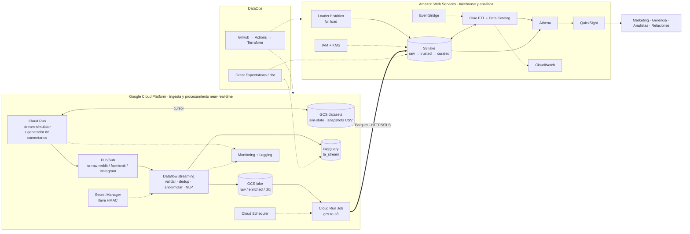

# TrendAnalyzer · ARCHITECTURE

> Documento maestro de arquitectura y contratos. **Versión vigente: 2.15.**
> Historial de versiones: [`CHANGELOG.md`](CHANGELOG.md) · Plan por fases, trazabilidad HU y estado: [`PLAN.md`](PLAN.md) · Historias de usuario: `HU.md` · Visión general: `README.md`.
> Fuentes de verdad combinadas: `README.md` + `diagramaFINAL.drawio` + decisiones de este documento.

---

## 0. Cómo usar este documento

Este archivo está pensado para que **baste con leerlo (o pegármelo) para construir cualquier pieza del proyecto sin tener que enviar el código ya hecho**.

| Si quieres… | Lee |
|---|---|
| Entender la decisión central y el delta contra el diagrama | §1.1–§1.3 (historial de versiones: `CHANGELOG.md`) |
| Ver el panorama completo | §2 |
| Entender cómo funciona el simulador | §3 (el generador y `src/common/`: §3.2.1 y §3.2.2) |
| Saber **cómo hablarle a cada componente** (formatos, nombres, topics, tablas, IAM) | **§5 (contratos)** |
| Saber **cómo se valida cada contrato** y cómo mantener §5 y `contracts/` alineados | **§5.13** |
| Saber **qué infraestructura base existe** y cómo aplicarla (estado remoto, APIs, presupuestos) | **§5.14** |
| Saber qué construir y en qué orden | `PLAN.md` §1 (fases y lotes) |
| Saber qué historias de usuario cubre cada fase o lote | **`PLAN.md` §1 y §2** (detalle en `HU.md`) |
| Saber en qué estado está cada fase y lote | **`PLAN.md` §3** |
| Pedirme el siguiente lote | §8 (plantilla de petición) |

**Regla de oro:** si dos componentes se comunican, su interfaz vive en §5. Si algo no está en §5, no es una interfaz y no debe depender de él ningún otro componente. Cuando una interfaz cambie, se cambia **primero aquí** y luego en el código.

---

## 1. Qué cambia respecto al README y al diagrama FINAL

### 1.1 Decisión central

Reddit, Facebook e Instagram solo se pueden consumir por APIs REST/OAuth (polling), lo que no es streaming real, y además dependen de aprobaciones y límites de acceso: Reddit exige aprobación OAuth, y las APIs de Meta (Facebook/Instagram) exigen revisión de la app y permisos, y no dan acceso libre a la conversación pública de terceros. **Decisión:** las tres fuentes pasan a ser **simuladas**. Cada una pide al **generador de comentarios** (§3.2) un par `marca,comentario` y publica un mensaje a Pub/Sub cada **1–3 s**. El dataset histórico es un **full load** batch directo a S3, generado con el **mismo** generador.

*Evolución:* la v2.0/v2.1 simulaba Mastodon, Reddit y RSS reproduciendo datasets públicos de emociones (TEC, GoEmotions, SemEval, DailyDialog). Se reemplazan porque estaban en inglés, no hablaban de las marcas del negocio y obligaban a inyectarlas artificialmente; el generador ya produce comentarios en español colombiano sobre marcas concretas.

Todo lo que viene después de Pub/Sub (Dataflow, GCS, BigQuery, S3, Glue, Athena, QuickSight) **no cambia de naturaleza**: el pipeline real es idéntico al que tendría con fuentes reales. Lo único falso es el origen del dato.

### 1.2 Delta contra el diagrama FINAL

| Elemento del diagrama FINAL | Cambio en v2 |
|---|---|
| Mastodon / Reddit / RSS → Cloud Run (flechas "Streaming HTTPS", "REST/OAuth2", "HTTPS") | Se eliminan las flechas externas. Los tres orígenes se sustituyen por **Reddit, Facebook e Instagram simulados**. Dentro de GCP aparece **`stream-simulator`** (Cloud Run), que invoca al generador de comentarios y publica a Pub/Sub. |
| Cloud Run (collectors) | Pasa a ser un único servicio always-on `stream-simulator` (§3.1). Los collectors reales (`src/collectors/`) quedan como código legado/opcional. |
| Cloud Scheduler → Cloud Run | Cambia de rol: ya no dispara polling. Dispara el **exportador GCS→S3** cada 15 min (y opcionalmente escenarios de demo, §3.7). |
| Secret Manager (credenciales de APIs) | Ya no guarda tokens de Mastodon/Reddit. Guarda la **llave HMAC de anonimización**. |
| Datasets históricos → S3 | Se mantiene. Se precisa: `scripts/generate_comments.py` / `historical/loader` generan registros con el **mismo generador** y el mismo envelope (§5.2) y los suben a `s3://…/raw/origin=historical/`. |
| *(no existe)* Datasets de emociones en GCS | Ya no se usan (v2.2). El bucket `…-ta-datasets` solo guarda el estado del simulador y snapshots opcionales del generador (§5.4). |
| *(no existe)* GCS → S3 | **Falta en el diagrama.** Se agrega el exportador `gcs-to-s3` (§5.6). Hoy el único camino GCP→AWS dibujado es BigQuery→QuickSight. |
| Flecha huérfana `? → EventBridge` | Sin origen. Se resuelve: EventBridge es un **schedule** que dispara el workflow de Glue (§5.7). |
| BigQuery → QuickSight "Carga batch" | **Verificar** si el conector de QuickSight a BigQuery está disponible para la cuenta. Camino principal recomendado: Parquet en S3 → Athena → QuickSight. BigQuery queda para analítica caliente en GCP. |

### 1.3 Discrepancias README ↔ diagrama FINAL (resueltas)

El README menciona **Firestore, Cloud SQL, Neptune y Dataplex**, que **no están** en el diagrama FINAL. El diagrama manda:

| Servicio del README | Decisión v2 |
|---|---|
| Firestore, Cloud SQL | **Fuera del alcance v1.** El estado del simulador vive en un objeto GCS (§3.6). |
| Neptune | **Fuera del alcance v1.** "Análisis de relaciones" se cubre con tablas de aristas en Curated consultables por Athena (§5.7). Neptune queda como extensión si sobra tiempo. |
| Dataplex / OpenLineage | Catálogo = **Glue Data Catalog**. Linaje = **dbt docs + documento de linaje** (`PLAN.md` §1, Fase 5). |

### 1.4 Historial de cambios

Movido a [`CHANGELOG.md`](CHANGELOG.md): una entrada por versión (v2.2 → v2.15), la más reciente primero. Este documento describe siempre la versión vigente (2.15).

---

## 2. Arquitectura objetivo



**Dos planos, un contrato.** GCP = plano caliente (segundos/minutos). AWS = plano de lakehouse (horas). Ambos hablan el mismo **envelope** (§5.2), por eso el dato histórico y el streaming terminan en la misma tabla Trusted.

---

## 3. El simulador de streaming

### 3.1 Dónde corre (y por qué no EC2)

**Decisión:** **un solo servicio Cloud Run `ta-stream-simulator`**, con `min-instances=1`, `max-instances=1` y CPU siempre asignada (`--no-cpu-throttling`).

- *Por qué no EC2:* publicar a Pub/Sub desde AWS obliga a llevar credenciales de GCP a otra nube y añade latencia/egreso entre nubes. El simulador debe vivir **donde está Pub/Sub**.
- *Por qué Cloud Run y no una VM:* el diagrama ya lo dibuja, ya existe módulo Terraform de Cloud Run y Dockerfiles en el repo, y se despliega/actualiza con una imagen.
- *Por qué `max=1`:* con más de una instancia habría emisiones duplicadas y el cursor se pisaría.
- *Servicio único con 3 workers asyncio* (uno por fuente) en vez de 3 servicios: una sola instancia siempre encendida, un solo costo fijo.
- *Plan B si el costo molesta:* una VM `e2-small` en GCE con el mismo contenedor (ADR-02, §9).

El contenedor expone `GET /healthz` (requisito de Cloud Run) y, opcionalmente, `POST /control/scenario` (§3.7). El resto es un loop de fondo.

### 3.2 El generador de comentarios

El script de Python que ya existe se integra como módulo del simulador (`src/simulator/generator/comment_generator.py`). **No es un servicio aparte**: corre en el mismo proceso del simulador y también se invoca en batch para el histórico (Lote 3.1).

**Contrato mínimo de salida** (CSV UTF-8 o su equivalente en objeto): `marca,comentario`.

```csv
marca,comentario
Postobón,Opinión personal: soy fan d Postobón y no pienso cambiar. Volvería mil veces. 🙌
Pepsi,Mi aporte del día: no tolero Pepsi Cola en el trancón. Mejor me hubiera tomado un agua. Es mi opinión.
Sprite,Vamos al punto: me chifla Sprite sobre todo con el frío de Bogotá. Eso sí es sabor. 🥤
```

> **Salida real desde el Lote 1.1.** El CSV de `scripts/generate_comments.py` trae `marca,comentario,sentimiento[,categoria]` y la columna `marca` lleva la **clave canónica** (`postobon`, no `Postobón`). `sentimiento` queda vacío cuando es `null` (categorías ambiguas). Ejemplo generado con `--seed 7 --categoria`:
>
> ```csv
> marca,comentario,sentimiento,categoria
> postobon,Me encanta Postobón cuando está bien fría. Quedé tan contento que se lo conté a mi novio. ¡Qué viva Postobón!,positive,gusto
> sprite,Dato: en el domicilio pedí una Sprite con carimañolas. Atentos.,neutral,informativo
> pepsi,"Mira, a mi jefe le gusta Pepsi Cola y yo no entiendo cómo. Eso fue una tortura. Cero.",negative,asco
> ```

Lo que se observa en los ejemplos: español coloquial colombiano, jerga, abreviaturas (`d`), emojis, y la marca presente tanto en la columna como en el texto. **No trae** red social, usuario, fecha, engagement ni etiqueta: eso lo añade el simulador (§3.8). Como un comentario puede contener comas, el CSV se escribe siempre con el módulo `csv` (con comillas).

**Cambios propuestos al script** (se pueden ajustar):

| # | Cambio | Por qué | Prioridad |
|---|---|---|---|
| 1 | Exponer `generate(rng, marca=None, sentimiento=None) -> Comentario` como función pura, con un `random.Random` inyectado (sin `random.choice` global) | Determinismo e idempotencia (§3.6) | Requerido |
| 2 | Aceptar `marca` y `sentimiento` opcionales | El simulador controla los pesos de marca en el tiempo (§3.8) y los escenarios de demo (§3.7) | Requerido |
| 3 | Devolver una tercera columna opcional `sentimiento` ∈ `positivo\|negativo\|neutro` (la plantilla ya lo conoce) | *Ground truth* para medir la precisión del NLP (§5.10). Sin ella esa métrica se omite | Recomendado |
| 4 | Normalizar la marca a una clave canónica (`Postobón` → `postobon`) con los alias de `brands.yaml` | Joins y dimensiones estables (`dim_brand`) | Requerido |
| 5 | Ampliar la variedad: más plantillas por marca y sentimiento, aperturas y cierres intercambiables, comentarios neutros/informativos y algunos con dos marcas ("Pepsi vs Postobón") | Menos repetición léxica y relaciones marca–marca para el análisis de grafos | Recomendado |
| 6 | Quitar (si los tiene): `sleep`, bucles infinitos, `print` o escritura directa a archivo, pesos de marca fijos, semilla global | El ritmo, el estado y la selección de marca los controla el simulador | Requerido |
| 7 | Mezclar longitudes (frase corta y 2–3 frases) y conservar el ruido (typos, jerga, emojis) | Los posts de Reddit usan la primera frase como título (§3.8); el ruido ejercita la limpieza en Trusted | Opcional |

**Estado (v2.13):** los siete cambios están hechos en el Lote 1.1 (#1 y #2 en `generate()`, #3 en `Comentario.sentimiento` y la columna del CSV, #4 en `generator/brands.py`, #5 en `generator/templates/`, #6 en el diseño del módulo y #7 en la mezcla de núcleo, contexto y reacciones, más el ruido). Ver §3.2.1 y §3.2.2.

#### 3.2.1 Estado del script real (`generar_comentarios.py`, v3 con plantillas ampliadas)

Ya cumple buena parte del cambio #5 (4 categorías, plantillas generativas, ruido de redes) y su función `construir(rng, marca, cat, …)` ya recibe `rng`, marca y categoría, por lo que se parece mucho a la función pura de los cambios #1 y #2. Puntos que resuelve el Lote 1.1 (HU-008), con la decisión adoptada:

| # | Hallazgo | Decisión (adoptada, ADR-13) | Resultado en el Lote 1.1 |
|---|---|---|---|
| 1 | `MARCAS` trae 5 marcas (Postobon, CocaCola, Sprite, Pepsi, Colombiana); v1 usa 3. | Leer la lista de `brands.yaml` (`postobon`, `pepsi`, `sprite`). CocaCola y Colombiana quedan fuera de v1 y se pueden añadir después. Clave canónica sin tilde (`postobon`), `display` con tilde. | ✅ `config/brands.yaml` con `postobon`, `pepsi` y `sprite`. Los alias y complementos por marca de CocaCola y Colombiana se conservan en `templates/huecos.py`, pero no se usan en v1. |
| 2 | El script no tiene *sentimiento*, solo `categoria` ∈ `gusto\|asco\|nostalgia\|adiccion`. | `gusto → positive`, `asco → negative`, `informativo → neutral` (categoría nueva, fila 3), `nostalgia` y `adiccion → null` (ambiguas, sin ground truth). El parámetro `sentimiento` de `generate()` restringe la categoría (`positive → gusto`, `negative → asco`, `neutral → informativo`). | ✅ El mapeo vive solo en `common/label_map.yaml`; el generador lo lee de ahí. Pasar `sentimiento` restringe la categoría. |
| 3 | No hay comentarios neutros/informativos ni con dos marcas. Sin neutral la precisión del NLP se mide en solo 2 clases. | Añadir una categoría `informativo` (→ `neutral`) y plantillas comparativas ("Pepsi vs Postobón"). Cambio #5, incluido en HU-008 (mínimo 15 plantillas informativas y 15 comparativas). | ✅ 40 plantillas informativas y 18 comparativas de dos marcas. Cerca de 3 de cada 10 comentarios informativos mencionan dos marcas. |
| 4 | `ruido_texto` pasa a minúsculas/mayúsculas, quita tildes y mete *typos* en palabras de más de 4 letras: puede dañar el nombre de la marca ("Postobón" → "Pstoobón"). | `brands[]` = marca elegida (se conoce de antemano) + otras detectadas por alias **normalizados** (sin tildes, sin mayúsculas). Proteger los tokens de marca del *typo*. | ✅ Los alias usados se enmascaran antes del ruido y se restauran después; si aun así se perdiera una marca, se conserva el texto sin ruido. Medido: 0 de 20.000 comentarios con ruido pierden la marca. |
| 5 | Usa un `random.Random(seed)` secuencial (el resultado depende del orden) y `--unico` usa `hash()` de Python (varía entre procesos). | Un `Random(f"{seed}\|{fuente}\|{seq}")` por evento (§3.6). Para unicidad en batch usar `hashlib`. El modo en línea no exige unicidad (§3.5). | ✅ `common.envelope.event_rng(seed, source, seq)`. Mismo resultado con distinto `PYTHONHASHSEED`, probado en subprocesos. `--unico` usa `hashlib`. |
| 6 | Los cierres ya incluyen hashtags (`#Colombia`, `#<marca>`, `#Nostalgia`…), contrario a lo que asume §3.8. | Extraer `hashtags[]` del texto con regex; el simulador solo añade los que falten según la probabilidad por red (§3.8). | ✅ `common.hashtags.extract_hashtags()` devuelve la forma canónica, sin repetidos y en orden de aparición. |
| 7 | CSV en `utf-8-sig`, `-n` por defecto 20 (el docstring dice 2.000.000) y salida solo `marca,comentario[,categoria]`. | `scripts/generate_comments.py` conserva el CLI; la salida pasa a `Comentario(marca, texto, categoria, sentimiento)` y el CSV agrega `sentimiento`. | ✅ CLI con `-n`, `-o` y `--unico` conservados; `-n` por defecto 1000; CSV `marca,comentario,sentimiento[,categoria]` en UTF-8 sin BOM. |

**Marcas** (`src/simulator/config/brands.yaml`). La clave canónica es la que viaja en `brands[]`; hay que registrar cada marca que produzca el generador (v1: `postobon`, `pepsi`, `sprite`):

```yaml
brands:
  postobon:
    display: "Postobón"
    aliases: ["Postobón", "Postobon"]
    role: propia            # confirmado en Fase 0
    facebook_page: "Postobón (sim)"
    instagram_account: "postobon.sim"
  pepsi:
    display: "Pepsi"
    aliases: ["Pepsi", "Pepsi Cola"]
    role: competidor
    facebook_page: "Pepsi (sim)"
    instagram_account: "pepsi.sim"
  sprite:
    display: "Sprite"
    aliases: ["Sprite"]
    role: competidor
    facebook_page: "Sprite (sim)"
    instagram_account: "sprite.sim"
```

**Modos de uso:**
- *En línea:* el bucle de emisión (§3.5) llama a `generate(rng, marca, sentimiento)`.
- *Batch:* `python scripts/generate_comments.py --n 50000 --seed 7 --out comentarios.csv` (histórico y snapshots).

#### 3.2.2 Implementación del generador y de `src/common/` (Lote 1.1)

> Entregado en el Lote 1.1 (HU-008, HU-009). Las rutas son relativas a `project/`. **No se tocó** ninguna interfaz de §5.2–§5.8 ni `contracts/`.

**Qué hay en cada módulo:**

| Ruta | Contenido |
|---|---|
| `src/common/envelope.py` | `event_id(origin, source, seed, seq)` (uuid5, §3.6) · `event_rng(seed, source, seq)` · `format_ts()` / `parse_ts()` (UTC con milisegundos y `Z`) · `build_envelope(...)` · `pubsub_attributes(envelope)` · `normalize_engagement(source, payload)`. Constantes `SCHEMA_VERSION`, `ORIGINS`, `SOURCES`, `SENTIMENTS`, `CHAOS_VALUES`. |
| `src/common/hashing.py` | `user_hash(user_id, secret)` (HMAC-SHA256 en hex, 64 caracteres) e `is_user_hash()`. La llave la recibe como argumento: no la obtiene de Secret Manager. |
| `src/common/hashtags.py` | `normalize_hashtag(raw)` (devuelve la forma canónica o `None`) y `extract_hashtags(text)`. |
| `src/common/label_map.yaml` y `label_map.py` | `map_sentiment()`, `map_emotion()`, `categoria_sentimiento()` y `categorias_para(sentimiento)`. Contiene los mapeos `NEG/NEU/POS`, la emoción (`others` y `neutral` → `neutral`) y la tabla de ADR-13. |
| `src/simulator/config/brands.yaml` | Las 3 marcas de v1, exactamente como en §3.2.1. |
| `src/simulator/generator/brands.py` | `Brands` (`keys`, `canonical(nombre)`, `detect(texto)`), `load_brands(path=None)` y `normalize_text()`. La detección compara alias **normalizados** (sin tildes ni mayúsculas) y no cuenta coincidencias dentro de otra palabra. |
| `src/simulator/generator/comment_generator.py` | `generate(...)`, `Comentario` y `GENERATOR_ID`. |
| `src/simulator/generator/noise.py` | `aplicar_ruido(texto, datos_cat, rng, protegidos)`. |
| `src/simulator/generator/templates/` | Un módulo por categoría (`gusto`, `asco`, `informativo`, `nostalgia`, `adiccion`) y `huecos.py` (huecos compartidos y alias por marca). |
| `scripts/generate_comments.py` | CLI del generador (abajo). |
| `pytest.ini`, `src/conftest.py` | `pythonpath = src`, `testpaths = src` y la fixture `envelope_validator` (valida contra `contracts/`). |

**API del generador:**

```python
generate(rng, marca=None, sentimiento=None, *, categoria=None, ruido=0.20, brands=None) -> Comentario
Comentario(marca, texto, categoria, sentimiento)   # dataclass inmutable
GENERATOR_ID = "comment-gen@1.0"                   # valor de `generator` en el envelope (§5.2)
```

- Es una **función pura**: el único origen de aleatoriedad es el `rng` que se le pasa; no hace `print`, `sleep` ni escribe archivos.
- `marca` acepta clave, `display` o alias (se normaliza a la clave canónica). Con `None` elige una al azar.
- `sentimiento` ∈ `positive|negative|neutral|None` restringe la categoría (ADR-13). Si además se fija `categoria`, debe ser coherente con el sentimiento.
- `ruido` es la probabilidad de aplicar ruido de redes (`0` lo apaga). Ante argumentos inválidos lanza `ValueError`.
- `Comentario.sentimiento` es el *ground truth* que el simulador copia a `sim.label_sentiment`. Para el campo `brands[]` del envelope, el simulador usa la marca elegida más `Brands.detect(texto)` (§3.8).

**CLI** `scripts/generate_comments.py` (se corre desde `project/`):

| Opción | Efecto |
|---|---|
| `-n`, `--n` | Número de filas (por defecto 1000). |
| `-o`, `--out` | Archivo de salida (por defecto `comentarios.csv`). |
| `--seed` | Semilla (por defecto `SIM_SEED` o 7). |
| `--ruido` | Probabilidad de ruido, de 0 a 1. |
| `--marca` | Limita a esas marcas; se puede repetir. |
| `--sentimiento` | Fuerza el sentimiento. |
| `--solo-categoria` | Fuerza la categoría. |
| `--categoria` | Agrega la columna `categoria` al CSV. |
| `--unico` | Evita duplicados exactos (hash con `hashlib`; usa más memoria). |
| `--brands` | Ruta a otro `brands.yaml`. |
| `--bom` | Escribe UTF-8 con BOM, para abrir en Excel de Windows. |

**Parámetros del generador** (constantes al inicio de `comment_generator.py`). Los tres primeros los decidió el Lote 1.1 y están **adoptados por defecto** desde la v2.14 (§5.12, §9 #12):

| Constante | Valor | Efecto |
|---|---|---|
| `PESOS_CATEGORIA` | `gusto` 28 % · `asco` 24 % · `informativo` 18 % · `nostalgia` 15 % · `adiccion` 15 % | Mezcla cuando no se fija sentimiento ni categoría. El ground truth resultante es 28 % `positive`, 24 % `negative`, 18 % `neutral` y 30 % `null`. |
| `P_COMPARATIVA` | 0,30 | Dentro de `informativo`, probabilidad de usar una comparativa de dos marcas (necesita ≥ 2 marcas en `brands.yaml`). |
| Truncado de hashtags | 100 caracteres | `normalize_hashtag()` corta a 100 para respetar el rango 1–100 de §5.2. |
| `DEFAULT_RUIDO` | 0,20 | Probabilidad de ruido por defecto. |
| `P_GENERATIVA` | 0,55 | Frase generativa (`{verbo} {m} {complemento}.`) frente a plantilla fija. |
| `P_CONTEXTO` | 0,40 | Añade una frase de contexto. |

**Medido** (referencia, no es un requisito): sobre 20.000 comentarios, 99,995 % de textos únicos y unos 12.000 comentarios por segundo; dos millones de filas tardan unos 3 minutos. En la máquina de desarrollo con Windows (v2.14), 50.000 filas en 3,5 s.

**Pruebas:** 64 en `src/common/tests/` y `src/simulator/tests/`. Las que usan los schemas (`test_envelope_contract.py` y `test_generator_contract.py`, esta con 1.000 eventos por fuente y caos apagado, §5.12) y la que compara `normalize_hashtag()` con la copia de `contracts/tests/test_contracts.py` se **omiten** si faltan `jsonschema`, `referencing` o `contracts/`.

```bash
# desde project/
pip install pyyaml pytest jsonschema referencing
python -m pytest                         # usa pytest.ini (pythonpath = src); funciona aunque `pytest` no esté en el PATH
python -m pytest contracts/tests -q      # las 18 de siempre, sin cambios
python scripts/generate_comments.py --n 50000 --seed 7 --out comentarios.csv
```

> **Estado de la verificación (v2.14):** `python -m pytest` da **64 passed** y `python -m pytest contracts/tests -q` da **18 passed** (Windows, Python 3.14.7, `jsonschema` 4.26.0). Las pruebas contra los schemas corrieron, no se omitieron. En Windows se usa `python -m pytest` porque `pytest.exe` queda fuera del PATH tras `pip install`. Si una prueba contra los schemas falla en el futuro, el desajuste está entre este código y `contracts/`, no en la lógica del generador.

**Lo que queda para el Lote 1.2:** el `enrich/brands.py` del simulador (pesos de marca en el tiempo, §3.8) **reutiliza** `generator/brands.py` para cargar `brands.yaml`; no es una segunda lectura del archivo.

### 3.3 Reparto por fuente y etiquetas

Cada comentario se publica por **una** red simulada. Las tres comparten el texto del generador y difieren en el `payload` y en la mezcla de tipos:

| Fuente simulada | Naturaleza | `kind` | Contexto simulado |
|---|---|---|---|
| **Reddit** | Foro, hilos | `post` 30% · `comment` 70% | Subreddit de una lista (`r/colombia`, `r/medellin`, …) |
| **Facebook** | Red social, páginas de marca | `post` 15% · `comment` 85% | Página de la marca comentada (`facebook_page` en `brands.yaml`) |
| **Instagram** | Red visual, cuentas de marca | `comment` 100% | Publicación (`media_id`, `media_type`) de la cuenta de la marca (`instagram_account`) |

**Etiquetas de salida del NLP** (ADR-05): `sentiment_label` ∈ `negative|neutral|positive` (el modelo devuelve `NEG/NEU/POS`; se mapea) y `emotion_label` ∈ 7 clases `joy, sadness, anger, fear, disgust, surprise, neutral` (la clase neutra del modelo de emoción se mapea a `neutral`; verificar el nombre exacto de la etiqueta al integrar). El mapeo vive en `src/common/label_map.yaml` (implementado en el Lote 1.1; se usa con `common.label_map.map_sentiment()` y `map_emotion()`, que lanzan `ValueError` ante una etiqueta desconocida).

**Ground truth:** `sim.label_sentiment` ∈ `positive|negative|neutral|null`, tomado de la columna opcional `sentimiento` del generador (cambio #3). Mapeo desde la categoría del script en §3.2.1 #2 (ADR-13): `nostalgia` y `adiccion` → `null`. No hay ground truth de emoción. **No se usa** como feature ni como respuesta del pipeline: solo sirve para medir la precisión del NLP (insumo para la sustentación). El sentimiento y la emoción oficiales los produce el modelo.

### 3.4 Reproducibilidad y snapshots (opcional)

Ya no hay preparación offline obligatoria. Todo el aleatorio sale de una semilla (`SIM_SEED`), de modo que misma semilla + fuente + `seq` ⇒ mismo comentario (con los mismos pesos de marca; los escenarios de §3.7 son la excepción y quedan marcados en `sim.scenario`). Para auditar o repetir una demo se puede guardar un snapshot con `scripts/generate_comments.py` en `gs://{GCP_PROJECT}-ta-datasets/snapshots/` (no se versiona en git).

### 3.5 Bucle de emisión

```
para cada fuente (tarea asyncio independiente):
  seq = leer cursor de sim-state (o 0)
  loop infinito:
     rng = Random(f"{SIM_SEED}|{fuente}|{seq}")                    # §3.6
     marca = elegir_marca(pesos_brands(seq), escenario_activo)     # §3.8
     c = generador.generate(rng, marca=marca, sentimiento=…)       # §3.2
     evento = construir_envelope(c, fuente, seq, rng)              # §3.8
     publicar(topic ta-raw-{fuente}, evento)
     seq += 1
     cada 50 mensajes: guardar cursor
     dormir uniform(1, 3) segundos
```

- Cadencia: ~0.5 msg/s por fuente → ~1.5 msg/s en total (~130k mensajes/día). Trivial para Pub/Sub y Dataflow.
- El generador es inagotable: ya no hay "vueltas" de dataset. El **texto exacto puede repetirse** entre eventos (plantillas); eso **no** es un duplicado, porque `event_id` depende de `seq`. Los duplicados se miden por `event_id`, no por texto.

### 3.6 Identidad, idempotencia y estado

- `event_id = uuid5(NAMESPACE_URL, "{origin}|{source}|{seed}|{seq}")`. Determinista → reenviar tras un reinicio produce el **mismo** id (Dataflow lo deduplica). La semilla forma parte del id: si se cambia, los ids nuevos no chocan con los anteriores.
- Entrega **al menos una vez**. Un reinicio puede repetir hasta 50 mensajes; es aceptable y deduplicable.
- **Cursor** persistido en `gs://…-ta-datasets/sim-state/{source}.json` → `{"seed": 7, "seq": 1207, "updated_at": "…"}`. Si la semilla configurada no coincide con la del cursor, se reinicia en `seq = 0`.
- Implementado en `common.envelope.event_id()` y `event_rng()` (Lote 1.1). Una prueba en subprocesos comprueba que el resultado no cambia con `PYTHONHASHSEED`.
- Todo el aleatorio sale de `random.Random(f"{seed}|{source}|{seq}")`. **No usar `hash()` de Python** para sembrar: varía entre procesos (aleatorización de hash de `str`) y rompería la reproducibilidad.

### 3.7 Escenarios de demo (opcional, Fase 6)

Para mostrar alertas en la sustentación sin esperar una tendencia real:

`POST /control/scenario` `{"brand": "postobon", "sentiment": "negative", "multiplier": 5, "duration_s": 600, "source": "instagram"}` (`source` opcional) → durante ese tiempo el simulador fuerza esa marca y ese sentimiento al generador (p. ej. una ola de comentarios negativos sobre `postobon`), sube la frecuencia y marca los eventos con `sim.scenario`. Cloud Scheduler puede dispararlo. Protegido con ID token de Cloud Run (no público). Requiere el cambio #2 del generador (§3.2).

### 3.8 Qué se inventa (campos sintéticos)

El **texto, la marca y (opcionalmente) el sentimiento** vienen del generador. Todo lo demás se simula en `src/simulator/enrich/`:

| Campo | Cómo se genera |
|---|---|
| **Selección de marca** | El simulador elige la marca con **pesos de `brands.yaml` que varían con `seq`** (ciclos suaves con deriva, para crear tendencias reproducibles) y se la pasa al generador. `brands[]` = marca elegida + otras marcas de `brands.yaml` detectadas por alias en el texto (p. ej. comentarios que comparan dos marcas). Es `[]` solo si el texto no menciona ninguna. |
| **Usuarios** | Pool estable por fuente (~2.000 usuarios, semilla fija, `Faker('es_CO')`). Actividad tipo Zipf (pocos publican mucho). Mismo pool en stream e histórico → los usuarios se repiten y se pueden unir/analizar relaciones. |
| **Handle** | Estilo por red: Reddit `u/usuario`; Facebook nombre visible (`María Gómez`); Instagram `@usuario_89`. |
| **Seguidores** | Lognormal por usuario (estable). Facebook: amigos/seguidores; Instagram: seguidores; Reddit: aproximación (karma). |
| **Engagement** | Reddit: `score` / `upvote_ratio` / `num_comments`. Facebook: reacciones (total y desglose `like/love/haha/wow/sad/angry`), `shares_count`, `comments_count`. Instagram: `like_count`, `comments_count` (sin shares). Escalado por seguidores, con leve impulso para sentimiento extremo y, en Facebook, un sesgo leve del desglose de reacciones según `label_sentiment` cuando existe. Se interpreta como *snapshot* al momento de la recolección. |
| **Fechas** | `event_time` = instante de emisión − lag aleatorio (0–5 s). `ingest_time` = instante de publicación. Siempre UTC. |
| **Hashtags** | El generador ya inserta algunos en los cierres (`#Colombia`, `#<marca>`…): se extraen del texto con regex a `hashtags[]` (§3.2.1 #6). El simulador añade 1–2 más derivados de la marca y del sector (`#Postobon`, `#Colombia`) con probabilidad por red (por defecto Instagram ~60%, Facebook ~15%, Reddit ~0%) solo si faltan, los agrega al final del texto y los registra en `hashtags[]`, en su **forma canónica**: minúsculas, sin `#`, sin tildes, solo `[a-z0-9_]`, sin repetidos y en orden de aparición (el texto conserva el hashtag tal como se escribió: `#Postobón` ⇒ `"postobon"`). Configurable en `sim.yaml`. La extracción y la normalización están en `common/hashtags.py` (`extract_hashtags`, `normalize_hashtag`; Lote 1.1). |
| **Subreddit / página / cuenta** | Reddit: lista de subreddits. Facebook: `facebook_page` de la marca. Instagram: `instagram_account` de la marca y `media_type` aleatorio. URLs ficticias (`sim.local`). |
| **`kind` y `parent_id`** | Según §3.3. Un `comment` de Reddit o Facebook lleva el `parent_id` de un post reciente simulado. |

> **Limitación honesta (para el informe):** los comentarios salen de plantillas y la marca/sentimiento están controlados por el simulador, así que la asociación marca→sentimiento es artificial y el vocabulario es acotado (las métricas de NLP serán optimistas). El objetivo es **ingeniería de datos** (ingesta, calidad, linaje, latencia), no conclusiones de negocio válidas.

### 3.9 Caos controlado (para que Calidad tenga qué medir)

Activable con `SIM_CHAOS_ENABLED=true`. Tasas configurables en `sim.yaml`:

| Defecto | Tasa por defecto | Qué ejercita |
|---|---|---|
| Duplicado (re-publica mismo `event_id`) | 0.5% | KPI Unicidad / Duplicados |
| Evento tardío (`event_time` −2 a −30 min) | 1% | Ventanas, watermarks, latencia |
| Campos opcionales nulos (`lang`, `followers`) | 1% | KPI Completitud |
| Mensaje malformado (JSON roto o falta campo requerido) | 0.2% | Validación + DLQ |

Hay que poder apagarlo para medir la línea base de los KPIs.

### 3.10 Implementación del núcleo del simulador (Lote 1.2)

> Entregado y cerrado en el Lote 1.2 (HU-010 a HU-015), v2.15. Rutas relativas a `project/src/simulator/`. No toca §5.2–§5.8 ni `contracts/`; solo amplía §5.1 con variables propias del simulador.

| Ruta | Contenido |
|---|---|
| `config/sim.yaml` | Cadencia (1–3 s), lag (0–5 s), `checkpoint_every` (50), mezcla de `kind` por red, pesos de marca por `seq`, hashtags por red, pool de usuarios, subreddits, medias de Instagram y tasas de caos. |
| `sim_config.py` | `load_config()` / `config_from_dict()`: lee y valida `sim.yaml`; `SIM_SEED` y `SIM_CHAOS_ENABLED` lo pisan. |
| `enrich/brands.py` | `BrandSelector` (pesos deterministas por `seq` = base × ciclo × deriva), `brands_in_text()`, `add_hashtags()`, `first_sentence()`. Reutiliza `generator/brands.py`. |
| `enrich/users.py` | `UserPool`: 2.000 usuarios por fuente con `Faker('es_CO')` y semilla fija `users.pool_seed` (1581, independiente de `SIM_SEED`), actividad Zipf (s = 1,1), seguidores lognormales. `user_id` = `u_{n:06d}` con un rango por fuente (reddit 0–1999, facebook 2000–3999, instagram 4000–5999). |
| `enrich/engagement.py` | Métricas por red (§3.8), con impulso para sentimiento extremo y sesgo de reacciones en Facebook según `label_sentiment`. |
| `enrich/chaos.py` | `plan()` decide los defectos con un `Random("{seed}\|{source}\|{seq}\|chaos")` propio: encender el caos no cambia texto, marca ni `event_id`. |
| `factory.py` | `EventFactory.make(source, seq, now, scenario=None) -> Emission` (envelope + mensajes Pub/Sub). `Scenario` queda listo para el Lote 6.3. |
| `state.py` | `Cursor` y almacenes `GcsStateStore`, `LocalStateStore` (escritura atómica) y `MemoryStateStore`; `resume_seq()`. |
| `publisher.py` | `PubSubPublisher` (respeta `PUBSUB_EMULATOR_HOST`), `StdoutPublisher`, `MemoryPublisher` y `SourceWorker` (bucle de §3.5; reintenta el mismo `seq` con *backoff* si falla la publicación). |
| `app.py` | Tres workers asyncio + HTTP mínimo: `GET /healthz` (200 con `seq` y contadores por fuente; 503 si un worker cayó) y `POST /control/scenario` → 501 hasta el Lote 6.3. Guarda los cursores al recibir `SIGTERM`. |

**Determinismo.** Misma semilla + fuente + `seq` ⇒ mismo `event_id`, texto, marca, usuario, hashtags y payload; solo `event_time` e `ingest_time` dependen del reloj. Orden fijo de extracciones del `Random` del evento: tipo → marca → contexto → usuario → generador → hashtags → lag → padre → engagement → flair. Las tres primeras se repiten sin estado (`EventFactory.peek`) para enlazar cada `comment` con un **post real reciente** de la misma fuente (en Facebook, de la misma marca; en Reddit hereda su subreddit); si aún no hay ninguno, apunta a un post preexistente simulado (`sim-post-pre-{marca}` o un `t3_` fijo). La pausa entre mensajes usa `Random("{seed}\|{source}\|{seq}\|sleep")`. Verificado con distintos `PYTHONHASHSEED`.

**Caos.** `duplicate` re-publica la misma copia con `sim.chaos = ["duplicate"]` (el original no lleva la marca); `late` resta 2–30 min a `event_time`; `null_fields` pone `lang` y/o `author.followers` en `null`; `malformed` (exclusivo) envía JSON truncado o el envelope sin uno de `event_time`, `text`, `source`, `author` o `payload`, con los atributos Pub/Sub intactos para que Dataflow lo mande a la DLQ.

**Identificadores sintéticos.** Reddit: `t3_`/`t1_` + 7 caracteres base 36; Facebook: `post_id` = `sim-post-{seq:06d}` del post, `comment_id` = `{página}_{evento}` (10 + 10 dígitos); Instagram: `comment_id` y `media_id` de 17 dígitos, una media nueva por cuenta cada 40 `seq` y el comentario va a una de las 3 últimas.

**Pruebas** (`tests/`): determinismo, reanudación del cursor (cada 50, al parar y tras una caída simulada, con los mismos ids), cambio de semilla ⇒ `seq = 0`, mezcla de `kind`, invariantes de payload, enlace a padres, Zipf, tasas de caos, `/healthz` y `test_simulator_contract.py` (1.000 eventos por fuente contra `contracts/*.schema.json`, caos apagado; se omite si faltan los schemas).

> **Estado de la verificación (v2.15):** desde la raíz del repo, `python -m pytest -c project/pytest.ini -rs` da **134 passed, 0 omitidas** (incluye `test_simulator_contract.py` contra los `contracts/` reales) y `python -m pytest project/contracts/tests -q` da **18 passed**. Entorno: WSL (Ubuntu) con un entorno virtual; las dependencias se instalan con `python -m pip install -r project/src/simulator/requirements.txt pytest jsonschema referencing`. La corrida tarda unos 3 minutos con el repo en `/mnt/c` (OneDrive); es la lentitud del sistema de archivos, no del código.

---

## 4. Flujo extremo a extremo

| # | Etapa | Componente | Entrada | Salida | Latencia objetivo |
|---|---|---|---|---|---|
| 1 | Emisión | `stream-simulator` (+ generador de comentarios) | Comentario `marca,comentario` generado en proceso | Mensaje Pub/Sub `ta-raw-{source}` | 1–3 s entre mensajes |
| 2 | Validación + dedup | Dataflow | Pub/Sub | Válidos continúan; inválidos → `ta-dlq` + `gs://…/dlq/` | segundos |
| 3 | Anonimización | Dataflow | Envelope con `author.user_id/handle` | `author.user_hash` (HMAC); sin handle ni id en claro | segundos |
| 4 | Normalización | Dataflow | `payload` específico de red | `likes/shares/comments` normalizados | segundos |
| 5 | NLP | Dataflow (`RunInference`) | `text` | `sentiment_*`, `emotion_*` | segundos |
| 6 | Escritura | Dataflow | Evento enriquecido | BigQuery `posts_enriched` + GCS `raw/` y `enriched/` | < 1 min |
| 7 | Tendencias | Dataflow (ventanas) | Eventos enriquecidos | BigQuery `trend_windows` | **< 5 min** (KPI) |
| 8 | Exportación | `gcs-to-s3` | GCS `enriched/` | S3 `raw/origin=stream/` | cada 15 min |
| 9 | Carga histórica | `historical/loader` (mismo generador, en batch) | Comentarios generados con semilla propia | S3 `raw/origin=historical/` | one-shot |
| 10 | Raw → Trusted | Glue | S3 `raw/` | S3 `trusted/posts/` | horario |
| 11 | Trusted → Curated | Glue/dbt | `trusted/` | S3 `curated/*` | horario |
| 12 | Consulta | Athena → QuickSight | `curated/` | Dashboards | **< 3 s** (KPI) |

---

## 5. Contratos de comunicación

> Esta es la sección que hace innecesario enviarme código. Cada subsección = una interfaz.

### 5.1 Convenciones globales

**Variables de entorno comunes** (todo código las lee del entorno; nada hardcodeado):

| Variable | Valor por defecto / ejemplo | Usada por |
|---|---|---|
| `ENV` | `dev` | todos |
| `GCP_PROJECT` | `project-0568d9ba-848f-413c-88b` *(confirmado; nombre `proyectoDatos`, número `63567159332`)* | simulador, Dataflow, exportador |
| `GCP_REGION` | `us-central1` *(ADR-12)* | idem |
| `AWS_REGION` | `us-east-1` *(confirmada)* | exportador, loader, Glue |
| `AWS_ACCOUNT_ID` | `648617469176` *(confirmado; va en `terraform.tfvars`, no en el código)* | Terraform, exportador, loader |
| `TA_HMAC_SECRET_NAME` | `ta-hmac-key` | Dataflow, loader |
| `SIM_SEED` | `7` | simulador, loader histórico |
| `SIM_CHAOS_ENABLED` | `false` | simulador (§3.9) |

**Variables propias del simulador** (Lote 1.2, §3.10). Solo las lee `ta-stream-simulator`; ningún otro componente depende de ellas.

| Variable | Valor por defecto | Uso |
|---|---|---|
| `PORT` | `8080` | Puerto HTTP (lo fija Cloud Run). |
| `SIM_SOURCES` | `reddit,facebook,instagram` | Fuentes a emitir. |
| `SIM_PUBLISHER` | `pubsub` | `pubsub` · `stdout` · `memory`. Con el emulador basta `PUBSUB_EMULATOR_HOST`. |
| `SIM_STATE_BACKEND` | `gcs` | `gcs` · `local` · `memory`. |
| `SIM_STATE_BUCKET` | `{GCP_PROJECT}-ta-datasets` | Bucket del cursor (§5.4). |
| `SIM_STATE_DIR` | `.sim-state` | Carpeta del cursor con `local`. |
| `SIM_TOPIC_TEMPLATE` | `ta-raw-{source}` | Nombre del topic (§5.3). |
| `SIM_CONFIG` | `src/simulator/config/sim.yaml` | Otra configuración. |
| `SIM_MAX_EVENTS` | sin límite | Corta cada worker tras N eventos (pruebas locales). |

**Nombres:** prefijo `ta-` en todos los recursos. Labels/tags: `project=trend-analyzer`, `env=dev`, `owner=alejandro`. En AWS se aplican con `default_tags` del proveedor; en GCP, con `labels` en los recursos que los admiten (el bucket de estado lo hace; `google_project_service`, el presupuesto y los canales de notificación no). El bucket de estado de GCP es una excepción de nombre: `{GCP_PROJECT}-ta-tfstate` (§5.14).
**Código:** Python 3.11, type hints, `pytest`, logs JSON a stdout, configuración por env vars + YAML, cero secretos en el repo.
**Terraform:** ≥1.6, proveedores `hashicorp/google ~> 6.0` y `hashicorp/aws ~> 5.0`. Un módulo por recurso lógico en `infra/{gcp,aws}/modules/`, entornos en `infra/{gcp,aws}/environments/dev/` y un directorio `bootstrap/` por nube (estado local, se aplica una vez; §5.14). Cada raíz (bootstrap y entorno) expone `outputs.tf` (§5.9); los módulos declaran sus outputs junto a su `main.tf`.
**Tiempo:** todo en **UTC**, ISO-8601 con milisegundos y `Z`.
**Autenticación de Terraform (dev):** en AWS, el proveedor `hashicorp/aws` usa las credenciales del perfil local de AWS CLI (`aws configure`, o `AWS_PROFILE`), sin claves en el código ni en el repositorio; además el proveedor lleva `allowed_account_ids` y se detiene si el perfil apunta a otra cuenta. En GCP usa Application Default Credentials, sin llaves JSON: `gcloud auth login`, `gcloud config set project project-0568d9ba-848f-413c-88b`, `gcloud auth application-default login` y `gcloud auth application-default set-quota-project project-0568d9ba-848f-413c-88b`. La cuenta de Alejandro debe ser Owner o Editor del proyecto. La autenticación en CI se define en el Lote 7.1.

**Contratos:** §5 es la fuente de verdad; `project/contracts/` es su copia ejecutable y verificada por pruebas (§5.13).

### 5.2 Envelope canónico (v1.0)

Todo evento —de stream o histórico, de cualquier fuente— tiene esta forma al salir del simulador/loader. Es el **contrato más importante del proyecto**.

```json
{
  "schema_version": "1.0",
  "event_id": "7d1c3f9e-…",
  "origin": "stream",
  "source": "reddit",
  "generator": "comment-gen@1.0",
  "seq": 1207,
  "event_time": "2026-10-17T14:03:11.482Z",
  "ingest_time": "2026-10-17T14:03:13.020Z",
  "author": {
    "user_id": "u_000481",
    "handle": "u/mariag_89",
    "followers": 412
  },
  "text": "Opinión personal: soy fan d Postobón y no pienso cambiar. Volvería mil veces. 🙌",
  "lang": "es",
  "brands": ["postobon"],
  "hashtags": [],
  "payload": { },
  "sim": {
    "label_sentiment": "positive",
    "scenario": null,
    "chaos": []
  }
}
```

| Campo | Tipo | Req. | Notas |
|---|---|---|---|
| `schema_version` | string | ✔ | `"1.0"`. Cambia solo con cambio incompatible. |
| `event_id` | string (UUID) | ✔ | Ver §3.6. Clave de deduplicación. |
| `origin` | enum `stream`\|`historical` | ✔ | |
| `source` | enum `reddit`\|`facebook`\|`instagram` | ✔ | **Red social simulada**, también en histórico. |
| `generator` | string | ✔ | Nombre y versión del generador de comentarios (`comment-gen@1.0`). |
| `seq` | int | ✔ | Posición del evento en la secuencia de su fuente (§3.5). |
| `event_time` | timestamp | ✔ | Cuándo "se publicó". |
| `ingest_time` | timestamp | ✔ | Cuándo se emitió. |
| `author.user_id` | string | ✔ | Estable. **Solo existe hasta Dataflow/loader.** |
| `author.handle` | string | ✔ | **Solo existe hasta Dataflow/loader.** |
| `author.followers` | int | – | Puede ser nulo (caos §3.9). |
| `text` | string | ✔ | Texto plano (comentario del generador + hashtags añadidos, §3.8). |
| `lang` | string | – | `es` en v2.2. |
| `brands` | string[] | ✔ | Puede ser `[]`. Claves de `brands.yaml`. |
| `hashtags` | string[] | ✔ | Puede ser `[]`. Forma canónica: minúsculas, sin `#`, sin tildes, solo `[a-z0-9_]` (1–100), sin repetidos y en orden de aparición en el texto (§3.8). |
| `payload` | objeto | ✔ | Específico de red (abajo). |
| `sim.*` | objeto | ✔ | `label_sentiment` (`positive`\|`negative`\|`neutral`\|`null`), `scenario` (string o `null`) y `chaos` (lista). Ground truth y trazas. **Nunca se usa como feature.** |

**`payload` por fuente:**

```json
// source = "reddit"
{ "reddit_id": "t1_k3x9a1", "kind": "comment", "subreddit": "r/colombia",
  "title": null, "parent_id": "t3_j8f2ds", "score": 27, "upvote_ratio": null,
  "num_comments": null, "permalink": "/r/colombia/comments/j8f2ds/_/k3x9a1/", "flair": null }

// source = "facebook"
{ "comment_id": "1029384756_5647382910", "kind": "comment", "page_id": "sim-page-postobon",
  "page_name": "Postobón (sim)", "post_id": "sim-post-000812", "parent_id": "sim-post-000812",
  "reactions_total": 14,
  "reactions": { "like": 9, "love": 3, "haha": 1, "wow": 0, "sad": 0, "angry": 1 },
  "shares_count": 2, "comments_count": 3,
  "permalink": "https://sim.facebook.local/postobon/posts/000812" }

// source = "instagram"
{ "comment_id": "17912345678901234", "kind": "comment", "media_id": "17855544433322211",
  "media_type": "IMAGE", "account_username": "postobon.sim", "parent_id": null,
  "like_count": 31, "comments_count": 4,
  "permalink": "https://sim.instagram.local/p/000812/" }
```

Los campos imitan el estilo de cada red (Reddit API, Graph API de Meta) pero son simulados. En Facebook, cuando `kind = "post"`, `parent_id` es `null`. `media_type` ∈ `IMAGE`\|`VIDEO`\|`CAROUSEL_ALBUM`.

**Envelope enriquecido** (lo que sale de Dataflow / loader hacia BigQuery y S3) = envelope **menos** `author.user_id`, `author.handle`, **más**:

```json
{
  "author": { "user_hash": "9a4c…(HMAC-SHA256 hex)", "followers": 412 },
  "likes": 27, "shares": null, "comments": null,
  "sentiment_label": "positive", "sentiment_score": 0.93,
  "emotion_label": "joy", "emotion_score": 0.88,
  "nlp_model_version": "robertuito-sentiment@<hash>+robertuito-emotion@<hash>",
  "process_time": "2026-10-17T14:03:13.900Z"
}
```

Normalización de engagement: `likes` = `score` (Reddit) | `reactions_total` (Facebook) | `like_count` (Instagram); `shares` = `shares_count` (Facebook) | `null` (Reddit, Instagram); `comments` = `num_comments` (Reddit) | `comments_count` (Facebook, Instagram).

**Reglas de validación.** Las aplica `contracts/` además de los tipos de arriba (§5.13):

| Campo | Regla |
|---|---|
| `event_time`, `ingest_time`, `process_time` | UTC, ISO-8601 con **milisegundos** y `Z` (`2026-10-17T14:03:11.482Z`). Sin milisegundos o con otra zona se rechazan. |
| `event_id` | UUID en minúsculas, calculado con la fórmula de §3.6. |
| `generator` | `nombre@versión`, p. ej. `comment-gen@1.0`. |
| `brands[]` | Claves canónicas `[a-z0-9_]+`, sin repetidos. |
| `hashtags[]` | Forma canónica descrita arriba. La función de referencia es `normalize_hashtag()` (en `contracts/tests/test_contracts.py`); el simulador la implementa en `src/common/hashtags.py` (Lote 1.1, entregado) y una prueba comprueba que ambas coinciden. |
| `text` | No vacío. |
| `lang` | Dos letras minúsculas (`es`) o `null`. |
| `author.followers` | Entero ≥ 0 o `null`. |
| `sim.chaos` | Lista sin repetidos; valores `duplicate`, `late`, `null_fields`, `malformed` (§3.9). |
| Campos no definidos | El envelope, `author` y `sim` los rechazan. |

**Invariantes por fuente y `kind`:**

| Fuente · `kind` | Regla |
|---|---|
| Reddit · `post` | `reddit_id` empieza por `t3_`; `title` no vacío; `parent_id` `null`; `upvote_ratio` (número) y `num_comments` (entero) presentes. |
| Reddit · `comment` | `reddit_id` empieza por `t1_`; `parent_id` es texto; `title`, `upvote_ratio` y `num_comments` son `null`. |
| Facebook · `post` | `parent_id` `null`. |
| Facebook · `comment` | `parent_id` es texto. |
| Instagram | `kind` es siempre `comment`; `media_type` ∈ `IMAGE`\|`VIDEO`\|`CAROUSEL_ALBUM`. |

**Reglas del envelope enriquecido:**
- `author` solo contiene `user_hash` (hex de 64 caracteres) y `followers`. Si aparece `handle` o `user_id`, se rechaza.
- `sentiment_label` ∈ `negative`\|`neutral`\|`positive` (no se aceptan las etiquetas crudas `NEG/NEU/POS` del modelo); `emotion_label` ∈ las 7 clases de §3.3.
- `sentiment_score` y `emotion_score` ∈ [0, 1].
- `nlp_model_version` tiene la forma `robertuito-sentiment@<hash>+robertuito-emotion@<hash>`. Si se adopta el plan B de ADR-05, se cambia el patrón en el schema y aquí.
- `process_time` es obligatorio.
- `likes` es entero (en Reddit puede ser negativo). `shares` es `null` en Reddit e Instagram y entero en Facebook. `comments` es entero en Facebook e Instagram; en Reddit es entero en posts y `null` en comentarios.

**Implementación de referencia (Lote 1.1, `src/common/`):** `build_envelope()` arma el envelope con las claves en el orden de este documento y rechaza (`ValueError`) lo que se puede comprobar sin el schema (origen, fuente, texto vacío, `generator`, `lang`, `followers`, `brands`, `hashtags`, `sim.chaos`); si no se le pasan `hashtags`, los extrae del texto. `pubsub_attributes()` devuelve los atributos de §5.3, `normalize_engagement()` aplica la normalización de arriba y `user_hash()` calcula `author.user_hash`. Estas funciones no validan contra los schemas: eso lo hacen las pruebas (§5.13).

### 5.3 Pub/Sub

| Recurso | Nombre | Notas |
|---|---|---|
| Topic | `ta-raw-reddit`, `ta-raw-facebook`, `ta-raw-instagram` | Un topic por fuente. |
| Suscripción | `ta-raw-{source}-df` | Pull, consumida por Dataflow. Ack deadline 60 s. |
| Topic DLQ | `ta-dlq` | Mensajes que no pasan validación. |
| Topic alertas | `ta-alerts` | Fase 6. |
| Retención | 7 días | |

- **Cuerpo:** JSON UTF-8 del envelope (§5.2).
- **Atributos del mensaje:** `event_id`, `source`, `origin`, `schema_version`. Dataflow usa `event_id` como `id_label` para deduplicar.
- **Publica:** `sa-simulator`. **Consume:** `sa-dataflow`.
- Sin ordenamiento garantizado (no se necesita).

### 5.4 Google Cloud Storage

| Bucket | Contenido |
|---|---|
| `{GCP_PROJECT}-ta-datasets` | Estado del simulador (cursor) y snapshots opcionales del generador |
| `{GCP_PROJECT}-ta-lake` | Salida de Dataflow |

```
gs://{GCP_PROJECT}-ta-datasets/
  snapshots/comentarios-{seed}-{n}.csv      # opcional: salida de scripts/generate_comments.py (no se versiona en git)
  sim-state/{source}.json                   # cursor del simulador
gs://{GCP_PROJECT}-ta-lake/
  raw/source={s}/dt={YYYY-MM-DD}/hr={HH}/part-*.jsonl.gz     # envelope tal cual llegó (auditoría/replay)
  enriched/source={s}/dt={YYYY-MM-DD}/hr={HH}/part-*.parquet # envelope enriquecido, anonimizado
  dlq/dt={YYYY-MM-DD}/part-*.jsonl.gz
  export-state/watermark.json
```

Particiones por **fecha/hora de proceso**. El Parquet de `enriched/` usa el **esquema plano** de `posts_enriched` (§5.5): `author.user_hash` → `user_hash`, `author.followers` → `followers`, `sim.label_sentiment` → `label_sentiment`, `brands[0]` → `brand_primary`, `payload` como JSON en string. `raw/` conserva el handle simulado (dato sintético, solo para auditoría y replay; acceso restringido). **Solo `enriched/` sale hacia AWS.**

### 5.5 BigQuery

Dataset: `ta_stream` (ubicación = región de GCP).

**`posts_enriched`** — partición por `DATE(event_time)`, clustering `source, brand_primary`.

| Columna | Tipo |
|---|---|
| `event_id` | STRING (único) |
| `origin`, `source`, `generator` | STRING |
| `event_time`, `ingest_time`, `process_time` | TIMESTAMP |
| `user_hash` | STRING |
| `followers` | INT64 |
| `text`, `lang` | STRING |
| `brands` | ARRAY&lt;STRING&gt; |
| `brand_primary` | STRING |
| `hashtags` | ARRAY&lt;STRING&gt; |
| `likes`, `shares`, `comments` | INT64 |
| `sentiment_label` | STRING (`negative`/`neutral`/`positive`) |
| `sentiment_score`, `emotion_score` | FLOAT64 (en [0, 1]) |
| `emotion_label` | STRING (`joy`, `sadness`, `anger`, `fear`, `disgust`, `surprise`, `neutral`) |
| `label_sentiment` | STRING (ground truth, nullable, solo evaluación) |
| `nlp_model_version` | STRING |
| `payload` | JSON |

**`trend_windows`** — ventanas deslizantes de 5 min (paso 1 min) por `brand` × `source`.

| Columna | Tipo |
|---|---|
| `window_start`, `window_end` | TIMESTAMP |
| `brand`, `source` | STRING |
| `n_posts`, `n_negative`, `n_positive` | INT64 |
| `avg_sentiment` | FLOAT64 (media con signo en [-1, 1]: positivo +score, negativo −score, neutro 0) |
| `emotion_counts` | JSON |
| `zscore_volume`, `zscore_sentiment` | FLOAT64 (vs. baseline móvil) |
| `is_alert` | BOOL |

**`dlq_events`** — `received_at`, `source`, `error_type`, `error_detail`, `raw_message` (STRING).
**`dq_results`** — una fila por verificación de calidad ejecutada (§5.10). Partición por `DATE(run_ts)`, clustering `layer, kpi`. Mismo reporte, además, en `s3://…/quality/{run_date}/`.

| Columna | Tipo | Notas |
|---|---|---|
| `run_id` | STRING, obligatorio | Identifica la corrida. |
| `run_ts` | TIMESTAMP, obligatorio | Partición. |
| `layer` | STRING, obligatorio | Capa verificada. Valores propuestos: `stream`, `raw`, `trusted`, `curated` (§9, #8). |
| `table_name` | STRING, obligatorio | |
| `suite` | STRING | Suite de Great Expectations o test de dbt. |
| `check_name` | STRING, obligatorio | |
| `kpi` | STRING | `completitud`, `unicidad`, `duplicados`, `anonimizacion`, `latencia`, `precision_nlp` u `otro` (§5.10). |
| `observed_value`, `threshold` | FLOAT64 | |
| `passed` | BOOL, obligatorio | |
| `details` | JSON | |

### 5.6 Puente GCP → AWS (exportador)

- **Componente:** Cloud Run Job `ta-gcs-to-s3`, disparado por Cloud Scheduler cada 15 min.
- **Lee:** `gs://…-ta-lake/enriched/` con watermark en `export-state/watermark.json`.
- **Escribe:** `s3://{lake_bucket}/raw/origin=stream/source={s}/dt={YYYY-MM-DD}/hr={HH}/{mismo nombre}.parquet`.
- **Idempotente:** si el objeto ya existe en S3 con el mismo tamaño, lo omite. Actualiza el watermark solo tras subir con éxito.
- **Autenticación recomendada:** el ID token OIDC de `sa-exporter` asume el rol AWS `ta-gcp-exporter-role` vía `AssumeRoleWithWebIdentity` (requiere un OIDC identity provider de Google en IAM). Evita llaves estáticas. *Plan B:* usuario IAM con llaves guardadas en Secret Manager (menos seguro).
- **Transporte:** HTTPS/TLS; objetos cifrados con SSE-KMS en destino.

### 5.7 AWS: S3, Glue, Athena, QuickSight

**Bucket:** `ta-{ENV}-{aws_account_id}-lake`

```
s3://…-lake/
  raw/origin={stream|historical}/source={s}/dt={YYYY-MM-DD}/…parquet
  trusted/posts/source={s}/dt={YYYY-MM-DD}/…parquet
  curated/{tabla}/…parquet
  quality/{run_date}/…                      # reportes de Great Expectations
  athena-results/
```

Formato: **Parquet + Snappy**. Particiones registradas con **partition projection** en Athena (sin crawlers, más simple y barato).

- **Raw** (`ta_raw.posts_raw`): rutas `raw/origin=…/source=…/dt=…/hr=…/`; también el histórico escribe `hr`. Claves de partición `part_origin`, `part_source`, `part_dt`, `part_hr` (las columnas `origin` y `source` ya viajan dentro del Parquet). Columnas = las de BigQuery `posts_enriched`.
- **Trusted** (`ta_trusted.posts`): `trusted/posts/source=…/dt=…/`, con `dt = DATE(event_time)` UTC; añade `text_clean`; `source` es partición, no columna.
- DDL en `project/contracts/athena/`, copia verificada de esta sección (§5.13). Las columnas de Curated están definidas abajo.

| Capa | Glue DB | Contenido |
|---|---|---|
| Raw | `ta_raw` | Tal como llega (ya anonimizado). Tabla `posts_raw`. |
| Trusted | `ta_trusted` | Unión stream + histórico, deduplicado por `event_id`, tipos correctos, texto limpio, reglas de calidad aplicadas. Tabla `posts`. |
| Curated | `ta_curated` | Modelo analítico (abajo). |

**Curated (esquema estrella + agregados + aristas):**

Parquet + Snappy en `curated/{tabla}/`. Las llaves foráneas son **naturales** (sin surrogate keys):
- `fact_posts.source` → `dim_source.source`
- `fact_posts.brand_primary` → `dim_brand.brand`
- `fact_posts.user_hash` → `dim_user.user_hash`
- `fact_posts.date_key` → `dim_date.date_key`

Solo `fact_posts` está particionada (por `dt`, con partition projection). Las demás tablas se **regeneran completas** en cada corrida.

| Tabla | Columnas |
|---|---|
| `fact_posts` | Grano = `event_id`. `event_id`, `date_key` (entero `yyyymmdd`), `origin`, `source`, `brand_primary`, `brands[]`, `user_hash`, `event_time`, `likes`, `shares`, `comments`, `sentiment_label`, `sentiment_score`, `emotion_label`, `emotion_score`, `label_sentiment`. Partición `dt` (ver §9, #9). |
| `dim_date` | `date_key`, `full_date`, `year`, `month`, `day`, `iso_week`, `day_of_week` (1 = lunes … 7 = domingo), `is_weekend`. |
| `dim_source` | `source` (`reddit`\|`facebook`\|`instagram`), `display_name`, `kind_mix` (descripción de la mezcla de `kind`, §3.3). |
| `dim_brand` | `brand` (clave de `brands.yaml`: `postobon`, `pepsi`, `sprite`), `display`, `role` (`propia`\|`competidor`). |
| `dim_user` | `user_hash`, `first_seen`, `last_seen`, `n_posts`, `max_followers`. **Nunca** `handle` ni `user_id`. |
| `agg_emotion_by_brand_hour` | Formato largo: `hour_start` (UTC, truncado a la hora), `brand`, `source`, `emotion_label`, `n_posts`. |
| `agg_trend_daily` | `full_date`, `brand`, `n_posts`, `n_negative`, `n_neutral`, `n_positive`, `avg_sentiment` (misma definición que `trend_windows`: con signo, en [-1, 1]). El día es UTC; los dashboards convierten a `America/Bogota` (§5.12). |
| `edges_user_brand` | Arista usuario → marca: `user_hash`, `brand`, `weight` (nº de menciones). |
| `edges_hashtag_cooccurrence` | Arista no dirigida: `hashtag_a`, `hashtag_b`, `weight`; siempre `hashtag_a < hashtag_b`. *(Cubre "análisis de relaciones" sin Neptune.)* |

**Orquestación:** EventBridge `rate(1 hour)` → Glue Workflow `ta-wf-raw-to-curated` (jobs `ta-job-raw-to-trusted`, `ta-job-trusted-to-curated`).
**Athena:** workgroup `ta-analytics`, resultados en `athena-results/`, límite de bytes escaneados por consulta.
**QuickSight:** datasets sobre `ta_curated` vía Athena, **SPICE** para cumplir < 3 s. Acceso por roles (IAM).

### 5.8 Identidades y permisos (mínimo privilegio)

| Identidad | Nube | Permisos |
|---|---|---|
| `sa-simulator` | GCP | `pubsub.publisher` en `ta-raw-*`; `storage.objectUser` en `…-ta-datasets` |
| `sa-dataflow` | GCP | `pubsub.subscriber`; `bigquery.dataEditor` en `ta_stream`; `storage.objectAdmin` en `…-ta-lake`; `secretmanager.secretAccessor` en `ta-hmac-key`; `dataflow.worker` |
| `sa-exporter` | GCP | `storage.objectViewer` en `…-ta-lake`; objeto escritura en `export-state/`; puede emitir OIDC |
| `ta-gcp-exporter-role` | AWS | `s3:PutObject`, `s3:HeadObject`, `kms:GenerateDataKey` solo sobre `raw/origin=stream/` |
| `ta-glue-role` | AWS | R/W en `raw/ trusted/ curated/ quality/`; Glue Catalog; logs |
| `ta-historical-loader` | AWS | `s3:PutObject` en `raw/origin=historical/` (perfil/SSO del desarrollador) |
| `ta-quicksight-role` | AWS | `athena:*` en workgroup `ta-analytics`; lectura `curated/` |

**Estado tras el Lote 1.0:** ninguna de estas identidades existe todavía. El bootstrap no crea service accounts ni roles; las de GCP llegan con el Lote 1.3 y las de AWS con las Fases 3 y 4. Mientras tanto, Terraform opera con las credenciales de Alejandro (§5.1).

### 5.9 Salidas de Terraform (outputs que consumen los demás)

| Módulo | Outputs |
|---|---|
| `infra/gcp` | `topic_names` (map source→topic), `subscription_names`, `datasets_bucket`, `lake_bucket`, `bq_dataset`, `simulator_url`, `service_accounts` (map) |
| `infra/aws` | `lake_bucket`, `glue_db_names`, `athena_workgroup`, `exporter_role_arn`, `glue_role_arn`, `kms_key_arn` |

**Outputs reales tras el Lote 1.0** (el resto de la tabla anterior llega con el Lote 1.3 y la Fase 4):

| Raíz | Outputs |
|---|---|
| `infra/gcp/bootstrap` | `tfstate_bucket`, `enabled_services`, `budget_name` |
| `infra/gcp/environments/dev` | `project_id`, `region`, `labels` |
| `infra/aws/bootstrap` | `tfstate_bucket`, `tflock_table`, `budget_name` |
| `infra/aws/environments/dev` | `aws_region` |

**Valores reales aplicados (Lote 1.0):**

| Output | Valor |
|---|---|
| GCP · `tfstate_bucket` | `project-0568d9ba-848f-413c-88b-ta-tfstate` |
| GCP · `budget_name` | `30693dc9-6ba3-46c3-b1fa-a79083be7785` (UUID asignado por Google) |
| GCP · `enabled_services` | Las 19 APIs de §5.14 |
| GCP · entorno `dev` | `project_id` = `project-0568d9ba-848f-413c-88b`, `region` = `us-central1`, `labels` = `env=dev`, `owner=alejandro`, `project=trend-analyzer` |
| AWS · `tfstate_bucket` | `ta-dev-648617469176-tfstate` |
| AWS · `tflock_table` | `ta-dev-tflock` |
| AWS · `budget_name` | `ta-dev-monthly` |
| AWS · entorno `dev` | `aws_region` = `us-east-1` |

El código **nunca** hardcodea estos valores: los recibe como variables de entorno o de plantilla de Dataflow. Para pedirme algo nuevo, basta darme los `outputs` reales.

### 5.10 Reglas de calidad ↔ KPIs

| KPI | Regla | Dónde se mide |
|---|---|---|
| Completitud ≥ 95% | `event_id, event_time, source, text, user_hash` no nulos; ratio global de no-nulos | GE sobre `trusted/posts` y BigQuery |
| Unicidad ≥ 99% | `event_id` único | idem |
| Duplicados < 1% | `COUNT(*) − COUNT(DISTINCT event_id)` / `COUNT(*)` | idem (medir **en Trusted**, tras dedup) |
| 100% anonimización | No existen columnas `handle`/`user_id`; `user_hash` con regex hex de 64 | GE + test en CI |
| Latencia < 5 min (p95) | `process_time − event_time` en eventos no tardíos | BigQuery + Cloud Monitoring |
| Dashboard < 3 s | Tiempo de carga con SPICE | Prueba manual documentada |
| Precisión NLP *(extra)* | `sentiment_label` vs `label_sentiment` (solo eventos con etiqueta; se excluyen los `null`, §3.2.1 #2) | notebook / dbt model |

Resultados en BigQuery `dq_results` (columnas en §5.5) y `s3://…/quality/`. El valor de `dq_results.kpi` sigue la primera columna de esta tabla (`completitud`, `unicidad`, `duplicados`, `anonimizacion`, `latencia`, `precision_nlp`); el resto, `otro`.

### 5.11 Matriz "si construyes X, necesitas…"

| Si construyes… | Necesitas leer | Me tienes que dar |
|---|---|---|
| Simulador | §3 (incluye §3.2.2 y §3.10), §5.2, §5.3, §5.4 | `outputs` de `infra/gcp`. El generador y `src/common/` ya están en el repo desde el Lote 1.1 |
| Pipeline Dataflow | §5.2, §5.3, §5.4, §5.5, §5.8 | Nombres reales de topics/buckets, región |
| Exportador | §5.4, §5.6, §5.8 | ARN del rol AWS, bucket S3 |
| Loader histórico | §3.2, §3.8, §5.2, §5.7 | Perfil AWS, bucket S3 |
| Jobs de Glue / dbt | §5.2, §5.7, §5.10 | Esquema real de Athena (`SHOW CREATE TABLE`) si ya existe algo |
| Calidad | §5.5, §5.7, §5.10 | — |
| Terraform | §5.1, §5.8, §5.9, §5.14 | Estado actual de `infra/` y `terraform.tfvars` (sin secretos) |
| Aplicar o ampliar la infraestructura base | §5.14 e `infra/BOOTSTRAP.md` | `billing_account_id`, montos de presupuesto y salida de `terraform plan` |
| Dashboard | §5.7 (Curated) | Región de QuickSight |
| Cambiar o validar un contrato | §5.2, §5.13 | — |

### 5.12 Parámetros operativos acordados

Valores por defecto que evitan decidir en cada lote. Se ajustan aquí primero.

| Tema | Valor acordado | HU |
|---|---|---|
| Eventos tardíos en ventanas | *Allowed lateness* de 30 min (cubre el caos de §3.9). Un evento más tardío se escribe en `posts_enriched` pero no recalcula ventanas; contador `late_events`. | HU-023 |
| Arranque en frío del z-score | Sin baseline no hay alertas: `is_alert = false` hasta tener 60 ventanas (1 h). Opcional: sembrar el baseline con `agg_trend_daily` del histórico. | HU-023 |
| Alertas repetidas | *Cooldown* de 15 min por marca × fuente × tipo de alerta. | HU-039 |
| Zona horaria | Almacenamiento en UTC; dashboards en `America/Bogota`. | HU-037 |
| Retención | GCS `raw/` y `dlq/`: 30 días · BigQuery `posts_enriched`: expiración de partición a 90 días (el histórico completo vive en S3) · S3 `athena-results/`: 7 días · Pub/Sub: 7 días. | HU-043 |
| Idempotencia en Glue | Se sobrescriben las particiones `dt` en lugar de añadir: mismo input ⇒ mismo output. | HU-026 |
| Contratos en CI | La salida del generador y del simulador (≥ 1.000 eventos por fuente, caos apagado) se valida contra `contracts/*.schema.json`. La parte del generador ya existe: `src/simulator/tests/test_generator_contract.py` (Lote 1.1). | HU-001, HU-041 |
| Mezcla de categorías del generador | *Adoptado por defecto en v2.14 (§9 #12).* Sin sentimiento ni categoría fijos: `gusto` 28 % · `asco` 24 % · `informativo` 18 % · `nostalgia` 15 % · `adiccion` 15 % (ground truth: 28 % `positive`, 24 % `negative`, 18 % `neutral`, 30 % `null`). Constante `PESOS_CATEGORIA`. | HU-008 |
| Comparativas de dos marcas | *Adoptado por defecto en v2.14.* 30 % de los comentarios `informativo` (`P_COMPARATIVA`), siempre que `brands.yaml` tenga ≥ 2 marcas. | HU-008 |
| Ruido y hashtags del generador | *Adoptado por defecto en v2.14.* Ruido en el 20 % de los comentarios (`DEFAULT_RUIDO`) sin perder nunca la marca; hashtags canónicos truncados a 100 caracteres. | HU-008, HU-009 |
| Secretos | *Pre-commit* con `gitleaks`; `terraform.tfvars` en `.gitignore` y `terraform.tfvars.example` versionado. | HU-041, HU-046 |
| Estado de Terraform | Remoto: GCS con versionado (GCP) y S3 con bloqueo (AWS). | HU-046 |
| Desarrollo local | `docker-compose` con emulador de Pub/Sub + simulador + `DirectRunner`, sin credenciales. | HU-047 |
| Canal de alertas | Correo. Un suscriptor de `ta-alerts` escribe un log estructurado (`severity=WARNING`, `alert=trend`) y una alerta basada en logs de Cloud Monitoring envía el correo mediante un canal de notificación de tipo email. Las direcciones van en `terraform.tfvars` (`alert_emails`, que no se versiona); por ahora el único destinatario es el correo de Alejandro. Sin SMTP ni secretos. | HU-039 |
| Prueba de humo E2E | `scripts/smoke_e2e.py` sigue un evento centinela (`event_id` conocido) desde el simulador hasta `ta_curated.fact_posts` y reporta latencia por etapa. | HU-048 |
| Retención del estado de Terraform | GCS: se conservan las 10 versiones no vigentes más recientes. S3: las versiones no vigentes expiran a los 90 días y los *uploads* multiparte incompletos a los 7. | HU-046 |
| Presupuestos | Solo avisan por correo; no cortan el gasto. GCP: 50 %, 90 % y 100 % del gasto real y 100 % del pronóstico. AWS: 50 %, 80 % y 100 % del gasto real y 100 % del pronóstico. Montos aplicados: 400000 COP (GCP) y 50 USD (AWS) (§9 #10). | HU-046, HU-043 |

### 5.13 Relación con `contracts/` y sincronización

**Regla:** §5 es la fuente de verdad. `project/contracts/` es su copia ejecutable: JSON Schemas, DDL, ejemplos y pruebas. Un cambio de interfaz se hace **primero en §5** y, en el **mismo commit**, en `contracts/` (con `pytest project/contracts/tests -q` en verde).

| Archivo de `contracts/` | Qué fija | Sección |
|---|---|---|
| `envelope.v1.schema.json`, `envelope.enriched.v1.schema.json` | Envelope antes y después de Dataflow/loader, con las reglas de §5.2 | §5.2 |
| `payload.{reddit,facebook,instagram}.schema.json` | `payload` por fuente e invariantes por `kind` | §5.2 |
| `pubsub.attributes.schema.json` | Atributos de `ta-raw-{source}` | §5.3 |
| `bigquery/{posts_enriched,trend_windows,dlq_events,dq_results}.sql` | Las 4 tablas de `ta_stream` | §5.5 |
| `athena/{posts_raw,posts,curated}.sql` | Raw, Trusted y las 9 tablas de Curated | §5.7 |
| `examples/valid/` (14), `examples/invalid/` (31) | Casos que deben pasar y casos que deben fallar | – |
| `tests/test_contracts.py` | 18 pruebas | – |

**Placeholders de despliegue** en las DDL: `{{GCP_PROJECT}}` (BigQuery) y `{{lake_bucket}}` (Athena). Los `${part_dt}` y similares de Athena son variables de partition projection y **no** se sustituyen.

**Qué verifican las 18 pruebas:**
- Los schemas son JSON Schema Draft 2020-12 válidos.
- Todos los ejemplos válidos pasan y todos los inválidos fallan. Los inválidos cubren, entre otros: identidad filtrada en el enriquecido (`handle`, `user_id`), hashtags no canónicos, marca no canónica, timestamps sin milisegundos o no UTC, payload de otra fuente, violaciones de `kind`, score fuera de rango y atributos de Pub/Sub mal tipados.
- Cada combinación fuente × `kind` tiene un ejemplo válido.
- `event_id` sigue la fórmula uuid5 de §3.6.
- El enriquecido es el envelope menos la identidad más el NLP; los atributos de Pub/Sub coinciden con el envelope; la normalización de engagement coincide con §5.2; los hashtags de los ejemplos son canónicos y coinciden con el texto.
- *Fuera de `contracts/tests/`* (Lote 1.1): `src/common/tests/test_envelope_contract.py` valida un envelope armado con `build_envelope()` por cada fuente, y `src/simulator/tests/test_generator_contract.py` valida 1.000 eventos por fuente producidos con el generador. Ambas usan la fixture `envelope_validator` de `src/conftest.py` y se omiten si faltan `jsonschema`, `referencing` o los schemas.
- Coherencia entre capas: las 4 tablas de BigQuery existen; `posts_raw` coincide columna a columna con `posts_enriched`; `posts` es Raw más `text_clean` con `source` como partición; la partition projection cubre cada clave de partición y los valores de Raw coinciden con los enums del envelope; las 9 tablas de Curated y sus llaves foráneas existen; las columnas de BigQuery se derivan del envelope enriquecido.

**Qué no verifican:** que `contracts/` y este documento digan lo mismo. Hoy esa alineación depende de la revisión en el PR.

**Pendiente (recomendado, Fase 5; no bloquea la Fase 0):** una prueba de sincronización que lea los nombres de columna de cada `.sql` y compruebe que aparecen en las tablas de §5.5 y §5.7, para que el CI falle si cambia un lado sin el otro.

### 5.14 Infraestructura base: bootstrap de Terraform (Lote 1.0)

El Lote 1.0 (HU-046) deja lo mínimo para que todo el Terraform posterior use **estado remoto** (ADR-14). Las rutas son relativas a `project/infra/`; la guía de ejecución paso a paso es `BOOTSTRAP.md`.

**Estructura**

```
infra/
├── BOOTSTRAP.md  validate.sh  .gitignore
├── gcp/
│   ├── bootstrap/                 # estado LOCAL; se aplica una vez
│   ├── modules/{project_services,tfstate_bucket,budget}/
│   └── environments/dev/          # estado REMOTO (GCS, prefix env/dev); vacío hasta el Lote 1.3
└── aws/
    ├── bootstrap/                 # estado LOCAL; se aplica una vez
    ├── modules/{tfstate_backend,budget}/
    └── environments/dev/          # estado REMOTO (S3, key env/dev/terraform.tfstate); vacío hasta las Fases 3 y 4
```

**Qué crea cada bootstrap**

| Nube | Recurso | Nombre | Detalle |
|---|---|---|---|
| GCP | APIs del proyecto | (19, abajo) | `disable_on_destroy = false`: destruir Terraform no apaga APIs. |
| GCP | Bucket de estado | `{GCP_PROJECT}-ta-tfstate` | Ubicación = `GCP_REGION`; acceso uniforme; `public_access_prevention = enforced`; versionado; borra versiones archivadas cuando hay 10 más nuevas; `force_destroy = false`; `prevent_destroy`; con labels. |
| GCP | Canal de notificación (uno por correo) | `ta-budget-{correo}` | Tipo `email`, en Cloud Monitoring. |
| GCP | Presupuesto | `ta-budget-{GCP_PROJECT}` | Filtrado por el **número** del proyecto (`63567159332`). |
| AWS | Bucket de estado | `ta-{ENV}-{AWS_ACCOUNT_ID}-tfstate` | Versionado; cifrado SSE `AES256` (no KMS: la llave del lake llega en la Fase 4); bloqueo total de acceso público; política que deniega todo tráfico sin TLS; versiones no vigentes a 90 días; `prevent_destroy`. |
| AWS | Tabla de bloqueo | `ta-{ENV}-tflock` | DynamoDB, `PAY_PER_REQUEST`, clave `LockID` (S), recuperación a un punto en el tiempo, `prevent_destroy` (ADR-15). |
| AWS | Presupuesto | `ta-{ENV}-monthly` | `COST`, mensual, en USD, a nivel de cuenta. |

**APIs de GCP habilitadas** (`gcp/bootstrap`): `serviceusage`, `cloudresourcemanager`, `cloudbilling`, `billingbudgets`, `iam`, `iamcredentials`, `sts`, `compute`, `storage`, `pubsub`, `run`, `cloudscheduler`, `dataflow`, `bigquery`, `secretmanager`, `artifactregistry`, `cloudbuild`, `monitoring` y `logging` (todas `*.googleapis.com`). Quien necesite otra API la agrega a esa lista, no a mano.

**Presupuestos**

| | GCP | AWS |
|---|---|---|
| Moneda | La de la cuenta de facturación (`COP` por defecto; debe coincidir con la de la cuenta) | USD |
| Alcance | Proyecto | Cuenta |
| Umbrales sobre gasto real | 50 %, 90 %, 100 % | 50 %, 80 %, 100 % |
| Pronóstico | 100 % | 100 % |
| Aviso | Correo mediante canales de Cloud Monitoring; además, con `disable_default_iam_recipients = false`, los administradores de la cuenta de facturación | Correo directo a `alert_emails` |
| Monto del ejemplo | `400000` COP | `50` USD |

**Interfaz bootstrap → entornos.** Cada entorno declara un backend parcial y recibe el resto con `terraform init -backend-config=backend.hcl`:

| Nube | Output del bootstrap | Clave de `backend.hcl` | Fijo en el `main.tf` del entorno |
|---|---|---|---|
| GCP | `tfstate_bucket` | `bucket` | backend `gcs`, `prefix = "env/dev"` |
| AWS | `tfstate_bucket` | `bucket` | backend `s3`, `key = "env/dev/terraform.tfstate"`, `encrypt = true` |
| AWS | `tflock_table` | `dynamodb_table` | (además, `region` en `backend.hcl`) |

**Variables de entrada** (los valores reales van en `terraform.tfvars`, que no se versiona; cada raíz trae un `terraform.tfvars.example`):

| Raíz | Variables (valor por defecto entre paréntesis) |
|---|---|
| `gcp/bootstrap` | `project_id`, `project_number`, `region` (`us-central1`), `env` (`dev`), `owner` (`alejandro`), `billing_account_id`, `budget_amount`, `budget_currency` (`COP`), `alert_emails` |
| `gcp/environments/dev` | `project_id`, `region` (`us-central1`), `env`, `owner` |
| `aws/bootstrap` | `aws_account_id`, `aws_region` (`us-east-1`), `env`, `owner`, `budget_usd`, `alert_emails` |
| `aws/environments/dev` | `aws_account_id`, `aws_region` (`us-east-1`), `env`, `owner` |

`billing_account_id`, `budget_amount`, `budget_usd` y `alert_emails` no tienen valor por defecto. `infra/.gitignore` excluye `.terraform/`, el estado, los planes, `terraform.tfvars`, `*.auto.tfvars` y `backend.hcl`, y **sí** versiona los `*.example` y `.terraform.lock.hcl` (hay que hacer *commit* del lock tras el primer `init`).

**Módulos reutilizables**

| Módulo | Variables (por defecto) | Outputs |
|---|---|---|
| `gcp/modules/project_services` | `project_id`, `services` | `enabled_services` |
| `gcp/modules/tfstate_bucket` | `project_id`, `name`, `location`, `noncurrent_versions_to_keep` (10), `labels` | `name`, `url` |
| `gcp/modules/budget` | `project_id`, `project_number`, `billing_account_id`, `amount`, `currency_code`, `alert_emails`, `thresholds` (`[0.5, 0.9, 1.0]`) | `budget_name` |
| `aws/modules/tfstate_backend` | `bucket_name`, `lock_table_name`, `noncurrent_expiration_days` (90) | `bucket_name`, `bucket_arn`, `lock_table_name` |
| `aws/modules/budget` | `name`, `limit_usd`, `alert_emails`, `actual_thresholds` (`[50, 80, 100]`) | `budget_name` |

**Protecciones.** Los buckets de estado y la tabla de bloqueo llevan `prevent_destroy`. El proveedor de AWS usa `allowed_account_ids` (cuenta `648617469176`). El proveedor de GCP usa `user_project_override` y `billing_project` para que Billing Budgets y Monitoring cuenten contra el proyecto. El estado del bootstrap es local y no se versiona: si se pierde, se recupera con `terraform import` de estos recursos.

**Orden de ejecución.** (1) `bash project/infra/validate.sh` (sin credenciales; necesita Terraform ≥ 1.6; corre `terraform fmt -check -recursive` y, en las cuatro raíces, `init -backend=false` + `validate`). (2) `gcp/bootstrap`: `init`, `plan`, `apply`; si falla porque `serviceusage` o `cloudresourcemanager` no están activos, se habilitan con `gcloud services enable` y se repite. (3) `aws/bootstrap`: igual. (4) En cada `environments/dev`: copiar `backend.hcl` y `terraform.tfvars` desde los `*.example`, `init -backend-config=backend.hcl` y `plan` (debe dar **sin cambios**).

**Qué no existe todavía:**
- Service accounts y roles (§5.8): Lote 1.3 en GCP; Fases 3 y 4 en AWS.
- Topics, suscripciones, buckets `…-ta-datasets` y `…-ta-lake`, Cloud Run y BigQuery: Lote 1.3 y Fase 2.
- Secreto `ta-hmac-key`: Lote 2.4.
- Bucket S3 del lake, KMS, Glue, Athena y EventBridge: Fase 4. Federación OIDC GCP → AWS: Lote 3.2.
- Acceso de Miguel y Camila al proyecto GCP: diferido (§9, Fase 0).

**Observaciones para lotes futuros:**
- `alert_emails` ya se usa en los bootstraps para los presupuestos. Cuando el Lote 6.2 cree el canal de alertas de tendencias (§5.12), debe declarar su propia variable en `environments/dev` y reutilizar o referenciar los canales para no duplicar correos.
- El bloqueo con DynamoDB se mantiene para respetar Terraform ≥ 1.6. Con ≥ 1.10 se podría usar `use_lockfile = true` y eliminar la tabla (ADR-15). **Observado al aplicar (v2.12):** el Terraform del equipo es ≥ 1.10 y `init` del entorno AWS avisa `Deprecated Parameter: dynamodb_table`. No bloquea; si se migra, el cambio toca el módulo `tfstate_backend`, el backend de `aws/environments/dev`, `backend.hcl.example` y §5.14 en el mismo commit. Si se sube el mínimo a ≥ 1.10, actualizar también §5.1.
- Recomendado: agregar un `.gitattributes` con `*.sh text eol=lf`, `*.tf text eol=lf` y `*.hcl text eol=lf`, para que `validate.sh` no falle en WSL por finales de línea CRLF de Windows.

---

## 6. Estructura del repositorio (v2)

```
.                                          <- raíz del repositorio
├── README.md
├── .gitignore                             <- incluye terraform.tfvars
├── .pre-commit-config.yaml                <- gitleaks, formato (HU-041)
├── .github/workflows/                     <- CI/CD; debe estar en la raíz y usar working-directory: project
│
├── docs/
│   ├── ARCHITECTURE.md                    <- este archivo: arquitectura y contratos (versión vigente)
│   ├── CHANGELOG.md                       <- historial de versiones (v2.2 → v2.15)
│   ├── PLAN.md                            <- fases y lotes, matriz HU y estado del proyecto
│   ├── HU.md                              <- historias de usuario (HU-001 a HU-048)
│   ├── GLOSSARY.md                        <- glosario del proyecto
│   ├── NOTAS.md                           <- notas de trabajo
│   ├── trend_analyzer_multicloud.drawio   <- diagrama editable (v2.5)
│   └── trend_analyzer_multicloud.jpg      <- exportación del diagrama
│
└── project/                               <- código, contratos e infraestructura (las rutas de este documento son relativas a aquí)
    ├── docker-compose.yml                 <- entorno local: emulador Pub/Sub + simulador (HU-047)
    ├── contracts/                         <- copia legible por máquina de §5 (Fase 0, entregado en v2.7)
    │   ├── README.md  requirements.txt
    │   ├── envelope.v1.schema.json
    │   ├── envelope.enriched.v1.schema.json
    │   ├── pubsub.attributes.schema.json
    │   ├── payload.{reddit,facebook,instagram}.schema.json
    │   ├── bigquery/{posts_enriched,trend_windows,dlq_events,dq_results}.sql
    │   ├── athena/{posts_raw,posts,curated}.sql
    │   ├── examples/{valid,invalid}/
    │   └── tests/test_contracts.py
    ├── infra/                             <- Lote 1.0 entregado (§5.14)
    │   ├── BOOTSTRAP.md                   <- guía de ejecución del bootstrap
    │   ├── validate.sh                    <- fmt + validate sin credenciales
    │   ├── .gitignore                     <- excluye estado, tfvars y backend.hcl
    │   ├── gcp/
    │   │   ├── bootstrap/                 <- estado local: APIs, bucket de estado, presupuesto
    │   │   ├── modules/{project_services,tfstate_bucket,budget}/
    │   │   └── environments/dev/          <- estado remoto (GCS)
    │   └── aws/
    │       ├── bootstrap/                 <- estado local: bucket de estado, tabla de bloqueo, presupuesto
    │       ├── modules/{tfstate_backend,budget}/
    │       └── environments/dev/          <- estado remoto (S3)
    ├── pytest.ini                         <- Lote 1.1: pythonpath = src, testpaths = src
    ├── scripts/
    │   ├── generate_comments.py           <- Lote 1.1: CLI del generador, snapshots CSV / histórico (§3.2.2)
    │   └── smoke_e2e.py                   <- prueba de humo extremo a extremo (HU-048)
    └── src/
        ├── conftest.py                    <- Lote 1.1: fixture envelope_validator (valida contra contracts/)
        ├── common/                        <- librería compartida (Lote 1.1 entregado; el NLP llega en el Lote 2.3)
        │   ├── envelope.py  hashing.py  hashtags.py
        │   ├── label_map.py  label_map.yaml
        │   └── tests/
        ├── simulator/                     <- NUEVO (reemplaza a collectors)
        │   ├── app.py  publisher.py  state.py                <- Lote 1.2 entregado (§3.10)
        │   ├── factory.py  sim_config.py                     <- Lote 1.2: construcción de eventos y carga de sim.yaml
        │   ├── generator/                 <- Lote 1.1 entregado
        │   │   ├── comment_generator.py   <- generate(), Comentario, GENERATOR_ID
        │   │   ├── brands.py  noise.py
        │   │   └── templates/{gusto,asco,informativo,nostalgia,adiccion,huecos}.py
        │   ├── enrich/{users,engagement,brands,chaos}.py    <- Lote 1.2 entregado (enrich/brands.py reutiliza generator/brands.py)
        │   ├── config/brands.yaml         <- Lote 1.1
        │   ├── config/sim.yaml            <- Lote 1.2 entregado
        │   ├── tests/                     <- Lote 1.1: marcas, generador, CLI y contrato del generador · Lote 1.2: núcleo, cursor, caos y contrato del simulador
        │   └── Dockerfile  requirements.txt                  <- requirements.txt: PyYAML (1.1) + Faker y clientes de Pub/Sub y GCS (1.2); Dockerfile en Lote 1.3
        ├── streaming/                     <- Dataflow (Beam)
        ├── historical/                    <- full load (usa el mismo generador)
        ├── exporter/                      <- gcs-to-s3
        ├── lakehouse/{glue_jobs,dbt}/
        ├── quality/                       <- Great Expectations
        └── collectors/                    <- LEGADO: conectores reales Mastodon/Reddit/RSS (no se despliega)
```

**Nota de rutas:** en `docs/` se documenta; en `project/` se construye. Un lote entrega archivos bajo `project/` (p. ej. `project/src/simulator/app.py`); los workflows de CI viven en `.github/workflows/` de la raíz.

`src/common/` evita duplicar lógica: el **mismo** código de anonimización y NLP lo usan Dataflow y el loader histórico (así stream e histórico son comparables).

---

## 7. Plan por fases (lotes)

Movido a [`PLAN.md`](PLAN.md): §1 fases y lotes con sus HU, responsables y marcadores ★ Sprint 2 / Sprint Final, y §2 matriz de trazabilidad Fase · Lote → HU. Los contratos no viven allí: para cualquier interfaz, §5 de este documento.

---

## 8. Protocolo de trabajo conmigo

**Para pedirme un lote, envíame:**

```text
Lote: <fase.lote>  (ej. 2.2)
HU: <HU-xxx cubiertas por el lote, según `PLAN.md` §2>  (ej. HU-020, HU-021)
Contexto: ARCHITECTURE.md adjunto (usa §<secciones de la matriz 5.11>).
Entorno real: <outputs de Terraform / proyecto / región / cualquier valor que cambie>
Restricciones: <opcional: lo que ya existe y no hay que tocar>
Entrégame: archivos completos en las rutas de §6, con tests y comandos para validarlos.
```

**Lo que yo entrego:**
1. Archivos completos en la ruta exacta de §6 (no fragmentos).
2. Pruebas y los comandos para correrlas.
3. La confirmación de **qué criterios de aceptación de cada HU** quedan cubiertos (y cuáles no).
4. Una lista de **"contratos tocados"**: si un lote requiere cambiar §5, lo digo explícitamente y propongo el cambio al documento antes de que el código lo asuma.

**Reglas que me impongo:**
- Si un archivo depende de otro ya existente, uso §5 y **no necesito verlo**.
- Nunca invento nombres de recursos: uso los de §5 o los `outputs` que me pasen.
- Nunca hardcodeo secretos ni IDs; todo va por variable de entorno.

**Reglas para ustedes:**
- Si cambian una interfaz en el código, actualicen §5 en el mismo commit.
- Al cerrar cada lote, marquen el estado en `PLAN.md` §3 (convención en la nota inicial de ese archivo) y en la tabla resumen de `HU.md` al cumplir cada HU.

---

## 9. Decisiones (ADR), riesgos y preguntas abiertas

### Decisiones

| ID | Decisión | Alternativa descartada |
|---|---|---|
| ADR-01 | Fuentes **Reddit, Facebook e Instagram simuladas** con un generador de comentarios en Python | APIs reales (OAuth de Reddit, revisión de app de Meta); datasets de emociones en inglés (v2.1); polling REST |
| ADR-02 | Simulador en Cloud Run (`min=max=1`, CPU always-on). ✅ **Aprobado** | EC2 (cross-cloud); VM en GCE (plan B por costo) |
| ADR-03 | Un servicio con 3 workers, no 3 servicios | 3 servicios always-on (3× costo fijo) |
| ADR-04 | Envelope único para stream e histórico; `origin` distingue | Esquemas separados |
| ADR-05 | NLP en **español** con modelos preentrenados RoBERTuito de pysentimiento: `robertuito-sentiment-analysis` (POS/NEG/NEU) y `robertuito-emotion-analysis` (emoción) | Modelo en inglés (v2.1); traducir comentarios; modelo multilingüe (plan B por evaluar: `cardiffnlp/twitter-xlm-roberta-base-sentiment`) |
| ADR-06 | Anonimización HMAC-SHA256 en el **primer** paso de cada plano (Dataflow / loader) | Anonimizar en AWS (el dato en claro cruzaría de nube) |
| ADR-07 | GCS→S3 con Cloud Run Job + OIDC | Storage Transfer Service / llaves estáticas |
| ADR-08 | Partition projection en Athena | Glue Crawlers |
| ADR-09 | Aristas en Curated en lugar de Neptune | Neptune |
| ADR-10 | Catálogo = Glue Data Catalog; linaje = dbt docs | Dataplex + OpenLineage |
| ADR-11 | Generador de comentarios **integrado en el proceso del simulador** y reutilizado en batch para el histórico; la selección de marca/sentimiento la hace el simulador | Generar un CSV fijo y reproducirlo por vueltas; servicio de generación separado |
| ADR-12 | Región de GCP **`us-central1`** (cuotas de vCPU y Dataflow verificadas en esa región; decidido en v2.10) | `us-east1` (primera elección en v2.4: más cerca de AWS `us-east-1` y de Colombia) |
| ADR-13 | Mapeo `categoria → sentimiento`: `gusto → positive`, `asco → negative`, `informativo → neutral`, `nostalgia` y `adiccion → null` ✅ **Aprobado** | Forzar una etiqueta a las categorías ambiguas (inflaría la precisión del NLP) |
| ADR-14 | Estado de Terraform **remoto** (GCS y S3) desde el primer día | Estado local (se pierde y no permite CI) |
| ADR-15 | Bloqueo del estado en AWS con tabla DynamoDB `ta-{env}-tflock`, compatible con Terraform ≥ 1.6 (adoptado en el Lote 1.0). **v2.12:** con Terraform ≥ 1.10 `init` avisa que `dynamodb_table` está deprecado; sigue funcionando y la migración es opcional | `use_lockfile = true` de S3 (exige Terraform ≥ 1.10; se puede migrar y eliminar la tabla) |
| ADR-16 | *Bootstrap* en un directorio aparte por nube, con estado local, `prevent_destroy` en buckets y tabla, y `allowed_account_ids` en AWS (adoptado en el Lote 1.0) | Bootstrap con estado remoto (dependencia circular); recursos de estado sin protección contra borrado |

### Riesgos

| Riesgo | Mitigación |
|---|---|
| **Tiempo** (dos entregas: Sprint 2 y Sprint Final) | Paralelizar fases 1–3; NLP en Dataflow es lo más arriesgado → fallback: modelo ligero o NLP en Cloud Run con Pub/Sub intermedio |
| **Costo** (Dataflow 24/7 + Cloud Run always-on) | `maxNumWorkers=1–2`, apagar fuera de demos, alertas de presupuesto (Lote 7.3) |
| Dataflow + modelos HF (imagen pesada, memoria; RoBERTuito requiere `pysentimiento` y su `preprocess_tweet`) | Contenedor personalizado, probar local con `DirectRunner` primero; si la memoria no alcanza, correr solo el modelo de sentimiento y dejar la emoción como mejora |
| Federación OIDC GCP→AWS no funciona a tiempo | Plan B con llaves en Secret Manager (documentar como deuda) |
| Licencias de modelos NLP | Uso académico; verificar la licencia de cada modelo en su *model card* (los de pysentimiento se entrenaron con corpus TASS) y citarlos en el informe |
| Modelos entrenados en tweets vs. comentarios con jerga y emojis de Reddit/Facebook/Instagram | Medir contra `label_sentiment`; declarar la limitación en el informe |
| Generador por plantillas: baja variedad léxica y texto repetido | Ampliar plantillas (§3.2 cambio #5); medir duplicados por `event_id` y **no** por texto; reportar la diversidad léxica en el profiling. **v2.13:** plantillas ampliadas en el Lote 1.1 (5 categorías, 40 informativas y 18 comparativas); medido, 99,995 % de textos únicos en 20.000 comentarios |
| Infraestructura desde cero (nada aplicado): retrasa la Fase 1 | Lote 1.0 (HU-046) primero; el simulador se desarrolla en local con el emulador (HU-047) mientras se crea el proyecto. **v2.12:** Lote 1.0 aplicado y verificado (§5.14); el riesgo baja a "mitigado" |
| Falsas alertas al arrancar (z-score sin baseline) | `is_alert = false` hasta 60 ventanas y *cooldown* de 15 min (§5.12) |
| Cuotas de la cuenta de crédito de GCP (p. ej. límite de vCPU) pueden limitar Dataflow con modelos pesados | Verificar cuotas en el Lote 1.0; `maxNumWorkers=1–2`; plan B: NLP en Cloud Run |

### Preguntas abiertas y respuestas (Fase 0)

| # | Pregunta | Respuesta | Estado |
|---|---|---|---|
| 1 | Proyecto/región de GCP y cuenta/región de AWS; estado de `infra/` | AWS `us-east-1`, cuenta `648617469176`. GCP `project-0568d9ba-848f-413c-88b` (nombre `proyectoDatos`, número `63567159332`), región `us-central1` (ADR-12), facturación con crédito a cargo de Alejandro Sepulveda. `infra/` sin nada aplicado al inicio; desde el Lote 1.0 (v2.12) están aplicados los bootstraps de ambas nubes. | ✅ Proyecto, región y cuotas de vCPU y Dataflow verificados en `us-central1`. Facturación verificada en v2.12 (`billingEnabled: true`, cuenta `01CCA0-88151A-A99D15`). El acceso de Miguel y Camila se otorga cuando lo necesiten sus lotes |
| 2 | ADR-02: ¿Cloud Run o VM en GCE? | Sin respuesta explícita: se adopta Cloud Run por defecto. | ✅ Aprobado (plan B en GCE si el costo molesta) |
| 3 | Empresa y marcas simuladas | Postobón (propia), Pepsi y Sprite (competidores). | ✅ El script trae además CocaCola y Colombiana: fuera de v1 (§3.2.1) |
| 4 | Fuentes y cambios al generador; script | Tres fuentes confirmadas. Script compartido. | ✅ Fuentes · ✅ Cambios al generador adoptados (§3.2.1, ADR-13) |
| 5 | Presupuesto para Dataflow en demos | No es preocupación por ahora; se asume disponible. | ✅ (supuesto). Se mantiene el Lote 7.3 como buena práctica |
| 6 | QuickSight y conector a BigQuery | Se asume acceso a QuickSight; conector sin verificar. | 🟨 El camino principal (Athena → QuickSight) no depende del conector |
| 7 | NLP en español (ADR-05) y licencia académica | Aceptados. | ✅ |
| 8 | Valores permitidos de `dq_results.layer` (el DDL no los fija) | Propuesta: `stream`, `raw`, `trusted`, `curated`. | ✅ Aprobado |
| 9 | `fact_posts.dt` (y `date_key`): ¿`DATE(event_time)` UTC o fecha de proceso? | Propuesta: `DATE(event_time)` UTC, igual que Trusted (§5.7). | ✅ Aprobado |
| 10 | Montos de los presupuestos y `billing_account_id` (Lote 1.0) | Valores de ejemplo en `terraform.tfvars.example`: GCP 400000 COP, AWS 50 USD; `billing_account_id` se obtiene con `gcloud billing accounts list`. Destinatario: solo el correo de Alejandro. | ✅ Confirmado y aplicado en v2.12: `billing_account_id` = `01CCA0-88151A-A99D15`; 400000 COP (GCP) y 50 USD (AWS). Se pueden ajustar editando `budget_amount` o `budget_usd` y repitiendo `apply` en el bootstrap (§5.14) |
| 11 | Criterios de aceptación de HU-008 y HU-009 (Lote 1.1) | Revisados contra `HU.md` en v2.15. HU-008: cubiertos todos; el único desvío era el orden de columnas del CSV, que `HU.md` daba como `marca,comentario,categoria,sentimiento` y §3.2.1 #7 había decidido como `marca,comentario,sentimiento[,categoria]` (`categoria` solo con `--categoria`): se alinea `HU.md` con la decisión. HU-009: cubiertos; la validación completa contra los schemas la hacen las pruebas (`build_envelope()` solo valida lo comprobable sin schema, §5.2). | ✅ Cerrado en v2.15. Pendiente aparte (no bloquea): repetir las pruebas en Python 3.11 con el `Dockerfile` (Lote 1.3) |
| 12 | Parámetros del generador que decidió el Lote 1.1 | Mezcla de categorías 28 / 24 / 18 / 15 / 15 %, 30 % de comparativas dentro de `informativo` y truncado de hashtags a 100 caracteres (§5.12; constantes en `comment_generator.py`). | ✅ Adoptados por defecto en v2.14 (sin objeción). Se pueden cambiar editando §5.12 y las constantes |

**Fase 0 cerrada.** Resuelto: proyecto GCP (`project-0568d9ba-848f-413c-88b`), región `us-central1` y cuotas; autenticación de Terraform en GCP (§5.1); revisión de `contracts/` (HU-001); ADR-02, ADR-12 y ADR-13; §9 #8 y #9; solo el correo de Alejandro por ahora. **Diferido (no bloquea):** acceso de Miguel y Camila (HU-046), verificación del conector QuickSight → BigQuery (§9 #6, Lote 6.1) y prueba de sincronización §5 ↔ `contracts/` (Fase 5, §5.13).

---

## 10. Estado del proyecto

Movido a [`PLAN.md`](PLAN.md) §3 (tabla única de estado por fase y lote).