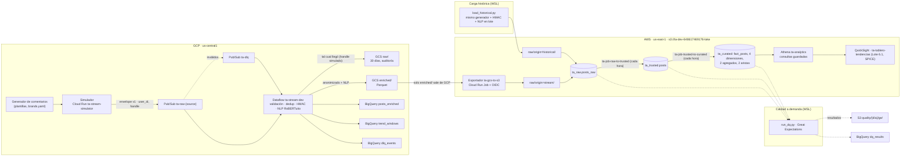

# TrendAnalyzer · Linaje de datos

> **HU-035, Lote 5.3 (v2.43).** Documento y diagrama **hechos a mano**, sin *dbt docs*: el proyecto no usa dbt desde el
> Lote 4.3 (ADR-26) y el usuario decidió el 27-oct-2026 cumplir el linaje así (ADR-10 cerrado por ADR-29,
> `ARCHITECTURE.md` §3.25). Cubre el camino completo **generador de comentarios → simulador → Pub/Sub → Dataflow →
> BigQuery / GCS → S3 → Trusted → Curated → Athena → tablero** y el linaje **por columna** de las 11 tablas del catálogo
> (qué significa cada columna: [`CATALOG.md`](CATALOG.md); gobernanza y privacidad: [`GOVERNANCE.md`](GOVERNANCE.md)).
> `validate_5_3.py local` comprueba que cada columna del catálogo aparece aquí y que las rutas citadas existen.
> Todos los datos son **sintéticos**.

## 1. Diagrama de extremo a extremo

Notas del diagrama: las flechas punteadas son lecturas de la calidad (no cambian los datos); `ta-dlq` lo lee el mismo
job de Dataflow por la suscripción `ta-dlq-df` para escribir `dlq_events`. El exportador está **en pausa** desde el 3.2
(Raw stream no cambia mientras siga así); el horario del lakehouse corre cada hora.

## 2. Etapas

| # | Etapa | Componente y código | Entra | Sale | Qué le hace al dato | Identidad del autor | Detalle |
|---|---|---|---|---|---|---|---|
| 1 | Generar | `project/src/simulator/generator/` (plantillas, ruido, `brands.yaml`) | Semilla y mezcla de categorías | Texto, marcas, hashtags y `label_sentiment` | Inventa el comentario con su sentimiento de verdad | Usuarios de `Faker('es_CO')` (`project/src/simulator/enrich/`) | §3.2, §3.8 |
| 2 | Simular | `project/src/simulator/` · Cloud Run `ta-stream-simulator` | Generador | Envelope v1 (`project/contracts/envelope.v1.schema.json`) | Asigna `event_id`, `seq`, `event_time`, `payload` por red; caos controlado | **En claro:** `author.user_id`, `author.handle` | §3.5–§3.10, §5.2 |
| 3 | Publicar | Pub/Sub `ta-raw-{source}` | Envelope | Mensaje + atributos | Transporte (7 días de retención) | En claro | §5.3 |
| 4 | Procesar | `project/src/streaming/` · Dataflow `ta-stream-dev` | Mensajes | `raw/`, `enriched/`, `posts_enriched`, `trend_windows`, `dlq_events` | Valida contra el contrato, deduplica por `event_id`, **anonimiza** (HMAC-SHA256 de `user_id` con `ta-hmac-key`, `project/src/common/hashing.py`), normaliza engagement, aplana (`project/src/common/enriched_row.py`), NLP RoBERTuito (`project/src/streaming/nlp.py`), ventanas de tendencias | `raw/` de GCS conserva el handle simulado (30 días); **desde aquí solo `user_hash`** | §3.13–§3.16, ADR-06 |
| 5 | Cargar histórico | `project/src/historical/` · `project/scripts/load_historical.py` | Mismo generador con `HIST_SEED = 3101` | `raw/origin=historical/` | Mismo envelope, HMAC y NLP que el stream; un Parquet por fuente y hora de `event_time` | Solo `user_hash` al salir | §3.17 |
| 6 | Exportar | `project/src/exporter/` · Cloud Run Job `ta-gcs-to-s3` | `enriched/` de GCS | `raw/origin=stream/` de S3 | Copia byte a byte (mismo Parquet), SSE-KMS, federación OIDC sin llaves | Solo `user_hash` | §3.18, §5.6 |
| 7 | Raw | Glue Data Catalog `ta_raw.posts_raw` (`project/contracts/athena/posts_raw.sql`) | Los dos orígenes | Tabla de Athena | Ninguna (lectura con partition projection) | Solo `user_hash` | §3.19, §5.7 |
| 8 | Trusted | `project/src/lakehouse/glue_jobs/raw_to_trusted.py` · `ta-job-raw-to-trusted` | `raw/` | `trusted/posts/` = `ta_trusted.posts` | Deduplica (menor `process_time`), quita centinelas, corrige tipos, `text_clean`, reporte con sha256 en `quality/` | Solo `user_hash` | §3.21 |
| 9 | Curated | `project/src/lakehouse/glue_jobs/trusted_to_curated.py` · `ta-job-trusted-to-curated` | `trusted/posts/` | `curated/{9 tablas}` | Estrella, agregados y aristas recalculados enteros; concilia antes de escribir; reporte en `quality/` | Solo `user_hash` (sin `text` ni `payload`) | §3.22, §3.23 |
| 10 | Consultar | Athena `ta-analytics` · `project/src/lakehouse/queries/` | Curated (y Raw) | Resultados en `athena-results/` (7 días) | Consultas guardadas | Solo `user_hash` | §3.19, §3.22.1 |
| 11 | Tablero | QuickSight `ta-tablero-tendencias` sobre `ta_curated` (Lote 6.1): fuente `ta-athena-curated` con `ta-quicksight-role` y 4 datasets SPICE (`src/serving/sql/`) | Curated vía Athena, importado a SPICE | Tablero con las hojas «Tendencias» (HU-037) y «Relaciones» (HU-038) | `quicksight.py deploy`; refresco `ta-cada-hora` | Ningún dataset tiene `user_hash`: las aristas se agregan por marcas dentro del SQL; horas pasadas a `America/Bogota` | §5.7, §3.27 |
| Q | Calidad | `project/src/dq/` · `project/scripts/run_dq.py` (GX 1.24.1) y el profiling `project/src/quality/` | Copia local de Raw, Trusted y Curated | `quality/{día}/ge/{run_id}/`, `ta_stream.dq_results` | Solo lee y resume: 239 comprobaciones sin datos de filas | Las salidas no llevan `user_hash` | §3.20, §3.24 |

## 3. Auditoría: cómo seguir un dato

- **Por evento:** `event_id` es el mismo desde el simulador hasta `fact_posts` (es la clave de deduplicación en Dataflow y en
  Trusted). Con él se encuentra el mensaje en GCS `raw/` (si tiene < 30 días), la fila de `posts_enriched` (< 90 días), el
  Parquet de `raw/` en S3, la fila de Trusted y la de `fact_posts`. Lo hará de forma automática la prueba de humo del 5.4.
- **Por corrida:** cada corrida de los jobs deja su reporte en `quality/{día}/{raw_to_trusted|trusted_to_curated}/{corrida}.json`
  (filas leídas, descartadas y escritas, comprobaciones de conciliación y **sha256 de cada archivo escrito**) y las
  propiedades de la corrida del workflow; la de Great Expectations deja su `run_id` en `dq_results`. Así se sabe qué
  versión del job (`trusted-to-curated@1.1`, `text-clean@1`) produjo cada archivo.
- **Por versión de modelo:** `nlp_model_version` dice con qué modelos y commit se predijo cada fila; las filas del stream
  procesadas antes de 2026-10-22T23:00Z no tienen NLP.

## 4. Linaje por columna

Notación: «=» copia sin cambios; ⟵ indica de dónde sale. Envelope = §5.2 de `ARCHITECTURE.md`.

### `ta_raw.posts_raw`

Viene de `posts_enriched` / `enriched/` (stream, Dataflow) o del loader histórico, con el mismo aplanado (`project/src/common/enriched_row.py`).

| Columna | Viene de | Transformación |
|---|---|---|
| `event_id`, `origin`, `source`, `generator`, `event_time`, `ingest_time`, `text`, `lang`, `brands`, `hashtags` | Envelope (simulador o loader) | = |
| `process_time` | Dataflow (o el loader) | Instante del enriquecimiento |
| `user_hash` | Envelope `author.user_id` | HMAC-SHA256 en hex con `ta-hmac-key`; `user_id` y `handle` se descartan |
| `followers` | Envelope `author.followers` | = (puede ser nulo por el caos) |
| `brand_primary` | Envelope `brands` | `brands[0]` o nulo |
| `likes`, `shares`, `comments` | Envelope `payload` | Engagement normalizado por red (§5.2) |
| `sentiment_label`, `sentiment_score`, `emotion_label`, `emotion_score`, `nlp_model_version` | Envelope `text` | RoBERTuito (pysentimiento) en Dataflow o en lote; nulo si el NLP estaba apagado o falló |
| `label_sentiment` | Envelope `sim.label_sentiment` | = (ground truth del simulador; nunca se usa como feature) |
| `payload` | Envelope `payload` | JSON compacto en texto |
| `part_origin`, `part_source`, `part_dt`, `part_hr` | Ruta de S3 | Particiones: `origin=`, `source=`, `dt=`/`hr=` de proceso (stream) o de `event_time` (histórico) |

### `ta_trusted.posts`

Viene de `ta_raw.posts_raw` (los dos orígenes) por `ta-job-raw-to-trusted`: una fila por `event_id` (la de menor
`process_time`), sin centinelas `ta-verify@*` ni filas sin `event_id`/`event_time`.

| Columna | Viene de | Transformación |
|---|---|---|
| `event_id`, `origin`, `generator`, `event_time`, `ingest_time`, `process_time`, `user_hash`, `followers`, `text`, `lang`, `brands`, `brand_primary`, `hashtags`, `likes`, `shares`, `comments`, `sentiment_label`, `sentiment_score`, `emotion_label`, `emotion_score`, `label_sentiment`, `nlp_model_version`, `payload` | `ta_raw.posts_raw` (misma columna) | = con el tipo de la DDL (filas sin NLP conservadas con NLP nulo) |
| `text_clean` | `ta_raw.posts_raw.text` | Regla `text-clean@1` (§5.7): NFC, sin emojis, URLs, menciones ni hashtags, minúsculas, espacios colapsados |
| `source` | `ta_raw.posts_raw.source` | Pasa a partición (`source=`) |
| `dt` | `ta_raw.posts_raw.event_time` | `DATE(event_time)` en UTC (partición `dt=`) |

### `ta_curated.fact_posts`

| Columna | Viene de | Transformación |
|---|---|---|
| `event_id`, `origin`, `source`, `brand_primary`, `brands`, `user_hash`, `event_time`, `likes`, `shares`, `comments`, `sentiment_label`, `sentiment_score`, `emotion_label`, `emotion_score`, `label_sentiment` | `ta_trusted.posts` (misma columna; `source` de su partición) | = (una fila por fila de Trusted) |
| `date_key` | `ta_trusted.posts.dt` | Entero `yyyymmdd` |
| `dt` | `ta_trusted.posts.dt` | = (partición) |

### `ta_curated.dim_date`

| Columna | Viene de | Transformación |
|---|---|---|
| `date_key`, `full_date`, `year`, `month`, `day`, `iso_week`, `day_of_week`, `is_weekend` | Mínimo y máximo de `ta_trusted.posts.dt` | Calendario continuo generado entre esas fechas |

### `ta_curated.dim_source`

| Columna | Viene de | Transformación |
|---|---|---|
| `source`, `display_name`, `kind_mix` | Constantes del job (= `project/src/simulator/config/sim.yaml`, §3.3) | Tres filas fijas, comprobadas por prueba contra la configuración |

### `ta_curated.dim_brand`

| Columna | Viene de | Transformación |
|---|---|---|
| `brand`, `display`, `role` | Constantes del job (= `project/src/simulator/config/brands.yaml`) y las marcas de `ta_trusted.posts.brands` que no estén | Una fila por marca; `display` y `role` nulos para las desconocidas |

### `ta_curated.dim_user`

| Columna | Viene de | Transformación |
|---|---|---|
| `user_hash` | `ta_trusted.posts.user_hash` | Distintos (sin nulos) |
| `first_seen`, `last_seen` | `ta_trusted.posts.event_time` | Mínimo y máximo por `user_hash` |
| `n_posts` | `ta_trusted.posts` | Filas por `user_hash` |
| `max_followers` | `ta_trusted.posts.followers` | Máximo por `user_hash` |

### `ta_curated.agg_emotion_by_brand_hour`

| Columna | Viene de | Transformación |
|---|---|---|
| `hour_start` | `ta_trusted.posts.event_time` | Truncado a la hora UTC |
| `brand`, `source`, `emotion_label` | `ta_trusted.posts.brand_primary`, `source`, `emotion_label` | Llaves de agrupación (solo filas con emoción) |
| `n_posts` | `ta_trusted.posts` | Conteo por hora, marca, red y emoción |

### `ta_curated.agg_trend_daily`

| Columna | Viene de | Transformación |
|---|---|---|
| `full_date`, `brand` | `ta_trusted.posts.dt`, `brand_primary` | Llaves de agrupación |
| `n_posts` | `ta_trusted.posts` | Todas las filas (también sin NLP) |
| `n_negative`, `n_neutral`, `n_positive` | `ta_trusted.posts.sentiment_label` | Conteo por etiqueta (solo filas con sentimiento) |
| `avg_sentiment` | `ta_trusted.posts.sentiment_label`, `sentiment_score` | Media de +score / −score / 0, 6 decimales (misma definición que `trend_windows`) |

### `ta_curated.edges_user_brand`

| Columna | Viene de | Transformación |
|---|---|---|
| `user_hash`, `brand` | `ta_trusted.posts.user_hash` y cada marca distinta de `brands` | Un par por usuario y marca mencionada (ADR-27) |
| `weight` | `ta_trusted.posts` | Filas del usuario cuyo `brands` contiene la marca |

### `ta_curated.edges_hashtag_cooccurrence`

| Columna | Viene de | Transformación |
|---|---|---|
| `hashtag_a`, `hashtag_b` | `ta_trusted.posts.hashtags` | Pares no dirigidos de hashtags distintos de la misma fila, `hashtag_a < hashtag_b` |
| `weight` | `ta_trusted.posts` | Filas que contienen los dos |

## 5. Análisis de impacto (si cambia X, revisa Y)

| Si cambia… | Afecta a… | Qué hacer |
|---|---|---|
| El envelope (`project/contracts/envelope.v1.schema.json`) | Dataflow, loader, `posts_enriched`, `enriched/`, `ta_raw.posts_raw` y todo lo de abajo | Cambiar §5.2 primero; `schema_version` si es incompatible; DDL, `tables.json` y este documento en el mismo commit (§5.13) |
| La llave HMAC `ta-hmac-key` | **Todos** los `user_hash` (stream nuevo ≠ histórico) y por tanto `dim_user`, `edges_user_brand` y la unión de usuarios | No se rota (§5.12); si se rota, hay que recargar el histórico y aceptar el corte |
| `brands.yaml` | Generador, `brand_primary`, `dim_brand`, agregados por marca y aristas | Las pruebas del 4.3 comparan las constantes del job con el archivo |
| La regla `text-clean@1` | `ta_trusted.posts.text_clean` (Curated no la usa) | Nueva versión de la regla en §5.7 y en el job |
| El modelo de NLP | `sentiment_*`, `emotion_*`, `nlp_model_version`, agregados y la precisión del NLP (HU-033) | La versión queda en `nlp_model_version`; repetir `run_dq.py run` |
| Una DDL de `project/contracts/athena/` | Glue (Terraform), los jobs, Athena, GX (DQ-64) y `CATALOG.md` | §5.7 → DDL → `python -m lakehouse.catalog_spec --write` → `terraform plan`/`apply` (§3.19.1) |
| Un job de Glue | La capa que escribe y todo lo que está debajo | Validador del lote; los reportes con sha256 muestran qué archivos cambiaron |
| El exportador o su horario | Solo `raw/origin=stream/` (y desde ahí Trusted y Curated en la siguiente hora) | `validate_3_2.py` |

## 6. Cómo se mantiene

Este documento se actualiza **a mano** en el mismo commit que cambie una etapa, un job o una DDL. `validate_5_3.py local`
(L4) falla si una columna del catálogo no aparece en §4 o si una ruta `project/…` citada aquí ya no existe; el resto
(transformaciones, etapas) depende de la revisión. La fuente de verdad de cada transformación es la sección de
`ARCHITECTURE.md` que cita la tabla de §2.
